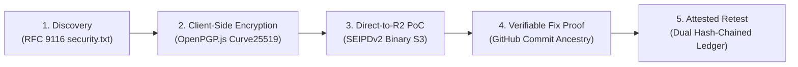
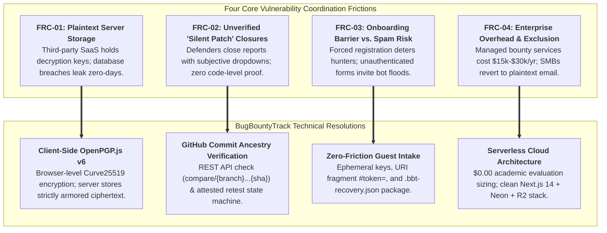
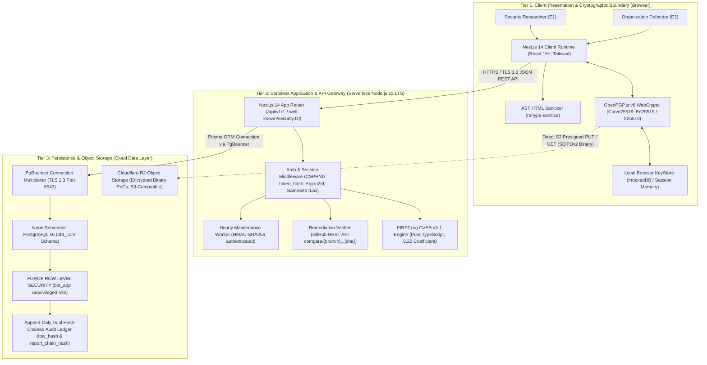
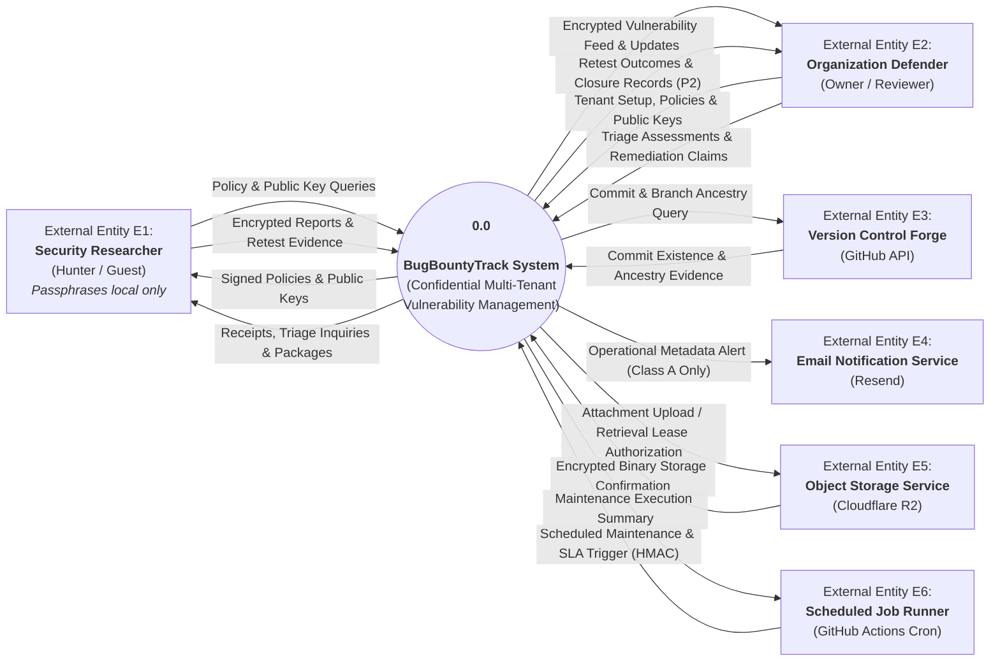
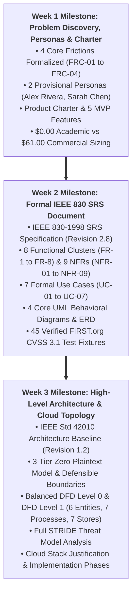

# BUGBOUNTYTRACK — COMPREHENSIVE PROJECT SPECIFICATION & SYSTEM OVERVIEW
## Private Vulnerability Coordination & Disclosure Platform with Client-Side Cryptographic Isolation and Evidence-Based Remediation Tracking

---

### Academic Document Control & Metadata

| Attribute | Specification |
| :--- | :--- |
| **Document Title** | BugBountyTrack — Comprehensive Project Specification & System Overview |
| **Document Version** | **Revision 1.0 (Master Academic Synthesis & Milestone Roadmap)** |
| **Release Date** | October 16, 2026 |
| **Author / Candidate** | **Taha Asadullah** (Roll No: **`24-ST-013`**) |
| **Academic Institution** | Punjab Tianjin University of Technology (PTUT), Lahore |
| **Department & Program** | Department of Software Engineering Technology — BS Software Engineering Technology |
| **Batch / Section** | Batch 24-SET-Fall / Section SET-B (`24-st-013@students.ptut.edu.pk`) |
| **FYP Project Supervisor** | **Sir Umar Hayat** (Assistant Professor, PTUT Lahore) |
| **Project Identifier** | `PTUT - PRJ - 089` (Sub-Field: 9. Cybersecurity, Privacy & LegalTech) |
| **Governing Standards** | IEEE Std 830-1998 / IEEE Std 42010-2011 / ISO/IEC/IEEE 29148:2018 / RFC 9116 / RFC 9580 |
| **Technology Stack** | Next.js 14+ (App Router, TypeScript), Node.js 22 LTS, PostgreSQL 16 (Neon), Cloudflare R2, OpenPGP.js v6 |
| **Active Baseline** | Submitted IEEE 830 SRS (`Revision 2.8`) & IEEE 42010 Architecture Baseline (`Revision 1.2`) |

---

## Executive Summary: The 30-Second Elevator Pitch



**BugBountyTrack** (`PTUT - PRJ - 089`) is a multi-tenant vulnerability coordination and disclosure platform engineered for small software teams (`5–50` engineers) and ethical security researchers. Traditional vulnerability disclosure relies on unencrypted email inboxes or trusted-server commercial platforms that hold organization decryption keys, creating high-risk honeypots of unpatched zero-day vulnerabilities. Furthermore, existing issue trackers allow engineering teams to close vulnerability tickets with a simple status change, leaving researchers and organizations with zero verifiable proof of remediation.

BugBountyTrack solves these fundamental problems through three technical innovations:
1. **Zero-Plaintext Server Architecture**: Vulnerability descriptions and proof-of-concept exploits are encrypted in the researcher's browser using **OpenPGP.js v6 (`RFC 9580` Curve25519)** before transmission. The application server and database store only armored ciphertexts, key fingerprints, and coarse operational metadata (`Class A`).
2. **Direct-to-Storage Encrypted Attachment Pipeline**: Binary evidence files (up to 25 MiB each) are encrypted into RFC 9580 `SEIPDv2` packets and streamed directly to **Cloudflare R2** via presigned S3 URLs, completely bypassing serverless execution and memory constraints.
3. **Evidence-Based Remediation & Attested Retest State Machine**: Tickets cannot be closed on informal declarations. Defenders must supply verifiable proof—either an authoritative GitHub commit SHA checked for ancestry via the GitHub REST API v3 (`compare/{branch}...{sha}`) or a cryptographic configuration snapshot bound to a SHA-256 hash—before transitioning through a 15-state lifecycle automaton backed by an append-only, dual hash-chained audit ledger (`row_hash` and `report_chain_hash`).

---

## 1. The Main Problem: Four Critical Industry & Academic Frictions

Through formal empirical research, developer interviews, and academic problem discovery conducted in Week 1, four structural frictions were identified that render existing vulnerability disclosure mechanisms inadequate for modern development teams:



### 1.1 Friction 1: Plaintext Server Storage & Provider-Held Decryption Keys (`FRC-01`)
* **The Root Issue**: Commercial bug bounty platforms and homegrown web forms operate on a "trusted server" model. Vulnerability descriptions, step-by-step reproduction scripts, and exploit screen recordings reside in plaintext on application servers or cloud database instances. The hosting provider retains full decryption capability.
* **The Danger**: If the platform's database is compromised or an insider rogue employee accesses the storage layer, active zero-day vulnerabilities across hundreds of tenant companies are instantly exposed prior to patch deployment.
* **Our Technical Fix**: BugBountyTrack enforces **browser-side asymmetric encryption**. The application backend acts strictly as a blind routing and authentication orchestrator. Neither the Node.js serverless functions nor the PostgreSQL database engine possess the private keys required to decrypt Class B (vulnerability descriptions) or Class C (internal triage discussion) content.

### 1.2 Friction 2: Unverified "Silent Patch" Closures & Remediation Disputes (`FRC-02`)
* **The Root Issue**: Standard issue management systems (Jira, Linear, GitHub Issues) treat ticket resolution as an administrative checkbox. A developer or project manager can transition a critical security report from "Open" to "Closed" without attaching any technical evidence.
* **The Danger**: This creates "silent patching" disputes, where organizations secretly fix bugs without acknowledging researchers, or prematurely close tickets without actually deploying a functional fix, leaving user data exposed to regression vulnerabilities.
* **Our Technical Fix**: BugBountyTrack implements an **attested, evidence-based 15-state lifecycle automaton**. A report cannot advance to `RETEST_PENDING` without attaching either:
  1. An authoritative Git commit SHA verified against the organization's repository via GitHub REST API v3 ancestry checks (`compare/{branch}...{sha}`), or
  2. A cryptographically hashed configuration snapshot (`config_artifact_ciphertext` bound to a SHA-256 digest).
  Furthermore, the report can only reach terminal closure via explicit researcher verification (`VERIFIED_RESEARCHER`), independent internal attestation (`VERIFIED_INTERNAL`), or an audited, manager-authorized timeout (`CLOSED_UNVERIFIED_TIMEOUT`).

### 1.3 Friction 3: High Onboarding Friction vs. Spam Floods in Vulnerability Intake (`FRC-03`)
* **The Root Issue**: To prevent spam, traditional platforms force security researchers to create formal user accounts, complete multi-step profile setups, and accept marketing terms before submitting a bug. Conversely, companies providing a simple public email address (`security@company.com`) are overwhelmed with automated scanner spam and receive unencrypted sensitive findings.
* **The Danger**: Forced friction causes ethical researchers to abandon responsible disclosure, leading to public zero-day drops on social media or sale on exploit markets.
* **Our Technical Fix**: BugBountyTrack provides **zero-friction guest intake**. Researchers can discover an organization's disclosure policy via RFC 9116 `/.well-known/security.txt` and submit an encrypted report anonymously. The browser generates an ephemeral RFC 9580 Curve25519 keypair in memory, derives a secure access token, and provides a secret tracking URL using a client-side URI fragment (`/report/track/BBT-RPT-XXXX#token=<secret>`). The fragment is never transmitted over HTTP. The researcher also receives a downloadable `.bbt-recovery.json` Guest Recovery Package, allowing multi-device restoration without a password. Automated spam is simultaneously mitigated at zero cost via privacy-preserving **Cloudflare Turnstile** bot verification and strict IP rate limiting (10 submissions/hour/IP, `FR-8.3`).

### 1.4 Friction 4: Enterprise Tooling Overhead & Small-Team Economic Exclusion (`FRC-04`)
* **The Root Issue**: Enterprise managed bug bounty platforms charge tens of thousands of dollars annually ($15,000–$30,000/year base fees). Small development teams (`5–50` engineers) cannot justify this expenditure for a periodic vulnerability flow. Consequently, they resort to unprotected email, shared Google Sheets, or unencrypted web forms.
* **The Danger**: The vast majority of internet software is built by small teams who operate with zero cryptographic disclosure protection, resulting in widespread data breaches.
* **Our Technical Fix**: BugBountyTrack is architected as an **efficient, modern serverless application** designed to run within permanent free tiers ($0.00/month) for academic evaluation, while supporting a transparent, lean commercial hosting cost (~$61.00/month) that can support 25 active startup tenants with high margins.

---

## 2. The Technical Solution: 3-Tier Zero-Plaintext Architecture

The system architecture implements an end-to-end zero-plaintext pipeline across three distinct physical and logical tiers:




*Figure 2.1: 3-Tier Zero-Plaintext Architecture Model (Client Browser Cryptography, Stateless Serverless Gateway, and Multi-Tenant Managed Persistence).*

### 2.1 Tier 1: Client Presentation & Cryptographic Boundary
* **Runtime**: Next.js 14 Client Components executing within user browser memory (React 18+, TypeScript).
* **Cryptographic Core**: **OpenPGP.js v6** utilizing native browser WebCrypto and WebAssembly primitives. Operates strictly with **`RFC 9580` Curve25519** (`Ed25519` for signatures, `X25519` for encryption) producing 64-character SHA-256 key fingerprints.
* **Key Generation & Storage**: Bare keypair generation targets an empirical benchmark of sub-50 ms (`NFR-02`). In-browser private keys are encrypted using Argon2id S2K passphrase derivation (~200–400 ms intentional hardening delay) and stored locally in browser `IndexedDB`.
* **Zero-Leakage Memory Hygiene**: Cleartext strings and decrypted buffers are maintained in `Uint8Array` allocations and zeroized immediately after rendering.
* **XSS Neutralization**: Decrypted markdown reports are cleansed through an Abstract Syntax Tree (AST) sanitizer (`rehype-sanitize`) before DOM insertion, completely preventing DOM-based Cross-Site Scripting.

### 2.2 Tier 2: Stateless Application & API Gateway Tier
* **Runtime**: Vercel Serverless Edge and Node.js 22 LTS functions deployed across global Anycast regions.
* **Stateless Token Governance**: Session governance relies on high-entropy CSPRNG 256-bit tokens (`token_hash` stored in the database via SHA-256). Cookies are partitioned using `__Host-bbt-session` (`SameSite=Lax`, `Secure`, `HttpOnly`).
* **Deterministic CVSS v3.1 Engine**: Pure TypeScript implementation of the official FIRST.org CVSS v3.1 specification. Accepts base metrics in any ordering, executes scoring within a proposed design target of < 5 ms (`FR-4`), enforces the official `8.22` scoring coefficient, and emits normalized canonical vectors.
* **Remediation Verifier**: Communicates over TLS 1.3 with the GitHub REST API v3 (`compare/{branch}...{sha}`) to verify that committed patches exist and are ancestors of the designated target branch.
* **Scheduled Maintenance Worker**: Executes hourly maintenance operations via `POST /api/v1/internal/cron/sla-check` authenticated using HMAC-SHA256 (`X-Cron-Signature: sha256=<64-hex-hmac>`, `FR-5.4`).

### 2.3 Tier 3: Persistence & Object Storage Tier
* **Relational Multi-Tenancy**: Neon Serverless PostgreSQL 16 partitioned under the dedicated `bbt_core` schema. All tables strictly enforce **`FORCE ROW LEVEL SECURITY`** accessed by the unprivileged `bbt_app` role (`NOSUPERUSER NOBYPASSRLS`). Connection pooling is multiplexed through PgBouncer (`?pgbouncer=true`).
* **Append-Only Dual Hash-Chained Audit Ledger**: All lifecycle transitions, access grants, and attestations are permanently anchored in `bbt_core.audit_events` using two concurrent cryptographic hash chains:
  1. `row_hash`: Tenant-wide chronological chain (`row_hash = SHA-256(prev_tenant_row_hash || "|" || event_digest)`).
  2. `report_chain_hash`: Report-scoped lifecycle chain (`report_chain_hash = SHA-256(prev_report_chain_hash || "|" || event_digest)`).
  This dual-chain architecture restricts application-level modification and supports independent detection of changes to recorded history (`FR-8.5`).
* **Multi-Tier Storage Quota Enforcement (`FR-8.4`)**: Capacity boundaries are hard-coded at the database level: a 20 MiB intake pool for unverified reports, a 6 MiB security and triage reserve, and a 300 KiB Priority-0 floor within that reserve strictly reserved for compact critical operations (such as researcher reply and retest attestations).
* **Direct-to-Object Attachment Pipeline**: Cloudflare R2 provides distributed, S3-compatible binary storage with **zero bandwidth egress fees**. Clients upload and download encrypted RFC 9580 `SEIPDv2` binary proof-of-concept files directly via time-limited (15-minute lease) presigned URLs.


*Figure 2.2: Cloud Infrastructure Topology across Vercel Edge compute, Neon Serverless PostgreSQL, Cloudflare R2, Resend, and GitHub Actions.*


---

## 3. Data Flow Architecture & Defensible Boundaries

### 3.1 DFD Level 0: System Context Architecture
The Level 0 Context Diagram establishes the global perimeter of BugBountyTrack (`0.0`), governing interactions across six external boundary entities:




*Figure 3.1: DFD Level 0 System Context Diagram modeling interactions across all 6 external boundary entities.*

### 3.2 DFD Level 1: Functional System Decomposition

The Level 1 Data Flow Diagram breaks down the central system process into seven core functional sub-processes interacting with seven distinct data stores and all six external boundary entities:


*Figure 3.2: DFD Level 1 Functional System Decomposition illustrating sub-processes P1.0 through P7.0, data stores D1 through D7, and external boundary entities E1 through E6.*

### 3.3 Defensible System Boundaries: What BugBountyTrack Controls vs. Does NOT Control

To maintain epistemic honesty and academic rigor, the system explicitly defines its architectural boundaries:

| Operational Dimension | What BugBountyTrack DOES Architecturally Control | What BugBountyTrack DOES NOT Control |
| :--- | :--- | :--- |
| **Cryptography** | Client-side OpenPGP v6 envelope creation, verification, and dual-lane key wrapping. | Malware, keyloggers, or hostile browser extensions on researcher or defender endpoints. |
| **Identity & Access** | CSPRNG session tokens (`token_hash`), Argon2id password KDF, TOTP MFA, and HMAC cron auth. | Compromised credentials or MFA devices outside application boundaries. |
| **Remediation Verification** | Live repository commit existence and branch ancestry check via GitHub API (`compare/{branch}...{sha}`). | Real-world server deployment and runtime execution of the committed fix on defender production systems (an API response alone does not establish production deployment or prove the fix works). |
| **Multi-Tenancy** | PostgreSQL engine-level RLS (`FORCE ROW LEVEL SECURITY`) via `bbt_app` role and schema isolation. | Physical host hardware or hypervisor security of cloud hosting providers. |
| **Storage & Retention** | Strict quota limits (20 MiB intake pool, 6 MiB security and triage reserve with 300 KiB Priority-0 floor) and automated hourly lease garbage collection. | Cloud provider physical storage integrity or disaster recovery beyond documented SLAs. |
| **Notifications & Messaging** | Notifications contain only approved Class A metadata and exclude confidential report content; redaction of vulnerability descriptions from alert emails. | Upstream SMTP deliverability; recipient mail server spam filters; mail server security at rest on the recipient's mail provider. |

---

## 4. What We Have Done: Completed Milestones & Verified Deliverables

Across the first three weeks of the semester Final Year Project lifecycle, formal engineering specifications have been authored, verified, and committed:



### 4.1 Week 1: Problem Discovery, User Personas & Product Charter
* **Deliverable Artifacts**:
  - [`requirements/WEEK_1_DISCOVERY_REPORT.md`](requirements/WEEK_1_DISCOVERY_REPORT.md) & [`requirements/WEEK_1_DISCOVERY_REPORT.docx`](requirements/WEEK_1_DISCOVERY_REPORT.docx) (Full Reference Report).
  - [`requirements/WEEK_1_PART_A_USER_PERSONAS.md`](requirements/WEEK_1_PART_A_USER_PERSONAS.md) & [`requirements/WEEK_1_PART_A_USER_PERSONAS.docx`](requirements/WEEK_1_PART_A_USER_PERSONAS.docx) (Dedicated Personas Specification).
  - [`requirements/WEEK_1_PART_B_CHARTER_AND_MVP.md`](requirements/WEEK_1_PART_B_CHARTER_AND_MVP.md) & [`requirements/WEEK_1_PART_B_CHARTER_AND_MVP.docx`](requirements/WEEK_1_PART_B_CHARTER_AND_MVP.docx) (Product Charter & MVP Blueprint).
* **Key Accomplishments**:
  - Formulation of the 4 foundational problem frictions (`FRC-01` to `FRC-04`).
  - Creation of two evidence-based user personas: **Alex Rivera** (Independent Security Researcher) and **Sarah Chen** (Lead Security Engineer at a 7-developer healthtech startup).
  - Definition of the 5 Core MVP feature sets: RFC 9116 `security.txt`, zero-plaintext client encryption, direct S3 binary PoC uploads, verified commit fix tracking, and the tamper-evident audit ledger.
  - Establishment of the dual-track cost feasibility model: $0.00 academic evaluation sizing on cloud free tiers vs. ~$61.00/month commercial production sizing.

### 4.2 Week 2: Software Requirements Specification (IEEE Std 830-1998)
* **Deliverable Artifacts**:
  - [`requirements/SRS_UNIVERSITY_SUBMISSION.md`](requirements/SRS_UNIVERSITY_SUBMISSION.md) & [`requirements/SRS.docx`](requirements/SRS.docx) (Complete IEEE 830-1998 SRS Specification, Revision 2.8).
  - [`requirements/CVSS_TEST_FIXTURES.md`](requirements/CVSS_TEST_FIXTURES.md) (45 verified FIRST.org and NIST NVD CVSS v3.1 test vectors).
* **Key Accomplishments**:
  - Full formalization of 8 Functional Requirement modules: `FR-1` (Identity & Keys), `FR-2` (RFC 9116 Policy), `FR-3` (Encrypted Intake), `FR-4` (CVSS Scoring), `FR-5` (Dual-Lane Triage), `FR-6` (Remediation Verification), `FR-7` (Retest State Machine), and `FR-8` (Audit & Quotas).
  - Specification of 9 quantifiable Non-Functional Requirements, including API latency targets (`NFR-01`: p95 <= 400 ms, p99 <= 800 ms), browser keygen benchmarks (`NFR-02`: sub-50 ms), and uptime SLO (`NFR-09`: >= 99.5%).
  - Authoring of 7 comprehensive Use Cases (`UC-01` to `UC-07`) mapped across all personas.
  - Development and export of 4 core UML behavioral diagrams: Component Architecture (`fig4_1`), Use Case Diagram (`fig4_2`), Sequence Diagrams for Submission & Decryption (`fig4_3`, `fig4_4`), State Machine Automaton (`fig4_5`), and Entity-Relationship Diagram (`fig4_6`).
  - Implementation of a 3-tier Field-Level Classification Scheme: Class A (Public Operational Metadata), Class B (Encrypted Vulnerability Payload), and Class C (Confidential Internal Triage Notes).


*Figure 4.1: Attested 15-State Remediation Lifecycle Automaton governing report progression from intake through verified closure.*


*Figure 4.2: Relational Entity-Relationship Diagram (ERD) defining schemas, relations, and RLS multi-tenant keys.*


### 4.3 Week 3: High-Level Architecture & Cloud Topology (IEEE Std 42010-2011)
* **Deliverable Artifacts**:
  - [`architecture/HIGH_LEVEL_ARCHITECTURE.md`](architecture/HIGH_LEVEL_ARCHITECTURE.md) & [`architecture/HIGH_LEVEL_ARCHITECTURE.docx`](architecture/HIGH_LEVEL_ARCHITECTURE.docx) (IEEE 42010 Architecture Specification, Revision 1.2).
  - [`tasks/week-03-high-level-architecture-cloud-topology.md`](tasks/week-03-high-level-architecture-cloud-topology.md) (University Task Deliverable).
  - 4 High-DPI architecture diagrams (`fig3_1_3tier_architecture`, `fig3_2_dfd_level_0`, `fig3_3_dfd_level_1`, `fig3_4_cloud_topology`).
* **Key Accomplishments**:
  - Structural modeling of the 3-Tier Zero-Plaintext Architecture.
  - Balancing and decomposition of DFD Level 0 (Context Diagram) and DFD Level 1 (Functional Decomposition across 7 processes, 7 persistent data stores, and all 6 external boundary entities).
  - Authoring of the "Controls vs. Does NOT Control" boundary matrix.
  - Comprehensive STRIDE Threat Mitigation Analysis mapping vulnerabilities across Spoofing, Tampering, Repudiation, Information Disclosure, Denial of Service, and Elevation of Privilege.
  - Component-by-component cloud infrastructure justification (Next.js 14, Neon PostgreSQL, Cloudflare R2, Resend, GitHub Actions).
  - Implementation of Section 6 "Implementation Phases and Clarifications", formally establishing the Phase 1 central demonstrable workflow.

### 4.4 Automated Verification Infrastructure
* Built and executed [`requirements/lint_all_specifications.py`](requirements/lint_all_specifications.py):
  - A static analysis and cross-document verification engine that executes **104 automated checks** across document schemas, mathematical parity, requirement ID sequences, cryptographic standards, OpenXML structures, and attribution hygiene.
  - Ensures zero persona bleed, zero broken file paths, zero LaTeX formatting artifacts, and absolute synchronization across all markdown specifications and compiled Word documents.

---

## 5. What Is In The Future: Implementation Roadmap & Execution Sprints

The remaining 13 weeks of the semester are structured into six focused implementation sprints, organized around delivering running software through red-green test-driven cycles:

```mermaid
gantt
    title BugBountyTrack FYP Implementation Roadmap (Weeks 4–16)
    dateFormat  YYYY-MM-DD
    section Phase 1: Foundation
    Sprint 2 (W4-W6): Relational DB & Cryptographic Core :2026-10-19, 21d
    section Phase 2: Core Engine
    Sprint 3 (W7-W9): Intake Pipeline & CVSS 3.1 Engine  :2026-11-09, 21d
    section Phase 3: Verification
    Sprint 4 (W10-W12): Remediation Verifier & Audit Ledger:2026-11-30, 21d
    section Phase 4: Hardening & Defense
    Sprint 5 (W13-W15): DevSecOps, E2E QA & Performance  :2026-12-21, 21d
    Sprint 6 (W16): Final Release & University Defense   :2027-01-11, 7d
```

### 5.1 Immediate Milestone: Phase 1 Demonstrable Central Workflow
The immediate development target focuses on delivering running software that proves the core value proposition end-to-end:
```
Submit Encrypted Report -> Review & Triage -> Record Fix Evidence -> Retest Attestation -> Record Closure Outcome
```
This ensures that early testing exercises client-side encryption, authenticated access control, GitHub commit verification, and immutable ledger persistence before secondary features are layered on.

### 5.2 Sprint 2: Weeks 4–6 (Relational Persistence & Cryptographic Subsystem)
* **Objective**: Establish the relational database foundation and browser cryptographic engine.
* **Key Deliverables**:
  1. Author and execute Prisma ORM / PostgreSQL DDL migration scripts defining the `bbt_core` schema.
  2. Implement database Row-Level Security policies (`FORCE ROW LEVEL SECURITY`) bound to the unprivileged `bbt_app` role.
  3. Construct the client-side OpenPGP.js v6 WebCrypto module supporting Curve25519 (`Ed25519` / `X25519`) keypair generation.
  4. Implement Argon2id password KDF (`FR-1.3`), CSPRNG session token issuance (`token_hash`), and TOTP MFA step-up logic.
  5. Build browser-side `IndexedDB` storage with strict memory zeroizing for private key protection.

### 5.3 Sprint 3: Weeks 7–9 (Intake Pipeline, CVSS Engine & Triage Messaging)
* **Objective**: Construct the zero-friction intake portal, scoring engine, and dual-lane message broker.
* **Key Deliverables**:
  1. Build the public RFC 9116 `security.txt` discovery endpoint and browser-side cleartext signing.
  2. Implement zero-friction guest reporting with URI fragment protection (`#token=`) and `.bbt-recovery.json` generation.
  3. Integrate Cloudflare Turnstile CAPTCHA and enforce 10 submissions/hour/IP rate limiting (`FR-8.3`).
  4. Build the pure TypeScript FIRST.org CVSS v3.1 scoring engine, validated against all 45 test fixtures.
  5. Implement direct-to-R2 presigned S3 binary upload handlers (`<= 25 MiB`, 15-minute lease expiry).
  6. Implement dual-lane triage message isolation separating Class B (vulnerability text) from Class C (internal notes).

### 5.4 Sprint 4: Weeks 10–12 (Remediation Verification & Audit Automaton)
* **Objective**: Connect version control verification and build the attested state machine.
* **Key Deliverables**:
  1. Integrate GitHub REST API v3 commit verification (`GET /repos/{owner}/{repo}/compare/{branch}...{sha}`).
  2. Implement the SHA-256 configuration snapshot hashing module for non-code remediation (`FR-6.3`).
  3. Build the 15-state lifecycle automaton, enforcing strict transition rules and preventing unverified closures.
  4. Implement the append-only dual hash-chained audit ledger (`row_hash` and `report_chain_hash`, `FR-8.5`).
  5. Deploy the scheduled maintenance worker via HMAC-SHA256 authenticated triggers on `/api/v1/internal/cron/sla-check` (`FR-5.4`).

### 5.5 Sprint 5: Weeks 13–15 (System Verification, DevSecOps & SRE Hardening)
* **Objective**: Execute comprehensive verification across the test pyramid and validate performance.
* **Key Deliverables**:
  1. Author Playwright browser end-to-end test suites verifying client-side key generation, encryption, and decryption.
  2. Run Jest / Vitest integration test suites validating all API routes, permissions, and database constraints.
  3. Conduct STRIDE security audit, SAST scanning, and OWASP Top 10 vulnerability assessments.
  4. Execute synthetic load tests (k6) to empirically evaluate latency targets (p95 <= 400 ms, p99 <= 800 ms under `NFR-01`).
  5. Validate storage quota edge cases (20 MiB intake pool, 6 MiB reserve, 300 KiB Priority-0 floor).

### 5.6 Sprint 6: Week 16 (Release, Final Documentation Portfolio & FYP Defense)
* **Objective**: Deploy the evaluated prototype and defend the project before the examination committee.
* **Key Deliverables**:
  1. Final production deployment on Vercel Edge compute and Neon Serverless PostgreSQL.
  2. Compilation of the comprehensive Final Year Project Thesis and academic documentation portfolio.
  3. Preparation of the live demonstration walkthrough illustrating the complete central workflow.
  4. Formal Viva Defense presentation before Academic Supervisor Sir Umar Hayat and the PTUT Examination Committee.

### 5.7 Post-Academic / Secondary P2 Extensions
* **Features Formally Deferred as P2 Extensions**:
  1. **Redacted Closure Evidence Exports (`FR-8.6`)**: Cryptographically signed `.bbt-closure-export.json` packages containing JCS-canonicalized audit logs and redacted commitments for third-party compliance audits.
  2. **Automated Disaster Recovery Drills (`FR-8.7`)**: Scheduled automated backup restoration and verification exercises.
  3. **Commercial SaaS Scaling**: Commercial billing integration (Merchant of Record), team member seats, and advanced multi-organization enterprise routing.

---

## 6. Comprehensive Project Deliverable Directory

| Milestone | Deliverable Name | Local Repository Path | Supporting Cloud Reference |
| :--- | :--- | :--- | :--- |
| **Week 1** | Discovery Report (Full) | `requirements/WEEK_1_DISCOVERY_REPORT.md` / `.docx` | [View Week 1 Discovery Doc (Google Drive)](https://docs.google.com/document/d/1drXMfAk4pIKc_9aMKZav62KfVZQ04--zT6VyuhDZKFA/edit?usp=drive_link) |
| **Week 1** | User Personas Spec | `requirements/WEEK_1_PART_A_USER_PERSONAS.md` / `.docx` | [View Week 1 Discovery Doc (Google Drive)](https://docs.google.com/document/d/1drXMfAk4pIKc_9aMKZav62KfVZQ04--zT6VyuhDZKFA/edit?usp=drive_link) |
| **Week 1** | Charter & MVP Blueprint | `requirements/WEEK_1_PART_B_CHARTER_AND_MVP.md` / `.docx` | [View Week 1 Discovery Doc (Google Drive)](https://docs.google.com/document/d/1drXMfAk4pIKc_9aMKZav62KfVZQ04--zT6VyuhDZKFA/edit?usp=drive_link) |
| **Week 2** | Software Requirements Spec | `requirements/SRS_UNIVERSITY_SUBMISSION.md` / `SRS.docx` | [View Week 2 IEEE 830 SRS Doc (Google Drive)](https://docs.google.com/document/d/1n8VKmXeK4TSTPPR-mDXp3NkKwDxvzTzEWR9tgdZlxSg/edit?usp=drive_link) |
| **Week 2** | CVSS v3.1 Test Suite | `requirements/CVSS_TEST_FIXTURES.md` | In-repo verified fixture suite (45 vectors) |
| **Week 3** | High-Level Architecture | `architecture/HIGH_LEVEL_ARCHITECTURE.md` / `.docx` | Local Word: `architecture/HIGH_LEVEL_ARCHITECTURE.docx` |
| **Week 3** | Task & Topology Spec | `tasks/week-03-high-level-architecture-cloud-topology.md` | In-repo university milestone submission |
| **Master** | Comprehensive Overview | `PROJECT_COMPREHENSIVE_OVERVIEW.md` / `.docx` | Master academic portfolio synthesis |

---

## 7. Milestone Sign-Off & Academic Endorsement

### Student Author Endorsement
I hereby confirm that this **Comprehensive Project Specification & System Overview** represents an authentic, standards-compliant architectural formulation authored for **BugBountyTrack** (`PTUT - PRJ - 089`), synthesizing all requirements, architectural designs, and milestone deliverables established across Weeks 1, 2, and 3.

* **Student Author**: **Taha Asadullah** (Roll No: `24-ST-013`, Section `SET-B`)  
* **Signature**: `[Signed Electronically — Taha Asadullah]`  
* **Date**: October 16, 2026  

---

### Academic Supervisor Endorsement
* **Academic Supervisor**: **Sir Umar Hayat** (Assistant Professor, PTUT Lahore)  
* **Department**: Department of Software Engineering Technology  
* **Status**: `[PENDING ACADEMIC SUPERVISOR REVIEW & ENDORSEMENT]`  
* **Date**: `____________________`  
