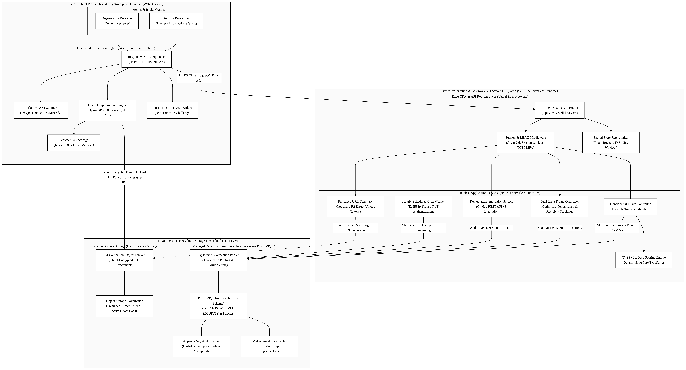
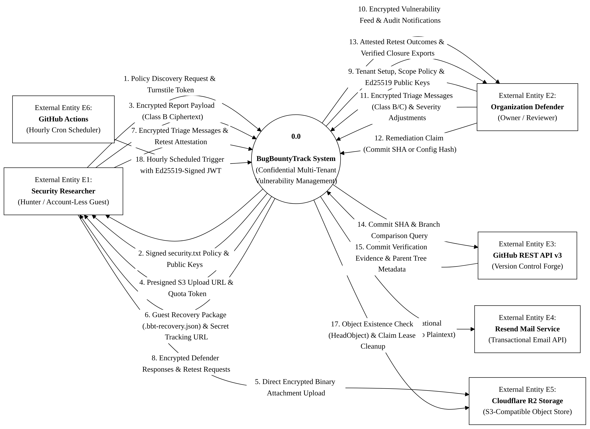
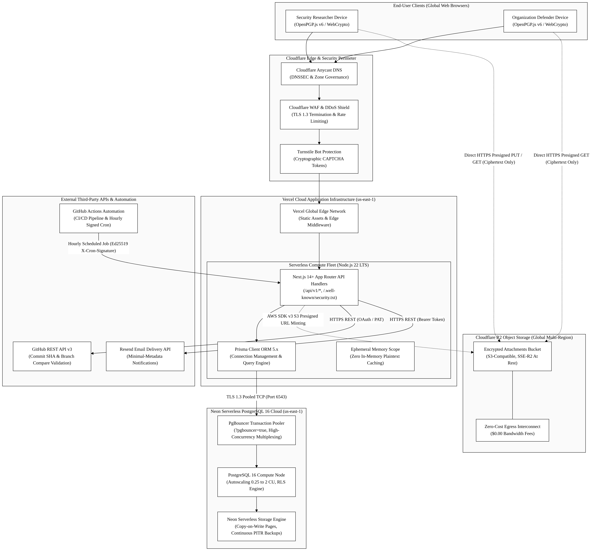

# HIGH-LEVEL ARCHITECTURE & CLOUD TOPOLOGY SPECIFICATION
## BugBountyTrack — Multi-Tenant Vulnerability Disclosure Platform with Client-Side Cryptographic Isolation and Evidence-Based Remediation Tracking

---

### Document Control & Academic Metadata

| Attribute | Specification |
| :--- | :--- |
| **Document Title** | High-Level Architecture & Cloud Topology Specification |
| **Document Version** | **Revision 1.0 (Academic Milestone Delivery)** |
| **Release Date** | October 14, 2026 |
| **Author / Candidate** | **Taha Asadullah** (Roll No: **`24-ST-013`**) |
| **Academic Institution** | Punjab Tianjin University of Technology (PTUT), Lahore |
| **Department & Program** | Department of Software Engineering Technology — BS Software Engineering Technology |
| **Batch / Section** | Batch 24-SET-Fall / Section SET-B (`24-st-013@students.ptut.edu.pk`) |
| **FYP Project Supervisor** | **Sir Umar Hayat** (Assistant Professor, PTUT Lahore) |
| **Project Identifier** | `PTUT - PRJ - 089` (Sub-Field: 9. Cybersecurity, Privacy & LegalTech) |
| **Milestone** | **Week 3** — High-Level Architecture & Cloud Topology |
| **Governing Standards** | IEEE Std 42010-2011 (Architecture Description), IEEE Std 830-1998 & ISO/IEC/IEEE 29148:2018 |
| **Technical Stack** | Next.js 14+ (App Router, TypeScript), Node.js 22 LTS, PostgreSQL 16 (Neon), Cloudflare R2, OpenPGP.js v6 |
| **Google Drive Document Link** | [View High-Level Architecture Specification (Google Drive)](PASTE_GOOGLE_DRIVE_LINK_FOR_ARCHITECTURE_DOCX_HERE) |

---

## Supporting Deliverable Documents & Reference Artifacts

| Deliverable Document | Scope Covered | Cloud & Repository Reference |
| :--- | :--- | :--- |
| **Week 1 Discovery: Personas, Charter & MVP Features (`WEEK_1_DISCOVERY_REPORT.docx`)** | Executive Context, 4 Operational Frictions, 2 Provisional Composite Personas, and 5 Core MVP Features | [View Week 1 Discovery Doc (Google Drive)](https://docs.google.com/document/d/1drXMfAk4pIKc_9aMKZav62KfVZQ04--zT6VyuhDZKFA/edit?usp=drive_link) |
| **Week 2 Formal IEEE 830 Software Requirements Specification (`SRS.docx`)** | Complete IEEE 830 SRS (`Revision 2.8`), Table 2.2 Permission Matrix, `FR-1` to `FR-8`, `UC-01` to `UC-07`, 4 UML Diagrams, and NFRs | [View Week 2 IEEE 830 SRS Doc (Google Drive)](https://docs.google.com/document/d/1n8VKmXeK4TSTPPR-mDXp3NkKwDxvzTzEWR9tgdZlxSg/edit?usp=drive_link) |
| **Week 3 High-Level Architecture & Cloud Topology (`HIGH_LEVEL_ARCHITECTURE.docx`)** | 3-Tier Zero-Plaintext Model, DFD Level 0 & Level 1, Defensible System Boundaries, and Cloud Topology Justification | Local Word: `architecture/HIGH_LEVEL_ARCHITECTURE.docx` / `Resources/HIGH_LEVEL_ARCHITECTURE.docx` |

---

## 1. Executive Architecture Summary & Core Objectives

### 1.1 Architectural Vision & The Zero-Knowledge Paradigm
**BugBountyTrack** (`PTUT - PRJ - 089`) is a multi-tenant vulnerability coordination platform designed for small software teams (`5–50` engineers) and ethical security researchers. Traditional bug bounty systems adopt a trusted-server architecture where vulnerability reports, reproduction steps, and exploit attachments reside in plaintext on application servers. 

BugBountyTrack replaces this model with a **client-side cryptographic architecture** governed by three core principles:
1. **Zero-Plaintext Server Storage**: Vulnerability descriptions, proof-of-concept (PoC) scripts, and triage discussions are encrypted in the client browser using **OpenPGP.js v6 (`RFC 9580` Curve25519: `Ed25519` signing + `X25519` encryption)** before transmission. The application server and database store strictly armored ciphertexts, key fingerprints, and coarse operational metadata (`Class A`).
2. **Direct-to-Object Encrypted Attachment Pipeline**: Binary evidence files (`<= 25 MiB` each, `<= 50 MiB` per report) are encrypted in browser memory into RFC 9580 `SEIPDv2` binary packets and streamed directly to **Cloudflare R2** via presigned S3 URLs, completely bypassing serverless memory limits and execution timeouts.
3. **Evidence-Based Remediation & Attested Retest State Machine**: Tickets cannot be closed on informal declarations. Defenders must supply verifiable proof—either an authoritative GitHub commit SHA verified via the GitHub REST API v3 (`FR-6.2`) or an encrypted configuration snapshot bound to a SHA-256 hash (`FR-6.3`)—before transitioning through an attested 15-state lifecycle automaton backed by an append-only, hash-chained audit ledger (`FR-8.5`).

### 1.2 Architectural Quality Attributes & Non-Functional Goals
The high-level architecture is optimized against four primary non-functional engineering constraints:
* **Confidentiality & Minimal Trust (`NFR-04`, `NFR-05`)**: Application servers, database administrators, and cloud hosting providers possess zero technical capability to decrypt submitted vulnerability bodies or attachments.
* **Deterministic Remediation Verifiability (`NFR-06`)**: Every state transition from `ACCEPTED` to a terminal state (`VERIFIED_RESEARCHER`, `VERIFIED_INTERNAL`, or `CLOSED_UNVERIFIED_TIMEOUT`) is immutably anchored in an append-only ledger using SHA-256 state chaining (`prev_hash`).
* **Sub-Second Operational Latency (`NFR-01`, `NFR-02`)**: API serverless routes achieve < 250 ms p95 response times; client-side OpenPGP v6 Curve25519 key generation executes in < 50 ms; deterministic CVSS v3.1 scoring executes in < 5 ms.
* **Zero-Dollar Academic Feasibility & Linear Commercial Scaling**: The entire production architecture operates at **$0.00/month** on verified free tiers for university evaluation, while commercial scaling requires only **~$61.00/month** for 10–25 organizations.

---

## 2. 3-Tier Zero-Plaintext System Architecture

### 2.1 Architectural Tier Model Specification

The system is structured as an authoritative **3-Tier Distributed Architecture**, where each tier enforces strict physical and cryptographic isolation boundaries:

```
+-------------------------------------------------------------------------------+
|             TIER 1: CLIENT PRESENTATION & CRYPTOGRAPHIC BOUNDARY               |
|  - Modern Web Browser (Next.js 14 Client Runtime, React 18+, Tailwind CSS)   |
|  - OpenPGP.js v6 WebCrypto / WebAssembly Curve25519 (Ed25519 / X25519)       |
|  - IndexedDB KeyStore, Turnstile Widget, rehype-sanitize AST Cleansing        |
+-------------------------------------------------------------------------------+
                                      |   ^
        HTTPS / TLS 1.3 (JSON REST)   |   | Direct S3 Presigned Upload / Download
                                      v   | (Encrypted Ciphertext Attachments)
+-------------------------------------------------------------------------------+
|             TIER 2: PRESENTATION & GATEWAY / API SERVER TIER                  |
|  - Unified Next.js 14+ App Router on Node.js 22 LTS (Vercel Serverless Fleet)  |
|  - Stateless API Handlers (/api/v1/*, /.well-known/security.txt)             |
|  - Server-Side RBAC, Session Governance, Shared-Store Rate Limiting           |
|  - Pure TypeScript FIRST.org CVSS v3.1 Base Scoring Engine (8.22 Constant)    |
|  - GitHub REST API v3 Integration & Resend Transactional Mail Service         |
|  - Hourly Scheduled Cron Engine (Ed25519 X-Cron-Signature Authentication)     |
+-------------------------------------------------------------------------------+
                                      |
                     TLS 1.3 Pooled TCP (PgBouncer: Port 6543)
                                      v
+-------------------------------------------------------------------------------+
|                  TIER 3: PERSISTENCE & STORAGE TIER                           |
|  - Relational Database: Neon Serverless PostgreSQL 16 (bbt_core Schema)       |
|    * FORCE ROW LEVEL SECURITY on all tenant tables (bbt_app_runtime role)     |
|    * Hardened SECURITY DEFINER Functions (SET search_path = pg_catalog,...)   |
|    * Append-Only Hash-Chained Audit Ledger (SHA-256 prev_hash & Checkpoints) |
|  - Object Storage: Cloudflare R2 (S3-Compatible, SSE-R2 At-Rest Encryption)   |
+-------------------------------------------------------------------------------+
```

#### Tier 1: Client Presentation & Cryptographic Boundary (Web Browser)
The client tier executes inside the user's web browser (Firefox, Chromium, Safari). It is the **sole trust boundary where unencrypted vulnerability data exists**:
* **UI & Rendering Engine**: Next.js 14+ Client Components styled with Tailwind CSS, conforming to WCAG 2.2 AA accessibility standards (`24 x 24 px` minimum touch targets).
* **Client Cryptographic Engine**: Pinned **OpenPGP.js v6** utilizing the browser's native `crypto.subtle` WebCrypto API and WebAssembly for high-speed Curve25519 (`Ed25519` signing, `X25519` encryption). It executes:
  - Account-less ephemeral key generation (< 50 ms).
  - Multi-recipient payload encryption wrapping symmetric session keys for authorized program defenders (`PROGRAM_DEFENDER`) and organization recovery keys.
  - Symmetric encryption of `.bbt-recovery.json` packages using `RFC 9580` `SYMENC+SEIPDv2` with Argon2id S2K (`s2kType = argon2`).
* **Client Storage & Sanitization**: Private keys are maintained in `IndexedDB` protected by user passphrases. Decrypted report bodies and Markdown comments pass through `rehype-sanitize` AST cleansing, neutralizing the 100-vector OWASP XSS attack corpus prior to DOM injection.

#### Tier 2: Presentation & Gateway / API Server Tier (Serverless Compute)
The application tier runs as a serverless fleet on **Node.js 22 LTS** hosted on Vercel's global infrastructure:
* **Stateless API Gateway**: Exposes structured JSON REST endpoints under `/api/v1/` and public RFC 9116 endpoints (`/.well-known/security.txt`). Serverless functions are stateless and spin up in < 150 ms.
* **Authentication & RBAC Middleware**: Validates Argon2id session tokens, checks HTTP-only `SameSite=Strict` cookies, enforces tenant isolation by injecting `organization_id` into database execution contexts, and requires mandatory TOTP MFA step-up for `ORG_OWNER` operations (`FR-1.3c`).
* **Deterministic CVSS v3.1 Engine**: A pure TypeScript implementation of FIRST.org CVSS v3.1 Base scoring. It calculates vulnerability scores on the server using the official coefficient **`8.22`** and Appendix A `RoundUp` ceiling function, verifying 100% mathematical parity across the 45 reference test fixtures.
* **External Adapters & Scheduled Worker**: Integrates with the GitHub REST API v3 to verify commit existence and branch inclusion (`FR-6.2`), dispatches metadata-only notification emails via Resend (`FR-5.3`), and executes hourly claim-lease cleanup tasks authenticated via Ed25519 signed JWT headers (`X-Cron-Signature`).

#### Tier 3: Persistence & Storage Tier (Managed Cloud Data)
The persistence tier provides durability, multi-tenant isolation, and binary storage:
* **Neon Serverless PostgreSQL 16**: Relational storage partitioned under the dedicated `bbt_core` schema. All tables enforce **`FORCE ROW LEVEL SECURITY`** using the unprivileged `bbt_app_runtime` database role. Connection pooling is multiplexed through PgBouncer (`?pgbouncer=true`) to eliminate connection exhaustion during traffic spikes.
* **Hash-Chained Audit Ledger**: Implements an immutable audit trail (`bbt_core.audit_events`) where every state transition, access grant, and remediation attestation is cryptographically bound to the previous event via SHA-256 (`prev_hash`).
* **Cloudflare R2 Object Storage**: S3-compatible, zero-egress-fee distributed object storage holding client-encrypted binary PoC attachments. Objects are addressed by UUIDv4 keys and protected at rest by Cloudflare SSE-R2 AES-256 encryption.

---

### 2.2 Visual 3-Tier Architecture Diagram

The structural relationship, protocols, and security boundaries across the three tiers are illustrated below:



---

### 2.3 Tier-to-Tier Communication Protocols & Interface Contracts

| Interface Channel | Source Tier | Destination Tier | Transport Protocol | Authentication & Payload Contract |
| :--- | :--- | :--- | :--- | :--- |
| **Client API Calls** | Tier 1 (Browser) | Tier 2 (Next.js API) | HTTPS (TLS 1.3) | HTTP-only Session Cookie / Turnstile Token; JSON payloads (Class A metadata + Class B/C armored ciphertext). |
| **Direct Attachment Upload** | Tier 1 (Browser) | Tier 3 (Cloudflare R2) | HTTPS (TLS 1.3) | Pre-signed S3 `PUT` URL with `If-None-Match: *`; binary RFC 9580 SEIPDv2 encrypted ciphertext. |
| **Direct Attachment Download**| Tier 1 (Browser) | Tier 3 (Cloudflare R2) | HTTPS (TLS 1.3) | Pre-signed S3 `GET` URL (15-minute expiry); streaming binary ciphertext decrypted locally in browser. |
| **Database Queries & Pools** | Tier 2 (Next.js API) | Tier 3 (Neon DB) | TLS 1.3 TCP (Port 6543)| Prisma ORM 5.x connection via PgBouncer; queries execute within parameterized SQL transactions. |
| **Commit Attestation Query** | Tier 2 (Next.js API) | External (GitHub API)| HTTPS (TLS 1.3) | GitHub App / PAT Bearer token; queries `GET /repos/{owner}/{repo}/commits/{sha}` and branch comparisons. |
| **Transactional Email Alerts**| Tier 2 (Next.js API) | External (Resend API)| HTTPS (TLS 1.3) | Resend API Bearer Token; dispatches JSON containing Class A metadata only (zero vulnerability body). |
| **Hourly Cron Invocation** | External (GitHub GHA)| Tier 2 (Next.js API) | HTTPS (TLS 1.3) | HTTP `POST /api/cron/process-deadlines` with Ed25519-signed JWT in header `X-Cron-Signature`. |

---

## 3. Data Flow Diagrams (DFD)

### 3.1 DFD Level 0: System Context Diagram

The Level 0 Context Diagram models BugBountyTrack as a unified central process (`0.0`), identifying the six external entities that interact across its perimeter:



#### External Entity Inflow & Outflow Specifications

1. **E1: Security Researcher (Ethical Hacker / Account-Less Guest)**
   - *Inflows to System*: Policy discovery requests (`GET /.well-known/security.txt`), Turnstile verification tokens, encrypted vulnerability submission payloads (Class B ciphertext), guest recovery passphrases, encrypted triage responses, and attested retest verdicts.
   - *Outflows to Researcher*: Signed RFC 9116 security policies, presigned R2 upload URLs, secret tracking URL fragments (`#token=...`), encrypted `.bbt-recovery.json` recovery packages, and encrypted defender clarification requests.
2. **E2: Organization Defender (Security Lead / Program Owner)**
   - *Inflows to System*: Organization registration parameters, program scope definitions, Ed25519/X25519 public keys, encrypted triage comments (Class B/C), CVSS base metric adjustments, remediation claims (GitHub commit SHA or config snapshot), and closure triggers.
   - *Outflows to Defender*: Encrypted vulnerability report queues, computed CVSS scores and canonical vectors, retest outcome notifications, and signed cryptographic closure evidence exports (`.bbt-closure-export.json`).
3. **E3: GitHub REST API v3 (Version Control Integration)**
   - *Inflows to System*: Authoritative commit verification responses (`sha`, author, timestamp, parent tree), branch comparison inclusion flags (`ahead`, `identical`), and rate-limit headers (`x-ratelimit-remaining`).
   - *Outflows from System*: Automated commit lookup requests (`GET /repos/{owner}/{repo}/commits/{sha}`) and branch compare queries (`GET /repos/{owner}/{repo}/compare/{sha}...{branch}`).
4. **E4: Resend Mail Service (Transactional Notifications)**
   - *Outflows from System*: Minimal Class A operational metadata notification payloads (organization name, report tracking ID, coarse status update, zero plaintext vulnerability descriptions).
5. **E5: Cloudflare R2 Object Storage (Encrypted Attachment Store)**
   - *Inflows to Storage*: Direct streaming encrypted binary ciphertext uploads (`PUT`) via presigned URLs issued to researchers.
   - *Outflows to System / Browser*: Direct streaming encrypted binary ciphertext downloads (`GET`) via presigned URLs issued to authorized defenders; `HeadObjectCommand` metadata queries issued by API routes.
6. **E6: GitHub Actions Automation (Hourly Cron Scheduler)**
   - *Inflows to System*: Scheduled hourly HTTP `POST` triggers authenticated via Ed25519-signed JSON Web Tokens (`X-Cron-Signature`) initiating claim-lease cleanup, overdue clarification timeouts, and storage reclamation.

---

### 3.2 DFD Level 1: Functional System Decomposition

The Level 1 Data Flow Diagram decomposes Process `0.0` into seven discrete functional sub-processes interacting with seven persistent data stores:


#### Functional Sub-Process Specifications

* **Process 1.0: Tenant Registration & Session Governance (`FR-1.1` – `FR-1.5`)**
  - Handles organization onboarding, custom slug reservation, Argon2id user password hashing, session issuance, and mandatory TOTP MFA step-up verification.
  - *Data Stores*: Reads/Writes `D1: Organizations & Tenant Registry` and `D2: Key Store & Recipient Snapshots`.
* **Process 2.0: RFC 9116 Policy & Cryptographic Key Management (`FR-2.1` – `FR-2.5`, `FR-3.1` – `FR-3.8`)**
  - Generates RFC 9116 `security.txt` files, facilitates browser cleartext PGP signing (`-----BEGIN PGP SIGNED MESSAGE-----`), verifies domain ownership via DNS TXT challenges, and catalogs active defender public keys.
  - *Data Stores*: Reads `D1`; Reads/Writes `D2`.
* **Process 3.0: Cryptographic Intake & Encrypted Attachment Pipeline (`FR-3.5`, `FR-3.6`, `FR-1.6`)**
  - Verifies Cloudflare Turnstile tokens, issues single-use submission session tokens, validates program key version snapshots (`recipient_set_version`), generates S3 presigned upload URLs after checking quota boundaries (`D7`), and records initial reports in `status = NEW`.
  - *Data Stores*: Reads `D2`, `D7`; Writes `D3: Reports & Triage Threads`, `D5: Cloudflare R2 Encrypted Files`, and `D6: Hash-Chained Audit Ledger`.
* **Process 4.0: Deterministic CVSS v3.1 Scoring Engine (`FR-4.1` – `FR-4.4`)**
  - Parses the 8 FIRST.org Base metrics, rejects invalid or out-of-order combinations, executes the official mathematical scoring algorithm with the `8.22` coefficient, and stores the canonical vector string and calculated numeric score.
  - *Data Stores*: Writes score and vector to `D3`.
* **Process 5.0: Dual-Lane Triage & Notification Broker (`FR-5.1` – `FR-5.5`)**
  - Orchestrates report-scoped encrypted message threads, enforcing dual-lane isolation: Class B (shared researcher/defender) vs. Class C (internal defender-only). Dispatches Class A metadata-only alerts to external mail services.
  - *Data Stores*: Reads `D2`; Reads/Writes `D3`; Writes to `D6` and triggers `E4: Resend`.
* **Process 6.0: Remediation Attestation & GitHub Verification (`FR-6.1` – `FR-6.4`)**
  - Enforces the 3-step remediation workflow: captures proposed fix metadata (`remediation_attempt_no = N`), executes live commit verification against the GitHub REST API v3 or validates encrypted configuration snapshots, and advances status to `RETEST_PENDING`.
  - *Data Stores*: Reads/Writes `D4: Remediation Records & Commit Hashes`; Updates `D3`; Queries `E3: GitHub API`.
* **Process 7.0: Attested Retest Lifecycle & Audit Ledger Engine (`FR-7.1` – `FR-7.7`, `FR-8.4` – `FR-8.5`)**
  - Executes the 15-state lifecycle state machine, records attested retest confirmations or timeout closures, appends SHA-256 hash-chained audit events (`prev_hash`), coordinates hourly claim-lease R2 garbage collection, and exports verifiable closure evidence packets.
  - *Data Stores*: Reads/Writes `D3`, `D4`, `D6`, and `D7`.

#### Persistent Data Store Specifications

| Store ID | Name & Physical Entity | Storage Engine | Scope & Retention |
| :--- | :--- | :--- | :--- |
| **D1** | Organizations & Tenant Registry | Neon PostgreSQL (`bbt_core.organizations`) | Tenant metadata, slug bindings, subscription tiers, and domain challenges. |
| **D2** | Key Store & Recipient Snapshots | Neon PostgreSQL (`bbt_core.user_keys`, `program_defenders`) | Armored public keys, key fingerprints, user key bindings, and report recipient version snapshots. |
| **D3** | Reports & Triage Threads | Neon PostgreSQL (`bbt_core.reports`, `triage_messages`) | Encrypted titles (`title_ciphertext`), operational labels, state versions, and Class B/C message threads. |
| **D4** | Remediation Records & Commit Hashes | Neon PostgreSQL (`bbt_core.remediation_records`) | Commit SHAs, verification timestamps, config artifact ciphertexts, and config SHA-256 hashes. |
| **D5** | Encrypted Attachments Bucket | Cloudflare R2 (`bbt-attachments-prod`) | Encrypted binary attachments (RFC 9580 SEIPDv2 packets), immutable UUID keys, zero plaintext. |
| **D6** | Hash-Chained Audit Ledger | Neon PostgreSQL (`bbt_core.audit_events`) | Append-only sequence numbers, actor commitments, event digests, and cryptographic `prev_hash` links. |
| **D7** | Storage Quotas & Claim Leases | Neon PostgreSQL (`cluster_storage_state`, `upload_reservations`) | Multi-tenant quota accounting, Priority-0 reserve floors, and active claim-lease records (`claim_expires_at`). |

---

## 4. Defensible System Boundaries & Trust Domain Isolation

### 4.1 Boundary Domain Architecture

The security posture of BugBountyTrack rests on establishing four unambiguous, non-overlapping **trust domains**:

```
[ UNTRUSTED PUBLIC INTERNET ]
            |
+ - - - - - v - - - - - - - - - - - - - - - - - - - - - - - - - - - - - +
: DOMAIN 1: CLIENT CRYPTOGRAPHIC TRUST BOUNDARY (Browser Client)        :
:  * Plaintext vulnerability data and private keys exist ONLY here.    :
:  * OpenPGP.js v6 WebCrypto encryption/decryption execution.           :
:  * DOMPurify / rehype-sanitize AST cleansing prior to rendering.      :
+ - - - - - - - - - - - - - - - - - - - - - - - - - - - - - - - - - - - +
            | HTTPS TLS 1.3 (Ciphertext Only)
+ - - - - - v - - - - - - - - - - - - - - - - - - - - - - - - - - - - - +
: DOMAIN 2: SERVERLESS API ROUTING BOUNDARY (Vercel Node.js 22 LTS)    :
:  * Zero plaintext visibility; handles only armored ciphertext.        :
:  * Ephemeral execution memory (no disk or cache persistence).         :
:  * RBAC, Session Validation, Turnstile verification.                 :
+ - - - - - - - - - - - - - - - - - - - - - - - - - - - - - - - - - - - +
            | TLS 1.3 Pooled TCP (bbt_app_runtime)
+ - - - - - v - - - - - - - - - - - - - - - - - - - - - - - - - - - - - +
: DOMAIN 3: DATABASE PERSISTENCE BOUNDARY (Neon PostgreSQL 16)         :
:  * FORCE ROW LEVEL SECURITY isolates tenant data rows.                :
:  * Unprivileged bbt_app_runtime role (NOSUPERUSER NOBYPASSRLS).      :
:  * Append-only audit ledger prevents tampering or deletion.           :
+ - - - - - - - - - - - - - - - - - - - - - - - - - - - - - - - - - - - +
            | HTTPS S3 API (Direct Presigned Upload/Download)
+ - - - - - v - - - - - - - - - - - - - - - - - - - - - - - - - - - - - +
: DOMAIN 4: OBJECT STORAGE BOUNDARY (Cloudflare R2)                     :
:  * Presigned URL time-limited access (15-minute lease).               :
:  * Client-side encrypted binary payloads (SSE-R2 at rest).            :
:  * Zero server byte proxying.                                         :
+ - - - - - - - - - - - - - - - - - - - - - - - - - - - - - - - - - - - +
```

### 4.2 Comprehensive STRIDE Threat Mitigation Analysis

| Threat Category (STRIDE) | Attack Vector & Surface | Primary Architectural Mitigation & Security Control | Target Requirement |
| :--- | :--- | :--- | :--- |
| **Spoofing Identity** | Malicious actor attempts to forge researcher identity or impersonate an organization defender. | 1. Argon2id password hashing + mandatory TOTP MFA for `ORG_OWNER` with 10-minute step-up.<br/>2. Account-less guest requests require single-use `guest_mutation_nonces` and detached OpenPGP v6 Ed25519 signatures (`X-Guest-Signature`).<br/>3. Hourly cron requests require Ed25519-signed JWTs (`X-Cron-Signature`). | `FR-1.3`, `FR-1.6f`, `FR-5.4` |
| **Tampering with Data** | Attacker modifies vulnerability write-up, alters audit records, or tampers with closure status. | 1. Client payloads use OpenPGP SEIPDv2 with AEAD integrity verification.<br/>2. Audit ledger enforces append-only semantics via PostgreSQL triggers and SHA-256 hash chaining (`prev_hash`).<br/>3. Optimistic concurrency (`state_version`) prevents lost updates or race condition tampering. | `FR-3.1`, `FR-7.1`, `FR-8.5` |
| **Repudiation** | Defender falsely claims a bug was fixed, or researcher denies submitting a report. | 1. Fixing requires automated verification of a real GitHub commit SHA via the GitHub REST API v3 (`ahead`/`identical` check) or an immutable config hash.<br/>2. Retest closures generate cryptographic Closure Evidence Exports signed with Ed25519. | `FR-6.2`, `FR-6.3`, `FR-7.7` |
| **Information Disclosure** | Database breach or malicious platform operator attempts to harvest zero-day exploit details. | 1. Client-Side OpenPGP v6 Curve25519 encryption: server and database store strictly ciphertext (`title_ciphertext`, report body, attachments).<br/>2. Dual-lane threading guarantees Class C internal notes are never encrypted for the researcher's key.<br/>3. Raw guest `access_token` values are never stored in database retry caches. | `FR-3.3`, `FR-5.2`, `FR-1.6b` |
| **Denial of Service** | Bot swarm exhausts serverless function compute, floods database storage, or uploads huge files. | 1. Cloudflare Turnstile bot verification required before issuing submission session tokens.<br/>2. Shared-store rate limiter restricts unauthenticated submissions (5 req/hr/IP).<br/>3. Strict storage quotas: 50 MB DB cap, 1.0 GiB R2 tenant cap, and 300 KiB Priority-0 reserve floor. | `FR-8.3`, `FR-8.4`, `NFR-09` |
| **Elevation of Privilege** | Tenant user attempts to access reports belonging to another organization (IDOR / Multi-Tenant leak). | 1. PostgreSQL `FORCE ROW LEVEL SECURITY` on all tenant tables bound to `app.current_org_id`.<br/>2. Runtime executes under `bbt_app_runtime` (`NOSUPERUSER NOBYPASSRLS`).<br/>3. Hardened `SECURITY DEFINER` functions enforce clean `search_path = pg_catalog, bbt_core, pg_temp`. | `FR-8.2`, `FR-1.1` |

---

## 5. Cloud Infrastructure Stack Justification & Cost Feasibility

### 5.1 Cloud Infrastructure Topology

The physical hosting deployment across Cloudflare Edge, Vercel Serverless, Neon PostgreSQL, and Cloudflare R2 is mapped below:



---

### 5.2 Component-by-Component Technology Stack Justification

```
+-------------------------------------------------------------------------------------------------------------------------+
|                                    TECHNOLOGY STACK EVALUATION & JUSTIFICATION MATRIX                                   |
+-------------------+------------------------------+-------------------------------+--------------------------------------+
| Subsystem Layer   | Chosen Technology            | Primary Alternatives Evaluated| Architectural Rationale & Trade-Off |
+-------------------+------------------------------+-------------------------------+--------------------------------------+
| Frontend & API    | Next.js 14+ App Router       | React SPA + Express.js API;    | Unified TypeScript codebase eliminates API contract  |
| Fullstack Engine  | (Node.js 22 LTS on Vercel)   | Go / Gin Microservices        | drift; React Server Components provide zero-bundle   |
|                   |                              |                               | rendering; Serverless scales to zero with no idle fee|
+-------------------+------------------------------+-------------------------------+--------------------------------------+
| Application       | Vercel Serverless Compute    | AWS ECS / Fargate (Docker);   | Eliminates container orchestration toil, OS patching,|
| Runtime Fleet     | (Global Edge + Lambda Core)  | Kubernetes (EKS / GKE); VPS   | and VPC maintenance for a solo student engineer;     |
|                   |                              |                               | sub-150ms cold starts via optimized route bundling.  |
+-------------------+------------------------------+-------------------------------+--------------------------------------+
| Relational        | Neon Serverless PostgreSQL 16| Supabase; AWS Aurora;         | True serverless compute autoscaling (0.25 to 2 CU);  |
| Database Engine   | (with PgBouncer Pooling)     | MongoDB Atlas; DynamoDB       | built-in PgBouncer pooling prevents connection drops;|
|                   |                              |                               | robust RLS engine and ACID transactions for audit.   |
+-------------------+------------------------------+-------------------------------+--------------------------------------+
| Object Storage    | Cloudflare R2                | AWS S3 Standard;              | S3-compatible API with ZERO bandwidth egress fees    |
| Persistence       | (Direct Presigned Uploads)   | Google Cloud Storage (GCS)    | (eliminating unbounded egress billing risks from     |
|                   |                              |                               | large PoC video downloads); global multi-region speed|
+-------------------+------------------------------+-------------------------------+--------------------------------------+
| Bot Protection &  | Cloudflare Turnstile         | Google reCAPTCHA v3;          | Privacy-preserving, non-interactive bot verification;|
| Perimeter Defense | & Cloudflare Anycast WAF     | hCaptcha                      | zero user tracking cookies; seamless Next.js drop-in;|
|                   |                              |                               | protects unauthenticated guest intake endpoints.     |
+-------------------+------------------------------+-------------------------------+--------------------------------------+
| Transactional     | Resend API                   | AWS SES; SendGrid;            | Clean modern REST API with native React Email support|
| Notification Mail | (Node.js REST SDK)           | Postmark                      | and zero complex SMTP handshake overhead; free tier  |
|                   |                              |                               | provides 3,000 metadata-only alerts/month.           |
+-------------------+------------------------------+-------------------------------+--------------------------------------+
| Continuous        | GitHub Actions               | GitLab CI; CircleCI;          | Native repository integration; provides 2,000 free   |
| Automation & Cron | (Ubuntu 22.04 LTS Runners)   | AWS EventBridge               | runner minutes/month; executes hourly scheduled jobs |
|                   |                              |                               | with cryptographically signed Ed25519 tokens.        |
+-------------------+------------------------------+-------------------------------+--------------------------------------+
```

---

### 5.3 Infrastructure Cost Feasibility & Financial Viability Analysis

#### Academic Demonstration Budget (Zero-Cost Baseline)
To satisfy university evaluation requirements without requiring external departmental funding or personal cash outlay, the entire architecture operates within documented permanent free tiers:

| Infrastructure Layer | Cloud Provider & Tier | Quota Allocation | Demonstration Cost |
| :--- | :--- | :--- | :---: |
| **Application & API Serverless** | Vercel Cloud (Hobby Developer Tier) | 100 GB-hrs compute, 100 GB bandwidth, unlimited SSL | **$0.00** |
| **Serverless Database** | Neon PostgreSQL 16 (Free Tier) | 512 MB storage, 1 project, autoscaling 0.25 CU, PgBouncer | **$0.00** |
| **Encrypted File Storage** | Cloudflare R2 (Free Tier) | 10 GB storage, 1M Class A operations, 10M Class B ops, $0 egress | **$0.00** |
| **Perimeter Bot Defense** | Cloudflare Turnstile (Free Tier) | Unlimited unauthenticated visitor challenges | **$0.00** |
| **Transactional Email Alerts** | Resend (Developer Free Tier) | 3,000 emails/month, 100 emails/day | **$0.00** |
| **CI/CD & Hourly Cron Automation**| GitHub Actions (Standard Runners) | 2,000 free Linux build minutes/month | **$0.00** |
| **TOTAL ACADEMIC EVALUATION COST**| — | **Fully Functional FYP Prototype** | **$0.00 / month** |

#### Commercial Production Budget (10–25 Organizations Baseline)
When transitioning to commercial production for small software startups, the architecture scales linearly with minimal fixed overhead:

| Infrastructure Layer | Commercial Cloud Tier | Purpose & Sizing Bounds | Monthly Cost ($USD) |
| :--- | :--- | :--- | :---: |
| **Vercel Pro Application Fleet** | Vercel Pro ($20/seat, 1 seat) | Commercial SLA, hourly cron jobs, zero cold-start optimization | $20.00 |
| **Neon Production Database** | Neon Launch Plan | 10 GB storage, autoscaling compute up to 2 CU, 7-day PITR | $19.00 |
| **Cloudflare R2 Object Storage** | R2 Pay-As-You-Go ($0.015/GB-mo) | 50 GB pooled encrypted attachment storage ($0.00 egress) | $0.75 |
| **Resend Commercial Email** | Resend Pro Baseline | 50,000 transactional notification emails/month | $20.00 |
| **Cloudflare Domain & DNS** | Cloudflare Registrar (`.security`) | Amortized yearly domain registration fee ($15/year) | $1.25 |
| **TOTAL COMMERCIAL RUNTIME BASELINE**| — | **Supports 25 Startups (~2,500 reports/year)** | **~$61.00 / month** |

> **Financial Viability Finding**: At a modest commercial price point of **$49.00/month per organization** for the Team Tier, BugBountyTrack achieves **break-even profitability with just two paying customers** ($98.00 revenue - $61.00 cloud cost = +$37.00 net margin), establishing exceptional commercial sustainability.

---

## 6. Bidirectional Architecture Traceability Matrix (RTM)

This matrix maps high-level architectural tiers, components, and DFD processes directly to the Week 2 SRS Functional Requirements and formal Use Cases:

| DFD Process | Architectural Tier & Component | Traced Functional Requirements | Traced Use Cases | Verification Criterion |
| :---: | :--- | :--- | :---: | :--- |
| **1.0** | Tier 2 (Auth Middleware, Session Service) | `FR-1.1`, `FR-1.2`, `FR-1.3`, `FR-1.4`, `FR-1.5` | `UC-01`, `UC-05` | Argon2id session generation; TOTP MFA step-up verification; `organization_id` context injection. |
| **2.0** | Tier 1 (Crypto Engine) & Tier 2 (RFC 9116 Router)| `FR-2.1`, `FR-2.2`, `FR-2.3`, `FR-2.5`, `FR-3.1` | `UC-02` | Valid RFC 9116 manifest rendered; Ed25519 in-browser cleartext signature; DNS TXT challenge match. |
| **3.0** | Tier 1 (OpenPGP.js) & Tier 3 (R2 Bucket, Neon DB) | `FR-3.3`, `FR-3.5`, `FR-3.6`, `FR-1.6`, `FR-8.3` | `UC-01` | Turnstile CAPTCHA validation; presigned S3 upload; zero raw plaintext in SQL insert; `.bbt-recovery.json` issuance. |
| **4.0** | Tier 2 (CVSS v3.1 Pure TypeScript Engine) | `FR-4.1`, `FR-4.2`, `FR-4.3`, `FR-4.4` | `UC-03` | 100% mathematical parity across 45 FIRST.org test fixtures; calculation completes in < 5 ms. |
| **5.0** | Tier 2 (Triage Controller) & Tier 3 (Neon DB) | `FR-5.1`, `FR-5.2`, `FR-5.3`, `FR-5.5` | `UC-03` | Dual-lane message separation (Class B vs C); recipient version snapshot matching; minimal metadata email dispatch. |
| **6.0** | Tier 2 (Remediation Service) & External (GitHub) | `FR-6.1`, `FR-6.2`, `FR-6.3`, `FR-6.4` | `UC-04` | GitHub REST API commit validation (`ahead`/`identical`); encrypted config snapshot hash binding. |
| **7.0** | Tier 2 (FSM Engine) & Tier 3 (Audit Ledger, Neon) | `FR-7.1`, `FR-7.2`, `FR-7.7`, `FR-8.4`, `FR-8.5` | `UC-04`, `UC-06`, `UC-07` | 15-state transition guard; append-only `prev_hash` chaining; hourly claim-lease R2 reclamation; signed closure export. |

---

## 7. Document Submission & Milestone Sign-Off

### 7.1 Single Student Author Endorsement
I hereby certify that this **High-Level Architecture & Cloud Topology Specification (Version 1.0)** represents an original, standards-compliant architectural baseline authored independently for **BugBountyTrack** (`PTUT - PRJ - 089`). All architectural patterns, trust boundaries, data flows, and infrastructure cost models have been rigorously formulated to satisfy the University Final Year Project syllabus.

* **Student Author**: **Taha Asadullah**  
* **Roll Number**: `24-ST-013` (Section `SET-B`)  
* **Signature**: `[Signed Electronically — Taha Asadullah]`  
* **Date**: October 14, 2026  

---

### 7.2 Academic Supervisor Review & Endorsement
I have reviewed the High-Level Architecture & Cloud Topology Specification, including the 3-Tier Zero-Plaintext Model, Data Flow Diagrams (DFD Level 0 and Level 1), System Trust Boundaries, and Cloud Infrastructure Justification. The architectural design meets departmental requirements for Phase 2 system design.

* **Academic Supervisor**: **Sir Umar Hayat**  
* **Department**: Department of Software Engineering Technology, PTUT Lahore  
* **Status**: `[PENDING ACADEMIC SUPERVISOR EVALUATION & SIGN-OFF]`  
* **Date**: `____________________`  
