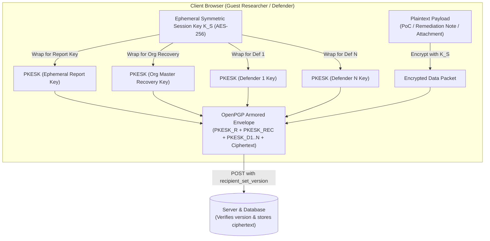

# Cryptographic Key Management & Data Boundary Architecture

**Project**: BugBountyTrack — Vulnerability Disclosure Platform with Remediation Tracking  
**Document**: Architecture Design Note (`ARCH-NOTE-001`)  
**Status**: Active Architecture Reference (Version 3.3.0 — `SRS Revision 2.6`)  
**Standard**: OpenPGP Specification (RFC 4880 / RFC 9580) & `openpgp.js` Integration  

---

## 1. Overview & Core Cryptographic Objective

BugBountyTrack incorporates client-side OpenPGP encryption to protect sensitive vulnerability reproduction steps, proof-of-concept payloads, attachments, and remediation discussions against database compromise, cloud snapshot theft, and unauthorized server-side access.

The cryptographic subsystem executes in the user's web browser using `openpgp.js`. The server functions strictly as an untrusted message routing and ciphertext persistence layer for encrypted payloads.

To ensure rapid browser performance (<50ms benchmark target) and eliminate compliance friction:
1. **Algorithm Pinning & RFC 9580 Conformance**: The platform pins exclusively to **Curve25519 (Ed25519 for signing, X25519 for encryption)** implemented via `openpgp.js`, adhering strictly to the modernized OpenPGP specification (**RFC 9580 Version 6 keys**). Generating bare Curve25519 keypairs in under 50ms is designated as an empirical benchmark target on evergreen desktop and modern mobile browsers. OpenPGP v6 key fingerprints are standardized as 64-character hexadecimal strings (32-byte SHA-256), and Key IDs represent the first 16 characters (8 bytes). Legacy RSA-4096 and OpenPGP v4 keys are deprecated and excluded from new key generation to eliminate in-browser keygen freezes, satisfy NFR-02 (<1.5s), and align with modern IETF crypto standards.
2. **Standardized Key Protection & WebAssembly CSP**: Private keys stored in browser `IndexedDB` are protected using OpenPGP's native **Argon2id S2K (String-to-Key)** derivation (`t=3, m=65536, p=4`) rather than custom wrappers. Because OpenPGP.js compiles its Argon2id implementation in WebAssembly, the application's Content Security Policy explicitly permits `'wasm-unsafe-eval'`. Passphrase derivation introduces an intentional, estimated cryptographic delay of ~200–400ms on modern client hardware to resist brute-force attacks, which is strictly decoupled from the sub-50ms bare keygen benchmark target.

---

## 2. Recipient Scope & Multi-Defender Protocol



### 2.1 Bounded Program-Scoped Recipient Model (N <= 10) & `PROGRAM_DEFENDER` Rules
To prevent combinatorial key explosion while supporting collaborative team triage:
1. **Program-Scoped Authorization**: Encryption recipients are strictly bounded to the **reporting researcher** (or ephemeral report key), the **offline organization master recovery key**, plus the **active defenders explicitly assigned to the specific program via `PROGRAM_DEFENDER`** (up to 10 authorized defenders). Defenders in the same organization who are not assigned to the program are not included in the encryption envelope.
2. **Explicit `PROGRAM_DEFENDER` Governance Rules**:
   - **Same-Organization Constraint**: A user can only be assigned to a program if both the user and the program belong to the exact same organization (`user.organization_id == program.organization_id`). Cross-tenant assignments are rejected by database foreign keys and application assertions.
   - **Unique Membership**: Unique compound constraint `@@unique([program_id, user_id])`. A defender cannot have duplicate active assignments in the same program.
   - **Atomic Assignment & Keyring Synchronization**: Adding or removing a defender from `PROGRAM_DEFENDER` must execute within an atomic, serializable database transaction that increments the parent `program.recipient_set_version`.
   - **Program-Level Authorization Boundary**: Report retrieval, attachment downloads, and export generation endpoints must verify active membership in `PROGRAM_DEFENDER` for the specific `program_id` of the report, not merely tenant-level organization membership.
3. **Pseudonymous Key Identifiers**: The client fetches public encryption subkeys identified strictly by their 16-character OpenPGP Key ID or 64-character RFC 9580 v6 fingerprint. Employee names, email addresses, and internal roles are not included in public keyrings to minimize internal organizational disclosure.

### 2.2 Account-Less (Guest) Researcher Lifecycle & Multi-Device Recovery
To eliminate adoption drop-off caused by mandatory account creation, BugBountyTrack enables account-less vulnerability intake while providing robust cryptographic access recovery:
1. **Ephemeral Key Generation**: When a researcher opens a program's submission form (`/report/:org_slug`), the browser autonomously generates an in-memory RFC 9580 v6 Curve25519 keypair (`K_report_pub`, `K_report_priv`) in under 50ms.
2. **Multi-Recipient Encryption**: The report payload is encrypted to:
   - All active defenders assigned to the program (`K_def_1..N`).
   - The organization's offline master recovery key (`K_recovery_pub`).
   - The ephemeral report key (`K_report_pub`).
3. **Durable Guest Identity Decoupled from Access Tokens**:
   - **Stable Guest Identity (`guest_actor_id`)**: A persistent UUIDv4 generated at intake, stored in `REPORT.guest_actor_id`. This immutable identity is referenced across all subsequent `DISCUSSION_MESSAGE` (`sender_guest_actor_id`), `RETEST_EVIDENCE` (`verifier_guest_actor_id`), and `AUDIT_EVENT` (`actor_guest_actor_id`) records. Rotating or re-issuing access credentials does not alter historical attribution.
   - **Guest Access Token (`guest_access_token`) & Encrypted Retry-Cache Persistence (`FR-1.6b`, `FR-3.5a`)**: An opaque, high-entropy bearer token returned by the server upon submission to authorize HTTP retrieval of the encrypted report record. The server stores only its cryptographic hash (`guest_token_hash`) in `REPORT` and **never** persists raw `access_token` values in retry caches (`submission_sessions.cached_response_json` [30-minute TTL] or `guest_mutation_nonces.response_body_json` [5-minute TTL]) or server logs. Instead, the server encrypts `{ report_id, guest_actor_id, access_token }` to the guest's `guest_public_key` (`encrypted_guest_credentials_armored`) before caching or returning it, allowing identical-request retries to recover the bearer token purely via client-side `ephemeral_private_key` decryption.
   - **Report Private Key (`K_report_priv`)**: The RFC 9580 Curve25519 private key enabling local client-side decryption of the report payload, stored in browser `IndexedDB`.
4. **Guest Recovery Package (`.bbt-recovery.json`, RFC 9580 `SYMENC+SEIPDv2`)**:
   Instead of speculative mnemonic seeds or storing plaintext bearer tokens in downloaded files, BugBountyTrack encrypts `{ report_id, guest_actor_id, access_token, armored_private_key }` inside a standard **RFC 9580 OpenPGP v6 symmetric password-encrypted message (`SYMENC` + `SEIPDv2` AEAD)** (`openpgp.config.s2kType = openpgp.enums.s2k.argon2`, `aeadProtect = true`):
   ```json
   {
     "version": 1,
     "format": "openpgp-symenc-seipdv2",
     "report_id": "BBT-RPT-2026-0042",
     "guest_actor_id": "550e8400-e29b-41d4-a716-446655440000",
     "key_fingerprint": "7F9A1B2C3D4E5F6A7B8C9D0E1F2A3B4C5D6E7F8A9B0C1D2E3F4A5B6C7D8E9F0A",
     "encrypted_recovery_bundle": "-----BEGIN PGP MESSAGE-----\n..."
   }
   ```
   - **Zero Plaintext Bearer Leakage**: Possessing `.bbt-recovery.json` without the passphrase reveals zero bearer credentials (`access_token` is inside `encrypted_recovery_bundle`).
   - **Validation on Import**: The browser reads `.bbt-recovery.json` strictly in local memory via `FileReader` (zero network upload), verifies `version === 1` and `format === "openpgp-symenc-seipdv2"`, and decrypts `encrypted_recovery_bundle` via `openpgp.decrypt({ message, passwords: [passphrase] })`, which verifies the SEIPDv2 AEAD authentication tag and inner `report_id`/`guest_actor_id`.
   - **Dropped-Response-Safe Signature-Only Token Rotation (`FR-1.6e`)**: Rotating an exposed `access_token` (`POST /api/v1/reports/{id}/guest-token/rotate` via `bbt_core.fn_guest_rotate_token_by_sig`) authenticates using an **OpenPGP v6 detached signature (`X-Guest-Signature`)** verified in the Node.js API layer over the RFC 8785 JCS rotation payload (`ROTATE_GUEST_TOKEN`, `nonce`, `issued_at`, `expires_at`) without requiring the old bearer token, and returns `encrypted_guest_credentials_armored` cached in `guest_mutation_nonces.response_body_json` (5-minute TTL) so a dropped rotation response never locks out the guest or persists a raw token.
5. **Tracking URL & Address Bar Secret Sanitization**:
   - The tracking URL contains **only** the access token in the hash fragment:
     `https://app.bugbountytrack.com/report/track/BBT-RPT-XXXX#token=<access_token>`
     Private key material is **never** included in the URL.
   - **Address Bar Scrubbing**: Immediately upon page load, client JavaScript reads `#token=...` into runtime memory and executes `window.history.replaceState(null, '', window.location.pathname)`. This immediately removes the token from the browser address bar, protecting against shoulder-surfing, browser history logging, and accidental copy-paste leakage.
   - **Telemetry & Error Exclusion**: Application observability hooks (Sentry `beforeSend`, OpenTelemetry) explicitly strip URI fragments, `Authorization` headers, and all decrypted vulnerability text.
6. **Multi-Device Portability & Clean-Browser Acceptance Verification**:
   - If a researcher opens the tracking URL on a new device or cleared browser, the application fetches the ciphertext using the access token, detects that `IndexedDB` lacks the private key, and prompts for the `.bbt-recovery.json` file.
   - *Acceptance Test*: (1) Submit report as guest; (2) download `.bbt-recovery.json`; (3) clear all browser storage and cookies; (4) load tracking URL in a clean browser; (5) import recovery package and enter passphrase; (6) successfully decrypt defender response and submit retest attestation.
7. **Optional Account Binding**: If the researcher later registers an account, they can claim the report using their access token, binding the historical `guest_actor_id` to their registered `USER.id`.

### 2.3 Offline Organization Master Recovery Key & Mandatory Backup
To prevent catastrophic data loss if all active defender laptops are destroyed or browser storage is wiped:
1. **Passphrase-Protected Key Generation**: During initial organization onboarding, the owner's browser generates an **Organization Master Recovery Keypair** (`K_rec_pub`, `K_rec_priv`) conforming to RFC 9580 v6 Curve25519. The private key is passphrase-protected in-browser with Argon2id S2K (`t=3, memory=64MiB, p=4`) before export.
2. **Server Storage of Public Key**: The server stores `K_rec_pub` (`recovery_public_key`, `recovery_key_fingerprint`) on `PROGRAM`. Every Class B and Class C object submitted to the organization includes a PKESK packet wrapped for `K_rec_pub`.
3. **Mandatory Offline Export**: `K_rec_priv` is **never** transmitted to the server. The owner must download the ASCII-armored recovery kit (`org-recovery-key.asc`) and store it offline (air-gapped USB, physical safe, or hardware vault).
4. **Client-Side Pre-Activation Decryption Challenge**: The onboarding wizard requires the owner to select and load the exported recovery key locally in browser runtime and decrypt a test challenge ciphertext entirely in client-side memory using `openpgp.js`. The private key material never traverses the network. In managed JavaScript runtime environments where garbage collection prohibits guaranteed zeroization of memory, the application exercises strict security hygiene: temporary typed arrays (`Uint8Array`) are explicitly zeroized where supported, persisted credentials are deleted from `IndexedDB`, and all in-memory JavaScript references are immediately nullified to allow prompt garbage collection. Programs cannot be activated until this client-side test succeeds.
5. **Disaster Recovery Authorization & Audit**:
   - Only the `ORG_OWNER` role may initiate emergency recovery (`POST /api/v1/reports/{id}/recovery-fetch`), requiring mandatory step-up TOTP MFA re-authentication (`<= 10 minutes`).
   - Invoking recovery emits an immediate high-priority email notification to all active program defenders and records an immutable audit ledger entry: `MASTER_RECOVERY_FETCH_INITIATED`.
   - The recovery key decrypts payload session keys ($K_S$) to re-wrap them for newly assigned defenders or replacement keys; because audit commitments bind to `seipdv2_body_sha256` (`FR-3.8b`), appending PKESK packets never invalidates historical audit log chains.

### 2.4 Key Synchronization & Concurrency Protocol (`recipient_set_version` & `report_recipient_version`)
To prevent race conditions when team members join or leave while reports or comments are in transit:
1. **Program & Report Keyring Versioning**: Every program maintains `recipient_set_version` (for new report submissions), and every existing report snapshots its authorized defenders in `REPORT_RECIPIENT` and maintains `report_recipient_version` (for all subsequent encrypted writes on that report).
2. **Key Retrieval**: When opening a report form or reply box, the browser retrieves:
   ```json
   {
     "program_id": "prog_123",
     "recipient_set_version": 4,
     "report_recipient_version": 2,
     "public_keys": [
       { "key_id": "F7B2C109E45A12D8", "armored_public_key": "-----BEGIN PGP..." },
       { "key_id": "3A81D92C4B7E55F1", "armored_public_key": "-----BEGIN PGP..." }
     ],
     "recovery_public_key": "-----BEGIN PGP..."
   }
   ```
3. **Submission Guard**: Initial submissions send `recipient_set_version`; subsequent encrypted writes on an existing report generate a fresh 256-bit session key and send `report_recipient_version`.
4. **Stale Keyring Rejection**: If the server detects that `recipient_set_version` or `report_recipient_version` has incremented, the write is rejected with `409 Conflict`. The client fetches the updated keyring and re-encrypts before retrying.

### 2.5 Dual-Lane Recipient Isolation
The platform enforces strict cryptographic separation between collaborative researcher dialogue and internal security analysis:
* **Lane 1 (`RESEARCHER_ORG` — Class B Shared Content)**: Encrypted with a fresh symmetric key $K_S$, wrapped for the **Submitter Active Key (`submitter_key_id` or `guest_public_key`) + Active `REPORT_RECIPIENT` Keys + `recovery_public_key`** (including `K_file` attachment session keys and `cvss_explanation_ciphertext`).
* **Lane 2 (`REVIEWER_INTERNAL` — Class C Internal Content)**: Encrypted with a fresh symmetric key $K_S$, wrapped **strictly for Active `REPORT_RECIPIENT` Keys + `recovery_public_key`**. The researcher's public key is completely excluded from the envelope and Class C columns are stripped from researcher API responses.

### 2.6 Separated Defender (`CLASS_B_AND_C`) vs. Researcher (`CLASS_B_ONLY`) Historical Key Re-Wrapping (`FR-3.8b`)
* **Historical-Access Isolation**: A newly onboarded defender receives access only to future submissions unless explicitly granted historical access on a report.
* **Path 1 — Defender Historical Access Grant (`POST /api/v1/reports/{id}/grant-defender-access`, `CLASS_B_AND_C`)**: Re-wraps session keys across **100% of Class B and Class C objects** on the report (including `CVSS_ASSESSMENT_HISTORY` Class B and Class C fields), activates `(report_id, user_id, key_id)` in `REPORT_RECIPIENT`, increments `report_recipient_version`, and logs `HISTORICAL_ACCESS_GRANTED`.
* **Path 2 — Registered Researcher Key Replacement Re-Wrap (`POST /api/v1/reports/{id}/rewrap-researcher-key`, `CLASS_B_ONLY`)**: When a registered `HUNTER` replaces a lost key (`key_id_new`), an authorized defender re-wraps session keys **strictly across Class B objects only** (excluding all Class C internal notes and rationales), updates `REPORT.submitter_key_id = key_id_new` **without adding the researcher to `REPORT_RECIPIENT`**, increments `report_recipient_version`, and logs `RESEARCHER_KEY_REWRAPPED`.
* **Coexistence with Audit Hashes (`seipdv2_body_sha256`)**: Historical audit commitments bind to `seipdv2_body_sha256` (the immutable OpenPGP Tag 18 SEIPDv2 ciphertext body packet), so appending `PKESK` packets increments `envelope_version` without invalidating prior audit hashes.
* **Three-Tier Offboarding (`FR-3.8a`)**: Distinguishes (1) Program Removal (`DELETE /api/v1/programs/{id}/defenders/{uid}`, affecting only that program and preserving access to Program B in the same organization), (2) Organization Removal (`DELETE /api/v1/organizations/{id}/members/{uid}`), and (3) Global Key Revocation (`POST /api/v1/keys/{key_id}/revoke`).

---

## 3. Data Boundary: Server-Visible Metadata vs. Client-Encrypted Fields

| Data Field | Storage Format | Visibility | System Purpose & Security Risk |
| :--- | :--- | :--- | :--- |
| **Report Reference ID** | Text (`#BBT-xxx`) | Server-Visible Plaintext (Class A) | Ticket routing, audit trail correlation. Low risk. |
| **Program & Target Asset** | UUID & Text (`api.example.com`) | Server-Visible Plaintext (Class A) | Program scope validation (redactable via salted commitment in exports). |
| **Operational Category Enum**| Enum (`AUTHENTICATION_BYPASS`, etc.) | Server-Visible Plaintext (Class A) | Queue filtering and SLA triage. |
| **CVSS 3.1 Vector & Score** | Text & Decimal (`9.8 Critical`) | Server-Visible Plaintext (Class A) | SLA routing and dashboard prioritization. |
| **Lifecycle State** | Enum (`ACCEPTED`, `RETEST_PENDING`, etc.) | Server-Visible Plaintext (Class A) | 15-state machine enforcement (`state_version`). |
| **VCS / Config Reference** | Commit SHA / 64-hex `config_hash` | Server-Visible Plaintext (Class A) | Automated GitHub `BASE...HEAD` and config snapshot verification. |
| **Vulnerability Title & PoC**| Text (`pgp_armored`) | Client-Encrypted Ciphertext (Class B) | Detailed exploit mechanics (`title_ciphertext`). Fully confidential. |
| **Reproduction & CVSS Explanation** | Text (`pgp_armored`) | Client-Encrypted Ciphertext (Class B) | Step-by-step reproduction & researcher-visible `cvss_explanation_ciphertext`. |
| **Thread Messages & Config Snapshot**| Text (`pgp_armored`) | Client-Encrypted Ciphertext (Class B) | `RESEARCHER_ORG` lane and `config_artifact_ciphertext` (`<= 160 KiB` incompressible UTF-8 plaintext / `<= 256 KiB` armored ciphertext). |
| **Internal Review Notes & Rationales** | Text (`pgp_armored`) | Client-Encrypted Ciphertext (Class C) | `REVIEWER_INTERNAL` lane, `cvss_internal_notes_ciphertext`, `risk_rationale_ciphertext`. |
| **Evidence Attachments** | Binary (`OpenPGP SEIPDv2` in R2) | Client-Encrypted Ciphertext (Class B) | PoC scripts, PCAP traces (`<= 25 MiB` each, `<= 3`/report, `K_file` wrapped for Class B). |

### Minimal-Metadata Notification Policy
To prevent notification emails from leaking exploit characteristics or vulnerable assets:
* External email notifications sent via transactional email (Postmark/Resend API) from `notification_outbox` default strictly to Class A notification fields (`report_id`, `operational_label`, `from_state -> to_state`, `timestamp`, portal URL, and signed Audit Checkpoint Receipt).
* Exploit titles, target domain names, and reproduction snippets are strictly excluded from automated emails.

---

## 4. Key Lifecycle & Storage Model

1. **Passphrase Separation**:
   * **Login Password**: Authenticates against the server (hashed using Argon2id `64 MiB, t=3, p=4`; bcrypt `12` rounds for legacy fixtures only).
   * **Encryption Passphrase**: Retained strictly on client devices, never transmitted to the server. Unlocks local OpenPGP Argon2id S2K (`s2kType = openpgp.enums.s2k.argon2`, `memExp = 16`) encrypted `IndexedDB` key storage and `.bbt-user-keys.json` / `.bbt-recovery.json` backups.
2. **Disaster Recovery via Offline Master Key**:
   * In individual key loss scenarios, users restore `.bbt-user-keys.json` or active defenders execute separated Path 1 (`CLASS_B_AND_C`) or Path 2 (`CLASS_B_ONLY`) session-key re-wrapping.
   * If all local defender devices are wiped, `ORG_OWNER` (with step-up TOTP MFA) applies the **Offline Master Recovery Key** via `POST /api/v1/reports/{id}/recovery-fetch`.
   * No server-side key escrow or plaintext reset mechanism exists.
3. **Direct-to-Storage Presigned Attachment Uploads**:
   * Client-side encrypted OpenPGP SEIPDv2 binary files (`<= 25 MiB` each, `<= 50 MiB` per report) are uploaded directly to Cloudflare R2 via presigned URLs (`If-None-Match: *`), bounded by a `1.0 GiB` tenant cap and `9.5 GiB` cluster cap (`cluster_storage_state`).

---

## 5. Security Model & Explicit Trust Assumptions

1. **Delivered Code & Key Distribution Trust Assumption**:
   Client-side cryptography isolates sensitive exploit payloads from backend database compromises, cloud snapshot theft, and untrusted database administrators. However, **the platform assumes that the delivered client web application (HTML/JS) and the server's public-key distribution endpoint are untampered**. Researchers can cross-verify the organization's 64-character public key fingerprint against the cleartext-signed `https://[org-domain]/.well-known/security.txt` hosted on the organization's own domain (`FR-2.3`).
2. **Platform Hardening**:
   To minimize the risk of client-side code modification or XSS injection, the application enforces:
   * Strict Content Security Policy (`default-src 'self'; script-src 'self' 'nonce-<per-request-nonce>' 'wasm-unsafe-eval' https://challenges.cloudflare.com; frame-src https://challenges.cloudflare.com; connect-src 'self' https://challenges.cloudflare.com https://*.r2.cloudflarestorage.com;`) permitting WebAssembly Argon2id S2K derivation and Cloudflare Turnstile while blocking unauthorized scripts.
   * Subresource Integrity (SRI) on all bundled static chunks.
   * AST-based Markdown sanitization (`rehype-sanitize`) neutralizing 100% of the 100-vector OWASP XSS test corpus.
3. **Client-Side Rendering Safety**:
   Decrypted vulnerability payloads and proof-of-concept code are rendered exclusively inside sanitized DOM nodes or inert syntax-highlighted code blocks. Raw plaintext is never injected via `dangerouslySetInnerHTML`.
