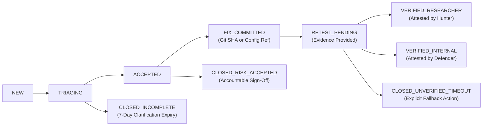

# Academic Project Proposal

## Project Title
**BugBountyTrack: A Multi-Tenant Vulnerability Disclosure Platform with Cryptographic Payload Isolation and Evidence-Based Remediation Traceability**

---

### Project Control & Metadata

| Attribute              | Specification                                              |
| :--------------------- | :--------------------------------------------------------- |
| **Project ID**         | `PTUT - PRJ - 089`                                         |
| **Candidate**          | Taha Asadullah (Roll No: `24-ST-013`, Section: `SET-B`)    |
| **Institution**        | Punjab Tianjin University of Technology (PTUT), Lahore     |
| **Program**            | Bachelor of Science in Software Engineering Technology     |
| **Academic Level**     | Fifth-Semester Project Proposal                            |
| **Academic Supervisor**| Sir Umar Hayat (Assistant Professor, PTUT Lahore)          |
| **Sub-Field**          | Application Security & Secure Software Engineering         |
| **Deliverable Target** | Evaluated Software Prototype & Commercial VDP Foundation   |
| **Project Duration**   | 16 Academic Weeks (+ Commercial SaaS Launch Track)         |
| **Target Reviewers**   | Course Instructor, Project Supervisor & Head of Department |
| **Document Status**    | Approved Baseline — Synchronized with SRS v3.2.0           |
| **Version**            | `3.2.0`                                                    |

---

## 1. Problem Statement

Vulnerability coordination is an essential component of modern software defense. When external security researchers discover flaws in web applications, they require a secure, confidential mechanism to report their findings without exposing the affected organization or risking legal ambiguity.

While mature enterprises deploy dedicated security portals or contract commercial crowdsourced platforms, early-stage technology startups, small development teams, and open-source projects frequently lack standardized disclosure channels. Consequently, reports are transmitted over unencrypted email, public issue trackers, or social media channels. This introduces two primary vulnerabilities:
1. **Confidentiality Exposure**: Sensitive exploit steps and proof-of-concept (PoC) payloads are transmitted over unencrypted communication hops or stored in shared corporate inboxes.
2. **The Remediation and Verification Gap**: Standard issue trackers treat vulnerability resolution as an informal textual status update. There is rarely an explicit, verifiable connection between the vulnerability report, the code or configuration change intended to resolve it, and an attested retest outcome confirming the fix before closure.

BugBountyTrack addresses this gap by providing a lightweight, multi-tenant vulnerability disclosure platform engineered around cryptographic confidentiality and an evidence-based remediation state machine.

---

## 2. Target Users & Actors

* **Security Researcher ("Hunter" — Authenticated or Account-Less Guest)**: An external researcher who discovers an in-scope vulnerability, prepares a structured report, encrypts the sensitive payload client-side, and conducts verification retests upon request. Can submit either via a verified Hunter account (for portfolio credit) or frictionlessly as an account-less Guest using a downloadable `.bbt-recovery.json` recovery package.
* **Designated Program Defender ("Defender")**: An authorized security or engineering lead assigned to a specific program (`PROGRAM_DEFENDER` role) who decrypts reports, coordinates triage, provides remediation references, and manages retest requests.
* **Organization Viewer (Read-Only / Management)**: Team members with visibility into aggregate program metrics, open report counts, and SLA timers without direct access to encrypted payloads.
* **Platform Administrator**: System operator responsible for tenant account provisioning, organization verification, abuse quarantine, and platform infrastructure health.

---

## 3. Project Objectives & Core Features

The primary objective is to develop and evaluate a functional prototype platform that streamlines vulnerability intake, protects payload confidentiality, and enforces strict remediation verification.

### Key Functional Features:
1. **RFC 9116 Directory & Policy Endpoint**: Automated generation of `/.well-known/security.txt` and public policy pages defining program scopes, safe harbor terms, and public encryption keys.
2. **Dual-Lane Multi-Tenant Intake**: Public discovery supporting both frictionless account-less guest submission (with encrypted `.bbt-recovery.json` recovery packages and URL-fragment tracking tokens) and authenticated researcher workflows.
3. **Deterministic CVSS 3.1 Calculation**: Pure-function Base Score calculation adhering strictly to the FIRST.org specification (`8.22` exploitability coefficient and integer-math `RoundUp`), producing standard vector strings and qualitative ratings.
4. **End-to-End Encrypted Triage Thread**: Multi-recipient asymmetric encryption of vulnerability payloads and threaded messages using `openpgp.js` (RFC 9580 Version 6 Curve25519).
5. **VCS Commit Reference Validation**: Read-only integration with the GitHub REST API to verify the existence, authorship, and repository branch of referenced fix commits.
6. **Configurable Remediation Evidence**: Support for both code commit references and non-code remediation evidence (e.g., infrastructure policy updates, WAF configuration rules).
7. **Attested Retest Workflow**: Explicit state transitions requiring structured retest evidence and verifier attribution prior to report closure, plus a public Redacted Remediation Certificate upon resolution.

---

## 4. Distinguishing Emphasis: Traceability & Accountable Closure

Rather than duplicating generic commercial issue trackers, BugBountyTrack concentrates engineering depth on **remediation traceability and verified closure**:

1. **Decoupled Fix Declaration and Verification**: Entering a Git commit SHA or configuration reference records the *declaration* of a fix; it does not mark the vulnerability resolved.
2. **Explicit Closure & Verification Outcomes**: Reports transition to closure under five distinct, mutually exclusive terminal states:
   * `VERIFIED_RESEARCHER`: The original researcher independently confirmed the vulnerability is mitigated.
   * `VERIFIED_INTERNAL`: An authorized Program Defender verified the fix (the audit log explicitly records whether this individual authored the remediation).
   * `CLOSED_UNVERIFIED_TIMEOUT`: If the researcher is unresponsive during a configurable grace period after a fix is committed, the report may be closed **only via an explicit authorized action with a recorded justification**.
   * `CLOSED_INCOMPLETE`: Used when a report in `NEED_MORE_INFO` receives no clarification within the 7-day grace window, preventing conflation with unverified fix timeouts.
   * `CLOSED_RISK_ACCEPTED`: Used when an organization formally accepts the risk of a valid finding without deploying a code patch, requiring mandatory `risk_accepted_by_user_id` and `risk_acceptance_justification` (>= 50 chars).
3. **Reopening Accountability**: Any closed report may be reopened if subsequent regression is identified, requiring an immutable, recorded rationale.

---

## 5. Mandatory PGP Cryptographic Requirement & Boundary

Client-side asymmetric cryptography is a mandatory architectural requirement to ensure report confidentiality against server-side database exposure.

* **Cryptographic Engine & Profile**: Implemented via a pinned `openpgp.js` library running in the client browser (`WebCrypto` / WASM), standardized on **RFC 9580 Version 6 Curve25519** (`Ed25519` signing + `X25519` encryption) with **64-character hexadecimal SHA-256 fingerprints**.
* **Bounded Multi-Defender Recipient Scope**: Encrypted payloads and attachments are encrypted using multi-recipient Public-Key Encrypted Session Key (`PKESK`) packets addressed to:
  1. All active **Program Defenders** (`N <= 10` authorized via `PROGRAM_DEFENDER` for that program),
  2. The organization's **Offline Master Recovery Public Key** (for disaster recovery), and
  3. The **Submitter / Ephemeral Guest Public Key**.
  Optimistic concurrency checks (`recipient_set_version`) reject submissions encrypted against stale defender rosters (`HTTP 409 Conflict`).
* **Encrypted vs. Server-Readable Boundary**:
  * *Encrypted (Ciphertext only)*: Vulnerability descriptions, reproduction steps, raw PoC scripts, attachments, and sensitive remediation notes.
  * *Server-Readable (Plaintext metadata)*: Report IDs, timestamps, current state, target asset scope, CVSS vector string, commit SHA, verifier identity, and retest outcomes.
* **Evidence Preservation & Safe Rendering**: Proof-of-concept text is stored unmodified to preserve exploit integrity. Text is rendered safely after client decryption through an Abstract Syntax Tree (AST) parser with strict HTML escaping and zero remote image/beacon fetching.
* **Key Lifecycle & Storage**: Private keys reside strictly on client devices inside **`IndexedDB`** encrypted via **Argon2id** passphrase derivation (`S2K` type `3`, `64 MiB` memory, `t=3`, `p=4`), or inside downloadable `.bbt-recovery.json` (v1) recovery bundles for guest reporters. Private keys are never stored in plaintext browser storage.

*(Detailed key management protocols and rotation mechanisms are documented in [KEY_MANAGEMENT.md](../architecture/KEY_MANAGEMENT.md)).*

---

## 6. Scope Exclusions (Anti-Goals)

To ensure reliable delivery within the academic schedule, the following are explicitly excluded:
* **No Automated Exploit Scanners**: The platform does not execute exploits or scan target infrastructure.
* **No Bounty Pool Escrow or Researcher Payout Splits**: BugBountyTrack is a software tool, not a financial escrow intermediary; it never holds vulnerability bounty funds or processes researcher payouts.
* **No Unverified AI/LLM Triage**: Triage assistance is strictly deterministic and rule-based.
* **No Server-Side Private Key Escrow**: The server never receives or stores user private keys or passphrases.

---

## 7. 16-Week Implementation Roadmap

The prototype will be engineered across 16 relative weeks following a disciplined lifecycle:

| Timeline        | SDLC Phase                    | Core Engineering Objectives                                                                                              | Deliverables                               |
| :-------------- | :---------------------------- | :----------------------------------------------------------------------------------------------------------------------- | :----------------------------------------- |
| **Weeks 1–3**   | Requirements & Architecture   | Lock requirements baseline, formalize state machines, design relational schemas and C4 architecture diagrams.            | Approved SRS, C4 Diagrams, ERD.            |
| **Weeks 4–6**   | Core Platform & Security      | Next.js and PostgreSQL scaffolding, tenant isolation, `PROGRAM_DEFENDER` RBAC, RFC 9116 generator, OpenPGP v6 keys.     | Multi-tenant core, public key directory.   |
| **Weeks 7–9**   | Intake & Triage Engine        | Dual-lane OpenPGP submission forms, `.bbt-recovery.json` recovery, pure CVSS 3.1 engine, encrypted triage messaging.     | Encrypted intake, validated CVSS engine.   |
| **Weeks 10–12** | Remediation & Verification    | State machine implementation, GitHub REST API commit validation, retest workflows, and hash-chained audit logging.       | End-to-end fix tracking subsystem.         |
| **Weeks 13–14** | Exploratory Evaluation        | Deploy containerized targets (OWASP Juice Shop), conduct peer user study (3–5 peers), collect usability and timing data. | Empirical evaluation dataset and analysis. |
| **Weeks 15–16** | Security Audit & Final Report | STRIDE threat model verification, code linting/testing, final project report, and demonstration preparation.             | Final project thesis and prototype demo.   |

---

## 8. Exploratory Evaluation Methodology

The completed prototype will be evaluated through a controlled, exploratory study designed to test functional correctness and workflow viability:
1. **State Machine & Data Integrity Testing**: Automated integration test suites verifying that invalid state transitions are rejected and confirming zero plaintext leakage in database storage dumps.
2. **Controlled Peer Study**: 3–5 software engineering students will execute simulated disclosure and remediation workflows across 2 containerized reference applications (e.g., OWASP Juice Shop).
3. **Evaluation Metrics**:
   * *Workflow Completion Rate*: Percentage of reports successfully transitioning from intake to verified closure.
   * *Triage & Remediation Traceability*: Consistency of audit records across commit checks and retest attestations.
   * *Cryptographic Reliability*: Decryption success rate across multi-recipient messages, guest `.bbt-recovery.json` restores, and key rotations.

---

## 9. Assumptions, Limitations & Resolved Architectural Decisions

* **Assumptions**: The client web browser executes application JavaScript faithfully (verified via Subresource Integrity and strict CSP); users maintain their own private key backups or `.bbt-recovery.json` files; Git commit validation relies on GitHub's REST API availability.
* **Limitations**: The prototype does not provide server-side private key escrow; losing both a defender's private key and the organization's offline master recovery key permanently prevents decryption of historical messages. The platform confirms commit existence, not whether the code change semantically fixes the vulnerability.
* **Resolved Architectural Profile**: Client-side keys are persisted exclusively in `IndexedDB` wrapped with Argon2id S2K protection (`64 MiB`, `t=3`, `p=4`), and guest tracking links scrub `#token=` from the browser URL bar immediately via `window.history.replaceState`.

---

## 10. Document Endorsement

**Submitted By**:  
Taha Asadullah (Roll No: `24-ST-013`, Section: `SET-B`) &nbsp;&nbsp;&nbsp;&nbsp;&nbsp;&nbsp;&nbsp;&nbsp; Date: ____________________  

**Academic Supervisor Review**:  
Sir Umar Hayat (Assistant Professor, PTUT Lahore)  
[ &nbsp; ] Recommended for Acceptance &nbsp;&nbsp;&nbsp;&nbsp; [ &nbsp; ] Revisions Requested  
Supervisor Signature: ______________________ &nbsp;&nbsp;&nbsp;&nbsp; Date: ____________________
