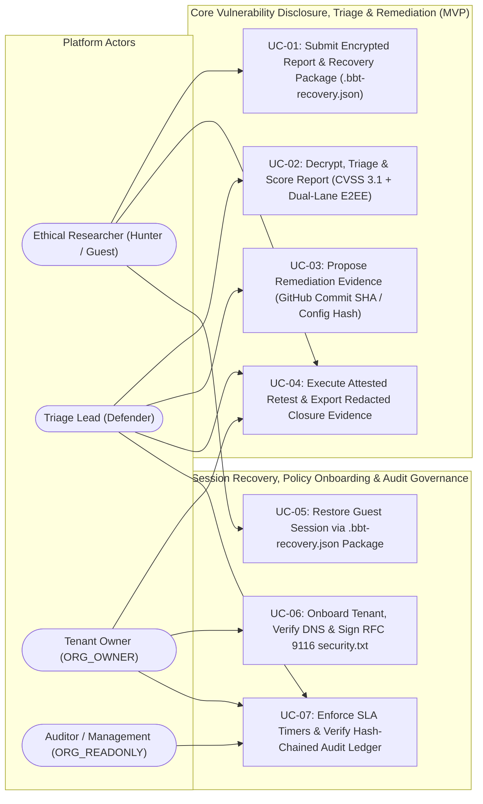
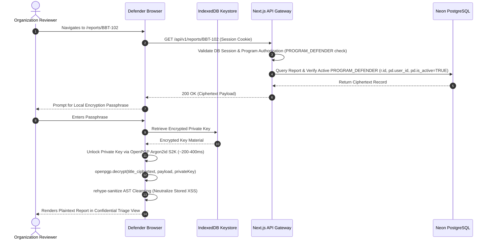
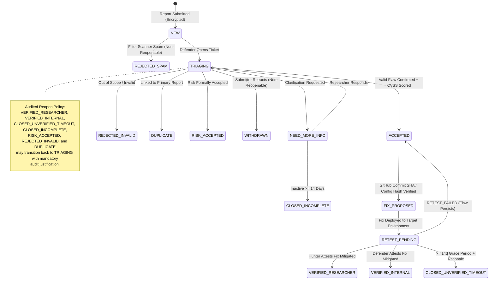

# Punjab Tianjin University of Technology
### Department of Software Engineering Technology
## FINAL YEAR PROJECT (FYP) ENGINEERING SPECIFICATION
# SOFTWARE REQUIREMENTS SPECIFICATION (SRS)
### Project: BugBountyTrack
**A Multi-Tenant Vulnerability Disclosure Platform with Cryptographic Payload Isolation and Evidence-Based Remediation Traceability**

---

| Academic & Engineering Parameter | Specification |
| :--- | :--- |
| **Student Author** | Taha Asadullah |
| **Roll Number / Student ID** | `24-ST-013` |
| **Session** | Session 2024–2028 |
| **Batch / Section** | Batch 24-SET-Fall / Section SET-B |
| **Official Student Email** | `24-st-013@students.ptut.edu.pk` |
| **FYP Project Supervisor** | Sir Umar Hayat |
| **Project Identifier** | `PTUT - PRJ - 089` |
| **Department Sub-Field** | 9. Cybersecurity, Privacy & LegalTech |
| **Milestone** | **Week 2** — Software Requirements Specification (**Gate 1: DoR Part II**) |
| **Standard Compliance** | IEEE Std 830-1998 / ISO/IEC/IEEE 29148:2018 |
| **Client Platform** | Modern Web (Next.js 14+ App Router, React 18+, TypeScript 5.x, Tailwind CSS, OpenPGP.js v6) |
| **Backend & API Engine** | Unified Next.js Fullstack (Serverless API Routes on Node.js 22 LTS) |
| **Database Architecture** | PostgreSQL 16 (Neon Serverless Cloud) / Prisma ORM 5.x (Row-Level Security & Append-Only Audit) |

---

## Supporting Deliverable Document (Google Drive Link)

| Deliverable Document | Scope Covered | Google Drive Link |
| :--- | :--- | :--- |
| **Formal IEEE 830 Software Requirements Specification (`SRS.docx`)** | Complete IEEE 830 SRS, Functional Requirements (`FR-1` to `FR-8`), Formal Use Case Specifications (`UC-01` to `UC-07`), 4 UML Behavioral Diagrams, Quantifiable NFRs (`NFR-01` to `NFR-09`), and Traceability Matrix | [View IEEE 830 Software Requirements Specification (Google Drive)](PASTE_GOOGLE_DRIVE_LINK_FOR_SRS_DOCX_HERE) |

---

## Table of Contents

1. Introduction
   - 1.1 Purpose & Target Scope
   - 1.2 Document Conventions & Priority Schema
   - 1.3 Intended Audience & Stakeholder Matrix
   - 1.4 Problem Statement & Alignment with Week 1 Discovery Baseline
2. Overall Description & Cryptographic Protection Boundary
   - 2.1 System Context & Core Architectural Overview
   - 2.2 Defensible Protection Boundary & Cryptographic Assumptions
   - 2.3 User Classes & Target Personas
   - 2.4 Operating Environment & Technical Bounds
   - 2.5 Design & Implementation Constraints
3. Specific Functional Requirements (FR)
   - 3.1 Multi-Tenant Workspaces, Onboarding & Access Governance (`FR-1`)
   - 3.2 RFC 9116 Policy & Safe Harbor Generator (`FR-2` — MVP Feature 1)
   - 3.3 Browser-Side OpenPGP Cryptographic Pipeline & Neutral Labeling (`FR-3` — MVP Feature 2)
   - 3.4 Deterministic CVSS 3.1 Base Scoring Engine (`FR-4` — MVP Feature 3)
   - 3.5 Confidential Triage, Dual-Lane Threading & SLA Timers (`FR-5`)
   - 3.6 Git-Linked Remediation & Evidence Verification (`FR-6` — MVP Feature 4)
   - 3.7 Attested Retest State Machine, Accountable Closure & Redacted Exports (`FR-7` — MVP Feature 5)
   - 3.8 Application Hardening, Defensive Controls & Storage Quotas (`FR-8`)
4. System Modeling & UML Behavioral Specifications
   - 4.1 Formal Textual Use Case Specifications (`UC-01` to `UC-07`)
   - 4.2 System Use Case Diagram (Figure 4.1)
   - 4.3 Sequence Diagram: Browser-Side OpenPGP Submission (Figure 4.2)
   - 4.4 Sequence Diagram: In-Browser Decryption & Confidential Triage (Figure 4.3)
   - 4.5 State Machine Diagram: Remediation & Attested Retest Lifecycle (Figure 4.4)
5. External Interface Requirements
   - 5.1 User Interfaces & Screen Catalog
   - 5.2 Software & External API Interfaces
6. Quantifiable Non-Functional Requirements (Latency, Security & Uptime)
7. Verification, Acceptance Criteria & Requirements Traceability
   - 7.1 Bidirectional Requirements Traceability Matrix (RTM)
   - 7.2 Verification Test Pyramid & Acceptance Criteria
8. Document Endorsement & Milestone Sign-Off

---

## 1. Introduction

### 1.1 Purpose & Target Scope

This Software Requirements Specification (SRS) establishes the formal engineering requirements baseline for **BugBountyTrack** (`PTUT - PRJ - 089`). It defines the functional behaviors, zero-knowledge cryptographic boundaries, deterministic severity calculation engines, formal Use Case specifications, UML behavioral models, and quantifiable non-functional requirements (latency, security, and uptime) for our Final Year Project prototype, conforming strictly to **IEEE Std 830-1998** and **ISO/IEC/IEEE 29148:2018**.

### 1.2 Document Conventions & Priority Schema

Every requirement in this specification is assigned a unique identifier (`FR-X.Y` for Functional Requirements, `NFR-XX` for Non-Functional Requirements, and `UC-XX` for Use Cases) and categorized by implementation priority:

* **P1 (Mandatory Core MVP)**: Essential functionality required for the 5 Core MVP Features, cryptographic payload isolation, and academic evaluation.
* **P2 (Important Operational Governance)**: Secondary capabilities that strengthen multi-device recovery, SLA tracking, domain verification, and auditability.

### 1.3 Intended Audience & Stakeholder Matrix

| Stakeholder Role | Interaction with Specification | Primary Concerns |
| :--- | :--- | :--- |
| **Taha Asadullah (Student Author)** | Implementation lead; responsible for delivering a verifiable, type-safe codebase adhering to this specification. | Technical feasibility, cryptographic soundness, architectural clarity, and automated test coverage. |
| **Sir Umar Hayat (Academic Supervisor)** | Evaluator; reviews IEEE 830 requirements rigor, Use Case completeness, state machine validity, and empirical verification. | Academic compliance, formal modeling accuracy, quantifiable NFR metrics, and defense readiness. |
| **Software Engineering Peers** | Participants in controlled usability and adversarial security evaluation across target applications. | Clarity of vulnerability submission workflow, triage ergonomics, and retest attestation flow. |

### 1.4 Problem Statement & Alignment with Week 1 Discovery Baseline

While established vulnerability platforms and source-code hosts offer free entry tiers (such as HackerOne Essential VDP or GitHub Security Advisories), small and medium software engineering teams (5–50 developers) still face a critical security and workflow gap: entry-level third-party platforms store raw exploit proofs-of-concept (PoCs) in **server-managed plaintext** on vendor infrastructure (or lock reporting to a single Git forge), causing security-conscious teams to fall back to ad-hoc channels like generic `security@company.com` email inboxes, shared spreadsheets, and standard issue trackers. Those ad-hoc channels lack **RFC 9116 `security.txt` policy discovery and legal Safe Harbor clarity**, expose unpatched zero-day vulnerability payloads in **plaintext across mail servers and ticket databases**, rely on **inconsistent subjective severity guesses** instead of deterministic **CVSS v3.1** mathematics, and allow developers to mark security tickets "Closed" **without linking a verified remediation Git commit SHA (or configuration hash) or requiring an attested retest by the reporting researcher**.

**BugBountyTrack** directly resolves these four operational frictions through **five core MVP features**:
1. **RFC 9116 `security.txt` Policy & Safe Harbor Engine** (`FR-2.1` – `FR-2.5`)
2. **Zero-Knowledge Client-Side OpenPGP Payload Encryption** (`FR-3.1` – `FR-3.6`)
3. **Deterministic CVSS v3.1 Base Severity Calculator** (`FR-4.1` – `FR-4.4`)
4. **Git Commit SHA & Configuration Hash Remediation Verifier** (`FR-6.1` – `FR-6.4`)
5. **Attested Retest State Machine & Append-Only Audit Ledger** (`FR-7.1` – `FR-7.7`, `FR-8.5`)

---

## 2. Overall Description & Cryptographic Protection Boundary

### 2.1 System Context & Core Architectural Overview

BugBountyTrack operates across three logical boundaries (detailed architectural topology and Data Flow Diagrams are specified in the Week 3 Architecture Deliverable):
1. **Client Browser Runtime**: Next.js 14+ App Router, React 18+, Tailwind CSS, `OpenPGP.js v6` client-side encryption/decryption, `rehype-sanitize` Markdown AST sanitizer, and WebCrypto API (`crypto.subtle`).
2. **Application API Gateway**: Next.js Route Handlers running on Node.js 22 LTS, enforcing server-side Role-Based Access Control (RBAC), database-backed session authentication, SLA countdown monitoring, presigned Cloudflare R2 upload URL generation, and GitHub REST API v3 commit/branch validation.
3. **Persistence & Storage Layer**: Neon Serverless PostgreSQL 16 (enforcing tenant Row-Level Security and an append-only hash-chained audit ledger) and Cloudflare R2 (storing client-encrypted binary PoC attachments).

### 2.2 Defensible Protection Boundary & Cryptographic Assumptions

* **Client-Side OpenPGP Payload Isolation**: Vulnerability titles (`title_ciphertext`), descriptions, reproduction steps, and PoC attachments are encrypted in the submitter's browser using OpenPGP multi-recipient packets prior to network transit. The server and database persist and route ciphertext only.
* **Algorithm Pinning & Performance**: All cryptographic keys are standardized exclusively on **RFC 9580 Version 6 Ed25519 (Signing) and X25519 (Encryption)** Curve25519 keys (targeting `< 50 ms` bare key generation as an empirical benchmark target) with **64-character hexadecimal SHA-256 fingerprints**. Legacy RSA-4096 and OpenPGP v4 keys are excluded to eliminate browser UI freezes and satisfy `NFR-02` (`<= 1,500 ms` total encryption latency).
* **Key Storage & Protection**: Private keys in browser `IndexedDB` (zero `localStorage` usage) are encrypted using OpenPGP's native **Argon2id S2K** string-to-key derivation (`t=3, m=65536, p=4`), introducing an intentional, estimated cryptographic delay of **~200–400 ms** on modern client hardware to resist offline brute-force attacks while separating login passwords from local encryption passphrases.
* **Account-Less (Guest) Vulnerability Intake**: External researchers can submit reports without registering an account. The browser autonomously generates an ephemeral RFC 9580 v6 Curve25519 keypair, encrypts the report to the target program's defenders (`PROGRAM_DEFENDER`), the offline recovery key (`recovery_public_key`), and the ephemeral report key, and receives an opaque Secret Tracking URL (`/report/track/BBT-RPT-XXXX#token=<secret>`) plus a downloadable versioned **Guest Recovery Package** (`.bbt-recovery.json`) enabling multi-device restoration and retest attestation.
* **Offline Organization Master Recovery Key**: Generated in-browser during tenant onboarding, the public recovery key (`recovery_public_key`) is included as an additional Public-Key Encrypted Session Key (PKESK) recipient on all reports. The private recovery key is exported offline by the Organization Owner, and program activation is gated on a mandatory in-browser test decryption challenge—ensuring disaster recovery without server-side key escrow.
* **Dual-Lane Recipient Isolation**: Researcher–Organization conversation messages are encrypted for the Submitter + Program Defenders (`PROGRAM_DEFENDER`, up to 10 authorized defenders) + Organization Recovery Key; Reviewer Internal Notes are encrypted strictly for Program Defenders + Organization Recovery Key, excluding the researcher.
* **Optimistic Concurrency Guard (`recipient_set_version`)**: Each program keyring maintains an integer `recipient_set_version` counter; report submissions encrypted against a stale defender roster are rejected with HTTP `409 Conflict` so the client refreshes the recipient keyring automatically.
* **Historical-Access Isolation & Audited Session Re-Wrapping**: Newly assigned defenders receive decryption access only to reports submitted after their assignment. Granting access to a historical report requires an existing authorized defender to locally decrypt the report's AES-256 session key (`K_S`), re-wrap it with the new defender's public X25519 subkey, and append the PKESK packet, recording an immutable audit event (`HISTORICAL_ACCESS_GRANTED`).
* **Browser Trust Boundary**: Client-side cryptography isolates sensitive exploit payloads from backend database breaches, cloud snapshot leaks, and untrusted database administrators. Within the standard web security model, the delivered client web application (HTML/JS protected by Subresource Integrity and strict Content Security Policy) and the server's public-key distribution endpoint are trusted to serve authentic code and public keys.
* **Tamper-Evident Hash-Chained Audit Boundary**: Immutability of the `audit_events` ledger is enforced at the PostgreSQL permission layer (`INSERT` and `SELECT` privileges only; zero `UPDATE` or `DELETE` grants) combined with a cryptographic SHA-256 `prev_hash` chain linking every lifecycle transition.

### 2.3 User Classes & Target Personas

Aligned with the Week 1 Discovery Report, the system serves two primary user personas and two supporting organizational roles:

1. **Persona 1: Alex Rivera — "The Hunter" (External Ethical Security Researcher / Guest Hunter)**:
   * Independent security researcher and cybersecurity student discovering web and API flaws. Requires explicit RFC 9116 Safe Harbor protection, frictionless account-less or authenticated submission, client-side zero-knowledge encryption, deterministic CVSS v3.1 scoring, and an attested retest workflow before ticket closure.
2. **Persona 2: Sarah Chen — "The Defender" (Startup Engineering & Security Triage Lead / `ORG_DEFENDER`)**:
   * Full-stack engineering lead managing vulnerability remediation across a 15-developer engineering team. Requires encrypted intake that keeps raw zero-day exploits out of plaintext databases/emails, dual-lane discussion (public researcher thread vs. private internal engineering notes), objective CVSS v3.1 vectors, GitHub commit SHA / configuration hash fix verification, and redacted closure exports.
3. **Organization Owner (`ORG_OWNER`)**:
   * Senior engineering manager or CTO who provisions the tenant workspace, verifies domain ownership via DNS TXT challenge, exports the offline Organization Master Recovery Key, assigns `PROGRAM_DEFENDER` members, and cleartext-signs the organization's `/.well-known/security.txt` policy.
4. **Read-Only Stakeholder / Auditor (`ORG_READONLY`)**:
   * Executive or compliance reviewer who inspects non-sensitive program metadata, SLA countdown compliance, and hash-chained audit logs without decrypting raw exploit payloads.

### 2.4 Operating Environment & Technical Bounds

* **Client Runtime**: Evergreen desktop and mobile web browsers (Chromium >= 110, Firefox >= 110, Safari >= 16.4) supporting WebCrypto API (`crypto.subtle`), WebAssembly, and `IndexedDB`.
* **Server Runtime**: Node.js 22 LTS executing Next.js 14+ App Router serverless route handlers (maximum execution timeout: 15 seconds per API request).
* **Database & Object Storage**: PostgreSQL 16 on Neon Serverless Cloud with Row-Level Security (RLS) via Prisma ORM 5.x, paired with Cloudflare R2 S3-compatible object storage for encrypted binary attachments.

### 2.5 Design & Implementation Constraints

* **Zero-Cost Academic Infrastructure Ceiling**: Operates strictly within free developer cloud tiers (`$0.00/month` total cost of ownership) with bounded per-tenant academic evaluation quotas (`50 MB` PostgreSQL database storage and `2 GB` Cloudflare R2 encrypted object storage per tenant).
* **Strict Zero-Knowledge Server Invariant**: The server shall never receive, log, or persist user passphrases, unencrypted private keys, or plaintext vulnerability titles, descriptions, or proof-of-concept payloads.

---

## 3. Specific Functional Requirements (FR)

### 3.1 Multi-Tenant Workspaces, Onboarding & Access Governance (`FR-1`)

* **FR-1.1 (P1, Core)**: The system shall support multiple isolated organization workspaces within a single PostgreSQL database using an `organization_id` foreign key on all tenant-scoped entities.
* **FR-1.2 (P1, Core)**: The server shall enforce Role-Based Access Control (RBAC) across four distinct roles (`ORG_OWNER`, `ORG_DEFENDER`, `ORG_READONLY`, and `HUNTER`) and enforce program-level decryption and triage authorization via the `PROGRAM_DEFENDER` relation (verifying that `user.organization_id == program.organization_id` and `is_active == true`).
* **FR-1.3 (P1, Core)**: Users shall register and authenticate via email and Argon2id/Bcrypt-hashed passwords (`cost >= 12`), backed by database-persisted session tokens stored in `HttpOnly`, `Secure`, `SameSite=Lax` cookies. Password resets shall immediately revoke all active session records for the user. `ORG_OWNER` and `ORG_DEFENDER` accounts shall support Time-Based One-Time Password (TOTP, RFC 6238) Multi-Factor Authentication with `totp_secret` encrypted at rest using AES-256-GCM.
* **FR-1.4 (P1, Core)**: The platform shall provide a Guided Onboarding Wizard enabling organization owners to complete workspace setup—domain DNS TXT verification, asset scope definition, in-browser Curve25519 key generation, offline **Organization Master Recovery Key** (`recovery_public_key`) export with a mandatory client-side test decryption challenge, and RFC 9116 `security.txt` cleartext signing—within 15 minutes.
* **FR-1.5 (P2, Core)**: The platform shall support both public disclosure programs (`/programs/[slug]`) and private invitation-only programs accessible via tokenized invitation links (`/programs/[slug]/join?token=...`). The server shall store only the SHA-256 hash (`token_hash`) of each invitation token and reject uninvited submissions to private programs with HTTP `403 Forbidden`.
* **FR-1.6 (P1, Core)**: The platform shall provide **Account-Less (Guest) Vulnerability Intake** so external researchers can submit encrypted vulnerability reports without registering an account:
  * **Durable Guest Actor Identity (`guest_actor_id`)**: A persistent UUIDv4 generated at submission time and referenced across all subsequent discussion messages, retest attestations, and audit events so token rotation never breaks historical attribution.
  * **Guest Access Token (`guest_token_hash`)**: A high-entropy bearer token issued upon submission to authorize HTTP retrieval of the encrypted report record; the server persists only its SHA-256 hash (`guest_token_hash`).
  * **Ephemeral Report Private Key (`K_report_priv`)**: An RFC 9580 v6 Curve25519 private key generated in-browser and stored in `IndexedDB` to decrypt the report session key locally.
  * **Versioned Downloadable Guest Recovery Package (`.bbt-recovery.json`)**: An exportable JSON file (`version: 1`) containing `{ version: 1, report_id, guest_actor_id, access_token, key_format: "openpgp-rfc9580-v6", key_fingerprint, encrypted_private_key, checksum }` protected with Argon2id S2K.
  * **URI Fragment Protection & Address Bar Scrubbing**: Secret Tracking URLs shall be formatted as `/report/track/BBT-RPT-XXXX#token=<access_token>` so the bearer token is never transmitted in HTTP `GET` request lines or `Referer` headers. Client JavaScript shall read the `#token=` fragment into memory on load and immediately scrub the address bar via `window.history.replaceState(null, '', window.location.pathname)`.
  * **Multi-Device Restoration (`/report/restore`)**: Guests switching browsers or devices shall be able to upload their `.bbt-recovery.json` package at `/report/restore`, verify its SHA-256 `checksum`, restore their private key into `IndexedDB`, and resume encrypted dialogue and retest attestation.

### 3.2 RFC 9116 Policy & Safe Harbor Generator (`FR-2` — MVP Feature 1)

* **FR-2.1 (P1, Core)**: The platform shall generate a standards-compliant RFC 9116 policy manifest available for preview and download at `/api/v1/programs/[slug]/security.txt`, containing mandatory `Contact`, `Expires` (capped at `<= 365 days` with automated 30-day renewal warnings), `Encryption`, `Policy`, `Acknowledgments`, `Preferred-Languages`, and `Canonical` directives.
* **FR-2.2 (P1, Core)**: The `security.txt` manifest shall be **cleartext-signed in the client browser** (`-----BEGIN PGP SIGNED MESSAGE-----`) using the organization's private Ed25519 signing key without transmitting the private key to the server. The organization owner can download the cleartext-signed file for deployment at `https://[org-domain]/.well-known/security.txt`.
* **FR-2.3 (P1, Core)**: The platform shall verify cleartext-signed `security.txt` policies in-browser using the organization's advertised public signing key (`fingerprint` verified as a 64-character SHA-256 hexadecimal string).
* **FR-2.4 (P1, Core)**: The policy builder shall provide structured **In-Scope** (`IN_SCOPE`) and **Out-of-Scope** (`OUT_OF_SCOPE`) asset tables (Domains, Wildcards, APIs, Repositories) and standardized **Safe Harbor** legal clauses (adapted from Disclose.io Core terms) authorizing good-faith security testing within scope.
* **FR-2.5 (P2, Core)**: The platform shall verify domain ownership before activating a public program by querying Node.js `dns.promises.resolveTxt()` for a unique challenge token at `_bbt-challenge.<domain>`.

### 3.3 Browser-Side OpenPGP Cryptographic Pipeline & Neutral Labeling (`FR-3` — MVP Feature 2)

* **FR-3.1 (P1, Core)**: The client browser shall generate OpenPGP keypairs pinned strictly to **RFC 9580 Version 6 Curve25519 (`Ed25519` for signing, `X25519` for encryption)** with **64-character hexadecimal SHA-256 fingerprints**. Generating bare Curve25519 keypairs in `< 50 ms` is established as an empirical benchmark target on modern browsers. Legacy RSA-4096 and OpenPGP v4 keys are excluded.
* **FR-3.2 (P1, Core)**: Private keys shall be stored locally in browser `IndexedDB` (never `localStorage`), encrypted using OpenPGP **Argon2id S2K** (`t=3, m=65536, p=4`). To permit WebAssembly execution of Argon2id within `OpenPGP.js v6`, the application Content Security Policy (CSP) shall include `'wasm-unsafe-eval'` while forbidding `'unsafe-inline'` and `'unsafe-eval'`.
* **FR-3.3 (P1, Core)**: When submitting a report, the client browser shall encrypt all sensitive fields (`title_ciphertext`, vulnerability description, reproduction steps, impact analysis, and PoC attachments) into a multi-recipient OpenPGP packet encrypted for:
  1. All active authorized defenders assigned to the program via `PROGRAM_DEFENDER` (up to 10 defenders),
  2. The organization's offline master recovery key (`recovery_public_key`), and
  3. The reporting researcher's public encryption key (or ephemeral guest report key).
  The submission request shall include the program's current `recipient_set_version`; if the defender roster changed concurrently, the server shall return HTTP `409 Conflict` so the browser refreshes the keyring and re-encrypts automatically.
* **FR-3.4 (P1, Core)**: Because the specific vulnerability title is encrypted as `title_ciphertext`, the client shall require the submitter to select a coarse, server-readable **neutral operational category label** (`operational_label` enum: `AUTHENTICATION_BYPASS`, `INJECTION_VULNERABILITY`, `INFORMATION_DISCLOSURE`, `CROSS_SITE_SCRIPTING`, `ACCESS_CONTROL_ISSUE`, `DENIAL_OF_SERVICE`, `CRYPTOGRAPHIC_CONFIGURATION`, or `OTHER`) to support safe queue filtering and non-leaking notifications without exposing exploit specifics.
* **FR-3.5 (P1, Core)**: Proofs-of-concept and binary attachments (`<= 25 MB`) shall be encrypted in-browser and uploaded directly from the client to **Cloudflare R2** via short-lived presigned `PUT` URLs issued by `/api/uploads/presign`, bypassing serverless function payload limits.
* **FR-3.6 (P2, Core)**: During onboarding, the Organization Owner must export the Argon2id-protected private **Organization Master Recovery Key** offline and pass a mandatory in-browser decryption challenge. Upon key lock or logout, the client shall execute strict memory hygiene: temporary `Uint8Array` buffers are zeroized (`fill(0)`), ephemeral keys are deleted from `IndexedDB` when requested, and all in-memory JavaScript object references are immediately nullified.

### 3.4 Deterministic CVSS 3.1 Base Scoring Engine (`FR-4` — MVP Feature 3)

* **FR-4.1 (P1, Core)**: The platform shall implement a pure, zero-dependency TypeScript calculation engine computing FIRST.org **CVSS v3.1 Base Scores** (`0.0` to `10.0`), verified at **100% mathematical parity across all 45 canonical FIRST.org and NIST NVD test vectors** documented in `CVSS_TEST_FIXTURES.md` using the official FIRST.org exploitability coefficient **`8.22`** and `RoundUp` ceiling function to 1 decimal place.
* **FR-4.2 (P1, Core)**: The calculator shall evaluate all 8 standard Base metrics: Attack Vector (`AV:N/A/L/P`), Attack Complexity (`AC:L/H`), Privileges Required (`PR:N/L/H`, adjusting weights when Scope is Changed `S:C`), User Interaction (`UI:N/R`), Scope (`S:U/C`), Confidentiality (`C:N/L/H`), Integrity (`I:N/L/H`), and Availability (`A:N/L/H`).
* **FR-4.3 (P1, Core)**: The engine shall provide bidirectional parsing and serialization between interactive metric selections and canonical CVSS v3.1 vector strings (`CVSS:3.1/AV:_/AC:_/PR:_/UI:_/S:_/C:_/I:_/A:_`), mapping scores deterministically to Qualitative Severity Ratings (`None: 0.0`, `Low: 0.1–3.9`, `Medium: 4.0–6.9`, `High: 7.0–8.9`, `Critical: 9.0–10.0`).
* **FR-4.4 (P1, Core)**: The relational schema shall preserve both the researcher's initial suggested vector (`cvss_suggested`) and the defender's official assessed score (`cvss_score`), recording the assessing defender's user ID and mandatory written justification in the audit ledger.

### 3.5 Confidential Triage, Dual-Lane Threading & SLA Timers (`FR-5`)

* **FR-5.1 (P1, Core)**: Authorized `PROGRAM_DEFENDER` reviewers shall unlock their private X25519 key in-browser using their local passphrase to decrypt `title_ciphertext`, report bodies, and encrypted R2 attachments on demand.
* **FR-5.2 (P1, Core)**: The triage desk shall enforce **Dual-Lane Encrypted Threading**:
  * **Lane 1 (`RESEARCHER_ORG` Conversation)**: Encrypted for the Submitter + active `PROGRAM_DEFENDER` keys + `recovery_public_key`.
  * **Lane 2 (`REVIEWER_INTERNAL` Notes)**: Encrypted strictly for active `PROGRAM_DEFENDER` keys + `recovery_public_key`, mathematically excluding the reporting researcher's public key.
* **FR-5.3 (P1, Core)**: Outbound email notifications (via Resend/Postmark) and webhook alerts shall transmit **operational metadata only** (`Report ID`, `operational_label`, `State Transition`, `Timestamp`, and portal link), containing **zero bytes** of vulnerability titles, descriptions, or comments.
* **FR-5.4 (P2, Core)**: The system shall track severity-driven Service Level Agreement (SLA) countdown targets (`Critical: 48h initial triage / 14d remediation`, `High: 72h triage / 30d remediation`, `Medium: 7d triage / 90d remediation`, `Low: 14d triage / 180d remediation`), displaying visual countdown badges and triggering metadata-only alerts via an hourly scheduled check.
* **FR-5.5 (P2, Core)**: Reviewers may link a duplicate report (`DUPLICATE`) to a canonical parent `report_id` after in-browser verification without exposing the parent report's encrypted contents to the duplicate submitter.

### 3.6 Git-Linked Remediation & Evidence Verification (`FR-6` — MVP Feature 4)

* **FR-6.1 (P1, Core)**: A defender cannot transition an `ACCEPTED` vulnerability to `FIX_PROPOSED` / `RETEST_PENDING` without submitting structured remediation evidence under one of two verification paths: `CODE_COMMIT` or `CONFIG_INFRASTRUCTURE`.
* **FR-6.2 (P1, Core)**: For `CODE_COMMIT` evidence, the backend shall query the **GitHub REST API v3** (`GET /repos/{owner}/{repo}/commits/{sha}` and `GET /repos/{owner}/{repo}/compare/{base}...{head}`) to cryptographically verify that the 40-character hexadecimal Git Commit SHA exists, record the commit author and timestamp, and confirm that the commit is present on the designated remediation branch (`status` is `ahead` or `identical`) before permitting the transition.
* **FR-6.3 (P1, Core)**: For `CONFIG_INFRASTRUCTURE` evidence (such as cloud IAM policy updates, firewall rules, or server configuration changes without a source code commit), the client browser shall compute the **64-character SHA-256 hash** of the configuration artifact via WebCrypto and bind it alongside a written remediation summary.
* **FR-6.4 (P1, Core)**: Every remediation record shall capture the target deployment environment (`Staging`, `Pre-Production`, or `Production`) and version tag where the fix has been deployed for verification.

### 3.7 Attested Retest State Machine, Accountable Closure & Redacted Exports (`FR-7` — MVP Feature 5)

* **FR-7.1 (P1, Core)**: The platform shall enforce a deterministic 13-state vulnerability lifecycle finite state machine (FSM), rejecting any unpermitted state transition with HTTP `400 Bad Request`:
  ```
  NEW -> TRIAGING -> ACCEPTED -> FIX_PROPOSED -> RETEST_PENDING -> [TERMINAL CLOSURE STATES]
          |               |
          v               v
   REJECTED_INVALID / NEED_MORE_INFO /
      DUPLICATE       RETEST_FAILED (loops back to ACCEPTED)
  ```
* **FR-7.2 (P1, Core)**: From `RETEST_PENDING`, a report shall transition to final remediation closure exclusively via one of **three distinct terminal states**:
  1. `VERIFIED_RESEARCHER`: The reporting researcher (`Hunter` or `Guest Hunter`) re-tested the fix on the target environment and confirmed the vulnerability is neutralized.
  2. `VERIFIED_INTERNAL`: An authorized `PROGRAM_DEFENDER` certified the fix internally with empirical test notes and explicit conflict-of-interest disclosure (recording whether the verifier authored the patch).
  3. `CLOSED_UNVERIFIED_TIMEOUT`: Closed after a `>= 14-day` researcher inactivity window following a retest invitation, requiring an explicit defender action and written administrative rationale. Never counted as a verified fix.
* **FR-7.3 (P1, Core)**: Additional non-remediation terminal states shall be strictly separated:
  * `CLOSED_INCOMPLETE`: Researcher failed to respond to a `NEED_MORE_INFO` clarification request within `>= 14 days` during initial triage.
  * `RISK_ACCEPTED`: Formal executive risk acceptance by `ORG_OWNER` or Lead Defender with a mandatory written security rationale and scheduled review date (never counted as a remediated vulnerability).
  * `REJECTED_SPAM`: Direct disposal of automated scanner noise from `NEW` (non-reopenable).
  * `REJECTED_INVALID`: Out-of-scope or non-reproducible submission with mandatory policy citation.
  * `DUPLICATE`: Linked to a canonical pre-existing report ID.
  * `WITHDRAWN`: Voluntarily retracted by the submitting researcher (non-reopenable).
* **FR-7.4 (P1, Core)**: If an empirical retest demonstrates that the patch is incomplete or bypassed, submitting a `RETEST_FAILED` attestation shall automatically transition the report from `RETEST_PENDING` back to `ACCEPTED` while preserving the failed retest evidence in the append-only audit log.
* **FR-7.5 (P1, Core)**: Reports remaining in `NEED_MORE_INFO` for `>= 14 days` without researcher response shall automatically transition to `CLOSED_INCOMPLETE` via the scheduled timeout check.
* **FR-7.6 (P1, Core)**: Closed reports in `VERIFIED_RESEARCHER`, `VERIFIED_INTERNAL`, `CLOSED_UNVERIFIED_TIMEOUT`, `CLOSED_INCOMPLETE`, `RISK_ACCEPTED`, `REJECTED_INVALID`, or `DUPLICATE` may be reopened to `TRIAGING` by an authorized `ORG_DEFENDER` or `ORG_OWNER` with a mandatory audit justification if a regression occurs or new evidence is provided. `REJECTED_SPAM` and `WITHDRAWN` are permanently terminal.
* **FR-7.7 (P2, Core)**: The platform shall generate **Redacted Closure Evidence Exports** (in both PDF and JSON formats) documenting the report ID, `operational_label`, CVSS v3.1 score and vector, lifecycle timestamps, verified Git commit SHA/branch or SHA-256 config hash, deployment environment, retest attestation outcome, and SHA-256 audit chain proof—while excluding all decrypted exploit payloads so teams can share clean remediation proof with academic evaluators or external auditors.

### 3.8 Application Hardening, Defensive Controls & Storage Quotas (`FR-8`)

* **FR-8.1 (P1, Core)**: All decrypted Markdown descriptions, comments, and reproduction steps shall be parsed into an Abstract Syntax Tree (AST) and sanitized via `unified` / `remark-parse` / `rehype-sanitize` using a strict allowlist prior to DOM rendering, neutralizing 100% of Stored Cross-Site Scripting (XSS) vectors. Raw `dangerouslySetInnerHTML` without prior AST sanitization is forbidden.
* **FR-8.2 (P1, Core)**: PostgreSQL 16 Row-Level Security (RLS) policies shall be enforced on all tenant-scoped tables, dynamically binding `SET LOCAL app.current_tenant_id = :org_id` inside every database transaction to prevent cross-tenant Horizontal Privilege Escalation (IDOR).
* **FR-8.3 (P1, Core)**: Public vulnerability submission and authentication endpoints shall enforce shared-store rate limiting (`5 submissions / hour / IP`) and **Cloudflare Turnstile CAPTCHA** verification to mitigate automated spam floods.
* **FR-8.4 (P2, Core)**: Tenant storage quotas shall be enforced at **`50 MB` PostgreSQL database volume** and **`2 GB` Cloudflare R2 encrypted object storage** per academic evaluation tenant. Presigned upload issuance (`/api/uploads/presign`) shall display administrative warnings at **90%** quota utilization and reject uploads exceeding **100%** quota with HTTP `413 Payload Too Large`, paired with an automated orphan attachment cleanup job.
* **FR-8.5 (P1, Core)**: The `audit_events` table shall enforce an **append-only cryptographic hash chain**: database privileges for the application runtime role shall grant `INSERT` and `SELECT` only (revoking `UPDATE`, `DELETE`, and `TRUNCATE`), and every event row shall compute `row_hash = SHA-256(prev_hash || report_id || actor_id || action || timestamp)`.

---

## 4. System Modeling & UML Behavioral Specifications

### 4.1 Formal Textual Use Case Specifications (`UC-01` to `UC-07`)

#### Use Case UC-01: Submit Encrypted Vulnerability Report & Generate Recovery Package

* **Primary Actor**: Ethical Security Researcher (`Hunter` or `Guest Hunter`).
* **Preconditions**: Researcher is viewing an organization's active public program page (or holds a valid private program invitation token `token_hash`).
* **Main Success Scenario**:
  1. Researcher selects an in-scope target asset, chooses a coarse neutral category (`operational_label` enum), and inputs the specific vulnerability title, technical reproduction steps, and optional PoC attachment (`<= 25 MB`).
  2. Client browser generates an ephemeral RFC 9580 v6 Curve25519 keypair in memory (`< 50 ms` benchmark target) and fetches the program's active `PROGRAM_DEFENDER` encryption subkeys (`recipient_set_version`) plus the offline `recovery_public_key`.
  3. Client browser generates an ephemeral AES-256 session key, encrypts the title (`title_ciphertext`), description, and PoC into an OpenPGP ciphertext envelope, and wraps the session key in PKESK packets for all active `PROGRAM_DEFENDER` subkeys, the `recovery_public_key`, and the reporter's key.
  4. If an attachment is included, the browser requests a presigned URL from `/api/uploads/presign` and streams the encrypted binary directly to Cloudflare R2.
  5. Browser dispatches an HTTP `POST` request with `operational_label`, `recipient_set_version`, `title_ciphertext`, `encrypted_payload`, and R2 object metadata.
  6. Server validates Cloudflare Turnstile CAPTCHA, rate limits, tenant storage quota, and `recipient_set_version`, then persists the ciphertext in PostgreSQL and appends a genesis `AUDIT_EVENT`.
  7. For guest submitters, the system issues a durable `guest_actor_id` and `guest_token_hash`, stores the ephemeral private key in `IndexedDB`, displays the Secret Tracking URL (`/report/track/BBT-RPT-XXXX#token=<secret>`) scrubbed immediately from the address bar via `window.history.replaceState`, and triggers download of the versioned `.bbt-recovery.json` **Guest Recovery Package**. Report enters state `NEW`.
* **Extensions**:
  * *2a. Organization public key missing or invalid*: Browser blocks submission and alerts user.
  * *5a. Stale `recipient_set_version`*: Server returns HTTP `409 Conflict`; browser refreshes recipient keyring and re-encrypts automatically.
  * *6a. Rate limit (`> 5 req/hr/IP`) or storage quota (`> 100%`) exceeded*: Server returns HTTP `429 Too Many Requests` or `413 Payload Too Large`.

#### Use Case UC-02: Decrypt & Triage Vulnerability Report

* **Primary Actor**: Organization Triage Lead (`Defender`).
* **Preconditions**: Authenticated with `ORG_DEFENDER` role and active `PROGRAM_DEFENDER` membership; report is in state `NEW` or `TRIAGING`.
* **Main Success Scenario**:
  1. Defender navigates to the report triage desk (`/dashboard/reports/[id]`). Browser fetches the encrypted report record and retrieves the defender's encrypted private key from `IndexedDB`.
  2. Defender enters their local encryption passphrase to unlock the Argon2id S2K-protected private key (`~200–400 ms` intentional cryptographic delay).
  3. Browser decrypts the AES-256 session key, decrypts `title_ciphertext` and `encrypted_payload`, sanitizes the Markdown AST via `rehype-sanitize`, and renders sanitized HTML in memory.
  4. Defender reviews the finding, posts encrypted comments in either the Researcher–Organization conversation lane (`RESEARCHER_ORG`) or Reviewer Internal Notes lane (`REVIEWER_INTERNAL`), evaluates the 8 CVSS v3.1 Base metrics, inputs a written scoring justification, and transitions the report state to `ACCEPTED`.
  5. Server persists the official CVSS v3.1 vector and score and appends a SHA-256 hash-chained `AUDIT_EVENT`.
* **Extensions**:
  * *2a. Passphrase incorrect*: Browser displays decryption error; private key remains locked.
  * *4a. Insufficient reproduction details*: Defender transitions state to `NEED_MORE_INFO` and posts a clarification request (auto-transitions to `CLOSED_INCOMPLETE` after `>= 14 days` of researcher inactivity).
  * *4b. Duplicate submission*: Defender links canonical parent Report ID and transitions state to `DUPLICATE`.
  * *4c. Out of scope or invalid*: Defender cites policy rule and transitions state to `REJECTED_INVALID`.
  * *4d. Automated scanner spam*: Defender transitions state directly from `NEW` to `REJECTED_SPAM`.

#### Use Case UC-03: Propose Remediation Evidence

* **Primary Actor**: Organization Triage Lead (`Defender`).
* **Preconditions**: Report is in state `ACCEPTED`.
* **Main Success Scenario**:
  1. Defender opens the Remediation Proposal modal, selects evidence type `CODE_COMMIT` or `CONFIG_INFRASTRUCTURE`, and specifies the target deployment environment (`Staging`, `Pre-Production`, or `Production`).
  2. *Path A (`CODE_COMMIT`)*: Defender inputs the GitHub repository, target branch, and 40-character Git Commit SHA. Server queries the GitHub REST API v3 (`/repos/{owner}/{repo}/commits/{sha}` and `/compare/{base}...{head}`) to confirm commit existence, author metadata, and branch inclusion.
  3. *Path B (`CONFIG_INFRASTRUCTURE`)*: Browser computes a 64-character SHA-256 hash of the configuration artifact via WebCrypto and submits it with the defender's remediation summary.
  4. Server persists the `REMEDIATION_RECORD`, transitions the report through `FIX_PROPOSED` to `RETEST_PENDING`, records an immutable `AUDIT_EVENT`, and dispatches a metadata-only retest invitation notification to the researcher.
* **Extensions**:
  * *2a. Commit SHA not found or not on target branch*: Server returns HTTP `422 Unprocessable Entity`; report remains in `ACCEPTED`.

#### Use Case UC-04: Execute Attested Retest & Export Closure Evidence

* **Primary Actor**: Ethical Security Researcher (`Hunter` / `Guest Hunter`) and Organization Triage Lead (`Defender`).
* **Preconditions**: Report is in state `RETEST_PENDING`.
* **Main Success Scenario**:
  1. Researcher reviews the linked Git commit SHA or configuration hash and re-tests the vulnerability against the designated deployment environment.
  2. Researcher submits an encrypted retest attestation confirming the vulnerability is resolved.
  3. Server transitions the report state to `VERIFIED_RESEARCHER` and records an immutable `AUDIT_EVENT`.
  4. Defender generates a **Redacted Closure Evidence Export** (PDF or JSON) capturing the lifecycle timestamps, CVSS v3.1 score/vector, verified commit SHA/config hash, deployment environment, and SHA-256 audit chain verification—excluding all raw exploit payloads.
* **Extensions**:
  * *2a. Vulnerability still exploitable (`RETEST_FAILED`)*: Researcher submits reproduction proof of the bypass; report automatically loops back to `ACCEPTED`.
  * *2b. Internal verification (`VERIFIED_INTERNAL`)*: Defender certifies the fix internally with empirical test evidence and conflict-of-interest disclosure.
  * *2c. Researcher unresponsive (`>= 14 days`)*: Defender closes report under `CLOSED_UNVERIFIED_TIMEOUT` with mandatory administrative rationale.

#### Use Case UC-05: Restore Guest Session via Recovery Package

* **Primary Actor**: Account-Less Ethical Security Researcher (`Guest Hunter`).
* **Preconditions**: Guest possesses a previously downloaded `.bbt-recovery.json` Recovery Package on a clean browser or secondary device.
* **Main Success Scenario**:
  1. Guest navigates to `/report/restore` and selects their `.bbt-recovery.json` file.
  2. Browser validates the JSON schema (`version: 1`) and verifies the SHA-256 `checksum` in memory.
  3. Browser imports `encrypted_private_key` into local `IndexedDB` and authenticates the session using `access_token` (`guest_token_hash`) while preserving durable `guest_actor_id` attribution.
  4. Browser redirects to `/report/track/BBT-RPT-XXXX` and decrypts all historical messages and retest requests seamlessly.
* **Extensions**:
  * *2a. Corrupted file or invalid SHA-256 checksum*: Browser rejects import and displays an integrity error without making any network request.

#### Use Case UC-06: Onboard Tenant, Verify DNS & Configure RFC 9116 / Master Recovery Key

* **Primary Actor**: Organization Owner (`ORG_OWNER`).
* **Preconditions**: Authenticated user creating or configuring an organization workspace.
* **Main Success Scenario**:
  1. Owner completes the Guided Onboarding Wizard and publishes the `_bbt-challenge.<domain>` DNS TXT record verified by the server.
  2. Browser generates RFC 9580 v6 Curve25519 defender keys and the offline **Organization Master Recovery Key** (`recovery_public_key`).
  3. Owner downloads the Argon2id-protected private recovery key offline and passes the mandatory in-browser test decryption challenge (`Uint8Array` zeroized immediately after verification).
  4. Owner assigns authorized defenders to `PROGRAM_DEFENDER` (incrementing `recipient_set_version`) and cleartext-signs the generated RFC 9116 `security.txt` policy in-browser for publication at `/.well-known/security.txt`.

#### Use Case UC-07: Enforce SLA Escalation Timers & Verify Hash-Chained Audit Ledger

* **Primary Actor**: Organization Reviewer (`Defender`), Read-Only Auditor (`ORG_READONLY`), or System Cron.
* **Preconditions**: Active vulnerability reports exist within the tenant workspace.
* **Main Success Scenario**:
  1. Hourly SLA countdown engine evaluates `sla_triage_due` and `sla_remediation_due` deadlines across active reports.
  2. Approaching or breached SLA targets trigger metadata-only email and webhook alerts without exposing exploit details.
  3. Reviewers and read-only auditors inspect the append-only `audit_events` ledger (`INSERT` and `SELECT` only) and verify cryptographic `prev_hash` SHA-256 chain continuity.

---

### 4.2 System Use Case Diagram (Figure 4.1)



---

### 4.3 Sequence Diagram: Browser-Side OpenPGP Submission (Figure 4.2)

```mermaid
sequenceDiagram
    autonumber
    actor Hunter as Ethical Researcher (Guest)
    participant Browser as Browser Client
    participant KeyStore as IndexedDB Keystore
    participant Server as Next.js API Gateway
    participant DB as Neon PostgreSQL

    Hunter->>Browser: Enters Scope, Category Enum, Title, Description & PoC
    Browser->>Server: GET /api/v1/programs/{slug}/encryption-targets
    Server-->>Browser: Returns recipient_set_version, Defender Public Keys, Recovery Key
    Browser->>Browser: Autonomous Curve25519 Ephemeral Key Generation (<50ms)
    Browser->>Browser: openpgp.encrypt(payload, [ReportKey, DefKeys, RecoveryKey])
    Browser->>Server: POST /api/v1/reports (recipient_set_version, Neutral Label, title_ciphertext, payload_ciphertext)
    Server->>Server: Validate recipient_set_version, Turnstile CAPTCHA, Tenant Scope & Quota
    Server->>DB: INSERT INTO reports (recipient_set_version, title_ciphertext, payload, operational_label, state='NEW')
    DB-->>Server: Record Persisted (Hash-Chained Audit Event)
    Server-->>Browser: 201 Created (Report ID &#35;BBT-102 + Guest Access Token + guest_actor_id)
    Browser->>KeyStore: Store Tracking Secret & Ephemeral Private Key in IndexedDB
    Browser->>Browser: Assemble Versioned JSON Recovery Package (.bbt-recovery.json v1)
    Browser->>Browser: history.replaceState (Scrub &#35;token Fragment from Address Bar)
    Browser-->>Hunter: Display Secret Tracking URL (&#35;token=...) & Download .bbt-recovery.json
```



---

### 4.4 Sequence Diagram: In-Browser Decryption & Confidential Triage (Figure 4.3)



---

### 4.5 State Machine Diagram: Remediation & Attested Retest Lifecycle (Figure 4.4)

#### Lifecycle State Transition Matrix

| Current State | Event / Trigger Action | Permitted Actor | Guard Conditions & Business Rules | Next State | Required Attestation & Evidence |
| :--- | :--- | :--- | :--- | :--- | :--- |
| `NEW` | Triage Intake Initiated | `Defender` | Report exists, valid ciphertext envelope | `TRIAGING` | Intake timestamp, assigned triager user ID |
| `NEW` | Filter Scanner Spam | `Defender` | Automated scan output, non-vulnerability | `REJECTED_SPAM` | Spam categorization record |
| `TRIAGING` | Accept Vulnerability | `Defender` | Flaw in-scope; valid reproduction; CVSS Base score computed | `ACCEPTED` | CVSS 3.1 Base vector string, numeric score, textual justification |
| `TRIAGING` | Request Clarification | `Defender` | PoC incomplete or unable to reproduce | `NEED_MORE_INFO` | Structured inquiry posted in Researcher–Org discussion lane |
| `NEED_MORE_INFO` | Submit Clarification | `Hunter` | Supplementary details or revised PoC provided | `TRIAGING` | Encrypted clarification response payload |
| `NEED_MORE_INFO` | Inactivity Timeout | System Cron | Researcher inactive >= 14 days after inquiry | `CLOSED_INCOMPLETE`| Automated timeout record (intake abandoned without proof) |
| `TRIAGING` | Reject Submission | `Defender` | Out of program scope, invalid bug, or non-actionable | `REJECTED_INVALID` | Mandatory rejection category and policy citation |
| `TRIAGING` | Mark as Duplicate | `Defender` | Identical root cause previously reported; verified in-browser | `DUPLICATE` | Reference to primary parent Report ID |
| `TRIAGING` | Accept Operational Risk| `Defender` / `Owner` | Management formally accepts risk; requires written rationale & review date | `RISK_ACCEPTED` | Executive risk acceptance justification and scheduled review date |
| `TRIAGING` | Withdraw Finding | `Hunter` | Reporter retracts mistaken submission | `WITHDRAWN` | Submitter retraction statement |
| `ACCEPTED` | Propose Remediation | `Defender` | Validated GitHub commit SHA or SHA-256 config hash | `FIX_PROPOSED` | 40-char commit SHA + target branch OR config SHA-256 hash |
| `FIX_PROPOSED` | Deploy Fix & Request Retest | `Defender` | Remediation deployed to designated accessible environment | `RETEST_PENDING` | Deployment environment URL, version tag, retest instructions |
| `RETEST_PENDING` | Retest Passed (Researcher) | `Hunter` | Fix independently verified mitigated by reporter on target env | `VERIFIED_RESEARCHER` | Empirical retest log, verification date, reporter confirmation |
| `RETEST_PENDING` | Retest Passed (Internal) | `Defender` | Fix verified mitigated internally; author conflict disclosed | `VERIFIED_INTERNAL` | Reviewer empirical test evidence, conflict-of-interest disclosure |
| `RETEST_PENDING` | Grace Period Inactivity Closure | `Defender` | Researcher inactive >= 14 days after deployment notification | `CLOSED_UNVERIFIED_TIMEOUT` | Explicit reviewer closure action with recorded administrative rationale |
| `RETEST_PENDING` | Retest Failed (Flaw Persists) | `Hunter` / `Defender` | Empirical retest demonstrates vulnerability remains exploitable | `ACCEPTED` (via `RETEST_FAILED` event) | Detailed failure reproduction notes, error logs; preserves audit record |
| `VERIFIED_RESEARCHER` / `VERIFIED_INTERNAL` / `CLOSED_UNVERIFIED_TIMEOUT` / `CLOSED_INCOMPLETE` / `RISK_ACCEPTED` / `REJECTED_INVALID` / `DUPLICATE` | Reopen Ticket | `Defender` / `Tenant Owner` | Regression identified, risk re-evaluated, or formal dispute upheld | `TRIAGING` | Mandatory reopening audit justification and incident link |



---

## 5. External Interface Requirements

### 5.1 User Interfaces & Screen Catalog

The platform provides a responsive, accessible web interface comprising 8 core screens:
1. **`SCR-01: Public Program Discovery (/programs/[slug])`**: Displays organization profile, Safe Harbor policy, in-scope and out-of-scope asset tables, rules of engagement, and active RFC 9580 v6 public key fingerprint.
2. **`SCR-02: Cryptographic Report Submission (/programs/[slug]/submit)`**: Intake form for selecting the neutral `operational_label` enum, entering the specific vulnerability title (`title_ciphertext`), selecting the target asset, suggesting a CVSS v3.1 vector, writing the Markdown description/PoC, and uploading encrypted attachments (supporting both authenticated and account-less guest submissions).
3. **`SCR-03: Triage & Confidential Discussion Desk (/dashboard/reports/[id])`**: Passphrase-unlocked triage view displaying the decrypted report, Dual-Lane discussion threads (`RESEARCHER_ORG` vs. `REVIEWER_INTERNAL`), SLA countdown badge, interactive CVSS v3.1 calculator, and lifecycle transition controls.
4. **`SCR-04: Remediation Proposal Modal`**: Modal for selecting evidence type (`CODE_COMMIT` vs. `CONFIG_INFRASTRUCTURE`), verifying a 40-character GitHub commit SHA and branch, or binding a 64-character SHA-256 configuration hash with target deployment environment metadata.
5. **`SCR-05: Attested Retest & Closure Modal`**: Structured verification form for submitting `VERIFIED_RESEARCHER`, `VERIFIED_INTERNAL`, or `RETEST_FAILED` attestations with encrypted verification logs.
6. **`SCR-06: Organization Policy & Key Settings (/settings/security-txt)`**: Interface for configuring RFC 9116 policy directives, executing in-browser cleartext OpenPGP signing, managing `PROGRAM_DEFENDER` key recipients (`recipient_set_version`), and running DNS TXT domain verification.
7. **`SCR-07: Guided Onboarding Wizard (/onboarding)`**: Step-by-step setup wizard guiding new organization owners through DNS TXT verification, local Curve25519 key generation, mandatory offline Master Recovery Key decryption challenge, and RFC 9116 `security.txt` signing.
8. **`SCR-08: Redacted Closure Evidence Export Modal (/dashboard/reports/[id]/export)`**: Export utility generating sanitized PDF and JSON remediation certificates containing lifecycle timestamps, CVSS v3.1 vectors, commit SHAs, and hash-chain proofs without raw exploit payloads.

### 5.2 Software & External API Interfaces

* **GitHub REST API v3**: `GET /repos/{owner}/{repo}/commits/{ref}` and `GET /repos/{owner}/{repo}/compare/{base}...{head}` verifying commit SHAs, author identity, and branch inclusion across public and private repositories.
* **DNS Resolver (Node.js `dns.promises`)**: `resolveTxt()` querying `_bbt-challenge.<domain>` TXT records for domain ownership verification.
* **Resend / Postmark Transactional Email API**: `POST /emails` dispatching metadata-only notification alerts over TLS 1.3.
* **Cloudflare R2 Object Storage (S3-Compatible API)**: `PutObjectCommand` and `GetObjectCommand` issuing short-lived presigned URLs for direct browser upload/download of client-encrypted PoC attachments (`<= 25 MB`).

---

## 6. Quantifiable Non-Functional Requirements (Latency, Security & Uptime)

* **NFR-01 (Server API Latency Target)**: 95% of non-cryptographic API requests (`GET /api/v1/programs`, `GET /api/v1/reports`, state transition endpoints) shall respond within **`<= 300 ms` (`p95 <= 300 ms` warm)** and **`<= 1,200 ms` (`p95 <= 1,200 ms` serverless cold start)** under a concurrent load of 10–50 virtual users on Node.js 22 LTS serverless runtime.
* **NFR-02 (Client Cryptographic Latency Benchmark)**: Client-side OpenPGP key generation and payload encryption (`<= 100 KB` text) shall complete within **`<= 1,500 ms`** on modern desktop browsers (Chromium 120+, Apple M-series or Intel Core i5 reference). Pinned RFC 9580 v6 Curve25519 bare keypair generation executes in **`< 50 ms`** (empirical benchmark target), while Argon2id S2K private-key unlocking (`t=3, m=65536, p=4`) introduces an intentional, estimated cryptographic delay of **`~200–400 ms`**.
* **NFR-03 (Security — Zero Cross-Tenant Leakage via RLS)**: The PostgreSQL database layer shall dynamically bind tenant context on pooled connections via `SET LOCAL app.current_tenant_id = :org_id` inside every transactional query block, guaranteeing **`0%` cross-tenant record leakage (`0` unauthorized rows returned)** across connection pool reuse.
* **NFR-04 (Usability & WCAG 2.2 AA Accessibility)**: All interactive controls shall meet the minimum target size of **`24 x 24 CSS px`** per WCAG 2.2 Level AA (with **`44 x 44 CSS px`** enforced on primary navigation controls) and maintain color contrast ratios of **`>= 4.5:1`** for normal text and **`>= 3.0:1`** for large text.
* **NFR-05 (Security — Stored XSS Neutralization & CSP Hardening)**: The Markdown rendering pipeline shall parse decrypted input into an Abstract Syntax Tree (AST) and sanitize it via `rehype-sanitize` against a strict allowlist, neutralizing **`100%` of test attack vectors** from the OWASP Cross-Site Scripting Filter Evasion Cheat Sheet (including `<script>`, `javascript:`, `onerror=`, and `data:` URIs). Content Security Policy headers shall enforce strict origin rules while permitting `'wasm-unsafe-eval'` solely for OpenPGP.js Argon2id WebAssembly execution.
* **NFR-06 (Reliability — Bounded Storage Quota Enforcement)**: Tenant storage shall be bounded at **`50 MB` PostgreSQL database volume** and **`2 GB` Cloudflare R2 encrypted object storage** per evaluation tenant. The platform shall display administrative warnings when usage reaches **`90%`** of configured quota and reject new allocations with HTTP `413 Payload Too Large` at **`100%`**.
* **NFR-07 (Security — Append-Only Audit Ledger Integrity)**: The PostgreSQL `audit_events` table shall enforce database-level grant constraints permitting `INSERT` and `SELECT` operations only (**`0` `UPDATE` or `DELETE` privileges**), paired with a cryptographic SHA-256 `prev_hash` chain ensuring 100% tamper-evident audit continuity.
* **NFR-08 (Operational SLA & Deterministic Scoring Accuracy)**: The CVSS v3.1 engine shall achieve **`100%` exact numeric parity (`45/45` test vectors)** against FIRST.org and NIST NVD fixtures using coefficient `8.22`. The SLA countdown monitor shall evaluate active report deadlines with **hourly precision (`<= 60-minute` drift)** and automatically transition abandoned `NEED_MORE_INFO` tickets after **`>= 14 days`**.
* **NFR-09 (System Uptime, Service Availability & Disaster Recovery SLO)**: Public vulnerability disclosure endpoints (`/programs/[slug]`, `/api/v1/reports`) and RFC 9116 policy discovery routes (`/api/v1/programs/[slug]/security.txt`) shall maintain a monthly service availability (uptime) target of **`>= 99.5%`** (maximum permitted unplanned downtime **`<= 3.65 hours/month`**), verified via automated 5-minute synthetic health probes (`/api/v1/health` responding in `p95 <= 200 ms`). Database and R2 backup procedures shall enforce a quantifiable Recovery Point Objective (**`RPO <= 24 hours`**) and Recovery Time Objective (**`RTO <= 4 hours`**).

### Quantifiable Non-Functional Requirements Summary Matrix

| NFR ID | Quality Pillar | Quantifiable Engineering Metric / Threshold | Verification Method |
| :--- | :--- | :--- | :--- |
| **NFR-01** | **Latency (Server API)** | `p95 <= 300 ms` warm (`<= 1,200 ms` cold) under 10–50 concurrent requests | Automated k6 / Supertest latency benchmark |
| **NFR-02** | **Latency (Client Crypto)** | `< 50 ms` Curve25519 keygen; `~200–400 ms` Argon2id S2K; `<= 1,500 ms` total encrypt | Browser WebCrypto / OpenPGP.js timing suite |
| **NFR-03** | **Security (Tenant RLS)** | `0` cross-tenant rows returned via `SET LOCAL app.current_tenant_id` | Multi-tenant RLS boundary integration test (`TC-SEC-01`) |
| **NFR-04** | **Accessibility (WCAG 2.2)** | `>= 24x24 px` touch targets (`44x44 px` mobile nav); `>= 4.5:1` contrast | Automated axe-core / Lighthouse accessibility audit |
| **NFR-05** | **Security (XSS & CSP)** | `100%` neutralization of OWASP XSS corpus via `rehype-sanitize` + strict CSP | OWASP XSS vector corpus unit test (`TC-SEC-02`) |
| **NFR-06** | **Reliability (Storage Quotas)** | `50 MB` DB / `2 GB` R2 per tenant; warn at `90%`, block with HTTP `413` at `100%` | Quota boundary rejection test (`TC-SEC-04`) |
| **NFR-07** | **Security (Audit Integrity)** | `INSERT` & `SELECT` only (`0` `UPDATE`/`DELETE`); SHA-256 `prev_hash` chain | PostgreSQL privilege & hash-chain verification (`TC-SEC-05`) |
| **NFR-08** | **Determinism & SLA Accuracy** | `100%` CVSS 3.1 parity (`45/45` vectors); hourly SLA cron (`<= 60 min` drift) | CVSS fixture suite (`TC-CVSS-01`) & SLA timer test (`TC-SLA-01`) |
| **NFR-09** | **Uptime & Continuity** | **`>= 99.5%` monthly uptime** (`<= 3.65h/mo` downtime); **`RPO <= 24h`**, **`RTO <= 4h`** | 5-minute `/api/v1/health` probes & backup restore drill (`TC-OPS-01`) |

---

## 7. Verification, Acceptance Criteria & Requirements Traceability

### 7.1 Bidirectional Requirements Traceability Matrix (RTM)

| Requirement ID | Core MVP Feature / Capability | Use Case ID | Automated Test Case ID | WBS Package Code |
| :--- | :--- | :---: | :--- | :---: |
| **FR-1.1** | Multi-tenant schema isolation & monorepo | `UC-06` | `TC-SEC-01` (Tenant RLS isolation test) | `WP-1.1` / `WP-1.2` |
| **FR-1.2** | Server-enforced 4-tier RBAC & `PROGRAM_DEFENDER` | `UC-02` | `TC-AUTH-02` (Role boundary verification) | `WP-2.3` |
| **FR-1.3** | DB sessions, Argon2/Bcrypt auth & TOTP MFA | `UC-02` | `TC-AUTH-01` (Password hashing & session kill) | `WP-2.2` |
| **FR-1.4** | Guided onboarding & offline Master Recovery Key | `UC-06` | `TC-ONBOARD-01` (Onboarding & recovery challenge) | `WP-3.4` |
| **FR-1.5** | Private program access (`token_hash` invite) | `UC-01` | `TC-INVITE-01` (Tokenized invite redemption test) | `WP-2.1` |
| **FR-1.6** | Account-less guest intake & `.bbt-recovery.json` | `UC-01`, `UC-05` | `TC-GUEST-01` (Guest intake & clean-browser restore) | `WP-4.1` |
| **FR-2.1** | **MVP 1**: RFC 9116 `security.txt` generator | `UC-06` | `TC-POL-01` (RFC 9116 syntax & expiry validator) | `WP-3.1` |
| **FR-2.2** | **MVP 1**: In-browser cleartext PGP policy signing | `UC-06` | `TC-POL-02` (Cleartext signature verification) | `WP-3.2` |
| **FR-2.5** | **MVP 1**: DNS TXT challenge domain verification | `UC-06` | `TC-POL-03` (DNS TXT challenge lookup test) | `WP-3.3` |
| **FR-3.1** | **MVP 2**: RFC 9580 v6 Curve25519 keygen (`<50ms`) | `UC-01`, `UC-06` | `TC-CRYPTO-01` (Curve25519 64-hex fingerprint check) | `WP-3.4` |
| **FR-3.2** | **MVP 2**: Argon2id S2K encrypted `IndexedDB` store | `UC-02` | `TC-CRYPTO-02` (Local keystore unlock assertion) | `WP-3.4` |
| **FR-3.3** | **MVP 2**: Multi-defender PKESK & `recipient_set_version` | `UC-01` | `TC-CRYPTO-03` (Multi-defender decryption test) | `WP-4.1` |
| **FR-3.4** | **MVP 2**: `title_ciphertext` & `operational_label` enum | `UC-01` | `TC-CRYPTO-05` (Zero-plaintext title & label test) | `WP-4.1` |
| **FR-3.5** | **MVP 2**: Direct-to-R2 presigned encrypted upload | `UC-01` | `TC-CRYPTO-04` (Direct R2 presigned upload test) | `WP-4.2` |
| **FR-3.6** | **MVP 2**: Offline recovery key & memory zeroization | `UC-06` | `TC-CRYPTO-06` (`Uint8Array` zeroize & re-wrap test) | `WP-3.4` |
| **FR-4.1** | **MVP 3**: Deterministic CVSS 3.1 engine (`8.22` coeff.) | `UC-02` | `TC-CVSS-01` (45 verified vectors in `CVSS_TEST_FIXTURES.md`) | `WP-4.3` |
| **FR-4.4** | **MVP 3**: Decoupled suggested vs. assigned CVSS score | `UC-02` | `TC-CVSS-02` (Assessor audit trail assertion) | `WP-4.3` |
| **FR-5.1** | In-browser payload decryption & triage desk | `UC-02` | `TC-TRIAGE-01` (In-browser decrypt pipeline test) | `WP-4.4` |
| **FR-5.2** | Dual-lane encrypted threading (`RESEARCHER_ORG` / `INTERNAL`) | `UC-02` | `TC-TRIAGE-02` (Internal notes key exclusion test) | `WP-5.1` |
| **FR-5.3** | Metadata-only email alerts & duplicate linking | `UC-02`, `UC-07` | `TC-NOTIF-01` (Zero-payload email notification test) | `WP-5.2` |
| **FR-5.4** | Severity-driven SLA countdown timers | `UC-07` | `TC-SLA-01` (Hourly SLA evaluation & alert test) | `WP-5.2` |
| **FR-6.2** | **MVP 4**: GitHub REST API v3 commit SHA & branch check | `UC-03` | `TC-VCS-01` (GitHub commit & compare verification) | `WP-5.3` |
| **FR-6.3** | **MVP 4**: Infrastructure config SHA-256 hash binder | `UC-03` | `TC-VCS-02` (WebCrypto SHA-256 hash binding test) | `WP-5.4` |
| **FR-7.1** | **MVP 5**: 13-state vulnerability lifecycle FSM | `UC-02`, `UC-04` | `TC-STATE-01` (Invalid transition rejection test) | `WP-4.4` / `WP-6.1` |
| **FR-7.2** | **MVP 5**: Attested retest (3 distinct terminal branches) | `UC-04` | `TC-STATE-02` (Mandatory retest attestation check) | `WP-6.1` |
| **FR-7.4** | **MVP 5**: `RETEST_FAILED` automatic loopback to `ACCEPTED` | `UC-04` | `TC-STATE-04` (Failed retest loopback & audit test) | `WP-6.1` |
| **FR-7.6** | **MVP 5**: Audited regression reopening policy | `UC-04` | `TC-STATE-05` (Reopen justification & spam block test) | `WP-6.1` |
| **FR-7.7** | **MVP 5**: Redacted Closure Evidence Export (PDF/JSON) | `UC-04` | `TC-EXPORT-01` (Zero-payload redacted export check) | `WP-6.1` |
| **FR-8.1** | `rehype-sanitize` Markdown AST XSS neutralization | `UC-02` | `TC-SEC-02` (OWASP XSS cheat sheet corpus test) | `WP-1.3` |
| **FR-8.2** | PostgreSQL 16 Row-Level Security (`app.current_tenant_id`) | `UC-02` | `TC-SEC-01` (Cross-tenant IDOR isolation test) | `WP-1.2` |
| **FR-8.3** | Shared rate limiter (`5/hr/IP`) & Turnstile CAPTCHA | `UC-01` | `TC-SEC-03` (Rate limit HTTP 429 enforcement test) | `WP-2.4` |
| **FR-8.4** | Storage quota enforcement (`50 MB` DB / `2 GB` R2) | `UC-01` | `TC-SEC-04` (90% warning & 100% HTTP 413 test) | `WP-6.2` |
| **FR-8.5** | **MVP 5**: Append-only SHA-256 `prev_hash` audit ledger | `UC-07` | `TC-SEC-05` (`UPDATE`/`DELETE` privilege denial test) | `WP-1.2` |
| **NFR-09** | `>= 99.5%` monthly uptime SLO & `RPO <= 24h` / `RTO <= 4h` | `UC-07` | `TC-OPS-01` (`/api/v1/health` probe & restore drill) | `WP-1.1` / `WP-6.2` |

### 7.2 Verification Test Pyramid & Acceptance Criteria

* **Level 1 — Deterministic Unit & Cryptographic Verification (Vitest / Jest)**:
  * **CVSS v3.1 Parity**: 100% exact numeric score and severity rating match across all **45 FIRST.org and NIST NVD test vectors** in `CVSS_TEST_FIXTURES.md` (using exploitability coefficient `8.22`), plus parser rejection of malformed vectors.
  * **Zero-Knowledge OpenPGP Roundtrip**: In-browser RFC 9580 v6 Curve25519 key generation (`< 50 ms`), multi-recipient PKESK encryption (`PROGRAM_DEFENDER` + `recovery_public_key` + reporter key), `title_ciphertext` isolation, and `.bbt-recovery.json` checksum verification.
  * **AST XSS Neutralization**: 100% neutralization of OWASP XSS payload fixtures through `rehype-sanitize`.
* **Level 2 — Integration & Database Boundary Verification (Supertest / PostgreSQL 16)**:
  * **Tenant RLS Isolation**: Queries executed under Tenant A's `app.current_tenant_id` session variable return `0` records belonging to Tenant B.
  * **State Machine & Commit Guard**: Attempting to transition `NEW -> VERIFIED_RESEARCHER` or `ACCEPTED -> FIX_PROPOSED` without a verified 40-character GitHub commit SHA (or 64-character SHA-256 config hash) is rejected with HTTP `400`/`422`.
  * **Append-Only Audit Chain**: Attempting `UPDATE` or `DELETE` on `audit_events` fails with a PostgreSQL permission error, and `prev_hash` verification detects any simulated tampering.
* **Level 3 — End-to-End Browser & Usability Verification (Playwright / axe-core)**:
  * Complete guest submission $\rightarrow$ `.bbt-recovery.json` download $\rightarrow$ clean-browser restoration $\rightarrow$ defender Argon2id unlock & decryption $\rightarrow$ CVSS v3.1 scoring $\rightarrow$ GitHub commit verification $\rightarrow$ researcher attested retest (`VERIFIED_RESEARCHER`) $\rightarrow$ Redacted Closure Evidence Export, with `0` WCAG 2.2 AA violations.

---

## 8. Document Endorsement & Milestone Sign-Off

This Week 2 Software Requirements Specification (`SRS`) is formally submitted and endorsed as the IEEE 830 / ISO/IEC/IEEE 29148 requirements baseline for **BugBountyTrack** (`PTUT - PRJ - 089`) under the Department of Software Engineering Technology, Punjab Tianjin University of Technology (PTUT), Lahore.

| Role | Name & Designation | Roll No. / Section | Signature | Date |
| :--- | :--- | :--- | :--- | :--- |
| **Student Author** | **Taha Asadullah** (B.Sc. Software Engineering Technology) | `24-ST-013` / `SET-B` | *Signed: Taha Asadullah* | October 11, 2026 |
| **Project Supervisor** | **Sir Umar Hayat** (Assistant Professor, Dept. of SET, PTUT) | Faculty Supervisor | ______________________ | ____________ |
