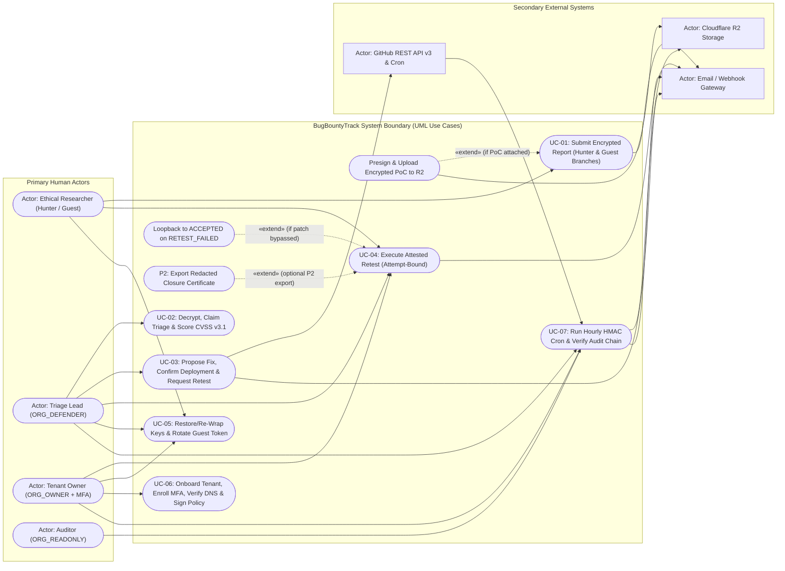
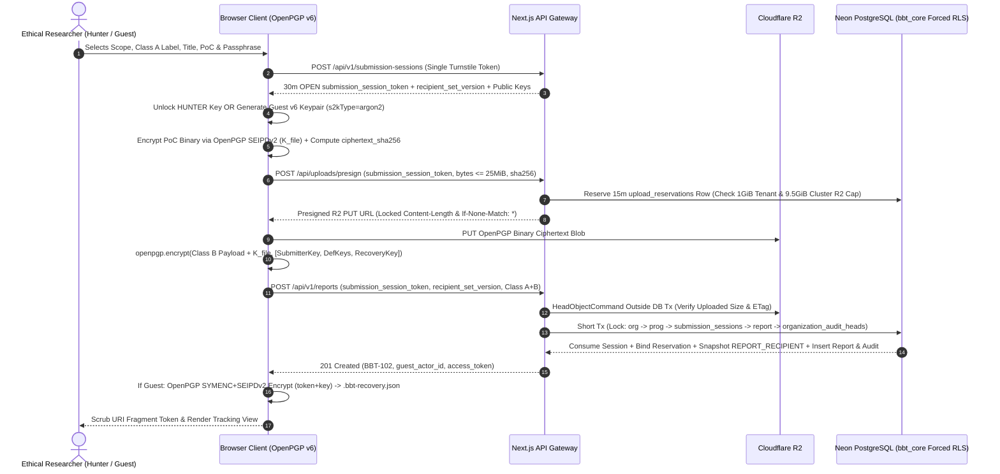
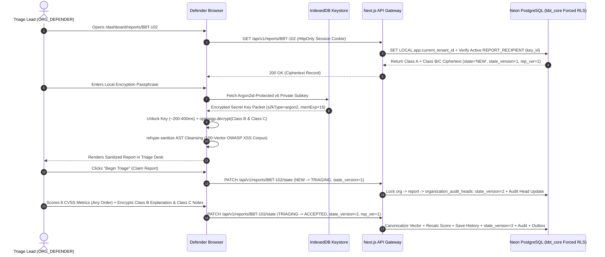
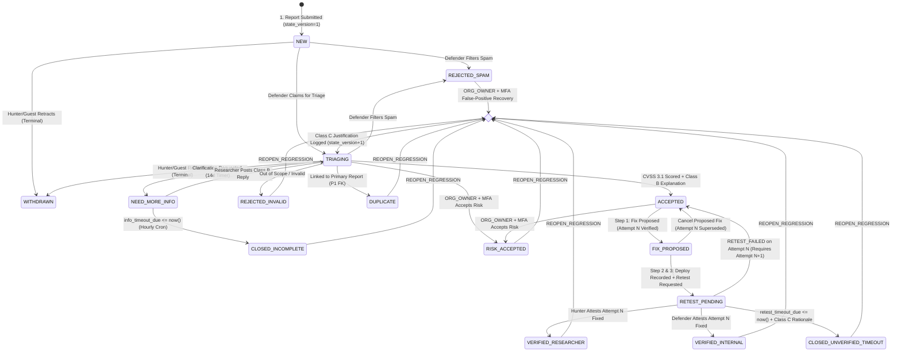

# Punjab Tianjin University of Technology
### Department of Software Engineering Technology
## FINAL YEAR PROJECT (FYP) ENGINEERING SPECIFICATION
# SOFTWARE REQUIREMENTS SPECIFICATION (SRS)
### Project: BugBountyTrack
**A Multi-Tenant Vulnerability Disclosure Platform with Client-Side Cryptographic Payload Isolation and Evidence-Based Remediation Traceability**

---

| Academic & Engineering Parameter | Specification |
| :--- | :--- |
| **Student Author** | Taha Asadullah |
| **Roll Number / Student ID** | `24-ST-013` |
| **Session** | Session 2024–2028 |
| **Batch / Section** | Batch 24-SET-Fall / Section SET-B |
| **Official Student Email** | `24-st-013@students.ptut.edu.pk` |
| **FYP Project Supervisor** | Sir Umar Hayat |
| **Project Identifier** | `PTUT - PRJ - 089` |
| **Department Sub-Field** | 9. Cybersecurity, Privacy & LegalTech |
| **Milestone** | **Week 2** — Software Requirements Specification (**Gate 1: DoR Part II**) |
| **Specification Structure** | Structured in accordance with IEEE Std 830-1998 & ISO/IEC/IEEE 29148:2018 |
| **Client Platform** | Modern Web (Next.js 14+ App Router, React 18+, TypeScript 5.x, Tailwind CSS, OpenPGP.js v6) |
| **Backend & API Engine** | Unified Next.js Fullstack (Serverless API Routes on Node.js 22 LTS + GitHub Actions Hourly Scheduler) |
| **Database Architecture** | PostgreSQL 16 (Neon Serverless Cloud) / Prisma ORM 5.x (`FORCE ROW LEVEL SECURITY` & Hash-Chained Audit) |
| **Document Status** | Baseline Revision 2.4 — Submitted for Supervisor Review & Milestone Endorsement |

---

## Supporting Deliverable Documents (Google Drive & Repository Links)

| Deliverable Document | Scope Covered | Cloud & Repository Reference |
| :--- | :--- | :--- |
| **Week 1 Discovery Part A: User Personas & Operational Discovery (`WEEK_1_PART_A_USER_PERSONAS.docx`)** | Executive Discovery Context, Structured Stakeholder Workflow Analysis, 4 Operational Frictions (`FRC-01` to `FRC-04`), and 2 Detailed User Personas (Alex Rivera & Sarah Chen) with Empathy Maps | [View Week 1 User Personas & Discovery Doc (Google Drive)](https://docs.google.com/document/d/1drXMfAk4pIKc_9aMKZav62KfVZQ04--zT6VyuhDZKFA/edit?usp=drive_link) |
| **Week 1 Discovery Part B: Project Charter, Problem Statement & 5 Core MVP Features (`WEEK_1_PART_B_CHARTER_AND_MVP.docx`)** | Project Charter, Scope Boundaries, Finalized 1-Paragraph Problem Statement, and 5 Core MVP Features | [View Week 1 Project Charter & MVP Doc (Google Drive)](https://docs.google.com/document/d/1-N7Pv-3CO95XNWcvjSga6vf0vDKOvFKdPQ5l6uGpQJY/edit?usp=drive_link) |
| **Week 2 Formal IEEE 830 Software Requirements Specification (`SRS.docx`)** | Complete IEEE 830 SRS (`Revision 2.4`), Field-Level Classification (`Table 2.1`), Permission Matrix (`Table 2.2`), Functional Requirements (`FR-1` to `FR-8`), Use Cases (`UC-01` to `UC-07`), 4 UML Behavioral Diagrams, Reproducible NFRs (`NFR-01` to `NFR-09`), and Full Subrequirement RTM | Word Deliverable: `requirements/SRS.docx` (Compiled in `Times New Roman`, `#000000` black text) |

---

## Table of Contents

1. Introduction
   - 1.1 Purpose & Target Scope
   - 1.2 Document Conventions, Priority Schema & Typography Boundary
   - 1.3 Intended Audience & Stakeholder Matrix
   - 1.4 Finalized One-Paragraph Problem Statement & Discovery Evidence Summary
   - 1.5 The 5 Mandatory Core MVP Features (`P1`) vs. Optional Secondary Extensions (`P2`)
2. Overall Description, Cryptographic Boundary & Permission Model
   - 2.1 System Context & Logical Boundaries
   - 2.2 Defensible Protection Boundary, Cryptographic Pinning & Explicit Limitations
   - 2.3 Field-Level Cryptographic, Visibility & Export Classification Matrix (Table 2.1)
   - 2.4 Detailed User Personas, Role Model & Authoritative Permission Matrix (Table 2.2)
   - 2.5 Operating Environment & Technical Bounds
   - 2.6 Hourly Cron Authentication, Physical vs. Logical Database Capacity & Cluster R2 Quotas
3. Specific Functional Requirements (FR)
   - 3.1 Multi-Tenant Workspaces, Onboarding, Guest Intake & Access Governance (`FR-1.1` – `FR-1.6`)
   - 3.2 RFC 9116 Policy Discovery & Safe Harbor Engine (`FR-2.1` – `FR-2.5` — MVP Feature 1)
   - 3.3 Client-Side OpenPGP v6 Pipeline & Key Lifecycle Management (`FR-3.1` – `FR-3.8` — MVP Feature 2)
   - 3.4 Deterministic CVSS 3.1 Base Scoring Engine (`FR-4.1` – `FR-4.4` — MVP Feature 3)
   - 3.5 Confidential Triage, Dual-Lane Threading & SLA Timers (`FR-5.1` – `FR-5.5` — MVP Feature 4)
   - 3.6 Git-Linked & Configuration-Snapshot Remediation Verification (`FR-6.1` – `FR-6.4` — MVP Feature 5)
   - 3.7 15-State Lifecycle FSM, Attested Retest & Redacted Closure Exports (`FR-7.1` – `FR-7.7` — MVP Feature 5)
   - 3.8 Application Hardening, Forced RLS, Upload Reservations & Hash-Chained Audit Ledger (`FR-8.1` – `FR-8.5` — MVP Features 4 & 5)
4. System Modeling & UML Behavioral Specifications
   - 4.1 Formal Textual Use Case Specifications (`UC-01` to `UC-07`)
   - 4.2 System Use Case Diagram (Figure 4.1)
   - 4.3 Sequence Diagram: Browser-Side OpenPGP Submission & Presigned Upload (Figure 4.2)
   - 4.4 Sequence Diagram: In-Browser Decryption, Triage & CVSS Assessment (Figure 4.3)
   - 4.5 State Machine Diagram: 15-State Remediation & Attested Retest Lifecycle (Figure 4.4)
5. External Interface Requirements
   - 5.1 Complete User Interfaces & Screen Catalog (`SCR-01` to `SCR-12`)
   - 5.2 Software & External API Interfaces
6. Quantifiable Non-Functional Requirements (Latency, Security & Uptime)
7. Verification, Acceptance Criteria & Complete Bidirectional Traceability
   - 7.1 Complete Subrequirement & NFR Bidirectional Traceability Matrix (RTM)
   - 7.2 Verification Test Pyramid & Acceptance Criteria
   - 7.3 Deterministic Operational Scenario Walkthrough Matrix (8 Edge-Case Scenarios)
8. Document Submission & Milestone Sign-Off

---

## 1. Introduction

### 1.1 Purpose & Target Scope

This Software Requirements Specification (SRS) defines the consolidated engineering requirements baseline (`Revision 2.4`) for **BugBountyTrack** (`PTUT - PRJ - 089`). It specifies the functional workflows, field-level cryptographic boundaries, authoritative permission matrix, separated researcher and defender key recovery protocols, deterministic severity scoring mathematics, 15-state vulnerability lifecycle finite state machine (FSM), formal Use Case specifications, and quantifiable non-functional acceptance targets (latency, security, and uptime) for our Final Year Project prototype, structured in accordance with **IEEE Std 830-1998** and **ISO/IEC/IEEE 29148:2018**.

### 1.2 Document Conventions, Priority Schema & Typography Boundary

* **Requirement & Priority Conventions**: Every requirement and atomic subrequirement in this specification has a unique, testable identifier (`FR-X.Y`, `FR-X.Ya`, `NFR-XX`, `UC-XX`) and is assigned a build-consistent priority so that **no P1 requirement or main use-case success scenario ever depends on a P2 component**:
  * **P1 (Mandatory Core Release)**: All capabilities required for the end-to-end buildable prototype—including multi-tenant isolation, authentication with mandatory `ORG_OWNER` TOTP MFA, guided onboarding, DNS TXT verification, public program intake (`FR-1.5a`), RFC 9116 policy signing, client-side OpenPGP v6 encryption, separated personal/guest/master key recovery, CVSS v3.1 calculation, dual-lane triage, core duplicate report binding (`FR-5.5a`), Git commit and encrypted configuration snapshot verification, the 15-state attested retest workflow, hourly scheduled SLA/timeout evaluation, atomic submission-session and quota reservation enforcement, and the hash-chained audit ledger.
  * **P2 (Optional Secondary Enhancements)**: Strictly optional post-core extensions that never block any P1 state transition or main use-case flow:
    1. `FR-1.5b`: Tokenized private invitation-only program access (`token_hash`).
    2. `FR-5.5b`: Fuzzy candidate filter UI helper when selecting a duplicate parent report.
    3. `FR-7.7`: Formatted PDF and JSON Redacted Closure Evidence Export generation (modeled as an optional post-closure extension `3a` in `UC-04`).
* **Unit Conventions (`MiB` / `GiB` Binary Units)**: All storage and memory limits in this specification use explicit binary units (`1 KiB = 1,024 bytes`, `1 MiB = 1,048,576 bytes`, `1 GiB = 1,073,741,824 bytes`) paired with exact byte counts (alongside legacy `MB`/`GB` notation where referenced by cloud provider tier names) to eliminate decimal-vs-binary ambiguity.
* **Source Markdown vs. Compiled Word Typography Note**: Because plain-text Markdown (`.md`) cannot enforce physical page margins, font binaries, or print pagination, final academic typography—**`Times New Roman` font family, pure black (`#000000`) text color across all body paragraphs, headings, tables, headers, and footers, 1-inch page margins, 1.15 line spacing, and native-aspect-ratio (`noChangeAspect="1"`) embedded UML diagrams**—is applied and verified at the OpenXML level in the companion Word deliverable (`requirements/SRS.docx` and `Resources/SRS.docx`) prepared for university submission.

### 1.3 Intended Audience & Stakeholder Matrix

| Stakeholder Role | Interaction with Specification | Primary Concerns |
| :--- | :--- | :--- |
| **Taha Asadullah (Student Author)** | Implementation lead; constructs and tests the system against this specification. | Unambiguous state transitions, lock ordering, permission checks, replay prevention, and verifiable test criteria. |
| **Sir Umar Hayat (Academic Supervisor)** | Academic evaluator; audits requirements consistency, state machine completeness, and empirical verification evidence. | Elimination of cross-section contradictions, realistic security claims, complete traceability, and defense readiness. |
| **Software Engineering Peers** | Participants in controlled usability and security evaluation (3–5 peers). | Ergonomics of encrypted report submission, key recovery, triage decryption, and retest attestation. |

### 1.4 Finalized One-Paragraph Problem Statement & Discovery Evidence Summary

#### 1.4.1 Finalized One-Paragraph Academic Problem Statement

> **While established vulnerability platforms and source-code hosts offer free entry tiers (such as HackerOne Essential VDP or GitHub Security Advisories), they operate on a server-managed model where sensitive exploit payloads are stored in plaintext on third-party vendor infrastructure, or are locked to single-forge repository ecosystems. Small and medium software engineering teams (5–50 developers) unwilling to delegate plaintext zero-day access to external vendors typically fall back to ad-hoc communication channels (such as generic `security@company.com` email inboxes, shared spreadsheets, or standard issue trackers), exposing exploit reproduction steps across unencrypted mail servers, deterring ethical researchers due to missing RFC 9116 Safe Harbor policies and mandatory account registration friction, and evaluating severity through subjective ad-hoc negotiation. Furthermore, existing issue trackers and entry-level VDP tiers treat vulnerability resolution as an informal text status toggle ('Closed' or 'Resolved'), creating a 'fix-and-forget' verification gap where patches are deployed without verifiable Git commit linkage or attested researcher retesting. BugBountyTrack resolves these gaps by delivering a lightweight, multi-tenant Vulnerability Disclosure Platform (VDP) that automates browser-signed RFC 9116 `security.txt` policy generation, enforces client-side OpenPGP v6 (`Curve25519`) exploit payload encryption so the platform server stores ciphertext only, provides deterministic FIRST.org CVSS v3.1 scoring with researcher-visible explanations, and governs remediation through an evidence-based, Git-linked retest state machine.**

#### 1.4.2 Summary of Week 1 Discovery Evidence & Epistemic Transparency

In accordance with our Week 1 Discovery Baseline (`WEEK_1_DISCOVERY_REPORT.md` and `WEEK_1_PART_A_USER_PERSONAS.md`), requirements elicitation combined **structured stakeholder workflow analysis** of our two primary actor archetypes (independent student/freelance security researchers and 5–50 person startup engineering leads) with **secondary empirical industry research** across ISO/IEC 29147, ISO/IEC 30111, RFC 9116, FIRST.org CVSS v3.1, and published vulnerability disclosure case studies. **Honest Epistemic Labeling**: Where quantitative thresholds (such as the 14-day inactivity timeout or `20 MiB` tenant intake quota) represent engineering design assumptions rather than primary survey statistics, they are explicitly labeled in this SRS as **provisional engineering baseline targets** to be validated during our Phase 4 usability and integration evaluation (`NFR-01` through `NFR-09`).

The discovery phase identified four concrete operational frictions (`FRC-01` through `FRC-04`):
1. **`FRC-01` (Third-Party Plaintext Exposure)**: Server-managed VDP tiers store raw exploit write-ups and PoC scripts in server-readable plaintext on vendor databases, creating a high-value breach target.
2. **`FRC-02` (Insecure Ad-Hoc Email Channels)**: Generic `security@` inboxes transmit and store unpatched SQLi/RCE/IDOR payloads in unencrypted SMTP plaintext across mail relays and shared mailboxes.
3. **`FRC-03` (Legal Ambiguity, Registration Friction & Subjective Downgrades)**: Missing signed `/.well-known/security.txt` Safe Harbor manifests, mandatory reporter account signups for one-off disclosures, and unexplained severity downgrades chill good-faith reporting.
4. **`FRC-04` (The "Fix-and-Forget" Remediation Verification Gap)**: Developers mark security tickets "Closed" when a pull request merges without verifying that the commit landed on the target branch, confirming deployment to the test environment, or inviting the finder to retest that specific fix attempt.

### 1.5 The 5 Mandatory Core MVP Features (`P1`) vs. Optional Secondary Extensions (`P2`)

To maintain 100% alignment with our Week 1 Discovery Baseline (`WEEK_1_PART_B_CHARTER_AND_MVP.md`), **BugBountyTrack** is structured around **5 Mandatory Core MVP Features (`P1`)**, clearly separated from **3 Optional Secondary Extensions (`P2`)**:

| Core MVP Feature (Consistent with Week 1 Baseline) | Mandatory Core Scope (`P1` — Required for Baseline Completion) | Optional Post-Core Extensions (`P2` — Non-Blocking Enhancements) |
| :--- | :--- | :--- |
| **MVP Feature 1: Hosted RFC 9116 `security.txt` & Scope Policy Generator** (`FR-2.1` – `FR-2.5`) | Automated RFC 9116 manifest generation (`<= 365d` expiry), in-browser Ed25519 cleartext signing, 64-hex fingerprint verification, structured `IN_SCOPE`/`OUT_OF_SCOPE` asset tables, hosted Safe Harbor terms, and DNS TXT (`_bbt-challenge`) verification. | *None (100% P1 Core).* |
| **MVP Feature 2: Client-Side OpenPGP v6 Exploit Payload Encryption & Neutral Labeling** (`FR-3.1` – `FR-3.8`) | Pinned RFC 9580 v6 Curve25519 keygen, explicit Argon2id S2K (`0x04`, `64 MiB`) in `IndexedDB`, multi-recipient PKESK encryption (`recipient_set_version` & `report_recipient_version`), Class B `title_ciphertext` + Class A `operational_label`, OpenPGP binary PoC attachments (`<= 25 MiB`), offline Master Recovery Key, personal key backup (`.bbt-user-keys.json`), and separated researcher vs. defender historical key recovery. | *None (100% P1 Core).* |
| **MVP Feature 3: Deterministic CVSS 3.1 Severity Scoring Engine** (`FR-4.1` – `FR-4.4`) | Pure TypeScript FIRST.org CVSS v3.1 Base engine (`8.22` coefficient, integer-scaled `RoundUp`), order-insensitive Base vector parser & canonical serializer, authoritative server recalculation, mandatory Class B researcher-visible explanation (`cvss_explanation_ciphertext`), optional Class C internal notes, and `CVSS_ASSESSMENT_HISTORY`. | *None (100% P1 Core).* |
| **MVP Feature 4: Dual-Lane Intake (Account-Less Guest & Authenticated Hunter) & Encrypted Triage Portal** (`FR-1.1` – `FR-1.6`, `FR-5.1` – `FR-5.5`, `FR-8.1` – `FR-8.4`) | Multi-tenant workspaces (`FORCE ROW LEVEL SECURITY`), mandatory `ORG_OWNER` TOTP MFA, public program intake (`FR-1.5a`), Account-Less Guest intake with OpenPGP `.bbt-recovery.json` & replay-safe `X-Guest-Signature` (`FR-1.6`), Dual-Lane encrypted threading (`RESEARCHER_ORG` vs. `REVIEWER_INTERNAL`), Class A notifications, hourly SLA/timeout cron, core duplicate FK binding (`FR-5.5a`), `rehype-sanitize` XSS protection, and bounded tenant/cluster quotas. | **`FR-1.5b` [P2]**: Tokenized private program invitations (`token_hash`). **`FR-5.5b` [P2]**: Candidate duplicate filter UI helper in triage desk. |
| **MVP Feature 5: Git-Linked Remediation & Retest Verification State Machine** (`FR-6.1` – `FR-6.4`, `FR-7.1` – `FR-7.6`, `FR-8.5`) | 3-step fix-to-retest workflow (`ACCEPTED -> FIX_PROPOSED -> RETEST_PENDING`), GitHub REST API v3 commit/branch ancestry verification (`ahead`/`identical`), encrypted config snapshot + SHA-256 `config_hash`, deterministic 15-state FSM with `state_version` concurrency, attempt-bound closures (`VERIFIED_RESEARCHER`, `VERIFIED_INTERNAL`, `CLOSED_UNVERIFIED_TIMEOUT`, `RETEST_FAILED` loopback), `organization_audit_heads` locking, and dual-hash `audit_events` ledger (`FR-8.5`). | **`FR-7.7` [P2]**: Export-Allowlisted PDF/JSON Redacted Closure Evidence Export (`bbt-closure-export-v1`) as an optional post-closure extension. |

---

## 2. Overall Description, Cryptographic Boundary & Permission Model

### 2.1 System Context & Logical Boundaries

BugBountyTrack is organized into three logical tiers (detailed 3-Tier Architecture and Level 0 / Level 1 Data Flow Diagrams are specified in the Week 3 Architecture Deliverable):
1. **Client Browser Runtime**: Next.js 14+ App Router, React 18+, Tailwind CSS, `OpenPGP.js v6` client-side encryption, decryption, session-key wrapping, and detached signing, `rehype-sanitize` Markdown AST sanitizer, and WebCrypto API (`crypto.subtle.digest` for SHA-256 hashing).
2. **Application API Gateway & Scheduled Worker**: Next.js Route Handlers running on Node.js 22 LTS, enforcing the Authoritative Permission Matrix (`Table 2.2`), database-persisted sessions, optimistic concurrency checks (`recipient_set_version`, `report_recipient_version`, and `state_version`), atomic single-use submission sessions, upload quota reservations, GitHub REST API v3 commit/branch comparisons, and an hourly lifecycle/cleanup cron endpoint triggered by an authenticated GitHub Actions scheduled workflow.
3. **Persistence & Object Storage Layer**: Neon Serverless PostgreSQL 16 (isolated inside schema `bbt_core`, enforcing `FORCE ROW LEVEL SECURITY` under non-superuser runtime role `bbt_app_runtime`, hardened `SECURITY DEFINER` entrypoints under `bbt_fn_owner`, `organization_audit_heads` serialization, and an append-only hash-chained `audit_events` ledger) and Cloudflare R2 (storing client-encrypted OpenPGP binary PoC attachments within a hard cluster-wide `9.5 GiB` cap).

### 2.2 Defensible Protection Boundary, Cryptographic Pinning & Explicit Limitations

Rather than claiming blanket "zero-knowledge" across the entire application, BugBountyTrack defines an explicit **Client-Side End-to-End Encrypted (E2EE) Payload Isolation Boundary**:

* **What Is Cryptographically Isolated from the Server**: All sensitive vulnerability text and files (classified as **Class B** and **Class C** in Table 2.1—including report titles, vulnerability descriptions, reproduction steps, PoC attachments, discussion messages, internal reviewer notes, researcher-visible CVSS explanations, internal CVSS notes, rejection explanations, risk-acceptance rationales, remediation summaries, configuration snapshots, retest notes, and administrative audit justifications) are encrypted in the client browser using OpenPGP v6 packets before network transmission. The backend server, PostgreSQL database, and Cloudflare R2 store ciphertext only.
* **What the Server Intentionally Knows (Class A Operational Metadata)**: To route reports, enforce tenant and cluster quotas, calculate SLA deadlines, verify Git commits, and maintain a deterministic state machine, the server stores and processes plaintext operational metadata: organization/program identifiers, actor IDs, timestamps, workflow state (`state`, `state_version`), a coarse 8-value category enum (`operational_label`), target asset identifier (`asset_scope`), CVSS v3.1 vector string and numeric score (`cvss_vector`, `cvss_score`), remediation reference metadata (`commit_sha`, `branch_name`, `config_hash`, `deployment_env`), and cryptographic hashes. Because Class A fields such as `asset_scope`, `branch_name`, and `hunter_id` can still be operationally sensitive outside the tenant, external exports are further restricted by the strict **External Export Allowlist** in Table 2.1 and `FR-7.7`.
* **Standardized `OpenPGP.js v6` Configuration & Native Formats (`s2kType = argon2`)**:
  * All keys and encrypted containers are standardized on **RFC 9580 OpenPGP Version 6 Curve25519 (`Ed25519` primary signing key + `X25519` encryption subkey)** with **64-character hexadecimal SHA-256 fingerprints**, avoiding custom cryptographic envelopes.
  * Because `OpenPGP.js v6` only applies `s2kArgon2Params` when Argon2 is explicitly selected as the S2K type, the client cryptographic module explicitly configures:
    1. `openpgp.config.v6Keys = true` (RFC 9580 v6 key packets and SEIPDv2 AEAD encrypted data packets)
    2. **`openpgp.config.s2kType = openpgp.enums.s2k.argon2`** (explicitly selecting RFC 9580 Argon2id String-to-Key specifier `0x04`)
    3. `openpgp.config.s2kArgon2Params = { passes: 3, parallelism: 4, memoryExponent: 16 }` (`2^16 KiB = 65,536 KiB = 64 MiB` RAM)
    4. `openpgp.config.aeadProtect = true` (authenticated encryption for secret keys and symmetric messages)
* **Key-Versioned Report Recipients (`REPORT_RECIPIENT` & `report_recipient_version`)**:
  * At initial report submission, the server snapshots the program's active `PROGRAM_DEFENDER` key records (`user_id`, `key_id`, `key_fingerprint`) into `REPORT_RECIPIENT` for that report, records the submitter's active key reference (`submitter_key_id` for `HUNTER` or `guest_public_key` for `GUEST`), and initializes `REPORT.report_recipient_version = 1`.
  * Every subsequent encrypted write on that report (comments, internal notes, CVSS explanations/notes, remediation notes, configuration snapshots, retest evidence, or follow-up attachments) must generate a **fresh random 256-bit OpenPGP session key**, encrypt strictly for the authoritative recipient set of its data class (Class B: Active `REPORT_RECIPIENT` keys + `PROGRAM.recovery_public_key` + Submitter Active Key; Class C: Active `REPORT_RECIPIENT` keys + `PROGRAM.recovery_public_key`), and submit `report_recipient_version`.
  * Whenever a defender is removed from a program, removed from an organization, or has a key revoked—or whenever a registered researcher replaces their `submitter_key_id`—the server atomically increments `REPORT.report_recipient_version` on every affected report, rejecting any in-flight write encrypted to a stale recipient list with HTTP `409 Conflict`.
* **Explicit Cryptographic & Runtime Limitations**:
  1. *Browser Code & Key-Distribution Trust*: Within the web security model, the client browser trusts the application bundle delivered over HTTPS (hardened with Subresource Integrity and strict Content Security Policy) and the server's public-key directory endpoint. To detect silent public-key substitution by a compromised server, researchers can cross-verify the organization's 64-character public key fingerprint against the cleartext-signed `https://[org-domain]/.well-known/security.txt` hosted on the organization's own domain (`FR-2.3`).
  2. *Prior-Access Revocation Limitation*: Deactivating a defender in `PROGRAM_DEFENDER` and `REPORT_RECIPIENT` immediately blocks their API access and excludes their key from future encrypted objects, but **cannot retroactively erase ciphertext or decrypted keys that the defender downloaded to their local machine prior to revocation**.
  3. *JavaScript Memory Hygiene Limitation*: On logout or key lock, the client explicitly overwrites owned `Uint8Array` buffers (`fill(0)`), deletes ephemeral keys from `IndexedDB` when requested, and nullifies references (`nullified`). Because JavaScript strings are immutable and garbage-collected asynchronously, this is a **best-effort defense-in-depth measure** and cannot guarantee physical RAM page zeroization against local OS memory dumps.

### 2.3 Field-Level Cryptographic, Visibility & Export Classification Matrix (Table 2.1)

Every domain field is assigned to one of three classifications governing storage, logging, notifications, API responses, and external exports:

| Data Class | Cryptographic Envelope & Authoritative Recipients | Exact Fields Included | Storage, Notification & External Export Allowlist Contract (`FR-7.7`, `FR-8.5c`) |
| :--- | :--- | :--- | :--- |
| **Class A: Plaintext Operational Metadata** | Stored in plaintext in PostgreSQL (protected by `FORCE ROW LEVEL SECURITY` and TLS 1.3). | `organization_id`, `program_id`, `report_id`, `hunter_id`, `guest_actor_id`, `submitter_key_id`, `state`, `state_version`, `report_recipient_version`, `operational_label` (8-value enum), `asset_scope`, `cvss_vector`, `cvss_suggested`, `cvss_score`, `rejection_code` (`OUT_OF_SCOPE`, `NON_REPRODUCIBLE`, `SPAM`), `remediation_attempt_no`, `evidence_type`, `commit_sha`, `branch_name`, `verified_branch_head_sha`, `github_signature_verified`, `config_hash`, `deployment_env`, `deployed_version`, `timestamps`, `tenant_seq_no`, `report_seq_no`, `event_digest`, `report_chain_hash`, `tenant_row_hash`. | **Notifications (`FR-5.3`)**: Only `report_id`, `operational_label`, `from_state -> to_state`, `timestamp`, and signed checkpoint receipt. **External Export Allowlist (`FR-7.7`)**: Exports a self-contained `bbt-closure-export-v1` document containing `report_id`, `organization_slug`, `program_slug`, `operational_label`, `cvss_vector`, `cvss_score`, state transition timestamps, `remediation_attempt_no`, `evidence_type`, `config_hash`, `deployment_env`, `deployed_version`, `terminal_state`, and the complete sequence of export-safe `report_chain_hash` inputs (`report_seq_no = 1..K`: `actor_role_category`, `actor_commitment`, `asset_scope_commitment`, `evidence_commitment`, `justification_seipdv2_sha256`) + Ed25519 export & checkpoint signatures. Internal `organization_id`, `hunter_id`, `guest_actor_id`, and `r2_object_key` are never exported; `asset_scope` and `commit_sha`/`branch_name` support redaction via salted commitments (`FR-7.7`). |
| **Class B: Encrypted Shared Content (`RESEARCHER_ORG`)** | OpenPGP v6 SEIPDv2 AEAD ciphertext (`PKESK` + `SEIPDv2` packets) with a **fresh random 256-bit session key per write**, encrypted for: **Submitter Active Key (`submitter_key_id` or `guest_public_key`)** + **Active `REPORT_RECIPIENT` Keys (`key_id`)** + **`recovery_public_key`**. | `title_ciphertext`, `description_ciphertext`, `reproduction_steps_ciphertext`, `impact_ciphertext`, **OpenPGP binary PoC attachments in R2 (`encrypted_file_key_packet` wrapping `K_file`)**, `RESEARCHER_ORG` discussion messages (`encrypted_body`), **Researcher-Visible CVSS Explanation (`cvss_explanation_ciphertext` on `REPORT` and `CVSS_ASSESSMENT_HISTORY`)**, **Rejection Reason Details (`rejection_reason_ciphertext`)**, **Remediation Summary & Retest Instructions (`remediation_notes_ciphertext`)**, **Encrypted Configuration Snapshot (`config_artifact_ciphertext`, `<= 256 KiB`)**, and **Retest Verification Logs (`verification_notes_ciphertext`)**. | Persisted as **ciphertext only** (`envelope_version`, `seipdv2_body_sha256`, `full_message_sha256`). Never written to server logs, telemetry, or email notifications. Excluded from Redacted Closure Evidence Exports (only `seipdv2_body_sha256` digests appear in audit commitments). |
| **Class C: Encrypted Internal Content (`REVIEWER_INTERNAL`)** | OpenPGP v6 SEIPDv2 AEAD ciphertext (`PKESK` + `SEIPDv2` packets) with a **fresh random 256-bit session key per write**, encrypted strictly for: **Active `REPORT_RECIPIENT` Keys (`key_id`)** + **`recovery_public_key`** (**Submitter Key Strictly Excluded**). | Reviewer internal discussion messages (`REVIEWER_INTERNAL` lane), **Internal CVSS Notes (`cvss_internal_notes_ciphertext` on `REPORT` and `CVSS_ASSESSMENT_HISTORY`)**, **Executive Risk-Acceptance Rationale (`risk_rationale_ciphertext`)**, and **Administrative Timeout / Reopen / Cancel Justifications (`audit_justification_ciphertext`)**. | Persisted as **ciphertext only** and stripped at the SQL/API projection layer before serving report records to `HUNTER`, `GUEST`, or `ORG_READONLY` sessions. Never included in notifications, Researcher Key Re-Wraps (`FR-3.8b`), or external exports. |

### 2.4 Detailed User Personas, Role Model & Authoritative Permission Matrix (Table 2.2)

#### 2.4.1 Detailed Target User Personas (Synchronized with Week 1 Discovery Baseline)

##### Persona 1: Alex Rivera — "The Hunter" (External Ethical Security Researcher, `HUNTER` or `GUEST`)
* **Demographic & Technical Profile**: 23-year-old independent security researcher and final-year undergraduate cybersecurity student (2 years part-time bug bounty hunting; Top 5% university CTF competitor). Operates on Kali Linux and macOS using Firefox Developer Edition, Burp Suite Professional, `ffuf`, `nuclei`, `curl`, Python, and GnuPG CLI.
* **Current Workflow & Discovery Evidence (`FRC-01`, `FRC-02`, `FRC-03`, `FRC-04`)**: Checks `https://[target]/.well-known/security.txt` before testing; captures HTTP exploit reproduction steps and PoC scripts in Burp Suite; attempts to disclose findings to small SaaS teams. Currently forced to choose between emailing raw zero-day exploits in plaintext to `security@target.com` (`FRC-02`), creating mandatory accounts on vendor-managed portals that store exploits in server-readable plaintext (`FRC-01`, `FRC-03`), or abandoning disclosure due to missing Safe Harbor terms (`FRC-03`).
* **Core Goals**:
  1. Disclose vulnerabilities rapidly and confidentially—either via an authenticated `HUNTER` account (for portfolio credit) or a 60-second account-less `GUEST` submission without server-readable plaintext exposure.
  2. Verify machine-readable, cryptographically signed RFC 9116 Safe Harbor authorization before testing.
  3. Receive deterministic FIRST.org CVSS v3.1 severity evaluations with a transparent, researcher-visible explanation whenever their suggested vector (`cvss_suggested`) is adjusted.
  4. Re-verify deployed fixes tied to a specific remediation attempt (`remediation_attempt_no`) and earn verified attribution (`VERIFIED_RESEARCHER`).
* **Specific Pain Points & Constraints**:
  1. *The Black Hole ("Ghosting")*: Sending detailed reports to `security@` inboxes with zero acknowledgement or status visibility.
  2. *Plaintext Leakage Refusal*: Will not upload live zero-day PoCs in plaintext to third-party servers or unencrypted email relays.
  3. *Unexplained Severity Downgrades*: Having critical findings downgraded to "Low" without a metric-by-metric CVSS v3.1 explanation.
  4. *Superficial Unverified Fixes*: Seeing tickets marked "Closed" after an incomplete patch without being invited to retest.

##### Persona 2: Sarah Chen — "The Defender" (Startup CTO & Security Triage Lead, `ORG_OWNER` / `ORG_DEFENDER`)
* **Demographic & Technical Profile**: 31-year-old Co-Founder, CTO, and Lead Full-Stack Engineer managing vulnerability triage and remediation across a **7-developer B2B FinTech SaaS startup engineering team (7 developers)** (8 years production full-stack experience). Operates on macOS using VS Code, TypeScript, Next.js App Router, GitHub, Vercel, Neon PostgreSQL, Cloudflare R2, and Linear.
* **Current Workflow & Discovery Evidence (`FRC-01`, `FRC-02`, `FRC-03`, `FRC-04`)**: Reviews GitHub pull requests, coordinates production deployments, and responds to enterprise customer security questionnaires. Currently monitors a shared `security@` inbox flooded with automated scanner noise while worrying that storing real zero-day reports in plaintext on external VDP vendor databases or internal issue trackers creates a single point of breach (`FRC-01`, `FRC-02`). Furthermore, manually managing CLI GnuPG keyrings across 7 developers is operationally brittle, and standard issue trackers allow developers to close security tickets without proving which Git commit fixed the bug or whether it passed retesting (`FRC-04`).
* **Core Goals**:
  1. Receive vulnerability reports encrypted client-side in the browser so only designated program defenders (`PROGRAM_DEFENDER` / `REPORT_RECIPIENT`) can decrypt Class B/C payloads—never the hosting platform.
  2. Separate researcher communication (`RESEARCHER_ORG`, Class B) from internal engineering notes (`REVIEWER_INTERNAL`, Class C) while maintaining an offline **Organization Master Recovery Key** (`recovery_public_key`) in case developers lose browser storage or leave the team.
  3. Enforce a three-step remediation workflow (`ACCEPTED -> FIX_PROPOSED -> RETEST_PENDING`) that verifies GitHub commit ancestry (`BASE...HEAD`) or encrypted configuration snapshots before inviting the researcher to retest.
  4. Optionally export allowlisted, verifiable closure certificates (`FR-7.7`) for enterprise security audits without exposing exploit payloads or internal developer identities.
* **Specific Pain Points & Constraints**:
  1. *Scanner Spam Fatigue*: Wasting engineering cycles filtering low-effort scanner noise in shared email inboxes.
  2. *CLI PGP Keyring Friction*: Cannot require 7 product engineers to manage command-line GPG keys and manual re-encryption when team membership changes.
  3. *Budget & Infrastructure Ceiling*: Needs an architecture that runs reliably within free/low-cost serverless and database resource bounds (`512 MiB` PostgreSQL, `10 GB` R2).

#### 2.4.2 Multi-Organization Account Model & Specialized Roles
1. **Multi-Organization & Dual-Hat Account Model**: A registered `USER` account is global and may hold `USER_MEMBERSHIP` records (`ORG_OWNER`, `ORG_DEFENDER`, or `ORG_READONLY`) across multiple organizations while also acting as an external `HUNTER` on other organizations' programs (blocked by a conflict-of-interest check from submitting as an external `HUNTER` to any organization where the user holds an active `USER_MEMBERSHIP`).
2. **Organization Owner (`ORG_OWNER`) — Normal Mode vs. Audited MFA Recovery Mode**: Manages workspace onboarding, DNS TXT verification, `USER_MEMBERSHIP` and `PROGRAM_DEFENDER` rosters, `security.txt` cleartext signing, `RISK_ACCEPTED` approvals, and `REJECTED_SPAM` false-positive recovery. **Mandatory TOTP MFA**: `ORG_OWNER` must enroll TOTP MFA during onboarding (`UC-06`) before activating a program. In normal mode, `ORG_OWNER` views Class A metadata only unless also assigned in `REPORT_RECIPIENT`. In emergency recovery mode (`POST /api/v1/reports/{id}/recovery-fetch`), an MFA-verified `ORG_OWNER` may retrieve report ciphertexts only after the server atomically logs `MASTER_RECOVERY_FETCH_INITIATED` in `audit_events`.
3. **Read-Only Stakeholder / Auditor (`ORG_READONLY`)**: Inspects Class A operational metadata, SLA compliance, and the hash-chained `audit_events` ledger (`0` access to Class B or Class C ciphertexts).

#### Table 2.2: Authoritative Actor × Operation × Resource Permission Matrix

| Operation / Endpoint | Submitting `HUNTER` (`report.hunter_id == user.id`) | Submitting `GUEST` (`guest_token_hash`) | Assigned `ORG_DEFENDER` (Active in `REPORT_RECIPIENT`) | Unassigned `ORG_DEFENDER` (In Org, NOT in `REPORT_RECIPIENT`) | `ORG_OWNER` (Normal Mode) | `ORG_OWNER` (MFA Step-Up Mode) | `ORG_READONLY` (Auditor) | Scheduled Cron (`X-Cron-Signature`) |
| :--- | :---: | :---: | :---: | :---: | :---: | :---: | :---: | :---: |
| **Submit Report (`UC-01`)** | Permitted (Non-Member Org) | Permitted (`submission_session`) | Denied (CoI Rule) | Denied (CoI Rule) | Denied (CoI Rule) | Denied (CoI Rule) | Denied (CoI Rule) | Denied |
| **Read Class A Report Queue / Metadata** | Own Reports Only | Own Report Only | Permitted (Org Scope) | Permitted (Org Scope) | Permitted (Org Scope) | Permitted (Org Scope) | Permitted (Org Scope) | Overdue Deadlines Only (`bbt_fn_owner`) |
| **Fetch Class B Ciphertext & Attachments** | Own Reports Only | Own Report Only (Bearer Token) | Permitted (`REPORT_RECIPIENT`) | **Denied (`403`)** | **Denied (`403`)** (Unless in `REPORT_RECIPIENT`) | Permitted via `recovery-fetch` (Logs Audit Event) | **Denied (`403`)** | **Denied** |
| **Fetch Class C Internal Ciphertext** | **Denied (Stripped)** | **Denied (Stripped)** | Permitted (`REPORT_RECIPIENT`) | **Denied (`403`)** | **Denied (`403`)** (Unless in `REPORT_RECIPIENT`) | Permitted via `recovery-fetch` (Logs Audit Event) | **Denied (Stripped)** | **Denied** |
| **Post `RESEARCHER_ORG` (Class B) Message** | Own Reports (`report_recipient_version`) | Own Report + OpenPGP Signature (`X-Guest-Signature`) | Permitted (`REPORT_RECIPIENT` + `report_recipient_version`) | **Denied (`403`)** | **Denied (`403`)** | Permitted if in `REPORT_RECIPIENT` | **Denied (`403`)** | **Denied** |
| **Post `REVIEWER_INTERNAL` (Class C) Note** | **Denied (`403`)** | **Denied (`403`)** | Permitted (`REPORT_RECIPIENT` + `report_recipient_version`) | **Denied (`403`)** | **Denied (`403`)** | Permitted if in `REPORT_RECIPIENT` | **Denied (`403`)** | **Denied** |
| **Withdraw Report (`NEW`/`TRIAGING -> WITHDRAWN`)** | Own Reports (`state_version`) | Own Report + `X-Guest-Signature` | **Denied** | **Denied** | **Denied** | **Denied** | **Denied** | **Denied** |
| **Triage, Score CVSS, Propose/Cancel Fix, Confirm Deploy, Request Retest** | **Denied** | **Denied** | Permitted (`REPORT_RECIPIENT` + `state_version`) | **Denied (`403`)** | **Denied (`403`)** (Unless in `REPORT_RECIPIENT`) | Permitted if in `REPORT_RECIPIENT` | **Denied (`403`)** | **Denied** |
| **Submit `VERIFIED_RESEARCHER` / `RETEST_FAILED`** | Own Reports (`remediation_record_id`) | Own Report + `X-Guest-Signature` (`remediation_record_id`) | `RETEST_FAILED` Only | **Denied** | **Denied** | **Denied** | **Denied** | **Denied** |
| **Submit `VERIFIED_INTERNAL` / `CLOSED_UNVERIFIED_TIMEOUT`** | **Denied** | **Denied** | Permitted (`REPORT_RECIPIENT` + `state_version`) | **Denied (`403`)** | **Denied (`403`)** | Permitted if in `REPORT_RECIPIENT` | **Denied (`403`)** | **Denied** |
| **Approve `RISK_ACCEPTED` or Recover `REJECTED_SPAM`** | **Denied** | **Denied** | **Denied (`403`)** | **Denied (`403`)** | **Denied (Requires MFA)** | **Permitted (`ORG_OWNER` + MFA Only)** | **Denied (`403`)** | **Denied** |
| **Manage Members, `PROGRAM_DEFENDER`, GitHub PAT, Rotate Recovery Key** | **Denied** | **Denied** | **Denied (`403`)** | **Denied (`403`)** | **Denied (Requires MFA)** | **Permitted (`ORG_OWNER` + MFA Only)** | **Denied (`403`)** | **Denied** |
| **Grant Defender Historical Access (`CLASS_B_AND_C`)** | **Denied** | **Denied** | Permitted (`REPORT_RECIPIENT`) | **Denied (`403`)** | **Denied (Requires MFA)** | Permitted (With Master Recovery Key) | **Denied (`403`)** | **Denied** |
| **Re-Wrap Researcher Replacement Key (`CLASS_B_ONLY`)** | Request Only (Own `key_id_new`) | **Denied** | Permitted (`REPORT_RECIPIENT`, Class B Only) | **Denied (`403`)** | **Denied (Requires MFA)** | Permitted (With Master Recovery Key, Class B Only) | **Denied (`403`)** | **Denied** |
| **Rotate Guest Token by Signature (`X-Guest-Signature`)** | **Denied** | Permitted (`X-Guest-Signature` Only; No Valid Bearer Required) | **Denied** | **Denied** | **Denied** | **Denied** | **Denied** | **Denied** |
| **Evaluate `NEED_MORE_INFO -> CLOSED_INCOMPLETE` & SLA Alerts** | **Denied** | **Denied** | **Denied** | **Denied** | **Denied** | **Denied** | **Denied** | **Permitted (Cron Only)** |
| **Inspect & Verify `audit_events` Hash Chain** | **Denied** | **Denied** | Permitted (Org Scope) | Permitted (Org Scope) | Permitted (Org Scope) | Permitted (Org Scope) | Permitted (Org Scope) | **Denied** |

### 2.5 Operating Environment & Technical Bounds

* **Client Runtime**: Evergreen desktop and mobile browsers (Chromium >= 120, Firefox >= 120, Safari >= 17.0) supporting WebCrypto API (`crypto.subtle`), WebAssembly (`wasm-unsafe-eval` CSP for OpenPGP.js Argon2id S2K), `FileReader` API, and `IndexedDB`.
* **Server Runtime**: Node.js 22 LTS executing Next.js 14+ App Router serverless handlers (maximum route execution timeout: 15 seconds).
* **Persistence Tier**: PostgreSQL 16 on Neon Serverless Cloud via Prisma ORM 5.x (schema `bbt_core`), paired with Cloudflare R2 S3-compatible object storage for encrypted binary attachments.

### 2.6 Hourly Cron Authentication, Physical vs. Logical Database Capacity & Cluster R2 Quotas

* **Single Authoritative Hourly Cron Authentication Contract (`X-Cron-Timestamp` + `X-Cron-Signature`)**:
  * Because Vercel Hobby limits native `vercel.json` cron expressions to once per day (`0 0 * * *`), the hourly SLA, inactivity timeout, and expired upload reservation job (`0 * * * *`) is triggered by an **external GitHub Actions Scheduled Workflow (`lifecycle-cron.yml`)** sending `POST /api/cron/lifecycle-evaluate`.
  * **Unified Authentication Contract**: Every cron request must include two headers:
    1. `X-Cron-Timestamp`: Current Unix epoch timestamp in seconds (integer string). The server rejects any request where `abs(now_epoch_sec - int(X-Cron-Timestamp)) > 300` (5-minute replay window) with HTTP `401 Unauthorized`.
    2. `X-Cron-Signature`: `sha256=<64-hex-hmac>`, computed as `HMAC_SHA256(CRON_HMAC_SECRET, X-Cron-Timestamp + "." + raw_request_body)` and verified on the server using constant-time `crypto.timingSafeEqual`. (No `Authorization: Bearer` header is used for cron authentication.)
* **Achievable Cluster & Tenant Storage Capacity Rules (`MiB` / `GiB` Binary Accounting)**:
  * To prevent tenant allocations from exceeding physical Free Tier limits across `<= 10` evaluation tenants, the system enforces **both per-tenant and cluster-wide hard caps** backed by exact byte accounting:
  * **1. Cloudflare R2 Object Storage Budget (`10 GB` Physical Tier / `9.5 GiB` [`10,200,547,328 bytes`] Hard Cluster Allocation Limit)**:
    - Each tenant has a per-tenant R2 cap of **`1.0 GiB` (`1,024 MiB` / `1,073,741,824 bytes`)** (with `<= 2.0 GiB` configurable for a single benchmark tenant only if cluster headroom permits), and the singleton table `bbt_core.cluster_storage_state (id = 1, total_r2_allocated_bytes BIGINT)` enforces a **hard cluster-wide R2 allocation ceiling of `9.5 GiB` (`10,200,547,328 bytes`)** covering the sum of all active `RESERVED` (`upload_reservations`) and `BOUND` (`attachments`) objects across all tenants.
    - During `POST /api/uploads/presign`, the server locks the tenant's `organizations` row and `cluster_storage_state (id = 1)` `FOR UPDATE`: if adding `exact_ciphertext_bytes` would exceed either the tenant's `1.0 GiB` R2 quota (`TENANT_R2_QUOTA_EXCEEDED`) or the cluster's `9.5 GiB` R2 ceiling (`CLUSTER_R2_CAPACITY_EXCEEDED`), the presign request is atomically rejected with HTTP `413 Payload Too Large`.
  * **2. Neon PostgreSQL Storage Budget (`512 MiB` [`536,870,912 bytes`] Physical Ceiling)**:
    - **Bucket A — Per-Tenant Logical Intake Pool (`20 MiB` [`20,971,520 bytes`] per tenant; `200 MiB` across 10 tenants)**: Tracks external researcher and intake data (`programs`, `submission_sessions`, `upload_reservations`, `reports` root columns, `attachments` metadata, `discussion_messages` in `RESEARCHER_ORG`, and `retest_evidence` submitted by researchers). Warnings trigger at **`90%` (`18 MiB`)**, and at **`100%` (`20 MiB`)** new report submissions (`POST /api/v1/reports`), new attachment presigns, and new researcher comment intake are rejected with HTTP `413 Payload Too Large: TENANT_INTAKE_QUOTA_EXCEEDED`.
    - **Bucket B — Per-Tenant Security, Triage & Remediation Reserve (`6 MiB` [`6,291,456 bytes`] per tenant; `60 MiB` across 10 tenants)**: Tracks internal defender and security operations (`organization_audit_heads`, `audit_events`, `cvss_assessment_history`, `discussion_messages` in `REVIEWER_INTERNAL`, `remediation_records` [with `config_artifact_ciphertext` capped at **`<= 256 KiB` (`262,144 bytes`)** per record], defender-submitted `retest_evidence`, and `guest_mutation_nonces`).
    - **Bounded Reserve Priority & Exhaustion Rules (Testable Guarantee)**:
      1. *`80%` Reserve Warning (`4.8 MiB` / `5,033,165 bytes`)*: Emits a high-priority dashboard banner and `notification_outbox` alert (`SECURITY_RESERVE_80_PERCENT`).
      2. *`95%` Soft Throttling of Large Reserve Writes (`5.7 MiB` / `5,976,883 bytes`)*: Rejects non-critical large reserve payloads—specifically `CONFIG_INFRASTRUCTURE` `config_artifact_ciphertext` snapshots and `REVIEWER_INTERNAL` notes `> 4 KiB`—with HTTP `413 Payload Too Large: SECURITY_RESERVE_THROTTLED`, strictly reserving the final **`5%` (`300 KiB` / `307,200 bytes`, sufficient for `>= 500` compact state/key/audit records at `<= 600 bytes` each)** for **Priority-0 Critical Security Operations**: (i) defender/key revocation and offboarding (`FR-3.8a`), (ii) guest token rotation (`FR-1.6e`), (iii) lifecycle state closure transitions (`FR-7.1`), and (iv) their mandatory `audit_events` rows.
      3. *`100%` Reserve Exhaustion (`6.0 MiB` / `6,291,456 bytes`)*: If the `6 MiB` reserve reaches `100%`, the tenant enters a deterministic **`READ_ONLY_CAPACITY_LOCK`** state and all mutating database requests for that tenant fail closed with HTTP `507 Insufficient Storage: TENANT_SECURITY_RESERVE_EXHAUSTED` until closed reports are archived or quota is expanded.
    - **Bucket C — Physical Index, TOAST, WAL & Shared-Table Headroom (`252 MiB` [`264,241,152 bytes`])**: The remaining `252 MiB` (`512 MiB - 200 MiB - 60 MiB`) provides physical headroom for PostgreSQL B-tree indexes, TOAST tables, shared tables (`users`, `sessions`, `notification_outbox`), and Neon WAL metadata, monitored via `SELECT pg_database_size(current_database())` on `/api/v1/health` (alerting at `400 MiB` physical usage).
    - **Incremental Byte Accounting Across `INSERT`, `UPDATE`, and `DELETE`**: `organizations.db_intake_bytes_used` and `organizations.db_reserve_bytes_used` are maintained atomically by a PostgreSQL `AFTER INSERT OR UPDATE OR DELETE` row trigger computing `COALESCE(pg_column_size(NEW), 0) - COALESCE(pg_column_size(OLD), 0)`.

---

## 3. Specific Functional Requirements (FR)

### 3.1 Multi-Tenant Workspaces, Onboarding, Guest Intake & Access Governance (`FR-1`)

* **FR-1.1 (P1, Core — Multi-Tenant Isolation & Composite Foreign Keys)**: The system shall isolate organization workspaces using an `organization_id` column on all tenant-scoped tables in schema `bbt_core`, enforced by composite foreign key constraints `(organization_id, id)` so that cross-organization references are rejected at the relational constraint layer.
* **FR-1.2 (P1, Core — Authoritative Role & Report-Level Permission Enforcement)**:
  * **FR-1.2a**: The server shall enforce the exact actor, role, and resource rules defined in **Table 2.2 (Authoritative Permission Matrix)** across all API routes.
  * **FR-1.2b**: Retrieving report ciphertexts (`GET /api/v1/reports/{id}`) or presigned attachment download URLs shall be permitted exclusively to: (1) the submitting researcher (`HUNTER` matching `report.hunter_id` or `GUEST` matching `guest_token_hash`, receiving Class A and Class B fields only, with Class C columns stripped at the query projection layer), (2) an `ORG_DEFENDER` or `ORG_OWNER` with an active row in `REPORT_RECIPIENT` (`is_active = true`, receiving Class A, Class B, and Class C fields), or (3) an MFA-verified `ORG_OWNER` executing an audited emergency recovery fetch via `POST /api/v1/reports/{id}/recovery-fetch` (`FR-3.8b`).
* **FR-1.3 (P1, Core — Authentication, Password Hashing & Mandatory Owner TOTP MFA)**:
  * **FR-1.3a**: User passwords shall be hashed on the server using **Argon2id** (`m = 65536 KiB [64 MiB], t = 3, p = 4, salt = 16 bytes, tag = 32 bytes`; with **Bcrypt** `cost = 12` supported solely for legacy fixture migration).
  * **FR-1.3b**: Authenticated sessions shall use 256-bit cryptographically random tokens persisted as SHA-256 hashes in the `SESSION` table (`HttpOnly; Secure; SameSite=Lax` cookies). Changing or resetting a password shall immediately delete all active `SESSION` rows for that user.
  * **FR-1.3c (Definite TOTP MFA Enforcement Policy)**: RFC 6238 Time-Based One-Time Password (TOTP) Multi-Factor Authentication (`totp_secret` encrypted at rest via AES-256-GCM) is **mandatory for `ORG_OWNER` enrollment during `/onboarding` before any program can be activated** (and optional/recommended for `ORG_DEFENDER`). Furthermore, the server shall require a verified step-up TOTP challenge (`session.mfa_verified_at >= now() - interval '10 minutes'`, returning HTTP `403 Forbidden: MFA_STEP_UP_REQUIRED` if unenrolled or expired) before executing any privileged owner action: (1) activating a program or rotating `recovery_public_key`, (2) invoking `POST /api/v1/reports/{id}/recovery-fetch` or granting historical access via Master Recovery Key, (3) adding/removing `USER_MEMBERSHIP` or `PROGRAM_DEFENDER` members, (4) transitioning a report to `RISK_ACCEPTED` or recovering `REJECTED_SPAM`, and (5) configuring or rotating GitHub Personal Access Tokens.
* **FR-1.4 (P1, Core — Guided Onboarding Wizard)**: The platform shall provide a Guided Onboarding Wizard (`/onboarding`) enabling an `ORG_OWNER` to complete active setup tasks—workspace slug registration, mandatory TOTP MFA enrollment (`FR-1.3c`), initialization of the tenant's `organization_audit_heads` row (`last_seq_no = 0`, `FR-8.5b`), DNS TXT challenge generation (`FR-2.5`), asset scope configuration, in-browser Curve25519 key generation, mandatory offline **Organization Master Recovery Key** (`recovery_public_key`) test decryption challenge (`FR-3.6`), and in-browser RFC 9116 `security.txt` cleartext signing (`FR-2.2`)—in **<= 15 minutes of active user interaction time** (excluding external DNS TTL propagation wait times).
* **FR-1.5 (Public Program Intake [P1] & Private Tokenized Programs [P2])**:
  * **FR-1.5a (P1, Core — Public Disclosure Program Discovery & Intake)**: The platform shall serve public vulnerability disclosure programs (`/programs/[slug]`) accessible to registered `HUNTER` accounts and unauthenticated `GUEST` researchers.
  * **FR-1.5b (P2, Secondary — Private Program Invitation Tokens)**: The platform shall support invitation-only private programs (`/programs/[slug]/join?token=...`), persisting only the SHA-256 hash (`token_hash`) of invitation tokens and rejecting uninvited access with HTTP `403 Forbidden`.
* **FR-1.6 (P1, Core — Account-Less Guest Vulnerability Intake, OpenPGP Guest Recovery Package & Atomic Replay-Safe Signatures)**: External researchers shall be able to submit encrypted vulnerability reports without registering an account:
  * **FR-1.6a (Durable Guest Actor Identity)**: At submission, the server assigns an immutable UUIDv4 `guest_actor_id` stored on `REPORT.guest_actor_id` and referenced by all subsequent guest comments, retest attestations, and audit events so rotating bearer tokens never breaks historical attribution.
  * **FR-1.6b (Guest Access Token & Ephemeral Report Keypair)**: The browser generates an ephemeral RFC 9580 v6 Curve25519 keypair (`Ed25519` primary signing key + `X25519` encryption subkey; public key stored in `REPORT.guest_public_key`, Argon2id-protected private key stored in local `IndexedDB`), and the server issues a 256-bit opaque `access_token` (persisting only its SHA-256 hash `guest_token_hash`).
  * **FR-1.6c (Standard OpenPGP v6 Password-Encrypted `.bbt-recovery.json` Guest Recovery Package)**: At submission, the guest sets a recovery passphrase (or copies a browser-generated 6-word Diceware passphrase). Using `OpenPGP.js v6` (`s2kType = openpgp.enums.s2k.argon2`, `aeadProtect = true`), the browser encrypts `{ report_id, guest_actor_id, access_token, armored_private_key }` as a standard **RFC 9580 OpenPGP v6 symmetric password-encrypted message (`SYMENC` + `SEIPDv2` AEAD)** and downloads `.bbt-recovery.json` containing `{ version: 1, format: "openpgp-symenc-seipdv2", report_id, guest_actor_id, key_fingerprint, encrypted_recovery_bundle }`. Possessing `.bbt-recovery.json` without the passphrase reveals **zero bearer credentials**, and any modification to the ciphertext or inner `report_id`/`guest_actor_id` is rejected by OpenPGP SEIPDv2 authentication tag verification. If a guest clears `IndexedDB` and loses both their passphrase and `.bbt-recovery.json`, guest session access cannot be recovered by the server.
  * **FR-1.6d (URI Fragment Scrubbing & Telemetry Sanitization)**: Immediate post-submission tracking URLs use a client-side URI fragment (`/report/track/BBT-RPT-XXXX#token=<access_token>`) which is never sent in HTTP request lines or `Referer` headers and is scrubbed on load via `window.history.replaceState(null, '', window.location.pathname)`. Error telemetry hooks strip all URI fragments and authorization headers.
  * **FR-1.6e (Local-Only Browser Restoration & Dropped-Response Safe Signature-Only Token Rotation)**:
    1. Selecting `.bbt-recovery.json` on `/report/restore` reads and decrypts `encrypted_recovery_bundle` strictly in browser memory via `FileReader` and `openpgp.decrypt({ message, passwords: [passphrase] })`; the file is **never uploaded to the backend server**.
    2. To rotate a suspected/exposed `access_token` (`POST /api/v1/reports/{id}/guest-token/rotate`), the request invokes the dedicated signature-only entrypoint (`bbt_core.fn_guest_fetch_pubkey_and_rotate_token`, `FR-8.2c`) and authenticates using an **OpenPGP v6 detached signature (`X-Guest-Signature`)** produced by the guest's `ephemeral_private_key` (`REPORT.guest_public_key`) over the canonical rotation payload (`action = "ROTATE_GUEST_TOKEN"`, `nonce`, `issued_at`, `expires_at`)—**without requiring any bearer `access_token`**. If the HTTP response is lost in transit after the server rotates `guest_token_hash`, the guest's browser either retries with the same `nonce` (receiving the cached idempotent response encrypted to `REPORT.guest_public_key`) or signs a fresh rotation request with a new `nonce`, guaranteeing that a dropped rotation response never locks out the guest.
  * **FR-1.6f (Canonical RFC 8785 JCS Guest Signature Proof-of-Possession & Shared-Transaction Nonce Idempotency)**:
    1. Every guest mutation—posting a comment (`POST_COMMENT`), withdrawing a report (`WITHDRAW_REPORT`), submitting a retest outcome (`VERIFIED_RESEARCHER` or `RETEST_FAILED`), or rotating a guest token (`ROTATE_GUEST_TOKEN`)—requires a detached **OpenPGP v6 Ed25519 signature (`X-Guest-Signature`)** created via `openpgp.sign({ message, signingKeys: [guestPrivateKey], detached: true })` over the **RFC 8785 JSON Canonicalization Scheme (JCS)** byte serialization of:
       `{ "protocol": "bbt-guest-pop-v1", "report_id": "<uuid>", "state_version": <int>, "action": "<ENUM>", "remediation_record_id": "<uuid|null>", "payload_sha256": "<64-hex>", "nonce": "<32-hex-128bit>", "issued_at": "<ISO8601>", "expires_at": "<ISO8601 (+300s)>" }`.
    2. For `VERIFIED_RESEARCHER` and `RETEST_FAILED`, `remediation_record_id` is mandatory and must match the report's active `remediation_record_id`.
    3. **Shared Atomic Transaction Boundary**: After verifying the OpenPGP detached signature against `REPORT.guest_public_key` and asserting `expires_at >= now()` (max 5-minute TTL, `<= 60s` clock skew tolerance), the server opens **one single PostgreSQL transaction** that: (i) locks the target `reports` row `FOR UPDATE`, (ii) checks `guest_mutation_nonces` (`PRIMARY KEY (report_id, nonce)`), (iii) if `(report_id, nonce)` does not exist, executes the domain mutation (inserting the comment, updating report state, or rotating `guest_token_hash`), appends the `audit_events` row (`organization_audit_heads FOR UPDATE`), and inserts `(report_id, nonce, action, request_sha256, response_status, response_body_json, expires_at)` into `guest_mutation_nonces` in the **same commit**.
    4. **Idempotent Retry vs. Replay Rejection**: If a request with an existing `(report_id, nonce)` arrives before `expires_at` with the exact same `action` and `request_sha256`, the transaction returns the cached `response_body_json` without creating duplicate messages or re-executing the mutation. If `(report_id, nonce)` is reused with any modified field, or if `expires_at < now()`, the server rejects the request with HTTP `409 Conflict` / `401 Unauthorized`.

### 3.2 RFC 9116 Policy Discovery & Safe Harbor Engine (`FR-2` — MVP Feature 1)

* **FR-2.1 (P1, Core — RFC 9116 Manifest Generation)**: The platform shall generate an RFC 9116 compliant text manifest at `/api/v1/programs/[slug]/security.txt` containing the standard RFC 9116 directives: `Contact` (pointing to the program's encrypted submission URI), `Expires` (ISO 8601 timestamp capped at `<= 365 days` from signing, with automated dashboard warnings 30 days before expiry), `Encryption` (URI to the program's OpenPGP v6 public keyring), `Policy` (URI to the hosted Safe Harbor & Scope policy page), `Acknowledgments`, `Preferred-Languages`, and `Canonical`.
* **FR-2.2 (P1, Core — In-Browser OpenPGP Cleartext Signing)**: The `security.txt` manifest shall be **cleartext-signed in the client browser** (`-----BEGIN PGP SIGNED MESSAGE-----`) using the `ORG_OWNER`'s private Ed25519 signing key without transmitting the private key to the server.
* **FR-2.3 (P1, Core — Signature & Fingerprint Verification)**: The platform shall verify cleartext-signed `security.txt` manifests against the organization's advertised 64-character SHA-256 public key fingerprint, allowing researchers to cross-verify the platform's encryption key against `https://[org-domain]/.well-known/security.txt`.
* **FR-2.4 (P1, Core — Structured Asset Scope & Hosted Safe Harbor Terms)**: Recognizing per RFC 9116 Section 1 that `security.txt` is a discovery manifest rather than a standalone legal contract, the platform shall host the human- and machine-readable **Safe Harbor & Scope Policy** at the URI referenced by the `Policy:` directive (`/programs/[slug]`), defining structured **In-Scope (`IN_SCOPE`)** and **Out-of-Scope (`OUT_OF_SCOPE`)** asset tables and good-faith Safe Harbor authorization clauses adapted from Disclose.io Core terms.
* **FR-2.5 (P1, Core — DNS TXT Domain Ownership Verification)**: Prior to marking an organization domain as `DOMAIN_VERIFIED` for public discovery, the backend shall verify domain ownership via Node.js `dns.promises.resolveTxt('_bbt-challenge.<domain>')` matching the tenant's unique verification token (sandbox evaluation workspaces may operate in `[SANDBOX_UNVERIFIED_DOMAIN]` mode during local grading without blocking P1 onboarding).

### 3.3 Client-Side OpenPGP v6 Pipeline & Key Lifecycle Management (`FR-3` — MVP Feature 2)

* **FR-3.1 (P1, Core — Pinned RFC 9580 v6 Curve25519 Key Generation)**: The client browser shall generate OpenPGP keypairs pinned strictly to **RFC 9580 Version 6 Curve25519 (`Ed25519` primary signing key + `X25519` encryption subkey)** by enforcing `openpgp.config.v6Keys = true`. Key fingerprints shall be 64-character lowercase hexadecimal SHA-256 strings stored in `USER_KEY (key_id, user_id, key_fingerprint, armored_public_key, status)`. Bare keypair generation in `< 50 ms` is designated as a provisional benchmark target on reference hardware.
* **FR-3.2 (P1, Core — Explicit Argon2id S2K Selection & `IndexedDB` Keystore)**: Private keys in browser `IndexedDB` (zero `localStorage` usage) shall be encrypted using OpenPGP **Argon2id S2K** by setting **both `openpgp.config.s2kType = openpgp.enums.s2k.argon2` and `openpgp.config.s2kArgon2Params = { passes: 3, parallelism: 4, memoryExponent: 16 }`** (`65,536 KiB = 64 MiB`, introducing an intentional, estimated cryptographic delay of `~200–400 ms` during passphrase unlock) with `openpgp.config.aeadProtect = true`. Automated unit tests (`TC-CRYPTO-02`) shall parse the serialized secret-key packet bytes to verify that S2K specifier `0x04` (Argon2id) and `memoryExponent = 16` are present in the emitted key material.
* **FR-3.3 (P1, Core — Multi-Recipient Encryption, Key-Versioned `REPORT_RECIPIENT` & Stale-Recipient Guards)**:
  * **FR-3.3a (Initial Submission Recipients & `recipient_set_version`)**: On initial report submission (`POST /api/v1/reports`), all Class B fields (and `K_file` attachment session keys per `FR-3.5b`) shall be encrypted for the **Authoritative Class B Recipient Set**: (1) all active `PROGRAM_DEFENDER` key versions (`key_id`, up to 10 defenders, which the server snapshots into `REPORT_RECIPIENT`), (2) the organization's active `recovery_public_key` (`recovery_key_fingerprint` recorded on the ciphertext), and (3) the submitter's active public encryption key (`USER_KEY` `submitter_key_id` for registered `HUNTER`s or `guest_public_key` for `GUEST`s). If the submitted `PROGRAM.recipient_set_version` is stale, the server rejects the submission with HTTP `409 Conflict` and returns the updated keyring.
  * **FR-3.3b (Subsequent Writes on Existing Reports & `report_recipient_version`)**: Every subsequent encrypted write on an existing report (comments, internal notes, CVSS explanations/notes, remediation notes, configuration snapshots, retest evidence, or attachments) shall generate a **fresh random 256-bit OpenPGP session key**, encrypt strictly for the report's active `REPORT_RECIPIENT` key records (`is_active = true` and `USER_KEY.status = 'ACTIVE'`) plus `PROGRAM.recovery_public_key` (**plus the submitter's active key `submitter_key_id` / `guest_public_key` for all Class B text and attachment objects**), and submit the report's current `report_recipient_version`. If `REPORT.report_recipient_version` changed concurrently (e.g., a defender was removed from the program/organization, a key was revoked, or the researcher replaced their key), the server rejects the write with HTTP `409 Conflict` and returns the updated recipient keyring and `report_recipient_version`.
* **FR-3.4 (P1, Core — Encrypted Title & Coarse `operational_label` Enum)**: The specific vulnerability title shall be encrypted as `title_ciphertext` (Class B), while the submitter selects a coarse Class A `operational_label` enum (`AUTHENTICATION_BYPASS`, `INJECTION_VULNERABILITY`, `INFORMATION_DISCLOSURE`, `CROSS_SITE_SCRIPTING`, `ACCESS_CONTROL_ISSUE`, `DENIAL_OF_SERVICE`, `CRYPTOGRAPHIC_CONFIGURATION`, or `OTHER`) for queue filtering and non-leaking notifications.
* **FR-3.5 (P1, Core — Atomic Single-Use Submission Sessions, OpenPGP Binary Attachment Encryption & Safe Downloads)**:
  * **FR-3.5a (Single Turnstile Validation -> Atomic Single-Use `submission_sessions` & Upload Reservations)**:
    1. To avoid re-validating single-use Cloudflare Turnstile tokens across presigning and final submission, the client validates Turnstile once via `POST /api/v1/submission-sessions` (executed outside DB transactions) to create a row in `bbt_core.submission_sessions (session_id, program_id, organization_id, status = 'OPEN', request_payload_sha256, created_report_id, cached_response_json, expires_at = now() + interval '30 minutes')`, allowing up to **`3` attachments per report**, each **`<= 25 MiB` (`26,214,400 bytes`)** encrypted size, and **`<= 50 MiB` (`52,428,800 bytes`)** total encrypted report size.
    2. Calling `POST /api/uploads/presign` with `(submission_session_token, exact_ciphertext_bytes, ciphertext_sha256)` verifies `submission_sessions.status == 'OPEN'` and creates a 15-minute `upload_reservations` record bound to a server-generated UUID `r2_object_key`, returning a presigned R2 `PUT` URL locked to `Content-Length = exact_ciphertext_bytes` and `If-None-Match: *`.
    3. **Atomic Consumption & Idempotent Retry on `POST /api/v1/reports`**: Whether a report submission includes attachments or **zero attachments**, the final `POST /api/v1/reports` transaction locks `SELECT * FROM bbt_core.submission_sessions WHERE session_id = :sid FOR UPDATE`. If `status == 'OPEN'` and `expires_at > now()`, the server transitions `submission_sessions.status = 'CONSUMED'`, records `request_payload_sha256`, `created_report_id`, and `cached_response_json`, binds any `upload_reservations`, and inserts the report in the **same atomic commit**. If a retry arrives for a `CONSUMED` session with the **exact same `request_payload_sha256`** (e.g., after a dropped HTTP response), the server returns the original `201 Created` `cached_response_json` idempotently without creating a duplicate report; if `request_payload_sha256` differs, the server rejects the reuse with HTTP `409 Conflict: SUBMISSION_SESSION_ALREADY_CONSUMED`.
  * **FR-3.5b (Standard OpenPGP v6 SEIPDv2 Binary Attachment Encryption & Authoritative Class B `K_file` Wrapping)**: The browser generates a random 256-bit OpenPGP session key (`K_file = await openpgp.generateSessionKey(...)`), encrypts the attachment binary (including filename and MIME metadata inside the literal packet) as a standard **OpenPGP v6 SEIPDv2 AEAD binary message (`openpgp.encrypt({ message: await openpgp.createMessage({ binary }), sessionKey: K_file, format: 'binary', config: { aeadProtect: true } })`)**, computes its SHA-256 hash (`ciphertext_sha256`), and uploads the ciphertext once to Cloudflare R2. Using the **exact same Authoritative Class B Recipient Rule (`Table 2.1`, `FR-3.3`)**, the session key `K_file` and `ciphertext_sha256` are wrapped via `openpgp.encryptSessionKey` into `encrypted_file_key_packet` for **all active `REPORT_RECIPIENT` keys (`key_id`) + `PROGRAM.recovery_public_key` + the submitter's active public key (`submitter_key_id` or `guest_public_key`)**. If `recipient_set_version` or `report_recipient_version` is stale (`409 Conflict`), the browser re-wraps `K_file` for the updated Class B recipient set without re-uploading the R2 binary blob.
  * **FR-3.5c (Safe Decrypted Attachment Handling)**: After downloading from R2, the browser verifies `ciphertext_sha256` before decrypting with `K_file`. Decrypted attachments are never rendered inline in the DOM or inside an `<iframe>`; downloads are triggered via isolated `Blob` object URLs with forced `download` attributes, `Content-Disposition: attachment`, and `X-Content-Type-Options: nosniff`.
* **FR-3.6 (P1, Core — Offline Organization Master Recovery Key & Best-Effort Memory Hygiene)**: During onboarding, the browser generates an offline RFC 9580 v6 Curve25519 **Organization Master Recovery Keypair** (`recovery_public_key` and `recovery_key_fingerprint` stored on `PROGRAM`; private key exported offline as a standard OpenPGP v6 armored secret key encrypted with Argon2id S2K via `s2kType = openpgp.enums.s2k.argon2`). Program activation requires passing an in-browser test decryption challenge using the exported file. Upon key lock or logout, temporary `Uint8Array` buffers are zeroized (`fill(0)`), ephemeral keys are deleted from `IndexedDB` when requested, and all in-memory JavaScript object references are immediately nullified as a best-effort defense-in-depth measure.
* **FR-3.7 (P1, Core — Standardized Registered User Personal Key Backup `.bbt-user-keys.json`)**: Registered `HUNTER`, `ORG_DEFENDER`, and `ORG_OWNER` users shall be able to export and import a **Personal Key Backup Bundle (`.bbt-user-keys.json`)** on `/settings/keys` (`SCR-10`, processed strictly in local browser memory via `FileReader` with zero network upload). The file contains `{ version: 1, format: "openpgp-v6-secret-key", user_id, key_id, key_fingerprint, created_at, armored_private_key, armored_public_key }` where `armored_private_key` is the standard RFC 9580 OpenPGP v6 armored secret key protected natively by OpenPGP's Argon2id S2K (`s2kType = openpgp.enums.s2k.argon2`, `aeadProtect = true`).
* **FR-3.8 (P1, Core — Three-Tier Offboarding/Revocation Scope, Separated Researcher vs. Defender Historical Re-Wrapping & Owner Recovery)**:
  * **FR-3.8a (Explicit Three-Tier Scope: Program Removal vs. Organization Removal vs. Global Key Revocation)**:
    1. *Program-Level Defender Removal (`DELETE /api/v1/programs/{program_id}/defenders/{user_id}`)*: When `ORG_OWNER` (with step-up MFA) removes a defender from a single program (`program_id`), the server atomically sets `is_active = false` on their `PROGRAM_DEFENDER` row for `program_id` and on all `REPORT_RECIPIENT` rows **strictly for reports belonging to `program_id`**, incrementing `program_id.recipient_set_version` and `REPORT.report_recipient_version` on `program_id`'s reports—**while preserving the defender's authorized `PROGRAM_DEFENDER` and `REPORT_RECIPIENT` access on Program B in the same organization**.
    2. *Organization-Level Member Offboarding (`DELETE /api/v1/organizations/{org_id}/members/{user_id}`)*: When `ORG_OWNER` (with step-up MFA) removes a member from `USER_MEMBERSHIP` in `org_id`, the server atomically deactivates their `USER_MEMBERSHIP` in `org_id`, sets `is_active = false` on all `PROGRAM_DEFENDER` and `REPORT_RECIPIENT` rows across all programs and reports within `org_id`, increments `recipient_set_version` and `report_recipient_version` across `org_id`, and revokes their `org_id` session context—**without affecting that user's `USER_KEY` or their memberships/access in Organization B**.
    3. *Global Key Compromise / Lost Key Revocation (`POST /api/v1/keys/{key_id}/revoke`)*: When a user marks a `USER_KEY (key_id)` as `REVOKED` (compromised or permanently lost), the server sets `USER_KEY.status = 'REVOKED'`, deactivates all `PROGRAM_DEFENDER` and `REPORT_RECIPIENT` rows referencing `key_id` across every organization and program, marks any `REPORT.submitter_key_id == key_id` as requiring replacement, and increments `recipient_set_version` and `report_recipient_version` on all affected programs and reports.
  * **FR-3.8b (Separated Defender vs. Researcher Historical Re-Wrapping, Complete Object Inventory & `SEIPDv2` Hash Coexistence)**:
    1. *Path 1 — Defender Historical Access Grant (`POST /api/v1/reports/{id}/grant-defender-access`, `CLASS_B_AND_C`)*: Used when granting an authorized `ORG_DEFENDER`'s active `USER_KEY (key_id)` access to an existing report (or restoring a defender after key loss). Re-wraps **100% of Class B and Class C encrypted objects on `report_id`**:
       - (i) `REPORT` root ciphertexts (`title_ciphertext`, `encrypted_payload`, `cvss_explanation_ciphertext`, `cvss_internal_notes_ciphertext`, `rejection_reason_ciphertext`, `risk_rationale_ciphertext`, `audit_justification_ciphertext`),
       - (ii) **all `CVSS_ASSESSMENT_HISTORY` rows** (`cvss_explanation_ciphertext` [Class B] and `cvss_internal_notes_ciphertext` [Class C]),
       - (iii) all `DISCUSSION_MESSAGE` rows in **both** `RESEARCHER_ORG` (Class B) and `REVIEWER_INTERNAL` (Class C) lanes,
       - (iv) all `REMEDIATION_RECORD` (`remediation_notes_ciphertext`, `config_artifact_ciphertext`) and `RETEST_EVIDENCE` (`verification_notes_ciphertext`) rows, and
       - (v) all `ATTACHMENT.encrypted_file_key_packet` entries.
       Upon commit, activates `(report_id, user_id, key_id)` in `REPORT_RECIPIENT`, increments `report_recipient_version`, and logs `HISTORICAL_ACCESS_GRANTED`.
    2. *Path 2 — Registered Researcher Class B Key Replacement Re-Wrap (`POST /api/v1/reports/{id}/rewrap-researcher-key`, `CLASS_B_ONLY`)*: Used when the submitting registered researcher (`HUNTER` matching `report.hunter_id`) loses their device without `.bbt-user-keys.json` and registers a replacement `USER_KEY (key_id_new)`. An authorized defender in `REPORT_RECIPIENT` (or MFA-verified `ORG_OWNER` via Master Recovery Key) re-wraps session keys for `key_id_new` **strictly across Class B objects on `report_id`**:
       - (i) `REPORT` Class B columns only (`title_ciphertext`, `encrypted_payload`, `cvss_explanation_ciphertext`, `rejection_reason_ciphertext`),
       - (ii) **`CVSS_ASSESSMENT_HISTORY.cvss_explanation_ciphertext` (Class B) only** (`cvss_internal_notes_ciphertext` is strictly excluded),
       - (iii) `DISCUSSION_MESSAGE` rows where **`lane = 'RESEARCHER_ORG'` only** (`REVIEWER_INTERNAL` rows are strictly excluded),
       - (iv) `REMEDIATION_RECORD` (`remediation_notes_ciphertext`, `config_artifact_ciphertext`), `RETEST_EVIDENCE` (`verification_notes_ciphertext`), and `ATTACHMENT.encrypted_file_key_packet`.
       Upon commit, the server updates `REPORT.submitter_key_id = key_id_new`, increments `REPORT.report_recipient_version` (so all subsequent Class B writes encrypt to `key_id_new`), **never adds the researcher to `REPORT_RECIPIENT`**, and logs `RESEARCHER_KEY_REWRAPPED`.
    3. *Coexistence of Key-Envelope (`PKESK`) Appends with Immutable Audit Hashes (`seipdv2_body_sha256`)*: In RFC 9580 OpenPGP messages, recipient `PKESK` packets (Tag 1) precede the immutable `SEIPDv2` AEAD ciphertext body packet (Tag 18). Every encrypted field/row stores `(envelope_version INT, seipdv2_body_sha256 CHAR(64), full_message_sha256 CHAR(64))`, and historical `audit_events` commitments bind to **`seipdv2_body_sha256`**. Appending a new `PKESK` packet during Path 1 or Path 2 increments `envelope_version` and updates `full_message_sha256` (recorded in the new `HISTORICAL_ACCESS_GRANTED` or `RESEARCHER_KEY_REWRAPPED` audit event) while **`seipdv2_body_sha256` remains immutable**, guaranteeing that key re-wrapping never invalidates prior audit commitments.
    4. *Exact Object ID & Envelope Version Manifest Validation*: Both `grant-defender-access` and `rewrap-researcher-key` require submitting `state_version` and an explicit manifest array `objects: [{ object_type, object_id, field_name, prev_envelope_version, seipdv2_body_sha256, appended_pkesk_b64 }]`. Inside a single database transaction locking `reports FOR UPDATE`, the server queries the exact authoritative set of `(object_type, object_id, field_name, envelope_version, seipdv2_body_sha256)` required for that path (`CLASS_B_AND_C` vs. `CLASS_B_ONLY`); if any required object ID/field is missing, extra, has a stale `prev_envelope_version`, or modifies `seipdv2_body_sha256`, the transaction rolls back with HTTP `409 Conflict`.
    5. *Audited Owner Recovery Fetch (`POST /api/v1/reports/{id}/recovery-fetch`)*: When all defenders have lost their local browser keystores, the MFA-authenticated `ORG_OWNER` calls `POST /api/v1/reports/{id}/recovery-fetch`, which atomically appends `MASTER_RECOVERY_FETCH_INITIATED` to `audit_events` before returning the report's ciphertext bundle for in-browser decryption with the offline Master Recovery Key.
  * **FR-3.8c (Master Recovery Key Rotation & Historical Key Retention)**: `ORG_OWNER` (authenticated via step-up TOTP MFA) may rotate `PROGRAM.recovery_public_key` by completing a new offline key generation and decryption challenge, incrementing `PROGRAM.recipient_set_version` and `REPORT.report_recipient_version`. Each ciphertext stores the `recovery_key_fingerprint` active when it was created; rotating `recovery_public_key` applies to **future encrypted writes only**, so organizations must retain prior offline Master Recovery Key files (or execute an in-browser batch re-wrap from the old recovery key to the new recovery key).

### 3.4 Deterministic CVSS 3.1 Base Scoring Engine (`FR-4` — MVP Feature 3)

* **FR-4.1 (P1, Core — Deterministic FIRST.org CVSS v3.1 Mathematical Engine & Server Recalculation)**: Computing the **CVSS v3.1 Base Score** (`0.0` to `10.0`) from a selected vector shall be 100% deterministic. Both client and server share a pure, zero-dependency TypeScript engine using the official FIRST.org exploitability coefficient **`8.22`** and FIRST.org Appendix A integer-scaled `RoundUp` ceiling function (`Math.ceil(Math.round(val * 100000) / 10000) / 10` to eliminate IEEE 754 floating-point drift). The backend server **always recalculates `cvss_score` and Qualitative Severity Rating authoritatively from the canonicalized vector string** (`CVSS_TEST_FIXTURES.md`: **100% exact numeric reference parity across 45 FIRST.org and NIST NVD test fixtures**, plus **100% mathematical invariant compliance across all 2,592 valid Base metric combinations**).
* **FR-4.2 (P1, Core — 8 Base Metrics & Scope-Changed Weight Adjustment)**: The engine shall evaluate Attack Vector (`AV:N/A/L/P`), Attack Complexity (`AC:L/H`), Privileges Required (`PR:N/L/H`, applying official Scope-Changed weights `PR:L = 0.68`, `PR:H = 0.50` when `S:C` vs. `0.62` and `0.27` when `S:U`), User Interaction (`UI:N/R`), Scope (`S:U/C`), Confidentiality (`C:N/L/H`), Integrity (`I:N/L/H`), and Availability (`A:N/L/H`).
* **FR-4.3 (P1, Core — Order-Insensitive Base Vector Parser, Canonical Serializer & Temporal/Environmental Rejection)**:
  * Per the FIRST.org CVSS v3.1 Specification, the vector parser shall **accept the 8 required Base metrics (`AV, AC, PR, UI, S, C, I, A`) in any input order**, and the serializer shall output accepted vectors in **canonical FIRST.org order** (`CVSS:3.1/AV:_/AC:_/PR:_/UI:_/S:_/C:_/I:_/A:_`).
  * The parser shall reject vectors with missing Base metrics, duplicate metric keys, invalid metric values, or malformed headers (`422 Unprocessable Entity`), and shall explicitly reject optional Temporal (`E, RL, RC`) or Environmental (`CR, IR, AR, MAV, MAC, MPR, MUI, MS, MC, MI, MA`) metrics with a clear error (`Base metrics only supported in MVP`).
  * Numeric scores map deterministically to Qualitative Severity Ratings (`None: 0.0`, `Low: 0.1–3.9`, `Medium: 4.0–6.9`, `High: 7.0–8.9`, `Critical: 9.0–10.0`).
* **FR-4.4 (P1, Core — Researcher-Visible Score Explanation, Optional Internal Notes & Assessment History)**:
  * The `REPORT` record stores `cvss_suggested` (submitted by the researcher) and official `cvss_vector` / `cvss_score` (assigned by the defender as Class A metadata).
  * Whenever a defender assigns or modifies the official CVSS assessment (especially when differing from `cvss_suggested`), the defender **must** provide a **Researcher-Visible CVSS Explanation (`cvss_explanation_ciphertext`, Class B Shared Content)** encrypted for the submitter, `REPORT_RECIPIENT`, and `recovery_public_key` so the researcher understands why each metric was chosen, and **may** optionally record confidential architectural details in **Internal CVSS Notes (`cvss_internal_notes_ciphertext`, Class C Internal Content)** encrypted strictly for `REPORT_RECIPIENT` and `recovery_public_key`.
  * Every assessment is appended to `CVSS_ASSESSMENT_HISTORY (assessment_id, report_id, actor_id, cvss_vector, cvss_score, cvss_explanation_ciphertext, cvss_internal_notes_ciphertext, envelope_version, seipdv2_body_sha256, created_at)` and bound into `audit_events`.

### 3.5 Confidential Triage, Dual-Lane Threading & SLA Timers (`FR-5` — MVP Feature 4)

* **FR-5.1 (P1, Core — In-Browser Decryption & Triage Desk)**: Authorized defenders in `REPORT_RECIPIENT` shall unlock their private X25519 subkey in-browser via Argon2id S2K to decrypt Class B and Class C ciphertexts on `/dashboard/reports/[id]`.
* **FR-5.2 (P1, Core — Dual-Lane Report-Scoped Encrypted Threading with `report_recipient_version`)**: The triage desk shall enforce two cryptographically isolated message lanes checked against `REPORT.report_recipient_version`:
  * **Lane 1 (`RESEARCHER_ORG` — Class B)**: Fresh session key encrypted for Submitter Active Key (`submitter_key_id` or `guest_public_key`) + Active `REPORT_RECIPIENT` Keys + `recovery_public_key` (counted against the `20 MiB` intake pool when posted by the researcher, or the `6 MiB` reserve when posted by a defender).
  * **Lane 2 (`REVIEWER_INTERNAL` — Class C)**: Fresh session key encrypted strictly for Active `REPORT_RECIPIENT` Keys + `recovery_public_key` (submitter key excluded and stripped from researcher API responses; counted against the `6 MiB` security/triage reserve).
* **FR-5.3 (P1, Core — Strict Class A Metadata-Only Notifications via Transactional Outbox)**: Outbound email notifications (Resend/Postmark) and webhook alerts shall be enqueued in a transactional `notification_outbox` table inside the same database commit as the triggering `audit_events` row and shall contain **strictly Class A notification fields** (`report_id`, `operational_label`, `from_state -> to_state`, `timestamp`, portal URL, and the signed Audit Checkpoint Receipt), containing **zero bytes** of Class B or Class C content.
* **FR-5.4 (P1, Core — Hourly Authenticated SLA & Inactivity Scheduler with HMAC Signature, Advisory Lock & Catch-Up)**:
  * Triggered hourly (`0 * * * *`) via an authenticated GitHub Actions scheduled workflow (`POST /api/cron/lifecycle-evaluate` signed with `X-Cron-Timestamp` and `X-Cron-Signature` per `Section 2.6`), the scheduler invokes `bbt_core.fn_cron_evaluate_overdue_deadlines(now())`, acquires PostgreSQL transaction advisory lock `pg_try_advisory_xact_lock(889001)` (ignoring duplicate concurrent triggers), and evaluates all overdue records (`WHERE deadline_at <= now()`, guaranteeing automatic catch-up after any delayed or missed run):
    1. Evaluates Class A SLA targets (`Critical: 48h triage / 14d fix`, `High: 72h triage / 30d fix`, `Medium: 7d triage / 90d fix`, `Low: 14d triage / 180d fix`) and enqueues one-time breach alerts in `notification_outbox`.
    2. Transitions `NEED_MORE_INFO` reports where `info_timeout_due <= now()` (`>= 14 days` without a researcher reply) to `CLOSED_INCOMPLETE` (`FR-7.5`).
    3. Purges unbound expired `upload_reservations` from Cloudflare R2 (`FR-8.4`).
* **FR-5.5 (Privacy-Preserving Duplicate Linking [P1 Core Binding / P2 UI Helper])**:
  * **FR-5.5a (P1, Core — Canonical Duplicate Binding & Cross-Reporter Isolation)**: Authorized defenders may transition a report from `TRIAGING` to `DUPLICATE` by linking a valid canonical parent `duplicate_of_report_id` within the same `organization_id` (enforced via composite FK `(organization_id, duplicate_of_report_id)`), without exposing the parent report's ciphertext, attachments, or reporter identity to the duplicate submitter.
  * **FR-5.5b (P2, Secondary — Candidate Duplicate Filter Helper)**: The triage desk provides an optional client-side filter helper suggesting open reports in the same `asset_scope` and `operational_label`.

### 3.6 Git-Linked & Configuration-Snapshot Remediation Verification (`FR-6` — MVP Feature 5)

* **FR-6.1 (P1, Core — Numbered Remediation Attempts, Three-Step Fix-to-Retest Workflow & Proposal Cancellation)**:
  * **FR-6.1a (Step 1 — Propose Fix: `ACCEPTED -> FIX_PROPOSED`)**: To transition a report from `ACCEPTED` to `FIX_PROPOSED`, an authorized defender in `REPORT_RECIPIENT` creates a numbered `REMEDIATION_RECORD` (`remediation_attempt_no = 1, 2, ...`, UUID `remediation_record_id`, `status = 'PROPOSED'`) specifying `evidence_type` (`CODE_COMMIT` or `CONFIG_INFRASTRUCTURE`) and an encrypted remediation summary (`remediation_notes_ciphertext`, Class B).
  * **FR-6.1b (Step 2 — Record Target Deployment)**: On a `FIX_PROPOSED` record, the defender records the target deployment environment (`Staging`, `Pre-Production`, or `Production`), `deployed_version` string, and `deployed_at` timestamp confirming where the candidate fix is live.
  * **FR-6.1c (Step 3 — Request Retest: `FIX_PROPOSED -> RETEST_PENDING`)**: Only after `deployed_at` and `deployment_env` are non-null on the active `remediation_record_id` may the defender transition the report from `FIX_PROPOSED` to `RETEST_PENDING` (starting the 14-day `retest_timeout_due` timer), which dispatches a metadata-only retest invitation bound to that specific `remediation_record_id` and `remediation_attempt_no`.
  * **FR-6.1d (Cancel Proposed Fix Before Retest: `FIX_PROPOSED -> ACCEPTED`)**: If a proposed fix in `FIX_PROPOSED` is discovered to be flawed or superseded before requesting a retest, an authorized defender in `REPORT_RECIPIENT` may transition **`FIX_PROPOSED -> ACCEPTED` (`CANCEL_PROPOSED_FIX`)** with Class C `audit_justification_ciphertext`, marking `remediation_record_id` as `SUPERSEDED` and requiring `remediation_attempt_no = N + 1` for the next fix proposal.
* **FR-6.2 (P1, Core — GitHub REST API v3 Commit Existence, `BASE...HEAD` Ancestry & Signature Metadata)**:
  * **FR-6.2a (Commit Existence & Signature Metadata)**: For `CODE_COMMIT` evidence (executed outside any long-lived database transaction), the server queries `GET /repos/{owner}/{repo}/commits/{commit_sha}` to verify that the 40-character hexadecimal SHA exists in the repository, recording the commit timestamp, author login/email metadata, and GitHub's `commit.verification.verified` boolean (`github_signature_verified`). Retrieving commit author metadata is explicitly distinguished from cryptographic identity verification.
  * **FR-6.2b (Explicit `BASE...HEAD` Branch Ancestry Check)**: The server queries `GET /repos/{owner}/{repo}/compare/{base}...{head}` with **`base = proposed_commit_sha`** and **`head = target_branch`**. Under GitHub's `BASE...HEAD` semantics, `proposed_commit_sha` is a merged ancestor of `target_branch` (or is the branch tip itself) if and only if the response `status` is **`ahead`** or **`identical`** (`behind_by == 0`). The server persists `verified_branch_head_sha` and `verified_at`, rejecting unmerged or divergent commits (`status == "behind"` or `"diverged"`) with HTTP `422 Unprocessable Entity`.
* **FR-6.3 (P1, Core — Encrypted Configuration Snapshot & SHA-256 Hash Binding)**: For `CONFIG_INFRASTRUCTURE` evidence, because a bare hash cannot reconstruct the configuration change for reviewer or researcher inspection, the defender selects or pastes the redacted configuration diff/manifest (**`<= 256 KiB` [`262,144 bytes`]** so a single snapshot cannot exhaust the `6 MiB` security reserve) in the browser. The browser computes its 64-character SHA-256 hash (`config_hash`) via WebCrypto, encrypts the configuration diff/manifest as a Class B OpenPGP payload (`config_artifact_ciphertext`, encrypted for `REPORT_RECIPIENT` + Submitter + `recovery_public_key`), and submits both `config_hash` and `config_artifact_ciphertext` alongside `remediation_notes_ciphertext`.
* **FR-6.4 (P1, Core — Private Repository GitHub Credential Lifecycle & Rate-Limit Aware Error Classification)**:
  * `ORG_OWNER` (with step-up TOTP MFA) may configure or rotate a fine-grained, read-only GitHub Personal Access Token (`Contents: Read-only`) in `/settings/integrations`, stored encrypted at rest using AES-256-GCM (`github_pat_ciphertext`) and revocable at any time.
  * **Strict Verification Rule & GitHub `403` vs. `429` Rate-Limit Disambiguation**: Because GitHub REST API v3 returns **either HTTP `429` or HTTP `403`** when primary or secondary rate limits are exceeded, the server inspects the response headers (`x-ratelimit-remaining == "0"` or `retry-after` header present) and JSON error message (`"rate limit"` or `"secondary rate limit"`) before classifying any `403` response. If GitHub API verification fails during a `CODE_COMMIT` proposal, **the report remains in `ACCEPTED`** and the server returns:
    1. **Rate Limit or Upstream Outage (`HTTP 429`, `HTTP 5xx`, or `HTTP 403` where `x-ratelimit-remaining == "0"`, `retry-after` is present, or message matches `"rate limit"`)** -> returns **`503 GITHUB_RATE_LIMIT_OR_OUTAGE`** (forwarding the computed `Retry-After` seconds so the defender can retry once the rate-limit window resets).
    2. **Authentication or Scope Error (`HTTP 401`, or `HTTP 403` where `x-ratelimit-remaining != "0"` and no rate-limit header/message is present)** -> returns **`422 GITHUB_AUTH_OR_PERMISSION_ERROR`** (instructing `ORG_OWNER` to refresh or grant `Contents: Read-only` on the PAT).
    3. **Commit Missing or Not Merged (`HTTP 404` or compare `status IN ('behind', 'diverged')`)** -> returns **`422 COMMIT_NOT_FOUND_OR_NOT_ANCESTOR`**.

### 3.7 15-State Lifecycle FSM, Attested Retest & Redacted Closure Exports (`FR-7` — MVP Feature 5)

* **FR-7.1 (P1, Core — Deterministic 15-State Vulnerability Lifecycle FSM & Atomic Concurrency)**:
  * **FR-7.1a (Exact 15 States)**: Every `REPORT` exists in exactly one of **15 distinct lifecycle states**:
    - **6 Active Workflow States**: `(1) NEW`, `(2) TRIAGING`, `(3) NEED_MORE_INFO`, `(4) ACCEPTED`, `(5) FIX_PROPOSED`, `(6) RETEST_PENDING`.
    - **3 Remediation Closure States**: `(7) VERIFIED_RESEARCHER`, `(8) VERIFIED_INTERNAL`, `(9) CLOSED_UNVERIFIED_TIMEOUT`.
    - **6 Non-Remediation Terminal States**: `(10) CLOSED_INCOMPLETE`, `(11) RISK_ACCEPTED`, `(12) REJECTED_INVALID`, `(13) DUPLICATE`, `(14) REJECTED_SPAM`, `(15) WITHDRAWN`.
  * **FR-7.1b (Atomic Optimistic Concurrency & Canonical Lock Order)**: Every state transition executes inside a short PostgreSQL transaction acquiring locks in canonical order (`1. organizations -> 2. programs -> 3. reports -> 4. organization_audit_heads`), asserting `WHERE id = :report_id AND organization_id = :org_id AND state = :expected_state AND state_version = :expected_version`, incrementing `state_version = state_version + 1`, updating `reports.last_audit_seq_no` and `reports.last_report_chain_hash`, and inserting the linked evidence and `audit_events` row in the same commit. Simultaneous conflicting actions (e.g., a researcher submitting `RETEST_FAILED` at the exact instant a defender submits `CLOSED_UNVERIFIED_TIMEOUT`) result in the second transaction affecting `0` rows and returning HTTP `409 Conflict`.
* **FR-7.2 (P1, Core — Three Distinct Remediation Closure States Bound to `remediation_record_id` & Timer Rules)**: From `RETEST_PENDING`, a report transitions to remediation closure exclusively via one of three terminal states, each mandatory-linked via foreign key to the active `remediation_record_id` (`remediation_attempt_no`):
  1. `VERIFIED_RESEARCHER`: The submitting researcher (`HUNTER` or `GUEST` with OpenPGP detached signature `X-Guest-Signature` binding `remediation_record_id` per `FR-1.6f`) confirms the fix on the target environment and submits `verification_notes_ciphertext` (Class B, counted against the `20 MiB` intake pool).
  2. `VERIFIED_INTERNAL`: An authorized `PROGRAM_DEFENDER` in `REPORT_RECIPIENT` certifies the fix internally with `verification_notes_ciphertext` (Class B, counted against the `6 MiB` reserve) and a boolean `verifier_authored_fix` conflict-of-interest disclosure.
  3. `CLOSED_UNVERIFIED_TIMEOUT`: Closed by an authorized defender in `REPORT_RECIPIENT` after `retest_timeout_due <= now()` (`>= 14 days` of researcher inactivity in `RETEST_PENDING`), requiring `audit_justification_ciphertext` (Class C). If the researcher posts a `RESEARCHER_ORG` message reporting a target environment outage/blocker during `RETEST_PENDING`, `retest_timeout_due` is extended by 7 days; defender-only comments never advance or satisfy the timer. Never counted as a verified fix in metrics or exports.
* **FR-7.3 (P1, Core — Non-Remediation Terminal States & Authority Rules)**:
  * `WITHDRAWN`: Voluntarily retracted by the submitting researcher (`HUNTER` or `GUEST` with `X-Guest-Signature`) from **either `NEW` or `TRIAGING`**. Permanently terminal (`non-reopenable`).
  * `RISK_ACCEPTED`: Formal operational risk acceptance from **either `TRIAGING` or `ACCEPTED`**, restricted **exclusively to `ORG_OWNER` with step-up TOTP MFA (`FR-1.3c`)**, requiring `risk_rationale_ciphertext` (Class C) and a scheduled `risk_review_date`. Never counted as a remediated vulnerability.
  * `CLOSED_INCOMPLETE`: Automatic transition from `NEED_MORE_INFO` after `info_timeout_due <= now()` (`>= 14 days` without a researcher reply).
  * `REJECTED_INVALID`: Transitioned from `TRIAGING` by an authorized defender in `REPORT_RECIPIENT` with a Class A `rejection_code` enum and Class B `rejection_reason_ciphertext`.
  * `DUPLICATE`: Transitioned from `TRIAGING` by an authorized defender in `REPORT_RECIPIENT` linked to an existing `duplicate_of_report_id` in the same organization (`FR-5.5a`).
  * `REJECTED_SPAM`: Transitioned from `NEW` or `TRIAGING` by an authorized defender in `REPORT_RECIPIENT` for automated scanner noise.
* **FR-7.4 (P1, Core — `RETEST_FAILED` Loopback Bound to Remediation Attempt)**: If empirical retesting shows the vulnerability persists or the patch is bypassed, submitting a `RETEST_FAILED` attestation (bound to the tested `remediation_record_id` with `verification_notes_ciphertext`) atomically marks `remediation_record_id.status = 'FAILED'` and transitions the report from `RETEST_PENDING` back to `ACCEPTED`. A subsequent fix proposal must create a new `REMEDIATION_RECORD` (`remediation_attempt_no + 1`), preventing any prior retest record from associating with the new fix.
* **FR-7.5 (P1, Core — Automated 14-Day Clarification Timeout & Exact Activity Reset Rule)**: When a defender transitions `TRIAGING -> NEED_MORE_INFO`, the server sets `info_timeout_due = now() + interval '14 days'`. This timer is reset/cleared **only when the submitting researcher (`HUNTER` or `GUEST`) posts a `RESEARCHER_ORG` clarification response**, which atomically transitions `NEED_MORE_INFO -> TRIAGING` (`info_timeout_due = NULL`). Defender comments or internal notes in `NEED_MORE_INFO` do **not** reset `info_timeout_due`. If `info_timeout_due <= now()`, the hourly cron job (`FR-5.4`) transitions the report to `CLOSED_INCOMPLETE`.
* **FR-7.6 (P1, Core — Explicit Regression & False-Positive Reopening Rules)**:
  * Reports in `VERIFIED_RESEARCHER`, `VERIFIED_INTERNAL`, `CLOSED_UNVERIFIED_TIMEOUT`, `CLOSED_INCOMPLETE`, `RISK_ACCEPTED`, `REJECTED_INVALID`, or `DUPLICATE` may be reopened to `TRIAGING` (via event `REOPEN_REGRESSION`) by an authorized defender in `REPORT_RECIPIENT` or `ORG_OWNER` with mandatory `audit_justification_ciphertext` (Class C).
  * To recover accidental spam classifications, a report in `REJECTED_SPAM` may be reopened to `TRIAGING` **exclusively by `ORG_OWNER` with step-up TOTP MFA** and mandatory `audit_justification_ciphertext` (Class C).
  * Only `WITHDRAWN` (researcher-retracted) is permanently non-reopenable.
* **FR-7.7 (P2, Secondary — Export-Allowlisted Redacted Closure Evidence Export & Standalone Verifier Contract `bbt-closure-export-v1`)**:
  * **FR-7.7a (Allowlisted Export Structure & Self-Contained Per-Report Chain Inputs)**: Authorized defenders in `REPORT_RECIPIENT` or `ORG_OWNER` may generate a **Redacted Closure Evidence Export (`bbt-closure-export-v1`)** (JSON or PDF) containing:
    1. *Summary Metadata (Table 2.1 External Export Allowlist)*: `report_id`, `organization_slug`, `program_slug`, `operational_label`, `cvss_vector`, `cvss_score`, `remediation_attempt_no`, `evidence_type`, `config_hash`, `deployment_env`, `deployed_version`, `deployed_at`, `terminal_state`, `submitted_at`, `closed_at`, and optional redactable fields `asset_scope` and `commit_sha`/`branch_name`.
    2. *Complete Recomputable Per-Report Hash Chain (`report_seq_no = 1..K`)*: Every event in the report's `report_chain_hash` sequence (`1..K`) is exported with **all exact inputs required to recompute `report_chain_hash` (`FR-8.5c`)**: `{ report_id, report_seq_no, state_version, actor_role_category, actor_commitment, action, from_state, to_state, remediation_record_id, remediation_attempt_no, asset_scope_commitment, evidence_commitment, justification_seipdv2_sha256, timestamp_iso8601, prev_report_chain_hash, report_chain_hash }`. Because `report_chain_hash` commits to `actor_role_category` (`"RESEARCHER" | "ORG_DEFENDER" | "ORG_OWNER" | "SYSTEM_CRON"`) and salted commitments (`actor_commitment`, `asset_scope_commitment`, `evidence_commitment`) rather than raw internal `org_id` or `actor_id` UUIDs, **100% of the inputs to `report_chain_hash` are present in the exported file without leaking internal UUIDs or unrelated tenant reports**.
    3. *Dual Cryptographic Signatures*: The export includes (i) the final event's Ed25519 **Audit Checkpoint Receipt** (`FR-8.5d`) anchoring `report_chain_hash[K]`, and (ii) a dedicated Ed25519 **Export Manifest Signature (`export_signature`)** signed by `AUDIT_CHECKPOINT_PRIVATE_KEY` (`checkpoint_key_id`) over the RFC 8785 JCS serialization of the entire exported JSON object.
  * **FR-7.7b (Explicit Verification Boundary for Unredacted vs. Redacted Fields)**:
    - *Unredacted Mode*: For any field not redacted (`asset_scope`, `commit_sha`, `branch_name`, `cvss_vector`, `cvss_score`, `config_hash`, `deployment_env`), the export includes the 128-bit hex `salt` (`asset_salt_hex`, `evidence_salt_hex`) alongside the plaintext values. A **standalone offline verifier (with zero database access)** recomputes `asset_scope_commitment` and `evidence_commitment` from the displayed values, recomputes `report_chain_hash[1..K]` from genesis (`"0000...0000"`), and verifies both `checkpoint_receipt` and `export_signature` against `checkpoint_key_id`. Modifying any exported lifecycle state, CVSS score/vector, timestamp, or unredacted `commit_sha`/`config_hash` causes both commitment recomputation and Ed25519 signature verification to fail (`TC-EXPORT-01`).
    - *Redacted Mode (`asset_scope` or `commit_sha` set to `"[REDACTED]"`) & Narrowed Claim*: When the exporter toggles redaction on `asset_scope` or `commit_sha`/`branch_name`, the export omits the corresponding plaintext string and `salt`, retaining only the 64-hex `asset_scope_commitment` or `evidence_commitment` inside the event chain. In this mode, the standalone verifier still validates `export_signature`, `checkpoint_receipt`, and the entire `report_chain_hash[1..K]` state-transition sequence, and verifies that a salted commitment existed at `timestamp_iso8601`, **but explicitly labels the redacted field as `COMMITMENT_VERIFIED_VALUE_REDACTED` (proving chain continuity and that the export was authorized, without proving the hidden string value of the redacted field)**.

### 3.8 Application Hardening, Forced RLS, Upload Reservations & Hash-Chained Audit Ledger (`FR-8` — MVP Features 4 & 5)

* **FR-8.1 (P1, Core — Markdown AST Sanitization & OWASP XSS Corpus Neutralization)**: All decrypted Class B and Class C Markdown fields shall be parsed into an Abstract Syntax Tree (AST) and sanitized via `unified` / `remark-parse` / `rehype-sanitize` using a strict allowlist (forbidding `<script>`, `<iframe>`, `<object>`, `<svg>`, inline `style`, `javascript:`, `data:`, and `on*` event attributes), neutralizing **100% of the defined 100-vector OWASP Cross-Site Scripting (XSS) Filter Evasion test corpus**.
* **FR-8.2 (P1, Core — Restricted Runtime Role, `FORCE ROW LEVEL SECURITY` & Complete `SECURITY DEFINER` Model)**:
  * **FR-8.2a (Schema & Role Separation)**: All application tables and routines reside in dedicated schema **`bbt_core`** owned by `bbt_migrator`. `CREATE` privileges on schemas `public` and `bbt_core` are explicitly revoked from `PUBLIC`, `bbt_app_runtime`, and `bbt_fn_owner` (`REVOKE CREATE ON SCHEMA public, bbt_core FROM PUBLIC, bbt_app_runtime, bbt_fn_owner`). The Next.js application runtime connects exclusively as **`bbt_app_runtime`** (`NOSUPERUSER NOCREATEDB NOCREATEROLE NOBYPASSRLS`).
  * **FR-8.2b (`ENABLE` + `FORCE ROW LEVEL SECURITY` Policies)**: Every tenant-scoped table in `bbt_core` enforces both `ENABLE ROW LEVEL SECURITY` and **`FORCE ROW LEVEL SECURITY`**, with two explicit policy sets:
    1. *Runtime Tenant Policy (`TO bbt_app_runtime`)*: `USING (organization_id = NULLIF(current_setting('app.current_tenant_id', true), '')::uuid) WITH CHECK (organization_id = NULLIF(current_setting('app.current_tenant_id', true), '')::uuid)`, bound via `SET LOCAL app.current_tenant_id = :org_id` inside every authenticated tenant transaction.
    2. *Definer Entrypoint Policy (`TO bbt_fn_owner`)*: Because `FORCE ROW LEVEL SECURITY` applies even to table owners and `bbt_fn_owner` (`NOLOGIN NOSUPERUSER NOBYPASSRLS`) does not bypass RLS, tenant tables grant `bbt_fn_owner` access **only when transaction-local guard variables set exclusively inside `bbt_fn_owner` functions are active**:
       - On `bbt_core.reports` and `bbt_core.programs`: permits point lookup by primary key `id = NULLIF(current_setting('app.definer_lookup_id', true), '')::uuid` or overdue deadline scan when `current_setting('app.definer_cron_mode', true) = 'ON'`.
       - On all tenant child tables (`discussion_messages`, `remediation_records`, `retest_evidence`, `attachments`, `guest_mutation_nonces`, `organization_audit_heads`, `audit_events`, `notification_outbox`): permits access when `organization_id = NULLIF(current_setting('app.definer_org_id', true), '')::uuid` (set by the `SECURITY DEFINER` function only after verifying the target report/program credential).
  * **FR-8.2c (Hardened `SECURITY DEFINER` Entrypoints, `pg_temp` Last & Separated Bearer vs. Signature-Only Functions)**:
    1. Every `SECURITY DEFINER` function is owned by `bbt_fn_owner`, schema-qualifies all table and operator references (`bbt_core.<table>`), declares **`SET search_path = pg_catalog, bbt_core, pg_temp`** (placing **`pg_temp` explicitly last** per PostgreSQL 16 documentation so session temporary tables/functions can never shadow application or catalog objects), and enforces `REVOKE ALL ON FUNCTION ... FROM PUBLIC; GRANT EXECUTE ON FUNCTION ... TO bbt_app_runtime;`.
    2. **Separated Guest Bearer vs. Guest Signature-Only Functions**:
       - `bbt_core.fn_guest_read_report_by_bearer(p_report_id uuid, p_token_sha256 char(64))` and `bbt_core.fn_guest_mutate_by_bearer_and_sig(p_report_id uuid, p_token_sha256 char(64), ...)`: Require a valid existing `guest_token_hash == p_token_sha256` (verified in-function before setting `app.definer_org_id`) and project **strictly Class A and Class B columns** (never selecting Class C columns).
       - `bbt_core.fn_guest_get_rotation_context(p_report_id uuid)` and `bbt_core.fn_guest_rotate_token_by_sig(p_report_id uuid, p_new_token_sha256 char(64), p_nonce text, p_req_sha256 char(64), p_resp_json jsonb, p_expires_at timestamptz)`: **Explicitly separated from bearer-token functions**; look up the report by `p_report_id` without requiring `guest_token_hash` so a guest whose previous rotation response was lost (or whose token was invalidated) can authenticate solely via `X-Guest-Signature` verified against `REPORT.guest_public_key` (`FR-1.6e`).
       - `bbt_core.fn_cron_evaluate_overdue_deadlines(p_now timestamptz)`: Sets `SET LOCAL app.definer_cron_mode = 'ON'`, acquires `pg_try_advisory_xact_lock(889001)`, and processes overdue Class A deadlines tenant-by-tenant (`SET LOCAL app.definer_org_id = v_org_id::text`) without reading any Class B or Class C columns.
* **FR-8.3 (P1, Core — Shared-Store Rate Limiting & Atomic Single-Use Submission Sessions)**: Public submission session creation (`POST /api/v1/submission-sessions`) and report endpoints enforce shared PostgreSQL rate-limiting (`<= 5 submission sessions / hour / IP`, `<= 15 presign requests / hour / IP`), validate Cloudflare Turnstile CAPTCHA once outside DB transactions to issue the 30-minute `submission_session_token`, and atomically mark `submission_sessions.status = 'CONSUMED'` inside `POST /api/v1/reports` with idempotent retry support (`FR-3.5a`).
* **FR-8.4 (P1, Core — Achievable Tenant & Cluster Quotas, Bounded Security Reserve, One-Time Upload Binding & Deferred Cleanup)**:
  * **Database & R2 Quotas (`Section 2.6`)**: Enforces per-tenant **`20 MiB` (`20,971,520 bytes`) logical DB intake pool** (`db_intake_bytes_used`) + **`6 MiB` (`6,291,456 bytes`) security/triage/audit reserve** (`db_reserve_bytes_used`, warning at `80%`, throttling snapshots/notes `> 4 KiB` at `95%` to reserve `300 KiB` for Priority-0 revocations/closures/audit rows, and entering `READ_ONLY_CAPACITY_LOCK` at `100%`), plus per-tenant **`1.0 GiB` (`1,073,741,824 bytes`) R2 quota** and **cluster-wide `9.5 GiB` (`10,200,547,328 bytes`) R2 ceiling** (`cluster_storage_state.total_r2_allocated_bytes` locked `FOR UPDATE`).
  * **One-Time Atomic Attachment Binding**: Prior to starting the database transaction for `POST /api/v1/reports`, the server executes `HeadObjectCommand` on Cloudflare R2 to verify that `r2_object_key` exists with `ContentLength == exact_ciphertext_bytes`. Inside the final short database transaction, the server consumes `submission_sessions` (`OPEN -> CONSUMED`) and executes `UPDATE bbt_core.upload_reservations SET status = 'BOUND', bound_report_id = :report_id WHERE reservation_id = :res_id AND submission_session_id = :sess_id AND organization_id = :org_id AND status = 'RESERVED' AND expires_at > now()`. If `0` rows are updated, the transaction aborts with `409 Conflict` / `422 Unprocessable Entity`.
  * **Expiry vs. Physical Deletion Accounting**: Bytes reserved by an `upload_reservations` row remain counted in both `organizations.r2_bytes_used` and `cluster_storage_state.total_r2_allocated_bytes` until the hourly cleanup job physically deletes the orphaned object from R2 via `DeleteObjectCommand` and sets `status = 'DELETED'`.
* **FR-8.5 (P1, Core — Audit-Head Locking, Universal `event_digest`, Export-Safe `report_chain_hash` & External Checkpoint Trust Model)**:
  * **FR-8.5a (Privilege Separation Between `organization_audit_heads` and `audit_events`)**: The `bbt_app_runtime` and `bbt_fn_owner` roles are granted **`SELECT, INSERT` ONLY on `bbt_core.audit_events`** (`0` `UPDATE`, `DELETE`, or `TRUNCATE` privileges) and **`SELECT, INSERT, UPDATE` on `bbt_core.organization_audit_heads`** (`organization_id UUID PRIMARY KEY, last_seq_no BIGINT NOT NULL DEFAULT 0, last_row_hash CHAR(64) NOT NULL`). `audit_events` enforces `UNIQUE (organization_id, tenant_seq_no)` and `UNIQUE (organization_id, report_id, report_seq_no)`.
  * **FR-8.5b (Deadlock-Free Lock Order, `organization_audit_heads` Serialization & Report Audit Head Update)**: Every tenant's `organization_audit_heads` row is created with `last_seq_no = 0` and `last_row_hash = "0000...0000"` during onboarding (`UC-06`). When recording any auditable action, the transaction follows the canonical lock order (`1. organizations -> 2. programs -> 3. reports [if report-scoped] -> 4. organization_audit_heads`), executes `SELECT last_seq_no, last_row_hash FROM bbt_core.organization_audit_heads WHERE organization_id = :org_id FOR UPDATE`, allocates `tenant_seq_no = last_seq_no + 1`, and:
    - If **report-scoped (`report_id IS NOT NULL`)**: allocates `report_seq_no = report.last_audit_seq_no + 1`, computes `report_chain_hash` from `prev_report_chain_hash = report.last_report_chain_hash`, **explicitly executes `UPDATE bbt_core.reports SET last_audit_seq_no = :report_seq_no, last_report_chain_hash = :report_chain_hash WHERE id = :report_id AND organization_id = :org_id`**, inserts the `audit_events` row, and updates `organization_audit_heads` in the **same atomic transaction**.
    - If **organization-scoped (`report_id IS NULL`)** (e.g., membership additions/removals, `PROGRAM_DEFENDER` updates, GitHub PAT changes, Master Recovery Key rotation): sets `report_seq_no = NULL` and `report_chain_hash = NULL`, inserts the `audit_events` row with its full `event_digest`, and updates `organization_audit_heads` in the **same atomic transaction**.
  * **FR-8.5c (Universal `event_digest`, Export-Compatible `report_chain_hash` & Tenant Chain `tenant_row_hash`)**:
    1. *Universal Canonical Event Digest (`event_digest` — Computed for Every Org-Scoped and Report-Scoped Event)*:
       `event_digest = SHA-256(RFC8785_JCS({ org_id, tenant_seq_no, scope_type: "ORG"|"REPORT", report_id, report_seq_no, state_version, actor_type, actor_id, actor_role_category, actor_commitment, action, target_entity_type, target_entity_id, from_state, to_state, remediation_record_id, evidence_payload_sha256, justification_seipdv2_sha256, timestamp_iso8601 }))`.
       Because `event_digest` binds `actor_id`, `action`, `target_entity_type`, `target_entity_id`, `evidence_payload_sha256`, and `timestamp_iso8601` for **every** event, modifying a membership-removal or integration-change event's actor, action, or target immediately invalidates `event_digest` and `tenant_row_hash` (`TC-SEC-05c`).
    2. *Export-Compatible Per-Report Chain (`report_chain_hash` — Computed for Report-Scoped Events `report_seq_no = 1..K`)*:
       `report_chain_hash = SHA-256(RFC8785_JCS({ report_id, report_seq_no, state_version, actor_role_category, actor_commitment, action, from_state, to_state, remediation_record_id, remediation_attempt_no, asset_scope_commitment, evidence_commitment, justification_seipdv2_sha256, timestamp_iso8601, prev_report_chain_hash }))`.
       All 15 fields in this JSON object are included in `bbt-closure-export-v1` (`FR-7.7`), allowing an external verifier to recompute `report_chain_hash[1..K]` without database access or internal UUID leakage.
    3. *Per-Tenant Chain (`tenant_row_hash`)*:
       `tenant_row_hash = SHA-256(RFC8785_JCS({ org_id, tenant_seq_no, event_digest, report_id, report_seq_no, report_chain_hash, prev_tenant_row_hash }))`.
  * **FR-8.5d (External Checkpoint Signing Key, Outbox Delivery & Trust Model)**:
    1. *Checkpoint Key Ownership & Distribution*: The application server holds a dedicated Ed25519 **Platform Audit Checkpoint Signing Key** (`AUDIT_CHECKPOINT_PRIVATE_KEY`, identified by `checkpoint_key_id`). The corresponding public key and rotation history (`checkpoint_key_id`, `public_key_hex`, `valid_from`, `valid_until`) are published at `GET /api/v1/audit/checkpoint-keys` and embedded as a comment header inside each organization's cleartext-signed `/.well-known/security.txt` manifest.
    2. *Signed Receipt & Outbox Guarantee*: Every `audit_events` insertion generates an Ed25519-signed **Audit Checkpoint Receipt** over `RFC8785_JCS({ checkpoint_key_id, org_id, tenant_seq_no, event_digest, tenant_row_hash, report_id, report_seq_no, report_chain_hash, timestamp_iso8601 })` stored on the event and enqueued in `notification_outbox` in the same transaction.
    3. *Explicit Tamper-Resistance Boundary*: Independently retained checkpoint receipts detect any retroactive database-only tampering. A simultaneous compromise of both PostgreSQL and `AUDIT_CHECKPOINT_PRIVATE_KEY` could sign forged receipts for rewritten history, which remains detectable when compared against previously delivered external receipts. An audit record proves **who attested to an action, when, and against which commit/config hash**—not the objective absence of residual software bugs.

---

## 4. System Modeling & UML Behavioral Specifications

### 4.1 Formal Textual Use Case Specifications (`UC-01` to `UC-07`)

#### Use Case UC-01: Submit Encrypted Vulnerability Report (Registered Hunter & Guest Branches)

* **Primary Actor**: Ethical Security Researcher (`Hunter` [Registered] or `Guest Hunter` [Account-Less]).
* **Preconditions**: Researcher is viewing an organization's active public program page (`/programs/[slug]`, P1 `FR-1.5a`; or holds a valid private program invitation token `token_hash`, P2 `FR-1.5b`). If registered, the researcher does not hold an active `USER_MEMBERSHIP` in the target organization.
* **Main Success Scenario**:
  1. Researcher selects an in-scope target asset (`asset_scope`), selects a coarse Class A `operational_label` enum, enters the specific vulnerability title, reproduction steps, optional suggested CVSS v3.1 vector (`cvss_suggested`), and optional PoC attachment (`<= 3` files, each `<= 25 MiB` [`26,214,400 bytes`] encrypted size, total report `<= 50 MiB` [`52,428,800 bytes`]).
  2. Browser completes Cloudflare Turnstile CAPTCHA once and calls `POST /api/v1/submission-sessions` (outside any DB lock) to create an `OPEN` 30-minute `submission_session_token` (`FR-3.5a`) and fetches the program's active `PROGRAM_DEFENDER` key versions (`recipient_set_version`) plus `recovery_public_key`.
  3. **Branch A (Registered `HUNTER`)**: Browser unlocks the researcher's existing RFC 9580 v6 Curve25519 `USER_KEY` (`submitter_key_id`) from `IndexedDB` (`s2kType = openpgp.enums.s2k.argon2`).
     **Branch B (Account-Less `GUEST`)**: Researcher enters (or copies) a Guest Recovery Passphrase; browser configures `OpenPGP.js v6` (`v6Keys = true`, `s2kType = openpgp.enums.s2k.argon2`, `aeadProtect = true`) and generates an ephemeral RFC 9580 v6 Curve25519 keypair in memory (`< 50 ms` target).
  4. **Optional Extension (When PoC Attachment Included)**: Browser generates a random 256-bit OpenPGP session key `K_file`, encrypts the attachment as a standard OpenPGP v6 SEIPDv2 binary message, computes `ciphertext_sha256`, and calls `POST /api/uploads/presign` with `submission_session_token`, `exact_ciphertext_bytes`, and `ciphertext_sha256`. Server locks the tenant's `organizations` row and `cluster_storage_state` (`<= 1.0 GiB` tenant / `<= 9.5 GiB` cluster R2 check), creates a 15-minute `upload_reservations` row (`status = 'RESERVED'`), and returns a presigned R2 `PUT` URL (`If-None-Match: *`). Browser uploads the ciphertext directly to Cloudflare R2.
  5. Browser encrypts all Class B fields (`title_ciphertext`, description, reproduction steps, impact, and `encrypted_file_key_packet` wrapping `K_file` if attachments are present) into multi-recipient OpenPGP v6 packets for the **Authoritative Class B Recipient Set** (`FR-3.3a`, `FR-3.5b`: active `PROGRAM_DEFENDER` keys `key_id` + `recovery_public_key` + submitter's public key).
  6. Browser dispatches `POST /api/v1/reports` with `submission_session_token`, `recipient_set_version`, Class A metadata, Class B ciphertexts, and any `reservation_id`s.
  7. Server first verifies any uploaded R2 objects via `HeadObjectCommand` (outside the DB transaction). Then, inside a single short PostgreSQL transaction following canonical lock order (`organizations -> programs -> submission_sessions -> reports -> organization_audit_heads`), the server locks `submission_sessions FOR UPDATE` (checking `status == 'OPEN'` or returning the cached idempotent response if `status == 'CONSUMED'` with matching `request_payload_sha256`), checks the `20 MiB` tenant logical intake quota, validates `recipient_set_version`, marks `submission_sessions.status = 'CONSUMED'`, atomically binds any `upload_reservations` (`status = 'RESERVED' -> 'BOUND'`), snapshots active `PROGRAM_DEFENDER` keys into `REPORT_RECIPIENT` (`report_recipient_version = 1`), inserts the `REPORT` in state `NEW` (`state_version = 1`, `last_audit_seq_no = 1`), locks `organization_audit_heads` to append `tenant_seq_no` / `report_seq_no = 1` (`event_digest`, `report_chain_hash`, `tenant_row_hash`) to `audit_events`, and enqueues a metadata-only notification in `notification_outbox`.
  8. **Post-Submission Output**:
     - For **Branch A (`HUNTER`)**: Browser redirects to `/dashboard/submissions/BBT-RPT-XXXX`.
     - For **Branch B (`GUEST`)**: Server returns `report_id`, durable `guest_actor_id`, and `access_token`. Browser encrypts `{ report_id, guest_actor_id, access_token, armored_private_key }` into a standard OpenPGP v6 password-encrypted `.bbt-recovery.json` Guest Recovery Package (`FR-1.6c`), stores the private key in `IndexedDB`, displays `/report/track/BBT-RPT-XXXX#token=<secret>`, and immediately scrubs the URI fragment via `window.history.replaceState`.
* **Extensions**:
  * *2a / 4a / 7a. Rate limit (`> 5 sessions/hr/IP`) or storage quota (`> 20 MiB` tenant DB intake, `> 1.0 GiB` tenant R2, or `> 9.5 GiB` cluster R2) exceeded*: Server rejects with HTTP `429 Too Many Requests` or `413 Payload Too Large`.
  * *6a. Stale `recipient_set_version`*: Server returns HTTP `409 Conflict` with updated keyring (leaving `submission_sessions.status = 'OPEN'`); browser re-encrypts the text payload and re-wraps `K_file` (without re-uploading the R2 binary blob) and retries automatically.
  * *7b. Network drop & retry with same `submission_session_token`*: Because `submission_sessions` stores `request_payload_sha256` and `cached_response_json` on consumption, retrying an identical `POST /api/v1/reports` returns the original `201 Created` response without creating a second report.

#### Use Case UC-02: Decrypt, Claim for Triage & Score Vulnerability Report

* **Primary Actor**: Organization Triage Lead (`ORG_DEFENDER` with active `REPORT_RECIPIENT` key).
* **Preconditions**: Authenticated with `ORG_DEFENDER` role and active in `REPORT_RECIPIENT` for the report; report is in state `NEW` or `TRIAGING`.
* **Main Success Scenario**:
  1. Defender opens `/dashboard/reports/[id]`. Browser fetches the ciphertext record (`state_version`, `report_recipient_version`) and retrieves the defender's Argon2id-protected private key from `IndexedDB`.
  2. Defender enters their local encryption passphrase to unlock the private key (`s2kType = openpgp.enums.s2k.argon2`, `~200–400 ms` intentional, estimated cryptographic delay).
  3. Browser decrypts `title_ciphertext` and `encrypted_payload` in memory, sanitizes the Markdown AST via `rehype-sanitize`, and renders sanitized HTML.
  4. **Step 4a (Claim Intake: `NEW -> TRIAGING`)**: If the report is in `NEW`, the defender clicks "Begin Triage," atomically transitioning `NEW -> TRIAGING` (`state_version + 1`) and recording the assigned triager in `audit_events`.
  5. **Step 4b (Evaluate & Accept: `TRIAGING -> ACCEPTED`)**: Defender posts encrypted comments in either `RESEARCHER_ORG` (Class B) or `REVIEWER_INTERNAL` (Class C) using a fresh session key and `report_recipient_version`, selects the 8 CVSS v3.1 Base metrics, writes the mandatory **Researcher-Visible CVSS Explanation (`cvss_explanation_ciphertext`, Class B)** and optional **Internal CVSS Notes (`cvss_internal_notes_ciphertext`, Class C)**, and transitions the report from `TRIAGING` to `ACCEPTED` (`state_version + 1`).
  6. Server canonicalizes the CVSS v3.1 vector, authoritatively recalculates `cvss_score`, persists the `CVSS_ASSESSMENT_HISTORY` row (`seipdv2_body_sha256`), updates `REPORT` (`last_audit_seq_no`, `last_report_chain_hash`), and appends a hash-chained `AUDIT_EVENT` + `notification_outbox` entry.
* **Extensions**:
  * *2a. Passphrase incorrect*: Browser displays decryption error; private key remains locked.
  * *5a. Stale `report_recipient_version` (defender removed or key revoked concurrently)*: Server rejects with HTTP `409 Conflict`; browser refreshes active `REPORT_RECIPIENT` keyring (or blocks access if the current defender was removed).
  * *5b. Insufficient reproduction details*: Defender transitions `TRIAGING -> NEED_MORE_INFO` and posts a Class B clarification question, setting `info_timeout_due = now() + 14 days` (reset only when the researcher replies in `RESEARCHER_ORG`; otherwise auto-transitions to `CLOSED_INCOMPLETE` after 14 days).
  * *5c. Duplicate submission*: Defender links canonical parent `duplicate_of_report_id` (`FR-5.5a`, P1) and transitions `TRIAGING -> DUPLICATE`.
  * *5d. Out of scope or invalid*: Defender selects Class A `rejection_code`, writes Class B `rejection_reason_ciphertext`, and transitions `TRIAGING -> REJECTED_INVALID`.
  * *5e. Automated scanner spam*: Defender transitions `NEW` or `TRIAGING -> REJECTED_SPAM` (reopenable only by `ORG_OWNER` with step-up MFA).
  * *5f. Operational risk acceptance*: `ORG_OWNER` (with step-up TOTP MFA) transitions `TRIAGING` or `ACCEPTED -> RISK_ACCEPTED` with Class C `risk_rationale_ciphertext` and `risk_review_date`.

#### Use Case UC-03: Propose Remediation Evidence, Confirm Deployment & Request Retest

* **Primary Actor**: Organization Triage Lead (`ORG_DEFENDER` active in `REPORT_RECIPIENT`).
* **Preconditions**: Report is in state `ACCEPTED`.
* **Main Success Scenario**:
  1. **Step 1 — Record Proposed Fix (`ACCEPTED -> FIX_PROPOSED`)**: Defender opens the Remediation Modal (`SCR-04`), selects `CODE_COMMIT` or `CONFIG_INFRASTRUCTURE`, and writes encrypted remediation notes (`remediation_notes_ciphertext`, Class B, checked against `report_recipient_version`).
     - *Path A (`CODE_COMMIT`)*: Defender inputs repository, `target_branch`, and 40-char `commit_sha`. Outside the DB transaction, server queries GitHub REST API v3 (`/commits/{sha}` and `/compare/{commit_sha}...{target_branch}`), verifies `status` is `ahead` or `identical`, and records `verified_branch_head_sha` and `github_signature_verified`.
     - *Path B (`CONFIG_INFRASTRUCTURE`)*: Defender supplies the redacted configuration diff/manifest (`<= 256 KiB` [`262,144 bytes`]). Browser computes its 64-char SHA-256 `config_hash` via WebCrypto and encrypts the snapshot as Class B `config_artifact_ciphertext`.
     Inside the short DB transaction, server creates `REMEDIATION_RECORD` (`remediation_attempt_no = N`, `remediation_record_id`, `status = 'PROPOSED'`) and atomically transitions report state `ACCEPTED -> FIX_PROPOSED` (`state_version + 1`).
  2. **Step 2 — Confirm Target Environment Deployment**: Once the patch is deployed, the defender records the target `deployment_env` (`Staging`, `Pre-Production`, or `Production`), `deployed_version`, and `deployed_at` timestamp on `remediation_record_id`.
  3. **Step 3 — Request Retest (`FIX_PROPOSED -> RETEST_PENDING`)**: Defender triggers "Request Retest." Server verifies `deployed_at != NULL` on the active `remediation_record_id`, atomically transitions `FIX_PROPOSED -> RETEST_PENDING` (`state_version + 1`, setting `retest_timeout_due = now() + 14 days`), records an `AUDIT_EVENT`, and enqueues a Class A metadata-only retest invitation referencing `remediation_attempt_no`.
* **Extensions**:
  * *1a. GitHub verification fails*: Server inspects rate-limit headers (`x-ratelimit-remaining == "0"`, `retry-after`) and response message (`FR-6.4`), returning `503 GITHUB_RATE_LIMIT_OR_OUTAGE` (for `429`, `5xx`, or rate-limit `403`), `422 GITHUB_AUTH_OR_PERMISSION_ERROR` (for non-rate-limit `401/403`), or `422 COMMIT_NOT_FOUND_OR_NOT_ANCESTOR` (for `404` or `behind`/`diverged`); **report remains in `ACCEPTED`**.
  * *2a. Proposed fix cancelled before deployment (`FIX_PROPOSED -> ACCEPTED`)*: Defender invokes `CANCEL_PROPOSED_FIX` with Class C `audit_justification_ciphertext`; `remediation_record_id` is marked `SUPERSEDED` and report returns to `ACCEPTED` (`FR-6.1d`).
  * *3a. Attempt to transition to `RETEST_PENDING` before recording deployment*: Server rejects with HTTP `400 Bad Request`.

#### Use Case UC-04: Execute Attested Retest Bound to Remediation Attempt

* **Primary Actor**: Ethical Security Researcher (`Hunter` / `Guest Hunter`) and Organization Triage Lead (`ORG_DEFENDER` in `REPORT_RECIPIENT`).
* **Preconditions**: Report is in state `RETEST_PENDING` with an active `remediation_record_id` (`remediation_attempt_no = N`).
* **Main Success Scenario**:
  1. Researcher inspects the linked `commit_sha` (or decrypts `config_artifact_ciphertext` and verifies `config_hash`) and `deployment_env` for `remediation_attempt_no = N` and re-tests the target asset.
  2. Researcher writes encrypted verification notes (`verification_notes_ciphertext`, Class B, checked against `report_recipient_version`) and submits a `VERIFIED_RESEARCHER` attestation bound to `remediation_record_id` (if a guest submitter, signed with an OpenPGP v6 detached signature `X-Guest-Signature` over the canonical RFC 8785 JCS payload including `remediation_record_id` and single-use `nonce` per `FR-1.6f`).
  3. Inside one atomic transaction locking `reports FOR UPDATE`, checking `state == RETEST_PENDING`, `state_version`, `remediation_record_id`, and (for guests) inserting `(report_id, nonce)` into `guest_mutation_nonces`, the server persists `RETEST_EVIDENCE (fix_confirmed = true)`, marks `remediation_record_id.status = 'VERIFIED'`, transitions the report to `VERIFIED_RESEARCHER` (`state_version + 1`), updates `reports.last_audit_seq_no` / `last_report_chain_hash`, and appends a hash-chained `AUDIT_EVENT` (`report_seq_no`, `tenant_seq_no`) with a signed Audit Checkpoint Receipt.
* **Extensions**:
  * *2a. Vulnerability still exploitable (`RETEST_FAILED`)*: Researcher submits reproduction proof bound to `remediation_record_id`; server records `RETEST_EVIDENCE (fix_confirmed = false)`, marks `remediation_record_id.status = 'FAILED'`, and atomically transitions `RETEST_PENDING -> ACCEPTED` (`state_version + 1`). Any subsequent fix requires `remediation_attempt_no = N + 1`.
  * *2b. Internal verification (`VERIFIED_INTERNAL`)*: Defender in `REPORT_RECIPIENT` certifies the fix on `remediation_record_id` with `verification_notes_ciphertext` and `verifier_authored_fix` disclosure; state transitions to `VERIFIED_INTERNAL`.
  * *2c. Researcher unresponsive (`>= 14 days`)*: Defender in `REPORT_RECIPIENT` submits `audit_justification_ciphertext` (Class C) after `retest_timeout_due <= now()` and transitions `RETEST_PENDING -> CLOSED_UNVERIFIED_TIMEOUT`.
  * *2d. Simultaneous conflicting action (`409 Conflict`)*: If a researcher submits `RETEST_FAILED` while a defender simultaneously attempts `CLOSED_UNVERIFIED_TIMEOUT`, the second transaction fails the `state_version` check and returns HTTP `409 Conflict`.
  * *3a. Optional Post-Closure Follow-Up — Generate Redacted Closure Evidence Export (`FR-7.7`, P2)*: After closure, an authorized defender opens `SCR-08` to export a signed `bbt-closure-export-v1` PDF or JSON certificate containing the complete export-safe `report_chain_hash` inputs (`report_seq_no = 1..K`), salted commitments (`asset_scope_commitment`, `evidence_commitment`), and Ed25519 `export_signature` + `checkpoint_receipt`, verifiable offline without database access.

#### Use Case UC-05: Restore Guest or Registered User Keys, Rotate Guest Token & Re-Wrap Historical Keys

* **Primary Actor**: Account-Less Researcher (`Guest Hunter`), Registered Researcher (`Hunter`), Organization Defender (`ORG_DEFENDER`), or Organization Owner (`ORG_OWNER`).
* **Preconditions**: Actor possesses an OpenPGP v6 password-encrypted `.bbt-recovery.json` (guest) or `.bbt-user-keys.json` (registered user) file and its passphrase, OR is replacing a lost/compromised `USER_KEY`.
* **Main Success Scenario**:
  * **Branch A — Guest Key Restoration & Signature-Only Token Rotation (`GUEST`, `FR-1.6e–f`)**:
    1. Guest navigates to `/report/restore` (`SCR-10`) and selects their `.bbt-recovery.json` file.
    2. Browser reads the file strictly in local memory via `FileReader` (zero network upload) and decrypts `encrypted_recovery_bundle` via `openpgp.decrypt({ message, passwords: [passphrase] })`, verifying the SEIPDv2 AEAD authentication tag and inner `report_id`/`guest_actor_id`.
    3. Browser imports `armored_private_key` into `IndexedDB` and authenticates against `/report/track/BBT-RPT-XXXX` preserving durable `guest_actor_id` attribution.
    4. If the guest suspects their `access_token` was exposed (or if a previous rotation response was lost in transit), they click "Rotate Tracking Token," which invokes `POST /api/v1/reports/{id}/guest-token/rotate` (`bbt_core.fn_guest_rotate_token_by_sig`, requiring **only** `X-Guest-Signature` over `ROTATE_GUEST_TOKEN`, `nonce`, `issued_at`, `expires_at`—never requiring the old bearer token). Inside one atomic transaction, the server verifies the signature against `REPORT.guest_public_key`, rotates `guest_token_hash`, records the cached response in `guest_mutation_nonces`, appends an `audit_events` row, and triggers download of an updated `.bbt-recovery.json`.
  * **Branch B — Registered User Personal Key Backup Restore (`HUNTER` / `ORG_DEFENDER` / `ORG_OWNER`, `FR-3.7`)**:
    1. Registered user logs in on a new device, navigates to `/settings/keys` (`SCR-10`), and selects their `.bbt-user-keys.json` Personal Key Backup file.
    2. Browser reads `.bbt-user-keys.json` locally via `FileReader`, unlocks `armored_private_key` using the user's passphrase (`s2kType = openpgp.enums.s2k.argon2`), verifies that `key_fingerprint` matches the user's active `USER_KEY` on the server, and stores the key in local `IndexedDB`.
  * **Branch C — Defender Key Loss Recovery (`grant-defender-access`, `CLASS_B_AND_C`, `FR-3.8b` Path 1)**:
    1. An `ORG_DEFENDER` who lost their browser storage without a `.bbt-user-keys.json` backup marks their old `key_id` as `REVOKED` (`FR-3.8a`), generates a new RFC 9580 v6 `USER_KEY (key_id_new)`, and exports a new `.bbt-user-keys.json`.
    2. Another active defender in `REPORT_RECIPIENT` (or MFA-authenticated `ORG_OWNER` via `POST /api/v1/reports/{id}/recovery-fetch` + offline Master Recovery Key) decrypts the session keys for **100% of Class B and Class C objects** on the report (including `CVSS_ASSESSMENT_HISTORY` Class B and Class C columns) in browser memory and submits the exact `{ object_type, object_id, field_name, prev_envelope_version, seipdv2_body_sha256, appended_pkesk_b64 }` manifest to `POST /api/v1/reports/{id}/grant-defender-access`.
    3. Server verifies the exact object ID/version manifest and unchanged `seipdv2_body_sha256` digests, appends the PKESK packets, activates `(report_id, user_id, key_id_new)` in `REPORT_RECIPIENT`, increments `report_recipient_version`, and logs `HISTORICAL_ACCESS_GRANTED`.
  * **Branch D — Registered Researcher Key Loss Recovery (`rewrap-researcher-key`, `CLASS_B_ONLY`, `FR-3.8b` Path 2)**:
    1. A registered `HUNTER` who lost their browser storage without a `.bbt-user-keys.json` backup marks their old `key_id` as `REVOKED`, generates a new `USER_KEY (key_id_new)`, and requests a Class B re-wrap on their submitted report.
    2. An authorized defender in `REPORT_RECIPIENT` (or MFA-verified `ORG_OWNER` via Master Recovery Key) re-wraps session keys for `key_id_new` **strictly across Class B objects only** (`REPORT` Class B columns, `CVSS_ASSESSMENT_HISTORY.cvss_explanation_ciphertext`, `RESEARCHER_ORG` messages, `REMEDIATION_RECORD`, `RETEST_EVIDENCE`, and `ATTACHMENT.encrypted_file_key_packet`—**strictly excluding all Class C objects**) and submits the manifest to `POST /api/v1/reports/{id}/rewrap-researcher-key`.
    3. Server verifies the exact `CLASS_B_ONLY` object ID/version manifest and unchanged `seipdv2_body_sha256` digests, updates `REPORT.submitter_key_id = key_id_new` (**without adding the researcher to `REPORT_RECIPIENT`**), increments `report_recipient_version`, and logs `RESEARCHER_KEY_REWRAPPED`.
* **Extensions**:
  * *A2a / B2a. Wrong passphrase or tampered file*: OpenPGP SEIPDv2 AEAD authentication fails in browser memory; import is aborted with zero network calls.
  * *C3a / D3a. Missing object ID, stale `prev_envelope_version`, or altered `seipdv2_body_sha256`*: Server rolls back the re-wrap transaction with HTTP `409 Conflict`.

#### Use Case UC-06: Onboard Tenant, Enroll MFA, Verify DNS & Sign `security.txt`

* **Primary Actor**: Organization Owner (`ORG_OWNER`).
* **Preconditions**: Authenticated user creating a new organization workspace.
* **Main Success Scenario**:
  1. Owner starts the Guided Onboarding Wizard (`SCR-07`), registers the organization slug (which initializes `organization_audit_heads` with `last_seq_no = 0`), and completes mandatory **TOTP MFA enrollment** (`FR-1.3c`).
  2. Owner publishes the `_bbt-challenge.<domain>` DNS TXT record verified by the server (`FR-2.5`).
  3. Browser configures `openpgp.config.v6Keys = true`, `openpgp.config.s2kType = openpgp.enums.s2k.argon2`, and `openpgp.config.aeadProtect = true`, generating the owner's Curve25519 `USER_KEY` (exporting `.bbt-user-keys.json`) plus the offline **Organization Master Recovery Keypair** (`recovery_public_key`, `recovery_key_fingerprint`).
  4. Owner downloads the Argon2id-encrypted private Master Recovery Key file and completes the mandatory in-browser test decryption challenge (`Uint8Array` buffers zeroized immediately after verification).
  5. Owner assigns authorized defenders (`user_id`, `key_id`) to `PROGRAM_DEFENDER` (initializing `recipient_set_version = 1`) and cleartext-signs the generated RFC 9116 `security.txt` manifest (including the platform's `checkpoint_key_id` public key header) in-browser for publication at `/.well-known/security.txt`.

#### Use Case UC-07: Enforce Hourly Authenticated Cron Timers & Verify Hash-Chained Audit Ledger

* **Primary Actor**: Organization Reviewer (`ORG_DEFENDER`), Read-Only Auditor (`ORG_READONLY`), or GitHub Actions Hourly Cron (`X-Cron-Timestamp` + `X-Cron-Signature`).
* **Preconditions**: Active vulnerability reports exist within the tenant workspace.
* **Main Success Scenario**:
  1. Hourly GitHub Actions workflow invokes `POST /api/cron/lifecycle-evaluate` signed with `X-Cron-Timestamp` (`<= 300s` window) and `X-Cron-Signature: sha256=<HMAC_SHA256>` (`Section 2.6`). Handler verifies the HMAC via `crypto.timingSafeEqual` and invokes `bbt_core.fn_cron_evaluate_overdue_deadlines(now())`, which acquires `pg_try_advisory_xact_lock(889001)`, evaluates all overdue `sla_triage_due` and `sla_remediation_due` deadlines (`<= now()`), transitions overdue `NEED_MORE_INFO` reports (`info_timeout_due <= now()`) to `CLOSED_INCOMPLETE`, and deletes expired unbound R2 objects (`DeleteObjectCommand`) before crediting back `organizations.r2_bytes_used` and `cluster_storage_state.total_r2_allocated_bytes`.
  2. State changes and SLA alerts commit atomically with `organization_audit_heads` / `audit_events` (`event_digest`, `report_chain_hash`, `tenant_row_hash`) and `notification_outbox` entries, dispatching Class A metadata notifications with Ed25519-signed Audit Checkpoint Receipts.
  3. Defenders and `ORG_READONLY` auditors inspect `/dashboard/audit` (`SCR-12`) to verify gapless `tenant_seq_no` and `report_seq_no` ordering, RFC 8785 JCS `event_digest`, `tenant_row_hash`, and `report_chain_hash` continuity, and Ed25519 checkpoint signatures against `/api/v1/audit/checkpoint-keys`.

---

### 4.2 System Use Case Diagram (Figure 4.1)

---

### 4.3 Sequence Diagram: Browser-Side OpenPGP Submission & Presigned Upload (Figure 4.2)

---

### 4.4 Sequence Diagram: In-Browser Decryption, Triage & CVSS Assessment (Figure 4.3)

---

### 4.5 State Machine Diagram: 15-State Remediation & Attested Retest Lifecycle (Figure 4.4)

#### Complete 15-State Transition, Permission & Concurrency Matrix

| # | Current State | Trigger Event / Action | Permitted Actor & Required Condition (`Table 2.2`) | Guard Conditions & Concurrency Rule (`state_version` & `report_recipient_version`) | Next State | Bound Evidence & Class A/B/C Classification |
| :---: | :--- | :--- | :--- | :--- | :--- | :--- |
| **1** | `NEW` | Claim for Triage | `ORG_DEFENDER` (Active in `REPORT_RECIPIENT`) | `state == NEW` & `state_version` match | `TRIAGING` | Class A triager ID & intake timestamp |
| **2** | `NEW` / `TRIAGING` | Filter Scanner Spam | `ORG_DEFENDER` (Active in `REPORT_RECIPIENT`) | Automated noise / non-actionable spam | `REJECTED_SPAM` | Class A `SPAM` code + `audit_events` row |
| **3** | `NEW` / `TRIAGING` | Withdraw Submission | Submitting `HUNTER` or `GUEST` (`X-Guest-Signature` + `nonce`) | `state IN (NEW, TRIAGING)` & `state_version` match | `WITHDRAWN` | Permanently terminal (`non-reopenable`) |
| **4** | `TRIAGING` | Request Clarification | `ORG_DEFENDER` (Active in `REPORT_RECIPIENT`) | PoC incomplete; posts Class B inquiry (`report_recipient_version`) | `NEED_MORE_INFO` | Class B message + `info_timeout_due = now() + 14d` |
| **5** | `NEED_MORE_INFO` | Researcher Responds | Submitting `HUNTER` or `GUEST` (`X-Guest-Signature` + `nonce`) | Researcher posts Class B reply (defender notes do NOT trigger) | `TRIAGING` | Class B response; `info_timeout_due` cleared |
| **6** | `NEED_MORE_INFO` | 14-Day Inactivity Timeout | Hourly Cron (`X-Cron-Signature`) | `info_timeout_due <= now()` (`>= 14d` without researcher reply) | `CLOSED_INCOMPLETE` | Class A automated timeout audit record |
| **7** | `TRIAGING` | Reject Invalid / Out-of-Scope | `ORG_DEFENDER` (Active in `REPORT_RECIPIENT`) | Out of scope or non-reproducible (`report_recipient_version`) | `REJECTED_INVALID` | Class A `rejection_code` + Class B reason |
| **8** | `TRIAGING` | Mark as Duplicate | `ORG_DEFENDER` (Active in `REPORT_RECIPIENT`) | Composite FK `(org_id, duplicate_of_report_id)` exists (`FR-5.5a`) | `DUPLICATE` | Class A `duplicate_of_report_id` FK |
| **9** | `TRIAGING` / `ACCEPTED` | Accept Operational Risk | **`ORG_OWNER` + Step-Up TOTP MFA Only** | Management accepts risk without patch (`FR-1.3c`) | `RISK_ACCEPTED` | Class C `risk_rationale_ciphertext` + review date |
| **10** | `TRIAGING` | Accept Vulnerability | `ORG_DEFENDER` (Active in `REPORT_RECIPIENT`) | Server canonicalizes/recalculates CVSS 3.1 + mandatory Class B explanation | `ACCEPTED` | Class A `cvss_vector`/`score` + Class B explanation + optional Class C notes |
| **11** | `ACCEPTED` | Propose Fix (Attempt `N`) | `ORG_DEFENDER` (Active in `REPORT_RECIPIENT`) | GitHub `BASE...HEAD` (`ahead`/`identical`) OR (`config_hash` + Class B `config_artifact_ciphertext <= 256 KiB`) | `FIX_PROPOSED` | New `REMEDIATION_RECORD` (`attempt_no = N`, `status = 'PROPOSED'`) |
| **12** | `FIX_PROPOSED` | Cancel Proposed Fix (`CANCEL_PROPOSED_FIX`) | `ORG_DEFENDER` (Active in `REPORT_RECIPIENT`) | Fix superseded before retest; marks Attempt `N` `SUPERSEDED` | `ACCEPTED` | Class C `audit_justification_ciphertext` (next fix requires `N+1`) |
| **13** | `FIX_PROPOSED` | Confirm Deployment & Request Retest | `ORG_DEFENDER` (Active in `REPORT_RECIPIENT`) | `deployment_env`, `deployed_version` & `deployed_at != NULL` on Attempt `N` | `RETEST_PENDING` | Class A deploy metadata + Class B instructions + `retest_timeout_due = now() + 14d` |
| **14** | `RETEST_PENDING` | Retest Failed (`RETEST_FAILED`) | Submitting `HUNTER` / `GUEST` (`X-Guest-Signature`) / `ORG_DEFENDER` | Bound to active `remediation_record_id` (Attempt `N`) | `ACCEPTED` | `RETEST_EVIDENCE (fix_confirmed=false)` on Attempt `N` (next fix requires `N+1`) |
| **15** | `RETEST_PENDING` | Researcher Confirms Fix | Submitting `HUNTER` or `GUEST` (`X-Guest-Signature` + `nonce`) | Bound to active `remediation_record_id` (Attempt `N`) | `VERIFIED_RESEARCHER` | `RETEST_EVIDENCE (fix_confirmed=true)` bound to Attempt `N` |
| **16** | `RETEST_PENDING` | Internal Defender Certifies Fix | `ORG_DEFENDER` (Active in `REPORT_RECIPIENT`) | Bound to Attempt `N` + `verifier_authored_fix` boolean flag | `VERIFIED_INTERNAL` | `RETEST_EVIDENCE` bound to Attempt `N` + conflict flag |
| **17** | `RETEST_PENDING` | 14-Day Retest Grace Timeout | `ORG_DEFENDER` (Active in `REPORT_RECIPIENT`) | `retest_timeout_due <= now()` (`>= 14d` researcher inactivity) | `CLOSED_UNVERIFIED_TIMEOUT` | Class C `audit_justification_ciphertext` (never counted as verified fix) |
| **18** | `VERIFIED_*` / `CLOSED_*` / `RISK_ACCEPTED` / `REJECTED_INVALID` / `DUPLICATE` | Reopen (`REOPEN_REGRESSION`) | `ORG_DEFENDER` (`REPORT_RECIPIENT`) or `ORG_OWNER` | Regression or new proof submitted | `TRIAGING` | Mandatory Class C `audit_justification_ciphertext` |
| **19** | `REJECTED_SPAM` | Recover False-Positive Spam | **`ORG_OWNER` + Step-Up TOTP MFA Only** | Accidental spam classification corrected | `TRIAGING` | Mandatory Class C `audit_justification_ciphertext` |

---

## 5. External Interface Requirements

### 5.1 Complete User Interfaces & Screen Catalog (`SCR-01` to `SCR-12`)

The platform provides a responsive, accessible web interface comprising **12 complete screens** covering all user, administrative, cryptographic, and audit workflows:
1. **`SCR-01: Public Program Discovery & Hosted Safe Harbor Policy (/programs/[slug])`**: Displays organization profile, hosted Safe Harbor legal terms (`FR-2.4`), structured `IN_SCOPE` and `OUT_OF_SCOPE` asset tables, rules of engagement, and the active 64-character SHA-256 public key fingerprint.
2. **`SCR-02: Cryptographic Report Submission & Guest Recovery Setup (/programs/[slug]/submit)`**: Form supporting both registered `HUNTER` and account-less `GUEST` branches (`UC-01`), single Turnstile validation (`submission_session_token`), Class A `operational_label` selection, Class B `title_ciphertext` and Markdown description/PoC encryption, OpenPGP binary attachment upload (`<= 3` files, `<= 25 MiB` each, wrapped for all Class B recipients), and download of the OpenPGP v6 password-encrypted `.bbt-recovery.json` Guest Recovery Package.
3. **`SCR-03: Triage & Confidential Discussion Desk (/dashboard/reports/[id])`**: Passphrase-unlocked triage view displaying decrypted Class B/C content, Dual-Lane discussion threads (`RESEARCHER_ORG` vs. `REVIEWER_INTERNAL`) guarded by `report_recipient_version`, SLA countdown badge, order-insensitive CVSS v3.1 calculator with mandatory Class B researcher explanation and optional Class C internal notes, assessment history log, and atomic lifecycle state transition controls.
4. **`SCR-04: Three-Step Remediation Proposal, Cancellation & Deployment Modal`**: Modal supporting Step 1 (`ACCEPTED -> FIX_PROPOSED` via GitHub commit SHA/branch compare or WebCrypto SHA-256 `config_hash` + Class B `config_artifact_ciphertext <= 256 KiB`), Step 2 (recording `deployment_env`, `deployed_version`, and `deployed_at`), Step 3 (`FIX_PROPOSED -> RETEST_PENDING`), and `CANCEL_PROPOSED_FIX` (`FIX_PROPOSED -> ACCEPTED`).
5. **`SCR-05: Attested Retest & Closure Modal`**: Verification modal bound to `remediation_record_id` (`remediation_attempt_no`) for submitting `VERIFIED_RESEARCHER` (with OpenPGP v6 detached signature `X-Guest-Signature` and single-use `nonce` for guests), `VERIFIED_INTERNAL` (with conflict-of-interest disclosure), `RETEST_FAILED` (looping back to `ACCEPTED`), or `CLOSED_UNVERIFIED_TIMEOUT`.
6. **`SCR-06: Organization Policy, DNS Verification & GitHub Integration Settings (/settings/security-txt, /settings/integrations)`**: Interface for configuring RFC 9116 directives, executing in-browser cleartext OpenPGP signing (with embedded `checkpoint_key_id` public key), running DNS TXT challenge verification, and managing AES-256-GCM encrypted GitHub Personal Access Tokens (requiring step-up TOTP MFA).
7. **`SCR-07: Guided Onboarding Wizard (/onboarding)`**: Step-by-step setup wizard guiding new `ORG_OWNER` users through workspace creation (`organization_audit_heads` initialization), mandatory TOTP MFA enrollment, DNS TXT verification, local Curve25519 key generation (`s2kType = argon2`), mandatory offline Master Recovery Key decryption challenge, and RFC 9116 `security.txt` signing.
8. **`SCR-08: Redacted Closure Evidence Export Modal (/dashboard/reports/[id]/export)`**: Optional P2 export generator producing signed `bbt-closure-export-v1` PDF and JSON closure certificates containing the complete export-safe `report_chain_hash` inputs (`report_seq_no = 1..K`), salted commitments (`asset_scope_commitment`, `evidence_commitment`), and Ed25519 `export_signature` + `checkpoint_receipt`, with redaction toggles for `asset_scope` and `commit_sha`.
9. **`SCR-09: Authentication, Registration & Step-Up TOTP MFA Challenge (/auth/login, /auth/register, /auth/mfa)`**: Screens for email/Argon2id authentication, mandatory `ORG_OWNER` TOTP authenticator app QR enrollment, 10-minute step-up MFA verification for sensitive actions, and password reset with session revocation.
10. **`SCR-10: Cryptographic Key Management, Personal Backup, Guest Restore & Separated Re-Wrap (/settings/keys, /report/restore)`**: Local `FileReader` interface for exporting/importing `.bbt-user-keys.json` (registered users), restoring `.bbt-recovery.json` and executing signature-only guest token rotation (guests), revoking compromised keys (`key_id`), and executing MFA-gated `recovery-fetch` + separated Defender (`grant-defender-access`, Class B+C) and Researcher (`rewrap-researcher-key`, Class B only) batch session-key re-wrapping.
11. **`SCR-11: Organization Membership, Role & Key-Versioned Program Defender Roster (/settings/members)`**: MFA-gated administrative interface for `ORG_OWNER` to invite users to `USER_MEMBERSHIP` (`ORG_OWNER`, `ORG_DEFENDER`, `ORG_READONLY`), remove defenders at either Program level (`DELETE /programs/{id}/defenders/{uid}`) or Organization level (`DELETE /organizations/{id}/members/{uid}`), and trigger historical report re-wrapping.
12. **`SCR-12: Multi-Tenant Vulnerability Queue, Quota Meters & Audit Ledger Explorer (/dashboard/reports, /dashboard/audit)`**: Filterable queue sorting reports by Class A metadata, tenant/cluster quota meters (`20 MiB` logical DB intake + `6 MiB` security reserve / `1.0 GiB` tenant & `9.5 GiB` cluster R2), and an interactive hash-chain verifier inspecting `organization_audit_heads`, `audit_events` (`tenant_seq_no`, `report_seq_no`, `event_digest`, `tenant_row_hash`, `report_chain_hash`), and Ed25519 checkpoint signatures.

### 5.2 Software & External API Interfaces

* **GitHub REST API v3 (Executed Outside Database Transactions)**:
  * `GET /repos/{owner}/{repo}/commits/{commit_sha}`: Verifies 40-char commit SHA existence and retrieves commit author/timestamp metadata plus `commit.verification.verified` signature status.
  * `GET /repos/{owner}/{repo}/compare/{commit_sha}...{target_branch}` (`BASE...HEAD` where `base = commit_sha`, `head = target_branch`): Verifies that the proposed fix commit is an ancestor of (or identical to) the target branch tip (`status IN ('ahead', 'identical')` and `behind_by == 0`), recording `verified_branch_head_sha` and `verified_at`.
  * **Rate-Limit Header Inspection**: Inspects `x-ratelimit-remaining` and `retry-after` headers on all `403` and `429` responses to distinguish rate-limit throttling (`503 GITHUB_RATE_LIMIT_OR_OUTAGE`) from credential/permission failures (`422 GITHUB_AUTH_OR_PERMISSION_ERROR`).
* **GitHub Actions Hourly Scheduled Workflow (`lifecycle-cron.yml`)**: Invokes `POST /api/cron/lifecycle-evaluate` every hour (`0 * * * *`) authenticated strictly via **`X-Cron-Timestamp`** (`<= 300s` replay window) and **`X-Cron-Signature: sha256=<HMAC_SHA256(CRON_HMAC_SECRET, timestamp + "." + raw_body)>`** (`Section 2.6`).
* **DNS Resolver (Node.js `dns.promises`)**: `resolveTxt('_bbt-challenge.<domain>')` verifying domain ownership tokens.
* **Resend / Postmark Transactional Email API**: Dispatches Class A metadata-only notifications and signed Audit Checkpoint Receipts from `notification_outbox` over TLS 1.3 with exponential backoff retry.
* **Cloudflare R2 Object Storage (S3-Compatible API)**: `PutObjectCommand` (with `Content-Length` and `If-None-Match: *`), `HeadObjectCommand` (executed outside DB transactions), `GetObjectCommand`, and `DeleteObjectCommand` managing OpenPGP binary PoC uploads (`<= 25 MiB` each, `<= 3` per report, `<= 1.0 GiB` tenant / `<= 9.5 GiB` cluster R2 cap) and deferred orphan cleanup.

---

## 6. Quantifiable Non-Functional Requirements (Latency, Security & Uptime)

All performance, availability, and recovery thresholds below are established as **provisional engineering acceptance targets** to be empirically measured under the explicitly specified reference conditions during Phase 4 (Quality Assurance & Verification):

* **NFR-01 (Server API Latency Target & Reference Conditions)**:
  * **Target**: `p95 <= 300 ms` (warm invocation) and `p95 <= 1,200 ms` (serverless cold start) for non-cryptographic API endpoints (`GET /api/v1/programs`, `GET /api/v1/reports`, state transition `PATCH` routes).
  * **Measurement Conditions**: Measured via k6 running 20 concurrent virtual users (VUs) over 60 seconds against a Node.js 22 LTS deployment connected to Neon PostgreSQL 16 (same regional zone, pooled via PgBouncer) with a seeded dataset of 10 organizations and 500 encrypted reports.
* **NFR-02 (Client Cryptographic Latency Benchmark & Reference Conditions)**:
  * **Target**: `< 50 ms` for bare RFC 9580 v6 Curve25519 keypair generation; `~200–400 ms` for Argon2id S2K key unlocking (`s2kType = openpgp.enums.s2k.argon2`, `passes = 3, parallelism = 4, memoryExponent = 16 [64 MiB]`); and `<= 1,500 ms` for end-to-end multi-recipient payload encryption or decryption.
  * **Measurement Conditions**: Measured via Playwright `performance.now()` over 50 iterations in Chromium 120+ on reference hardware (4-core / 8-thread x86_64 CPU @ 2.8 GHz or Apple M1, 16 GB RAM), encrypting a `100 KiB` Markdown payload across `5` recipient subkeys (`3` `REPORT_RECIPIENT` keys + `1` `recovery_public_key` + `1` submitter key), measured separately from network transfer and Argon2id unlock time.
* **NFR-03 (Security — Zero Cross-Tenant & Unauthorized Role Leakage under `FORCE ROW LEVEL SECURITY`)**:
  * **Target**: `0` unauthorized cross-tenant rows returned and `100%` enforcement of **Table 2.2** across all integration test queries (`TC-SEC-01`, `TC-AUTH-02`).
  * **Measurement Conditions**: Verified against PostgreSQL 16 (`bbt_core` schema) running under `bbt_app_runtime` (`NOSUPERUSER NOBYPASSRLS`) with `FORCE ROW LEVEL SECURITY` enabled on all tenant tables and hardened `SECURITY DEFINER` functions owned by `bbt_fn_owner` (`SET search_path = pg_catalog, bbt_core, pg_temp`, `REVOKE ALL FROM PUBLIC`) tested under absent tenant context, invalid credentials, cross-tenant requests, and temporary-table (`pg_temp`) shadowing attempts.
* **NFR-04 (Accessibility & Usability — Automated Scan + Manual Human Evaluation)**:
  * **Target**: `0` critical/serious automated violations in `@axe-core/playwright` WCAG 2.2 Level AA scans (`>= 4.5:1` normal text contrast, `>= 24x24 CSS px` interactive targets), **combined with** a mandatory manual keyboard-navigation, focus-order, and screen-reader walkthrough across `SCR-01` through `SCR-12`, plus a System Usability Scale (SUS) score of **`>= 75.0`** across `3–5` peer evaluators.
* **NFR-05 (Security — Defined OWASP XSS Corpus Neutralization & Turnstile-Compatible CSP)**:
  * **Target**: `100%` neutralization of all test vectors in the project's **OWASP Cross-Site Scripting (XSS) Filter Evasion Test Corpus** (`100` curated malicious Markdown/HTML fixtures) via `rehype-sanitize` AST parsing, and `0` CSP errors on the live submission and triage pages under the complete production Content Security Policy supporting per-request script nonces, OpenPGP.js WebAssembly, Cloudflare Turnstile (`https://challenges.cloudflare.com`), and presigned R2 uploads:
    `default-src 'self'; script-src 'self' 'nonce-<per-request-nonce>' 'wasm-unsafe-eval' https://challenges.cloudflare.com; frame-src https://challenges.cloudflare.com; connect-src 'self' https://challenges.cloudflare.com https://*.r2.cloudflarestorage.com; style-src 'self' 'unsafe-inline'; img-src 'self' data: blob:; object-src 'none'; base-uri 'self'; frame-ancestors 'none';` (`TC-SEC-02`).
* **NFR-06 (Reliability — Achievable Tenant & Cluster Quotas, Bounded Security Reserve & Deferred R2 Cleanup)**:
  * **Target**: Enforce per-tenant **`20 MiB` (`20,971,520 bytes`) logical DB intake pool** + **`6 MiB` (`6,291,456 bytes`) security/triage/audit reserve** (warning at `80%`, throttling snapshots/notes `> 4 KiB` at `95%` to reserve `300 KiB` for Priority-0 revocations/closures/audit rows, and entering `READ_ONLY_CAPACITY_LOCK` with HTTP `507` at `100%`), plus per-tenant **`1.0 GiB` (`1,073,741,824 bytes`)** and **cluster-wide `9.5 GiB` (`10,200,547,328 bytes`) Cloudflare R2 caps** (`cluster_storage_state` locked `FOR UPDATE`), crediting expired R2 reservations only after physical `DeleteObjectCommand` completion (`TC-SEC-04`).
* **NFR-07 (Security — Audit-Head Serialization, Universal `event_digest`, Export-Safe `report_chain_hash` & Checkpoint Verification)**:
  * **Target**: `100%` rejection of `UPDATE`, `DELETE`, and `TRUNCATE` statements executed by `bbt_app_runtime` on `audit_events`; `0` sequence gaps or deadlocks under concurrent writes serialized via `organization_audit_heads FOR UPDATE`; `100%` detection of any modification to either organization-level events (membership/integration changes via `event_digest`) or report-level events (via `report_chain_hash` and `tenant_row_hash`); and `100%` standalone offline verification of `bbt-closure-export-v1` exports (`TC-SEC-05`, `TC-EXPORT-01`).
* **NFR-08 (Determinism — 100% Reference Parity on 45 Fixtures & 100% Invariant Compliance Across 2,592 Combinations)**:
  * **Target**: `100%` exact numeric reference parity (`0.0` drift) across all **45 FIRST.org and NIST NVD reference fixtures** in `CVSS_TEST_FIXTURES.md`, and **100% mathematical invariant compliance** (order-insensitivity across permuted metric strings, `[0.0, 10.0]` bounds, 1-decimal quantization, and monotonic severity ordering) across all **2,592 valid Base metric combinations** using FIRST.org's integer-scaled `RoundUp` formula and `8.22` coefficient.
* **NFR-09 (System Uptime SLO, Hourly HMAC Cron Reliability & Cryptographic Disaster Recovery)**:
  * **Target**: Provisional monthly service availability target of **`>= 99.5%`** (`<= 3.65 hours/month` unplanned downtime) for public disclosure and policy routes, monitored via 5-minute `/api/v1/health` synthetic probes (`p95 <= 200 ms`, including physical `pg_database_size` check), plus hourly GitHub Actions HMAC-signed cron execution with advisory-lock deduplication and automatic catch-up.
  * **Backup Scope & Cryptographic Recovery Boundary (`RPO <= 24h`, `RTO <= 4h`)**: Daily automated Neon PostgreSQL snapshots and Cloudflare R2 replication target **`RPO <= 24 hours`** and **`RTO <= 4 hours`** for **server-stored state (Class A metadata, audit chains, and Class B/C ciphertexts)**. Restoring readable plaintext after a total loss of defender browser storage additionally requires the tenant's offline **Organization Master Recovery Key** (tested during `UC-06` and retrieved via audited `POST /api/v1/reports/{id}/recovery-fetch`) or defender `.bbt-user-keys.json` backups.

### Quantifiable Non-Functional Requirements Summary Matrix

| NFR ID | Quality Pillar | Provisional Acceptance Target | Reference Measurement Condition & Verification Method |
| :--- | :--- | :--- | :--- |
| **NFR-01** | **Latency (Server API)** | `p95 <= 300 ms` warm / `<= 1,200 ms` cold | k6 (`20 VUs`, `60s`, 500-report DB, Node.js 22 + Neon PgBouncer) (`TC-PERF-01`) |
| **NFR-02** | **Latency (Client Crypto)** | `< 50 ms` keygen; `~200–400 ms` Argon2id; `<= 1,500 ms` encrypt | Playwright (`100 KiB` payload, `5` recipients, Chromium 120+, 50 runs) (`TC-PERF-02`) |
| **NFR-03** | **Security (Forced RLS & Definer)** | `0` cross-tenant rows; `100%` Table 2.2 & `pg_temp`-last compliance | Interleaved Tenant A/B pooled RLS, `bbt_fn_owner` & `pg_temp` shadow suite (`TC-SEC-01`) |
| **NFR-04** | **Accessibility & Usability** | `0` axe-core AA errors + manual keyboard/SR pass; `SUS >= 75.0` | `@axe-core/playwright` + manual audit across `SCR-01..12` + 3–5 peer study (`TC-UX-01`) |
| **NFR-05** | **Security (XSS & Turnstile CSP)** | `100%` OWASP XSS neutralization; `0` CSP errors with Turnstile | Vitest `rehype-sanitize` corpus test + Playwright `/submit` CSP test (`TC-SEC-02`) |
| **NFR-06** | **Reliability (Quotas & Reserve)** | `20 MiB` intake + `6 MiB` reserve (`80%/95%/100%`); `1 GiB`/`9.5 GiB` R2 | Trigger byte counter, `413` intake/R2 cap, `95%` throttle & `507` lock test (`TC-SEC-04`) |
| **NFR-07** | **Security (Audit & Export Proof)** | `0` `UPDATE`/`DELETE`; universal `event_digest` + standalone export check | Concurrent first-report chain, org-event tamper & offline export verifier (`TC-SEC-05`) |
| **NFR-08** | **Determinism (CVSS 3.1)** | `100%` parity on 45 NVD fixtures + `100%` invariants on 2,592 vectors | `verify_cvss_engine.py`, reordered-vector & 2,592 invariant suite (`TC-CVSS-01`) |
| **NFR-09** | **Uptime, Cron & DR** | `>= 99.5%` uptime; hourly HMAC cron catch-up; `RPO <= 24h`, `RTO <= 4h` | `/api/v1/health` probe, HMAC cron catch-up test & Master Key restore drill (`TC-OPS-01`) |

---

## 7. Verification, Acceptance Criteria & Complete Bidirectional Traceability

### 7.1 Complete Subrequirement & NFR Bidirectional Traceability Matrix (RTM)

Every atomic Functional Requirement and Subrequirement (`FR-1.1` through `FR-8.5d`) and every individual Non-Functional Requirement (`NFR-01` through `NFR-09`) is mapped below to its Priority, Week 1 Core MVP Feature, Use Case, Screen, Automated Test Case, and WBS Work Package:

| Req / Subreq ID | Priority | Core MVP Feature & Testable Capability Description | Use Case ID | Screen ID | Automated Test Case ID | WBS Code |
| :--- | :---: | :--- | :---: | :---: | :--- | :---: |
| **FR-1.1** | P1 | **MVP 4 (Foundation)**: Multi-tenant `organization_id` & composite FKs `(org_id, id)` in `bbt_core` | `UC-06` | `SCR-07` | `TC-SEC-01a` (Composite FK cross-org rejection) | `WP-1.1`, `WP-1.2` |
| **FR-1.2a** | P1 | **MVP 4 (Foundation)**: Authoritative Table 2.2 role & conflict-of-interest enforcement | `UC-01`, `UC-02` | `SCR-02`, `SCR-11` | `TC-AUTH-02a` (Table 2.2 matrix & CoI block test) | `WP-2.3` |
| **FR-1.2b** | P1 | **MVP 4 (Foundation)**: Ciphertext access (Submitter Class B, `REPORT_RECIPIENT`, Owner recovery) | `UC-02`, `UC-05` | `SCR-03`, `SCR-10` | `TC-AUTH-02b` (Submitter/Recipient/Owner fetch test) | `WP-2.3` |
| **FR-1.3a** | P1 | **MVP 4 (Foundation)**: Argon2id password hashing (`64 MiB, t=3, p=4`) | `UC-02`, `UC-06` | `SCR-09` | `TC-AUTH-01a` (Argon2id hash verification test) | `WP-2.2` |
| **FR-1.3b** | P1 | **MVP 4 (Foundation)**: DB-persisted session hashes & password-reset session kill | `UC-02` | `SCR-09` | `TC-AUTH-01b` (Password reset session revocation) | `WP-2.2` |
| **FR-1.3c** | P1 | **MVP 4 (Foundation)**: Mandatory `ORG_OWNER` TOTP MFA & 10m step-up enforcement | `UC-02`, `UC-06` | `SCR-07`, `SCR-09` | `TC-AUTH-01c` (Unenrolled/expired MFA `403` test) | `WP-2.2` |
| **FR-1.4** | P1 | **MVP 4 (Foundation)**: Guided onboarding wizard (`<= 15m` active time, audit head init) | `UC-06` | `SCR-07` | `TC-ONBOARD-01` (End-to-end onboarding wizard) | `WP-2.1` |
| **FR-1.5a** | P1 | **MVP 4 (Foundation)**: Public vulnerability disclosure program discovery & intake | `UC-01` | `SCR-01`, `SCR-02` | `TC-PROG-01` (Public program intake E2E test) | `WP-2.1` |
| **FR-1.5b** | P2 | **MVP 4 (Optional P2)**: Private program invitation token hash (`token_hash`) | `UC-01` | `SCR-01` | `TC-INVITE-01` (Private token hash validation) | `WP-2.1` |
| **FR-1.6a** | P1 | **MVP 4**: Durable `guest_actor_id` decoupled from bearer token rotation | `UC-01`, `UC-05` | `SCR-02`, `SCR-10` | `TC-GUEST-01a` (`guest_actor_id` persistence test) | `WP-4.1` |
| **FR-1.6b** | P1 | **MVP 4**: Ephemeral v6 Curve25519 report keypair & `guest_token_hash` | `UC-01` | `SCR-02` | `TC-GUEST-01b` (Guest keypair & token hash test) | `WP-4.1` |
| **FR-1.6c** | P1 | **MVP 4**: OpenPGP v6 `SYMENC+SEIPDv2` `.bbt-recovery.json` Guest Recovery Package | `UC-01`, `UC-05` | `SCR-02`, `SCR-10` | `TC-GUEST-01c` (SEIPDv2 recovery encrypt/tamper test) | `WP-4.1` |
| **FR-1.6d** | P1 | **MVP 4**: URI fragment `#token` `history.replaceState` scrubbing & telemetry filter | `UC-01` | `SCR-02` | `TC-GUEST-01d` (URI fragment scrubbing test) | `WP-4.1` |
| **FR-1.6e** | P1 | **MVP 4**: Local `FileReader` restore & signature-only dropped-response-safe token rotation | `UC-05` | `SCR-10` | `TC-GUEST-01e` (Signature-only dropped rotation retry test) | `WP-4.1` |
| **FR-1.6f** | P1 | **MVP 4**: Shared-tx RFC 8785 JCS OpenPGP `X-Guest-Signature` & `guest_mutation_nonces` | `UC-01`, `UC-04`, `UC-05` | `SCR-03`, `SCR-05`, `SCR-10` | `TC-GUEST-01f` (Shared-tx duplicate nonce idempotency test) | `WP-4.1` |
| **FR-2.1** | P1 | **MVP 1**: RFC 9116 `security.txt` manifest generator (`<= 365d` expiry) | `UC-06` | `SCR-06` | `TC-POL-01` (RFC 9116 directive & expiry check) | `WP-3.1` |
| **FR-2.2** | P1 | **MVP 1**: In-browser Ed25519 cleartext OpenPGP policy signing | `UC-06` | `SCR-06` | `TC-POL-02` (In-browser cleartext signature test) | `WP-3.2` |
| **FR-2.3** | P1 | **MVP 1**: Cleartext `security.txt` signature & 64-hex fingerprint verifier | `UC-01`, `UC-06` | `SCR-01`, `SCR-06` | `TC-POL-04` (Public key fingerprint cross-check) | `WP-3.2` |
| **FR-2.4** | P1 | **MVP 1**: Structured `IN_SCOPE` / `OUT_OF_SCOPE` & hosted Safe Harbor policy | `UC-01`, `UC-06` | `SCR-01`, `SCR-06` | `TC-POL-05` (Asset scope & Safe Harbor rendering) | `WP-3.1` |
| **FR-2.5** | P1 | **MVP 1**: Automated DNS TXT (`_bbt-challenge.<domain>`) verification | `UC-06` | `SCR-06`, `SCR-07` | `TC-POL-03` (DNS TXT challenge resolver test) | `WP-3.3` |
| **FR-3.1** | P1 | **MVP 2**: Pinned RFC 9580 v6 Curve25519 keygen (`v6Keys = true`, `USER_KEY`) | `UC-01`, `UC-06` | `SCR-02`, `SCR-10` | `TC-CRYPTO-01` (v6 key & 64-hex fingerprint test) | `WP-3.4` |
| **FR-3.2** | P1 | **MVP 2**: Explicit `s2kType = argon2` (`0x04`), `memExp=16`, `aeadProtect` & CSP | `UC-02`, `UC-06` | `SCR-10` | `TC-CRYPTO-02` (Serialized key S2K byte `0x04` inspection) | `WP-3.4` |
| **FR-3.3a** | P1 | **MVP 2**: Initial submission Class B recipients & `recipient_set_version` `409` guard | `UC-01` | `SCR-02` | `TC-CRYPTO-03a` (Initial submission `409` retry test) | `WP-4.1` |
| **FR-3.3b** | P1 | **MVP 2**: Fresh session key per write & `report_recipient_version` `409` guard | `UC-02`, `UC-03`, `UC-04` | `SCR-03`, `SCR-04`, `SCR-05` | `TC-CRYPTO-03b` (Concurrent defender/researcher key `409` test) | `WP-4.1`, `WP-5.1` |
| **FR-3.4** | P1 | **MVP 2**: Class B `title_ciphertext` & Class A `operational_label` enum | `UC-01` | `SCR-02`, `SCR-12` | `TC-CRYPTO-05` (Class A/B field boundary test) | `WP-4.1` |
| **FR-3.5a** | P1 | **MVP 2**: Single Turnstile `submission_sessions` (`OPEN -> CONSUMED` idempotency) & R2 presign | `UC-01` | `SCR-02` | `TC-CRYPTO-04a` (Attachment-free session consume & retry test) | `WP-4.2` |
| **FR-3.5b** | P1 | **MVP 2**: OpenPGP v6 SEIPDv2 binary attachment & full Class B `K_file` wrapping | `UC-01` | `SCR-02` | `TC-CRYPTO-04b` (Submitter + Defender + Recovery `K_file` test) | `WP-4.2` |
| **FR-3.5c** | P1 | **MVP 2**: `ciphertext_sha256` check & isolated `Blob` download (`nosniff`) | `UC-02` | `SCR-03` | `TC-CRYPTO-04c` (SHA-256 tamper & `nosniff` header test) | `WP-4.2` |
| **FR-3.6** | P1 | **MVP 2**: Offline Master Recovery Key challenge & `Uint8Array` memory hygiene | `UC-06` | `SCR-07`, `SCR-10` | `TC-CRYPTO-06` (Recovery challenge & zeroize test) | `WP-3.4` |
| **FR-3.7** | P1 | **MVP 2**: Registered user Personal Key Backup (`.bbt-user-keys.json` v6 secret key) | `UC-05` | `SCR-10` | `TC-CRYPTO-07` (Local `FileReader` user key restore) | `WP-3.4` |
| **FR-3.8a** | P1 | **MVP 2**: 3-tier scope: Program removal vs. Org removal vs. Global `key_id` revocation | `UC-05`, `UC-06` | `SCR-10`, `SCR-11` | `TC-CRYPTO-08a` (Program A removal preserves Program B access) | `WP-4.1` |
| **FR-3.8b** | P1 | **MVP 2**: Separated Defender (`CLASS_B_AND_C`) vs. Researcher (`CLASS_B_ONLY`) re-wrap & `SEIPDv2` hash | `UC-05` | `SCR-10`, `SCR-11` | `TC-CRYPTO-08b` (Researcher Class B re-wrap excludes Class C) | `WP-4.1` |
| **FR-3.8c** | P1 | **MVP 2**: Master Recovery Key rotation & `recovery_key_fingerprint` tagging | `UC-06` | `SCR-10` | `TC-CRYPTO-08c` (Recovery key rotation & old key retention) | `WP-3.4` |
| **FR-4.1** | P1 | **MVP 3**: Deterministic CVSS 3.1 engine (`8.22` coeff., integer `RoundUp`, server recalc) | `UC-02` | `SCR-02`, `SCR-03` | `TC-CVSS-01` (45 NVD fixtures + 2,592 invariant suite) | `WP-4.3` |
| **FR-4.2** | P1 | **MVP 3**: 8 Base metrics & Scope-Changed (`S:C`) `PR` weight adjustment | `UC-02` | `SCR-02`, `SCR-03` | `TC-CVSS-02` (`S:U` vs. `S:C` privilege weight test) | `WP-4.3` |
| **FR-4.3** | P1 | **MVP 3**: Order-insensitive Base vector parser, canonical serializer & Temporal reject | `UC-02` | `SCR-02`, `SCR-03` | `TC-CVSS-03` (Permuted metric order & Temporal reject test) | `WP-4.3` |
| **FR-4.4** | P1 | **MVP 3**: Mandatory Class B `cvss_explanation_ciphertext`, Class C notes & history | `UC-02` | `SCR-03` | `TC-CVSS-04` (Researcher explanation vs. Class C note test) | `WP-4.3` |
| **FR-5.1** | P1 | **MVP 4**: In-browser decryption & triage desk (`NEW -> TRIAGING`) | `UC-02` | `SCR-03` | `TC-TRIAGE-01` (In-browser decrypt & claim test) | `WP-4.4` |
| **FR-5.2** | P1 | **MVP 4**: Dual-lane `REPORT_RECIPIENT` threading (`report_recipient_version`) | `UC-02` | `SCR-03` | `TC-TRIAGE-02` (Class C stripping & stale recipient reject) | `WP-5.1` |
| **FR-5.3** | P1 | **MVP 4**: Transactional `notification_outbox` Class A metadata-only notifications | `UC-01`–`UC-07` | `SCR-03` | `TC-NOTIF-01` (Outbox commit & zero Class B/C bytes test) | `WP-5.2` |
| **FR-5.4** | P1 | **MVP 4**: Hourly GitHub Actions HMAC cron (`X-Cron-Signature`, advisory lock & catch-up) | `UC-07` | `SCR-03`, `SCR-12` | `TC-SLA-01` (HMAC check, advisory lock & overdue catch-up) | `WP-5.2` |
| **FR-5.5a** | P1 | **MVP 4**: Canonical `duplicate_of_report_id` binding & cross-reporter isolation | `UC-02` | `SCR-03` | `TC-TRIAGE-03a` (Same-org FK & cross-reporter isolation) | `WP-5.2` |
| **FR-5.5b** | P2 | **MVP 4 (Optional P2)**: Candidate duplicate filter UI helper | `UC-02` | `SCR-03` | `TC-TRIAGE-03b` (Duplicate candidate filter UI test) | `WP-5.2` |
| **FR-6.1a** | P1 | **MVP 5**: Step 1 Propose Fix (`ACCEPTED -> FIX_PROPOSED`, `remediation_attempt_no = N`) | `UC-03` | `SCR-04` | `TC-VCS-01a` (Attempt `N` creation & `FIX_PROPOSED` test) | `WP-5.3` |
| **FR-6.1b** | P1 | **MVP 5**: Step 2 Record Deployment (`deployment_env`, `deployed_version`, `deployed_at`) | `UC-03` | `SCR-04` | `TC-VCS-01b` (Target environment metadata persistence) | `WP-5.3` |
| **FR-6.1c** | P1 | **MVP 5**: Step 3 Request Retest (`FIX_PROPOSED -> RETEST_PENDING` deployment guard) | `UC-03` | `SCR-04` | `TC-VCS-01c` (`400` rejection when `deployed_at` is null) | `WP-5.3` |
| **FR-6.1d** | P1 | **MVP 5**: Cancel Proposed Fix (`FIX_PROPOSED -> ACCEPTED`, `SUPERSEDED`) | `UC-03` | `SCR-04` | `TC-VCS-01d` (Cancel fix & require `attempt_no = N+1`) | `WP-5.3` |
| **FR-6.2a** | P1 | **MVP 5**: GitHub `/commits/{sha}` existence & `commit.verification.verified` boolean | `UC-03` | `SCR-04` | `TC-VCS-02a` (Commit existence & signature boolean test) | `WP-5.3` |
| **FR-6.2b** | P1 | **MVP 5**: GitHub `/compare/{commit_sha}...{target_branch}` (`ahead`/`identical`) | `UC-03` | `SCR-04` | `TC-VCS-02b` (`ahead`/`identical` vs. `behind` `422` test) | `WP-5.3` |
| **FR-6.3** | P1 | **MVP 5**: WebCrypto 64-hex `config_hash` + Class B `config_artifact_ciphertext <= 256 KiB` | `UC-03` | `SCR-04` | `TC-VCS-03` (Encrypted config snapshot & SHA-256 match) | `WP-5.4` |
| **FR-6.4** | P1 | **MVP 5**: MFA-gated GitHub PAT, `403` rate-limit header inspection & `ACCEPTED` retention | `UC-03`, `UC-06` | `SCR-04`, `SCR-06` | `TC-VCS-04` (`403` rate-limit `-> 503` vs. `403` auth `-> 422` test) | `WP-5.3` |
| **FR-7.1a** | P1 | **MVP 5**: Deterministic 15-state vulnerability lifecycle FSM | `UC-02`–`UC-04` | `SCR-03`, `SCR-05` | `TC-STATE-01a` (Exhaustive 15-state valid/invalid transitions) | `WP-4.4`, `WP-6.1` |
| **FR-7.1b** | P1 | **MVP 5**: Canonical lock order & atomic `state_version` concurrency (`409` on race) | `UC-02`–`UC-04` | `SCR-03`, `SCR-05` | `TC-STATE-01b` (Simultaneous `RETEST_FAILED` vs. timeout `409`) | `WP-4.4`, `WP-6.1` |
| **FR-7.2** | P1 | **MVP 5**: 3 remediation closures bound to `remediation_record_id` & timer rules | `UC-04` | `SCR-05` | `TC-STATE-02` (Attempt-bound closure & blocker timer extension) | `WP-6.1` |
| **FR-7.3** | P1 | **MVP 5**: Non-remediation closures (`WITHDRAWN` from `NEW`, MFA `ORG_OWNER` risk) | `UC-01`, `UC-02` | `SCR-03` | `TC-STATE-03` (`WITHDRAWN` & MFA `ORG_OWNER` `RISK_ACCEPTED`) | `WP-6.1` |
| **FR-7.4** | P1 | **MVP 5**: `RETEST_FAILED` loopback to `ACCEPTED` requiring `remediation_attempt_no = N+1` | `UC-04` | `SCR-05` | `TC-STATE-04` (`RETEST_FAILED` attempt increment test) | `WP-6.1` |
| **FR-7.5** | P1 | **MVP 5**: 14-day `NEED_MORE_INFO -> CLOSED_INCOMPLETE` & researcher-only reset rule | `UC-02`, `UC-07` | `SCR-03`, `SCR-12` | `TC-STATE-05` (Defender note does not reset 14d timer test) | `WP-6.1` |
| **FR-7.6** | P1 | **MVP 5**: Audited `REOPEN_REGRESSION` & MFA `ORG_OWNER` `REJECTED_SPAM` recovery | `UC-02`, `UC-04` | `SCR-03` | `TC-STATE-06` (Reopen rules & `WITHDRAWN` permanent block) | `WP-6.1` |
| **FR-7.7a** | P2 | **MVP 5 (Optional P2)**: Self-contained `bbt-closure-export-v1` export & `export_signature` | `UC-04` | `SCR-08` | `TC-EXPORT-01a` (Standalone offline export verifier test) | `WP-6.1` |
| **FR-7.7b** | P2 | **MVP 5 (Optional P2)**: Salted commitments for unredacted vs. `[REDACTED]` export fields | `UC-04` | `SCR-08` | `TC-EXPORT-01b` (Modified state/evidence rejection & redaction test) | `WP-6.1` |
| **FR-8.1** | P1 | **MVP 4**: `rehype-sanitize` AST cleansing against 100-vector OWASP XSS corpus | `UC-02` | `SCR-03` | `TC-SEC-02` (100-vector OWASP XSS corpus unit test) | `WP-1.3` |
| **FR-8.2a** | P1 | **MVP 4**: Schema `bbt_core` (`REVOKE CREATE`) & `bbt_app_runtime` (`NOBYPASSRLS`) | `UC-02`, `UC-07` | `SCR-12` | `TC-SEC-01b` (Schema ACL & runtime role attribute test) | `WP-1.2` |
| **FR-8.2b** | P1 | **MVP 4**: `FORCE ROW LEVEL SECURITY` policies for `bbt_app_runtime` & `bbt_fn_owner` | `UC-02`, `UC-07` | `SCR-12` | `TC-SEC-01c` (Forced RLS pooled connection & `bbt_fn_owner` test) | `WP-1.2` |
| **FR-8.2c** | P1 | **MVP 4**: `SECURITY DEFINER` (`search_path = pg_catalog, bbt_core, pg_temp` & split rotation) | `UC-01`, `UC-05`, `UC-07` | `SCR-02`, `SCR-10`, `SCR-12` | `TC-SEC-01d` (`pg_temp` shadow, absent tenant & sig-only rotation test) | `WP-1.2` |
| **FR-8.3** | P1 | **MVP 4**: Shared rate limiter & atomic single-use `submission_sessions` (`OPEN -> CONSUMED`) | `UC-01` | `SCR-02` | `TC-SEC-03` (Session reuse `409` vs. idempotent retry `201` test) | `WP-2.4` |
| **FR-8.4** | P1 | **MVP 4**: `20 MiB` intake + `6 MiB` reserve (`80/95/100%`), `1 GiB`/`9.5 GiB` R2 & one-time bind | `UC-01`, `UC-07` | `SCR-02`, `SCR-12` | `TC-SEC-04` (`9.5 GiB` cluster cap, `95%` throttle & `507` lock test) | `WP-6.2` |
| **FR-8.5a** | P1 | **MVP 5**: `INSERT/SELECT`-only on `audit_events` vs. `UPDATE` on `organization_audit_heads` | `UC-01`–`UC-07` | `SCR-12` | `TC-SEC-05a` (`audit_events` `UPDATE` denial & head lock test) | `WP-1.2` |
| **FR-8.5b** | P1 | **MVP 5**: `organization_audit_heads FOR UPDATE` & `reports.last_audit_seq_no` update | `UC-01`–`UC-07` | `SCR-12` | `TC-SEC-05b` (Simultaneous first-reports continuous chain test) | `WP-1.2` |
| **FR-8.5c** | P1 | **MVP 5**: Universal `event_digest`, export-safe `report_chain_hash` & `tenant_row_hash` | `UC-01`–`UC-07` | `SCR-08`, `SCR-12` | `TC-SEC-05c` (Org membership event tamper & report chain test) | `WP-1.2` |
| **FR-8.5d** | P1 | **MVP 5**: Ed25519 Checkpoint Signing Key (`checkpoint_key_id`) & outbox receipts | `UC-01`–`UC-07` | `SCR-06`, `SCR-08`, `SCR-12` | `TC-SEC-05d` (External checkpoint signature verification test) | `WP-1.2` |
| **NFR-01** | P1 | **Quality (Server Latency)**: `p95 <= 300 ms` warm / `<= 1,200 ms` cold | `UC-01`–`UC-07` | `SCR-01`–`SCR-12` | `TC-PERF-01` (k6 20-VU 60s latency benchmark) | `WP-6.2` |
| **NFR-02** | P1 | **Quality (Client Crypto)**: `< 50 ms` keygen; `~200–400 ms` Argon2id; `<= 1,500 ms` encrypt | `UC-01`, `UC-02` | `SCR-02`, `SCR-03` | `TC-PERF-02` (Playwright 50-run 100KiB 5-recipient timing suite) | `WP-3.4`, `WP-4.1` |
| **NFR-03** | P1 | **Quality (Forced RLS & Definer)**: `0` cross-tenant rows; `100%` Table 2.2 & `pg_temp` last | `UC-01`–`UC-07` | `SCR-01`–`SCR-12` | `TC-SEC-01` (Interleaved pooled RLS, `bbt_fn_owner` & `pg_temp` suite) | `WP-1.2`, `WP-2.3` |
| **NFR-04** | P1 | **Quality (Accessibility & SUS)**: `0` axe-core AA errors + manual SR pass; `SUS >= 75.0` | `UC-01`–`UC-07` | `SCR-01`–`SCR-12` | `TC-UX-01` (`@axe-core/playwright` + manual audit + peer SUS) | `WP-6.2` |
| **NFR-05** | P1 | **Quality (XSS & Turnstile CSP)**: `100%` OWASP XSS neutralization; Turnstile CSP pass | `UC-01`, `UC-02` | `SCR-02`, `SCR-03` | `TC-SEC-02` (Vitest 100-vector OWASP XSS & Playwright `/submit` CSP) | `WP-1.3` |
| **NFR-06** | P1 | **Quality (Quotas & Reserve)**: `20 MiB` intake + `6 MiB` reserve; `1 GiB`/`9.5 GiB` R2 | `UC-01`, `UC-07` | `SCR-02`, `SCR-12` | `TC-SEC-04` (Cluster R2 cap, `95%` throttle & `507` reserve lock test) | `WP-6.2` |
| **NFR-07** | P1 | **Quality (Audit & Export Proof)**: Universal `event_digest` + standalone export verifier | `UC-01`–`UC-07` | `SCR-08`, `SCR-12` | `TC-SEC-05` (Privilege denial, org-event tamper & offline export test) | `WP-1.2` |
| **NFR-08** | P1 | **Quality (CVSS Determinism)**: `45/45` NVD parity + `2,592` invariant & order suite | `UC-02` | `SCR-02`, `SCR-03` | `TC-CVSS-01` (`verify_cvss_engine.py` & 2,592 Vitest suite) | `WP-4.3` |
| **NFR-09** | P1 | **Quality (Uptime, Cron & DR)**: `>= 99.5%` uptime; hourly HMAC cron; `RPO <= 24h` | `UC-06`, `UC-07` | `SCR-07`, `SCR-10` | `TC-OPS-01` (`/api/v1/health` probe, HMAC cron & Master Key DR drill) | `WP-6.2` |

---

### 7.2 Verification Test Pyramid & Acceptance Criteria

* **Level 1 — Deterministic Unit, Cryptographic & Standalone Export Verification (Vitest)**:
  * **CVSS v3.1 Reference Parity & 2,592 Invariant Suite (`TC-CVSS-01..04`)**: Confirms **100% exact numeric reference parity across all 45 FIRST.org and NIST NVD test fixtures** (`CVSS_TEST_FIXTURES.md`), **100% mathematical invariant compliance across all 2,592 Base metric combinations**, order-insensitive parsing of permuted metric strings into canonical output order, and rejection of Temporal/Environmental metrics.
  * **OpenPGP v6 Native Formats, S2K Packet Inspection, `SEIPDv2` Hash Coexistence & Standalone Export Verifier (`TC-CRYPTO-01..08`, `TC-EXPORT-01a..b`)**: Inspects serialized secret-key packets to verify S2K byte `0x04` (`s2kType = openpgp.enums.s2k.argon2`, `memoryExponent = 16`), verifies that appending PKESK packets preserves `seipdv2_body_sha256`, and verifies that the standalone offline export verifier (`bbt-closure-export-v1`) validates exported files without database access and rejects any modified lifecycle state, CVSS score, or evidence value.
  * **AST XSS Corpus (`TC-SEC-02`)**: Asserts 100% neutralization of the 100-vector OWASP XSS corpus through `rehype-sanitize`.
* **Level 2 — Database, Privileged-Function, Concurrency, Quota & API Integration Verification (Supertest / PostgreSQL 16)**:
  * **Forced RLS, `bbt_fn_owner` Policies & `pg_temp`-Last Shadowing Suite (`TC-SEC-01a..d`, `TC-AUTH-02a..b`)**: Verifies `bbt_app_runtime` and `bbt_fn_owner` under `FORCE ROW LEVEL SECURITY`, tests `SECURITY DEFINER` functions with absent tenant context, invalid bearer/signature credentials, cross-tenant IDs, and malicious `CREATE TEMP TABLE reports` shadowing attempts (`pg_temp` last), verifies separated Researcher (`CLASS_B_ONLY`) vs. Defender (`CLASS_B_AND_C`) key re-wrapping, and verifies that removing a defender from Program A preserves their access to Program B in the same organization.
  * **Audit-Head Concurrency, Universal `event_digest`, Atomic Session Consumption & Bounded Quotas (`TC-SEC-03`, `TC-SEC-04`, `TC-SEC-05a..d`, `TC-STATE-01..06`)**: Verifies that concurrent first submissions to a brand-new tenant lock `organization_audit_heads` to produce a single gapless chain (`tenant_seq_no = 1, 2`), that altering a membership-removal event's actor or action invalidates `event_digest` and `tenant_row_hash`, that attachment-free submissions consume `submission_sessions` atomically with idempotent retry support, and that the `9.5 GiB` cluster R2 cap and `80%/95%/100%` (`507`) security reserve thresholds behave deterministically.
* **Level 3 — End-to-End Browser, Turnstile CSP, Accessibility & Disaster Recovery Drill (Playwright / axe-core / k6)**:
  * Complete E2E verification across `SCR-01` to `SCR-12` (including live Cloudflare Turnstile loading on `/programs/[slug]/submit` under the production CSP), `@axe-core/playwright` + manual keyboard/screen-reader walkthrough, k6 latency benchmark (`NFR-01`), and full-loss defender keystore restoration using `POST /api/v1/reports/{id}/recovery-fetch` + the offline Master Recovery Key (`NFR-09`).

---

### 7.3 Deterministic Operational Scenario Walkthrough Matrix (8 Edge-Case Scenarios)

To verify that all requirements, permissions, concurrency locks, and recovery rules operate as one cohesive system without improvisation, the table below traces the exact deterministic system behavior for eight critical edge-case scenarios:

| # | Operational Scenario | Governing Requirements | Deterministic System Resolution |
| :---: | :--- | :---: | :--- |
| **1** | **Two first reports arrive for the same brand-new tenant simultaneously.** | `FR-1.4`, `FR-8.5a`, `FR-8.5b` | During `UC-06` onboarding, a single row was inserted into `bbt_core.organization_audit_heads (organization_id, last_seq_no = 0, last_row_hash = '0000...0000')`. Both concurrent submission transactions acquire locks in canonical order (`organizations -> programs -> submission_sessions -> reports -> organization_audit_heads`) and execute `SELECT ... FROM bbt_core.organization_audit_heads WHERE organization_id = :org_id FOR UPDATE`. Transaction A acquires the row lock first, inserts `tenant_seq_no = 1` into `audit_events`, updates `last_seq_no = 1`, and commits. Transaction B immediately unblocks, reads `last_seq_no = 1`, inserts `tenant_seq_no = 2` chained to Transaction A's `tenant_row_hash`, and commits. If either transaction rolls back, both its `audit_events` insert and `organization_audit_heads` update roll back atomically. |
| **2** | **A defender is removed from Program A (or from the organization) while a comment is being encrypted in another browser.** | `FR-3.3b`, `FR-3.8a`, `FR-5.2` | Removing Defender X from Program A (`DELETE /api/v1/programs/{prog_a}/defenders/{uid}`) atomically sets `is_active = false` on Defender X's `PROGRAM_DEFENDER` row for Program A and on `REPORT_RECIPIENT` rows **strictly for Program A's reports** (while **preserving Defender X's access to Program B**), and increments `REPORT.report_recipient_version` from `v` to `v + 1` on Program A's reports. 1) If Defender X was composing the comment on a Program A report, `Table 2.2` immediately rejects their `POST` with `403 Forbidden`. 2) If another authorized Defender Y was composing a comment on Program A encrypted for the stale recipient list (`report_recipient_version = v`), the server rejects Defender Y's `POST` with HTTP `409 Conflict` (`STALE_REPORT_RECIPIENT_VERSION`) and returns the updated active `REPORT_RECIPIENT` keyring (`v + 1`, excluding Defender X). Defender Y's browser generates a **fresh 256-bit session key**, re-encrypts the comment strictly for the remaining active recipients, and resubmits with `v + 1`. |
| **3** | **A guest token rotation succeeds on the server, but the HTTP response is lost before reaching the browser.** | `FR-1.6e`, `FR-1.6f`, `FR-8.2c`, `UC-05` | Because `POST /api/v1/reports/{id}/guest-token/rotate` invokes `bbt_core.fn_guest_rotate_token_by_sig` and authenticates via an **OpenPGP v6 detached signature (`X-Guest-Signature`)** created with the guest's `ephemeral_private_key` over `{ action: "ROTATE_GUEST_TOKEN", report_id, nonce, issued_at, expires_at }` **without requiring the invalidated bearer `access_token`**, the guest is never locked out: 1) Automatic browser retry with the **same `nonce`** within 5 minutes returns the cached idempotent rotation response from `guest_mutation_nonces` (committed in the same transaction as the token rotation). 2) Even if the guest reloads the page later and signs a new rotation request with a **new `nonce`**, the server verifies the new OpenPGP detached signature against `REPORT.guest_public_key` and issues a fresh `access_token` + `.bbt-recovery.json`. |
| **4** | **A tenant's `20 MiB` report intake quota is 100% full when security-critical operations occur, or the `6 MiB` security reserve approaches exhaustion.** | `Section 2.6`, `FR-8.4`, `NFR-06` | Each tenant's logical DB budget is partitioned into a **`20 MiB` intake pool** (`db_intake_bytes_used`) and a **`6 MiB` security/triage/audit reserve** (`db_reserve_bytes_used`). Reaching `100%` of the `20 MiB` intake pool rejects new external report submissions and new researcher attachment/comment intake with HTTP `413 Payload Too Large`, while defender triage, revocations, and audit writes use the `6 MiB` reserve. Within the `6 MiB` reserve, warnings fire at **`80%` (`4.8 MiB`)**; at **`95%` (`5.7 MiB`)**, large reserve writes (`config_artifact_ciphertext` snapshots and `REVIEWER_INTERNAL` notes `> 4 KiB`) are rejected with HTTP `413: SECURITY_RESERVE_THROTTLED` so the final **`300 KiB` (`5%`)** is reserved exclusively for **Priority-0 Critical Security Operations** (key/defender revocations, guest token rotations, terminal closures, and their `audit_events` rows). If `100%` (`6.0 MiB`) is reached, the tenant enters deterministic `READ_ONLY_CAPACITY_LOCK` (`507 Insufficient Storage`). |
| **5** | **GitHub REST API v3 returns `403` (due to rate limiting vs. bad PAT), `429`, `503`, or `404` during a `CODE_COMMIT` fix proposal.** | `FR-6.2`, `FR-6.4`, `UC-03` | The GitHub API call executes outside any database transaction. The server inspects response headers (`x-ratelimit-remaining == "0"`, `retry-after`) and error text before classifying `403` responses, does not create a `REMEDIATION_RECORD`, and **keeps the report in state `ACCEPTED`**: 1) `429`, `5xx`, or rate-limit `403` returns `503 GITHUB_RATE_LIMIT_OR_OUTAGE` with `Retry-After`; 2) non-rate-limit `401/403` returns `422 GITHUB_AUTH_OR_PERMISSION_ERROR`; 3) `404` or `behind`/`diverged` returns `422 COMMIT_NOT_FOUND_OR_NOT_ANCESTOR`. |
| **6** | **Every defender loses their local `IndexedDB` keystore, OR a registered researcher loses their local `IndexedDB` keystore without `.bbt-user-keys.json`.** | `Table 2.2`, `FR-1.2b`, `FR-3.8a–b`, `UC-05` | **Case A (All Defenders Lose Keystores)**: Affected defenders revoke their old `key_id` and generate new `USER_KEY (key_id_new)`. MFA-verified `ORG_OWNER` assigns `key_id_new` to `PROGRAM_DEFENDER`, calls **`POST /api/v1/reports/{id}/recovery-fetch`** (logging `MASTER_RECOVERY_FETCH_INITIATED`), unlocks the offline **Organization Master Recovery Key** in browser memory, re-wraps **100% of Class B and Class C objects** (including `CVSS_ASSESSMENT_HISTORY` Class B+C fields), and commits the exact object ID/version manifest to `POST /api/v1/reports/{id}/grant-defender-access` (verifying unchanged `seipdv2_body_sha256` digests). **Case B (Registered Researcher Loses Keystore)**: Researcher revokes `key_id_old` and registers `key_id_new`. An authorized defender invokes `POST /api/v1/reports/{id}/rewrap-researcher-key`, which re-wraps **strictly Class B objects only** (excluding all Class C notes/rationales), updates `REPORT.submitter_key_id = key_id_new` **without adding the researcher to `REPORT_RECIPIENT`**, and increments `report_recipient_version`. |
| **7** | **A researcher or defender submits a valid CVSS v3.1 vector with metrics in non-standard order (e.g., `CVSS:3.1/S:U/C:H/I:H/A:H/AV:N/AC:L/PR:N/UI:N`).** | `FR-4.1`, `FR-4.3`, `NFR-08` | Per `FR-4.3` and the FIRST.org CVSS v3.1 specification, the parser accepts the 8 required Base metrics in any order, verifies that all 8 Base metrics are present exactly once with valid values, serializes the vector into canonical FIRST.org order (`CVSS:3.1/AV:N/AC:L/PR:N/UI:N/S:U/C:H/I:H/A:H`), and deterministically computes `9.8 (Critical)` on both client and server. |
| **8** | **A researcher submits `RETEST_FAILED` at the exact instant a defender attempts `CLOSED_UNVERIFIED_TIMEOUT`.** | `FR-7.1b`, `FR-7.2`, `FR-7.4`, `UC-04` | Both requests target the report in `state = 'RETEST_PENDING'` with `state_version = v`. Both transactions follow the canonical lock order and execute `UPDATE bbt_core.reports SET state = :next_state, state_version = v + 1 WHERE id = :id AND state = 'RETEST_PENDING' AND state_version = v`. PostgreSQL row-level locking on the `reports` row serializes the two `UPDATE`s: whichever transaction acquires the row lock first updates `state_version` to `v + 1`, inserts its `RETEST_EVIDENCE` and `audit_events` row, and commits. The second transaction immediately sees `state_version = v + 1` (`0` rows updated), rolls back cleanly, and returns HTTP `409 Conflict` with the updated report state. |

---

## 8. Document Submission & Milestone Sign-Off

This Week 2 Software Requirements Specification (`SRS`, Revision 2.4) is submitted for academic supervisor review and milestone endorsement as the requirements baseline for **BugBountyTrack** (`PTUT - PRJ - 089`) under the Department of Software Engineering Technology, Punjab Tianjin University of Technology (PTUT), Lahore.

| Role | Name & Designation | Roll No. / Section | Signature | Date |
| :--- | :--- | :--- | :--- | :--- |
| **Student Author** | **Taha Asadullah** (B.Sc. Software Engineering Technology) | `24-ST-013` / `SET-B` | *Signed: Taha Asadullah* | October 11, 2026 |
| **Project Supervisor** | **Sir Umar Hayat** (Assistant Professor, Dept. of SET, PTUT) | Faculty Supervisor | ______________________ | ____________ |
