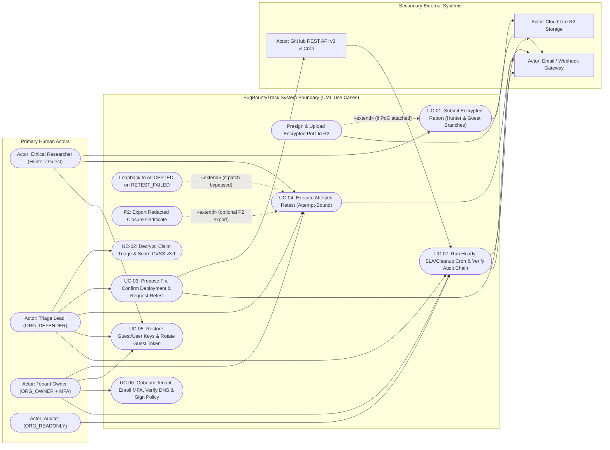
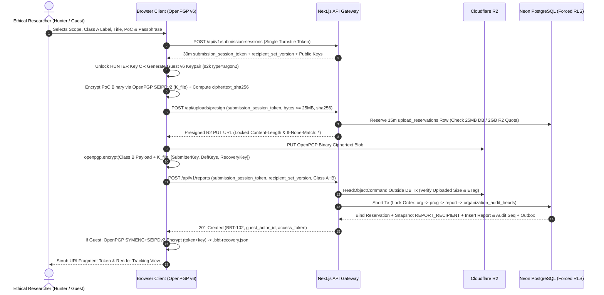
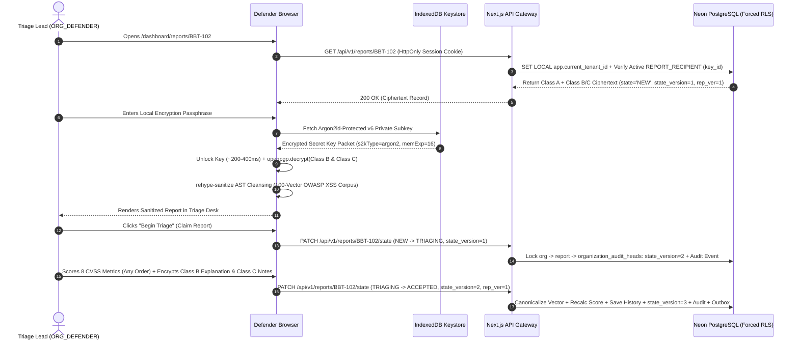

# Punjab Tianjin University of Technology
### Department of Software Engineering Technology
## FINAL YEAR PROJECT (FYP) ENGINEERING SPECIFICATION
# SOFTWARE REQUIREMENTS SPECIFICATION (SRS)
### Project: BugBountyTrack
**A Multi-Tenant Vulnerability Disclosure Platform with Client-Side Cryptographic Payload Isolation and Evidence-Based Remediation Traceability**

---

| Academic & Engineering Parameter | Specification |
| :--- | :--- |
| **Student Author** | Taha Asadullah |
| **Roll Number / Student ID** | `24-ST-013` |
| **Session** | Session 2024–2028 |
| **Batch / Section** | Batch 24-SET-Fall / Section SET-B |
| **Official Student Email** | `24-st-013@students.ptut.edu.pk` |
| **FYP Project Supervisor** | Sir Umar Hayat |
| **Project Identifier** | `PTUT - PRJ - 089` |
| **Department Sub-Field** | 9. Cybersecurity, Privacy & LegalTech |
| **Milestone** | **Week 2** — Software Requirements Specification (**Gate 1: DoR Part II**) |
| **Specification Structure** | Structured in accordance with IEEE Std 830-1998 & ISO/IEC/IEEE 29148:2018 |
| **Client Platform** | Modern Web (Next.js 14+ App Router, React 18+, TypeScript 5.x, Tailwind CSS, OpenPGP.js v6) |
| **Backend & API Engine** | Unified Next.js Fullstack (Serverless API Routes on Node.js 22 LTS + GitHub Actions Hourly Scheduler) |
| **Database Architecture** | PostgreSQL 16 (Neon Serverless Cloud) / Prisma ORM 5.x (`FORCE ROW LEVEL SECURITY` & Hash-Chained Audit) |
| **Document Status** | Baseline Revision 2.3 — Submitted for Supervisor Review & Milestone Endorsement |

---

## Supporting Deliverable Document (Google Drive Link)

| Deliverable Document | Scope Covered | Repository & Cloud Reference |
| :--- | :--- | :--- |
| **Formal IEEE 830 Software Requirements Specification (`SRS.docx`)** | Complete IEEE 830 SRS (`Revision 2.3`), Field-Level Classification (`Table 2.1`), Permission Matrix (`Table 2.2`), Functional Requirements (`FR-1` to `FR-8`), Use Cases (`UC-01` to `UC-07`), 4 UML Behavioral Diagrams, Reproducible NFRs (`NFR-01` to `NFR-09`), and Full Subrequirement RTM | Word Deliverable: `requirements/SRS.docx` (Upload to Google Drive and replace link when ready) |

---

## Table of Contents

1. Introduction
   - 1.1 Purpose & Target Scope
   - 1.2 Document Conventions & Priority Schema
   - 1.3 Intended Audience & Stakeholder Matrix
   - 1.4 Problem Statement & Traceability to Week 1 Discovery Baseline (5 Core MVP Features)
2. Overall Description, Cryptographic Boundary & Permission Model
   - 2.1 System Context & Logical Boundaries
   - 2.2 Defensible Protection Boundary, Cryptographic Pinning & Explicit Limitations
   - 2.3 Field-Level Cryptographic, Visibility & Export Classification Matrix (Table 2.1)
   - 2.4 User Classes, Personas & Authoritative Permission Matrix (Table 2.2)
   - 2.5 Operating Environment & Technical Bounds
   - 2.6 Scheduler Compatibility, Physical vs. Logical Database Capacity & Quota Reserves
3. Specific Functional Requirements (FR)
   - 3.1 Multi-Tenant Workspaces, Onboarding, Guest Intake & Access Governance (`FR-1.1` – `FR-1.6`)
   - 3.2 RFC 9116 Policy Discovery & Safe Harbor Engine (`FR-2.1` – `FR-2.5` — MVP Feature 1)
   - 3.3 Client-Side OpenPGP v6 Pipeline & Key Lifecycle Management (`FR-3.1` – `FR-3.8` — MVP Feature 2)
   - 3.4 Deterministic CVSS 3.1 Base Scoring Engine (`FR-4.1` – `FR-4.4` — MVP Feature 3)
   - 3.5 Confidential Triage, Dual-Lane Threading & SLA Timers (`FR-5.1` – `FR-5.5` — MVP Feature 2)
   - 3.6 Git-Linked & Configuration-Snapshot Remediation Verification (`FR-6.1` – `FR-6.4` — MVP Feature 4)
   - 3.7 15-State Lifecycle FSM, Attested Retest & Redacted Closure Exports (`FR-7.1` – `FR-7.7` — MVP Feature 5)
   - 3.8 Application Hardening, Forced RLS, Upload Reservations & Hash-Chained Audit Ledger (`FR-8.1` – `FR-8.5` — MVP Feature 5)
4. System Modeling & UML Behavioral Specifications
   - 4.1 Formal Textual Use Case Specifications (`UC-01` to `UC-07`)
   - 4.2 System Use Case Diagram (Figure 4.1)
   - 4.3 Sequence Diagram: Browser-Side OpenPGP Submission & Presigned Upload (Figure 4.2)
   - 4.4 Sequence Diagram: In-Browser Decryption, Triage & CVSS Assessment (Figure 4.3)
   - 4.5 State Machine Diagram: 15-State Remediation & Attested Retest Lifecycle (Figure 4.4)
5. External Interface Requirements
   - 5.1 Complete User Interfaces & Screen Catalog (`SCR-01` to `SCR-12`)
   - 5.2 Software & External API Interfaces
6. Quantifiable Non-Functional Requirements (Latency, Security & Uptime)
7. Verification, Acceptance Criteria & Complete Bidirectional Traceability
   - 7.1 Complete Subrequirement & NFR Bidirectional Traceability Matrix (RTM)
   - 7.2 Verification Test Pyramid & Acceptance Criteria
   - 7.3 Deterministic Operational Scenario Walkthrough Matrix (8 Edge-Case Scenarios)
8. Document Submission & Milestone Sign-Off

---

## 1. Introduction

### 1.1 Purpose & Target Scope

This Software Requirements Specification (SRS) defines the consolidated engineering requirements baseline (`Revision 2.3`) for **BugBountyTrack** (`PTUT - PRJ - 089`). It specifies the functional workflows, field-level cryptographic boundaries, authoritative permission matrix, key lifecycle and recovery rules, deterministic severity scoring mathematics, 15-state vulnerability lifecycle finite state machine (FSM), formal Use Case specifications, and quantifiable non-functional acceptance targets (latency, security, and uptime) for our Final Year Project prototype, structured in accordance with **IEEE Std 830-1998** and **ISO/IEC/IEEE 29148:2018**.

### 1.2 Document Conventions & Priority Schema

Every requirement and atomic subrequirement in this specification has a unique, testable identifier (`FR-X.Y`, `FR-X.Ya`, `NFR-XX`, `UC-XX`) and is assigned a build-consistent priority so that **no P1 requirement or main use-case success scenario ever depends on a P2 component**:

* **P1 (Mandatory Core Release)**: All capabilities required for the end-to-end buildable prototype—including multi-tenant isolation, authentication with mandatory `ORG_OWNER` TOTP MFA, guided onboarding, DNS TXT verification, public program intake (`FR-1.5a`), RFC 9116 policy signing, client-side OpenPGP v6 encryption, personal/guest/master key recovery, CVSS v3.1 calculation, dual-lane triage, core duplicate report binding (`FR-5.5a`), Git commit and encrypted configuration snapshot verification, the 15-state attested retest workflow, hourly scheduled SLA/timeout evaluation, quota reservation enforcement, and the hash-chained audit ledger.
* **P2 (Secondary Operational Enhancements)**: Strictly optional convenience features that never block any P1 state transition or main use-case flow:
  1. `FR-1.5b`: Tokenized private invitation-only program access (`token_hash`).
  2. `FR-5.5b`: Fuzzy candidate search UI helper when selecting a duplicate parent report.
  3. `FR-7.7`: Formatted PDF and JSON Redacted Closure Evidence Export generation (modeled as an optional post-closure follow-up extension).

### 1.3 Intended Audience & Stakeholder Matrix

| Stakeholder Role | Interaction with Specification | Primary Concerns |
| :--- | :--- | :--- |
| **Taha Asadullah (Student Author)** | Implementation lead; constructs and tests the system against this specification. | Unambiguous state transitions, lock ordering, permission checks, replay prevention, and verifiable test criteria. |
| **Sir Umar Hayat (Academic Supervisor)** | Academic evaluator; audits requirements consistency, state machine completeness, and empirical verification evidence. | Elimination of cross-section contradictions, realistic security claims, complete traceability, and defense readiness. |
| **Software Engineering Peers** | Participants in controlled usability and security evaluation (3–5 peers). | Ergonomics of encrypted report submission, key recovery, triage decryption, and retest attestation. |

### 1.4 Problem Statement & Traceability to Week 1 Discovery Baseline (5 Core MVP Features)

Small and medium software engineering teams (5–50 developers) frequently coordinate incoming vulnerability reports through ad-hoc channels such as generic `security@company.com` email inboxes, shared spreadsheets, or general-purpose issue trackers, or rely on server-managed intake forms where third-party platform servers hold unencrypted report contents. These workflows create four concrete operational problems:
1. External researchers lack standardized **RFC 9116 `security.txt` discovery** and clear **Safe Harbor** scope definitions prior to testing.
2. Sensitive vulnerability titles, reproduction steps, and proof-of-concept (PoC) attachments are transmitted or stored in **server-readable plaintext** across mail servers and ticket databases.
3. Triage teams rely on inconsistent, subjective severity ratings rather than deterministic **FIRST.org CVSS v3.1** vector evaluations with transparent researcher feedback.
4. Developers frequently mark security tickets "Closed" **without linking a verified remediation Git commit SHA (or encrypted configuration snapshot hash) or recording an attested retest** tied to that specific fix attempt.

**BugBountyTrack** addresses these four operational problems through the **5 Core MVP Features** defined in our Week 1 Discovery Baseline, supported by foundational multi-tenant access governance (`FR-1`) and application hardening (`FR-8`):
1. **MVP Feature 1 — RFC 9116 `security.txt` Policy & Safe Harbor Engine**: `FR-2.1` – `FR-2.5`.
2. **MVP Feature 2 — Client-Side End-to-End Encrypted (OpenPGP v6) Submission & Multi-Tenant Triage Workspace**: `FR-3.1` – `FR-3.8` and `FR-5.1` – `FR-5.5` (supported by multi-tenant workspace, RBAC, and guest intake governance in `FR-1.1` – `FR-1.6`).
3. **MVP Feature 3 — Deterministic CVSS v3.1 Base Severity Calculator**: `FR-4.1` – `FR-4.4`.
4. **MVP Feature 4 — Git Commit SHA & Configuration Snapshot Remediation Verifier**: `FR-6.1` – `FR-6.4`.
5. **MVP Feature 5 — Attested Retest State Machine, Redacted Closure Exports & Append-Only Audit Ledger**: `FR-7.1` – `FR-7.7` and `FR-8.1` – `FR-8.5`.

---

## 2. Overall Description, Cryptographic Boundary & Permission Model

### 2.1 System Context & Logical Boundaries

BugBountyTrack is organized into three logical tiers (detailed 3-Tier Architecture and Level 0 / Level 1 Data Flow Diagrams are specified in the Week 3 Architecture Deliverable):
1. **Client Browser Runtime**: Next.js 14+ App Router, React 18+, Tailwind CSS, `OpenPGP.js v6` client-side encryption, decryption, session-key wrapping, and detached signing, `rehype-sanitize` Markdown AST sanitizer, and WebCrypto API (`crypto.subtle.digest` for SHA-256 hashing).
2. **Application API Gateway & Scheduled Worker**: Next.js Route Handlers running on Node.js 22 LTS, enforcing the Authoritative Permission Matrix (`Table 2.2`), database-persisted sessions, optimistic concurrency checks (`recipient_set_version`, `report_recipient_version`, and `state_version`), bounded submission sessions, upload quota reservations, GitHub REST API v3 commit/branch comparisons, and an hourly lifecycle/cleanup cron endpoint triggered by an authenticated GitHub Actions scheduled workflow.
3. **Persistence & Object Storage Layer**: Neon Serverless PostgreSQL 16 (enforcing `FORCE ROW LEVEL SECURITY` under a non-superuser runtime role, a per-organization audit head lock table, and an append-only hash-chained audit ledger) and Cloudflare R2 (storing client-encrypted OpenPGP binary PoC attachments).

### 2.2 Defensible Protection Boundary, Cryptographic Pinning & Explicit Limitations

Rather than claiming blanket "zero-knowledge" across the entire application, BugBountyTrack defines an explicit **Client-Side End-to-End Encrypted (E2EE) Payload Isolation Boundary**:

* **What Is Cryptographically Isolated from the Server**: All sensitive vulnerability text and files (classified as **Class B** and **Class C** in Table 2.1—including report titles, vulnerability descriptions, reproduction steps, PoC attachments, discussion messages, internal reviewer notes, researcher-visible CVSS explanations, internal CVSS notes, rejection explanations, risk-acceptance rationales, remediation summaries, configuration snapshots, retest notes, and administrative audit justifications) are encrypted in the client browser using OpenPGP v6 packets before network transmission. The backend server, PostgreSQL database, and Cloudflare R2 store ciphertext only.
* **What the Server Intentionally Knows (Class A Operational Metadata)**: To route reports, enforce tenant quotas, calculate SLA deadlines, verify Git commits, and maintain a deterministic state machine, the server stores and processes plaintext operational metadata: organization/program identifiers, actor IDs, timestamps, workflow state (`state`, `state_version`), a coarse 8-value category enum (`operational_label`), target asset identifier (`asset_scope`), CVSS v3.1 vector string and numeric score (`cvss_vector`, `cvss_score`), remediation reference metadata (`commit_sha`, `branch_name`, `config_hash`, `deployment_env`), and cryptographic hashes. Because Class A fields such as `asset_scope`, `branch_name`, and `hunter_id` can still be operationally sensitive outside the tenant, external exports are further restricted by the strict **Export Allowlist** in Table 2.1 and `FR-7.7`.
* **Standardized `OpenPGP.js v6` Configuration & Native Formats (`s2kType = argon2`)**:
  * All keys and encrypted containers are standardized on **RFC 9580 OpenPGP Version 6 Curve25519 (`Ed25519` primary signing key + `X25519` encryption subkey)** with **64-character hexadecimal SHA-256 fingerprints**, avoiding custom cryptographic envelopes.
  * Because `OpenPGP.js v6` only applies `s2kArgon2Params` when Argon2 is explicitly selected as the S2K type, the client cryptographic module explicitly configures:
    1. `openpgp.config.v6Keys = true` (RFC 9580 v6 key packets and SEIPDv2 AEAD encrypted data packets)
    2. **`openpgp.config.s2kType = openpgp.enums.s2k.argon2`** (explicitly selecting RFC 9580 Argon2id String-to-Key specifier `0x04`)
    3. `openpgp.config.s2kArgon2Params = { passes: 3, parallelism: 4, memoryExponent: 16 }` (`2^16 KiB = 65,536 KiB = 64 MiB` RAM)
    4. `openpgp.config.aeadProtect = true` (authenticated encryption for secret keys and symmetric messages)
* **Key-Versioned Report Recipients (`REPORT_RECIPIENT` & `report_recipient_version`)**:
  * At initial report submission, the server snapshots the program's active `PROGRAM_DEFENDER` key records (`user_id`, `key_id`, `key_fingerprint`) into `REPORT_RECIPIENT` for that report and initializes `REPORT.report_recipient_version = 1`.
  * Every subsequent encrypted write on that report (comments, internal notes, CVSS explanations/notes, remediation notes, configuration snapshots, retest evidence, or follow-up attachments) must generate a **fresh random 256-bit OpenPGP session key**, encrypt strictly for the currently active `REPORT_RECIPIENT` keys (`is_active = true` and `USER_KEY.status = 'ACTIVE'`) plus `PROGRAM.recovery_public_key` (and the submitter's active key for Class B objects), and submit `report_recipient_version`.
  * If a defender is offboarded from the organization/program or a defender's key is revoked, the server atomically sets `is_active = false` on their `PROGRAM_DEFENDER` and `REPORT_RECIPIENT` rows and increments both `PROGRAM.recipient_set_version` and `REPORT.report_recipient_version` on every affected report, rejecting any in-flight message encrypted to the stale recipient list with HTTP `409 Conflict`.
* **Explicit Cryptographic & Runtime Limitations**:
  1. *Browser Code & Key-Distribution Trust*: Within the web security model, the client browser trusts the application bundle delivered over HTTPS (hardened with Subresource Integrity and strict Content Security Policy) and the server's public-key directory endpoint. To detect silent public-key substitution by a compromised server, researchers can cross-verify the organization's 64-character public key fingerprint against the cleartext-signed `https://[org-domain]/.well-known/security.txt` hosted on the organization's own domain (`FR-2.3`).
  2. *Prior-Access Revocation Limitation*: Deactivating a defender in `PROGRAM_DEFENDER` and `REPORT_RECIPIENT` immediately blocks their API access and excludes their key from future encrypted objects, but **cannot retroactively erase ciphertext or decrypted keys that the defender downloaded to their local machine prior to revocation**.
  3. *JavaScript Memory Hygiene Limitation*: On logout or key lock, the client explicitly overwrites owned `Uint8Array` buffers (`fill(0)`), deletes ephemeral keys from `IndexedDB` when requested, and nullifies references (`nullified`). Because JavaScript strings are immutable and garbage-collected asynchronously, this is a **best-effort defense-in-depth measure** and cannot guarantee physical RAM page zeroization against local OS memory dumps.

### 2.3 Field-Level Cryptographic, Visibility & Export Classification Matrix (Table 2.1)

Every domain field is assigned to one of three classifications governing storage, logging, notifications, API responses, and external exports:

| Data Class | Cryptographic Envelope & Effective Recipients | Exact Fields Included | Storage, Notification & External Export Allowlist Rules |
| :--- | :--- | :--- | :--- |
| **Class A: Plaintext Operational Metadata** | Stored in plaintext in PostgreSQL (protected by `FORCE ROW LEVEL SECURITY` and TLS 1.3). | `organization_id`, `program_id`, `report_id`, `hunter_id`, `guest_actor_id`, `state`, `state_version`, `report_recipient_version`, `operational_label` (8-value enum), `asset_scope`, `cvss_vector`, `cvss_suggested`, `cvss_score`, `rejection_code` (`OUT_OF_SCOPE`, `NON_REPRODUCIBLE`, `SPAM`), `remediation_attempt_no`, `evidence_type`, `commit_sha`, `branch_name`, `verified_branch_head_sha`, `github_signature_verified`, `config_hash`, `deployment_env`, `deployed_version`, `timestamps`, `tenant_seq_no`, `report_seq_no`, `report_chain_hash`, `tenant_row_hash`. | **Notifications**: Only `report_id`, `operational_label`, `from_state -> to_state`, `timestamp`, and signed checkpoint receipt. **External Export Allowlist (`FR-7.7`)**: Includes only `report_id`, `organization_slug`, `program_slug`, `operational_label`, `cvss_vector`, `cvss_score`, state transition timestamps, `remediation_attempt_no`, `evidence_type`, `commit_sha` (or redacted digest if toggled), `config_hash`, `deployment_env`, terminal state, and per-report `report_chain_hash` + checkpoint receipt. Internal `hunter_id`, `guest_actor_id`, `branch_name`, `r2_object_key`, and (when toggled) `asset_scope` are excluded from external exports. |
| **Class B: Encrypted Shared Content (`RESEARCHER_ORG`)** | OpenPGP v6 SEIPDv2 AEAD ciphertext with a **fresh random session key per write**, encrypted for: **Submitter Active Key** + **Active `REPORT_RECIPIENT` Keys (`key_id`)** + **`recovery_public_key`**. | `title_ciphertext`, `description_ciphertext`, `reproduction_steps_ciphertext`, `impact_ciphertext`, OpenPGP binary PoC attachments in R2 (`encrypted_file_key_packet`), `RESEARCHER_ORG` discussion messages (`encrypted_body`), **Researcher-Visible CVSS Explanation (`cvss_explanation_ciphertext`)**, **Rejection Reason Details (`rejection_reason_ciphertext`)**, **Remediation Summary & Retest Instructions (`remediation_notes_ciphertext`)**, **Encrypted Configuration Snapshot (`config_artifact_ciphertext`)**, and **Retest Verification Logs (`verification_notes_ciphertext`)**. | Persisted as **ciphertext only**. Never written to server logs, telemetry, or email notifications. Excluded from Redacted Closure Evidence Exports. |
| **Class C: Encrypted Internal Content (`REVIEWER_INTERNAL`)** | OpenPGP v6 SEIPDv2 AEAD ciphertext with a **fresh random session key per write**, encrypted strictly for: **Active `REPORT_RECIPIENT` Keys (`key_id`)** + **`recovery_public_key`** (**Submitter Key Excluded**). | Reviewer internal discussion messages (`REVIEWER_INTERNAL` lane), **Internal CVSS Notes (`cvss_internal_notes_ciphertext`)**, **Executive Risk-Acceptance Rationale (`risk_rationale_ciphertext`)**, and **Administrative Timeout / Reopen / Cancel Justifications (`audit_justification_ciphertext`)**. | Persisted as **ciphertext only** and stripped at the SQL/API projection layer before serving report records to `HUNTER`, `GUEST`, or `ORG_READONLY` sessions. Never included in notifications or exports. |

### 2.4 User Classes, Personas & Authoritative Permission Matrix (Table 2.2)

1. **Multi-Organization & Dual-Hat Account Model**:
   * A registered `USER` account is global and may hold `USER_MEMBERSHIP` records (`ORG_OWNER`, `ORG_DEFENDER`, or `ORG_READONLY`) across multiple organizations while also acting as an external `HUNTER` on other organizations' programs (blocked by a conflict-of-interest check from submitting as an external `HUNTER` to any organization where the user holds an active `USER_MEMBERSHIP`).
2. **Persona 1: Alex Rivera — "The Hunter" (`HUNTER` or `GUEST`)**:
   * Independent security researcher and undergraduate cybersecurity student. Requires RFC 9116 Safe Harbor discovery, authenticated (`HUNTER`) or account-less (`GUEST`) E2EE submission, researcher-visible explanations when suggested CVSS scores are adjusted, and attested retesting tied to numbered remediation attempts.
3. **Persona 2: Sarah Chen — "The Defender" (`ORG_DEFENDER` with active `REPORT_RECIPIENT` assignment)**:
   * Lead full-stack engineer managing vulnerability triage and remediation across a **7-developer startup engineering team (7 developers)** (aligned with Week 1 Persona 2). Requires client-side E2EE payload isolation, dual-lane discussion (`RESEARCHER_ORG` vs. `REVIEWER_INTERNAL`), deterministic CVSS v3.1 scoring, Git commit SHA / configuration snapshot verification, and redacted closure exports.
4. **Organization Owner (`ORG_OWNER`) — Normal Mode vs. Audited Recovery Mode**:
   * Manages workspace onboarding, DNS TXT verification, `USER_MEMBERSHIP` and `PROGRAM_DEFENDER` rosters, `security.txt` cleartext signing, `RISK_ACCEPTED` approvals, and `REJECTED_SPAM` false-positive recovery. **Mandatory TOTP MFA**: `ORG_OWNER` must enroll TOTP MFA during onboarding (`UC-06`) before activating a program. In normal mode, `ORG_OWNER` views Class A metadata only unless also assigned in `REPORT_RECIPIENT`. In emergency recovery mode (`POST /api/v1/reports/{id}/recovery-fetch`), an MFA-verified `ORG_OWNER` may retrieve report ciphertexts only after the server atomically logs `MASTER_RECOVERY_FETCH_INITIATED` in `audit_events`.
5. **Read-Only Stakeholder / Auditor (`ORG_READONLY`)**:
   * Inspects Class A operational metadata, SLA compliance, and the hash-chained `audit_events` ledger (`0` access to Class B or Class C ciphertexts).

#### Table 2.2: Authoritative Actor × Operation × Resource Permission Matrix

| Operation / Endpoint | Submitting `HUNTER` (`report.hunter_id == user.id`) | Submitting `GUEST` (`guest_token_hash`) | Assigned `ORG_DEFENDER` (Active in `REPORT_RECIPIENT`) | Unassigned `ORG_DEFENDER` (In Org, NOT in `REPORT_RECIPIENT`) | `ORG_OWNER` (Normal Mode) | `ORG_OWNER` (MFA Step-Up Mode) | `ORG_READONLY` (Auditor) | Scheduled Cron (`CRON_HMAC_SECRET`) |
| :--- | :---: | :---: | :---: | :---: | :---: | :---: | :---: | :---: |
| **Submit Report (`UC-01`)** | Permitted (Non-Member Org) | Permitted (`submission_session`) | Denied (CoI Rule) | Denied (CoI Rule) | Denied (CoI Rule) | Denied (CoI Rule) | Denied (CoI Rule) | Denied |
| **Read Class A Report Queue / Metadata** | Own Reports Only | Own Report Only | Permitted (Org Scope) | Permitted (Org Scope) | Permitted (Org Scope) | Permitted (Org Scope) | Permitted (Org Scope) | Deadlines Only (`SECURITY DEFINER`) |
| **Fetch Class B Ciphertext & Attachments** | Own Reports Only | Own Report Only (Bearer Token) | Permitted (`REPORT_RECIPIENT`) | **Denied (`403`)** | **Denied (`403`)** (Unless in `REPORT_RECIPIENT`) | Permitted via `recovery-fetch` (Logs Audit Event) | **Denied (`403`)** | **Denied** |
| **Fetch Class C Internal Ciphertext** | **Denied (Stripped)** | **Denied (Stripped)** | Permitted (`REPORT_RECIPIENT`) | **Denied (`403`)** | **Denied (`403`)** (Unless in `REPORT_RECIPIENT`) | Permitted via `recovery-fetch` (Logs Audit Event) | **Denied (Stripped)** | **Denied** |
| **Post `RESEARCHER_ORG` (Class B) Message** | Own Reports (`report_recipient_version`) | Own Report + OpenPGP Signature (`X-Guest-Signature`) | Permitted (`REPORT_RECIPIENT` + `report_recipient_version`) | **Denied (`403`)** | **Denied (`403`)** | Permitted if in `REPORT_RECIPIENT` | **Denied (`403`)** | **Denied** |
| **Post `REVIEWER_INTERNAL` (Class C) Note** | **Denied (`403`)** | **Denied (`403`)** | Permitted (`REPORT_RECIPIENT` + `report_recipient_version`) | **Denied (`403`)** | **Denied (`403`)** | Permitted if in `REPORT_RECIPIENT` | **Denied (`403`)** | **Denied** |
| **Withdraw Report (`NEW`/`TRIAGING -> WITHDRAWN`)** | Own Reports (`state_version`) | Own Report + `X-Guest-Signature` | **Denied** | **Denied** | **Denied** | **Denied** | **Denied** | **Denied** |
| **Triage, Score CVSS, Propose Fix, Confirm Deploy, Request Retest** | **Denied** | **Denied** | Permitted (`REPORT_RECIPIENT` + `state_version`) | **Denied (`403`)** | **Denied (`403`)** (Unless in `REPORT_RECIPIENT`) | Permitted if in `REPORT_RECIPIENT` | **Denied (`403`)** | **Denied** |
| **Submit `VERIFIED_RESEARCHER` / `RETEST_FAILED`** | Own Reports (`remediation_record_id`) | Own Report + `X-Guest-Signature` (`remediation_record_id`) | `RETEST_FAILED` Only | **Denied** | **Denied** | **Denied** | **Denied** | **Denied** |
| **Submit `VERIFIED_INTERNAL` / `CLOSED_UNVERIFIED_TIMEOUT`** | **Denied** | **Denied** | Permitted (`REPORT_RECIPIENT` + `state_version`) | **Denied (`403`)** | **Denied (`403`)** | Permitted if in `REPORT_RECIPIENT` | **Denied (`403`)** | **Denied** |
| **Approve `RISK_ACCEPTED` or Recover `REJECTED_SPAM`** | **Denied** | **Denied** | **Denied (`403`)** | **Denied (`403`)** | **Denied (Requires MFA)** | **Permitted (`ORG_OWNER` + MFA Only)** | **Denied (`403`)** | **Denied** |
| **Manage Members, `PROGRAM_DEFENDER`, GitHub PAT, Rotate Recovery Key** | **Denied** | **Denied** | **Denied (`403`)** | **Denied (`403`)** | **Denied (Requires MFA)** | **Permitted (`ORG_OWNER` + MFA Only)** | **Denied (`403`)** | **Denied** |
| **Grant Historical Access (`HISTORICAL_ACCESS_GRANTED`)** | **Denied** | **Denied** | Permitted (`REPORT_RECIPIENT`) | **Denied (`403`)** | **Denied (Requires MFA)** | Permitted (With Master Recovery Key) | **Denied (`403`)** | **Denied** |
| **Evaluate `NEED_MORE_INFO -> CLOSED_INCOMPLETE` & SLA Alerts** | **Denied** | **Denied** | **Denied** | **Denied** | **Denied** | **Denied** | **Denied** | **Permitted (Cron Only)** |
| **Inspect & Verify `audit_events` Hash Chain** | **Denied** | **Denied** | Permitted (Org Scope) | Permitted (Org Scope) | Permitted (Org Scope) | Permitted (Org Scope) | Permitted (Org Scope) | **Denied** |

### 2.5 Operating Environment & Technical Bounds

* **Client Runtime**: Evergreen desktop and mobile browsers (Chromium >= 120, Firefox >= 120, Safari >= 17.0) supporting WebCrypto API (`crypto.subtle`), WebAssembly (`wasm-unsafe-eval` CSP for OpenPGP.js Argon2id S2K), `FileReader` API, and `IndexedDB`.
* **Server Runtime**: Node.js 22 LTS executing Next.js 14+ App Router serverless handlers (maximum route execution timeout: 15 seconds).
* **Persistence Tier**: PostgreSQL 16 on Neon Serverless Cloud via Prisma ORM 5.x, paired with Cloudflare R2 S3-compatible object storage for encrypted binary attachments.

### 2.6 Scheduler Compatibility, Physical vs. Logical Database Capacity & Quota Reserves

* **Hourly Scheduler Compatibility (`GitHub Actions Cron -> /api/cron/lifecycle-evaluate`)**:
  * Because Vercel Hobby limits native `vercel.json` cron expressions to once per day (`0 0 * * *`), the hourly SLA, inactivity timeout, and expired upload reservation job (`0 * * * *`) is triggered by an **external GitHub Actions Scheduled Workflow (`lifecycle-cron.yml`)** (with a daily Vercel cron backup) sending an authenticated `POST /api/cron/lifecycle-evaluate` request signed with `CRON_HMAC_SECRET`.
* **Bounded Evaluation Cluster Budget & Physical vs. Logical Database Accounting**:
  * Rather than claiming an unconditional `$0.00` commercial budget or equating logical row bytes to physical database size, the academic evaluation environment enforces a **10-tenant cluster cap** explicitly budgeted against the **`512 MB` physical Neon PostgreSQL storage ceiling** and **`10 GB` Cloudflare R2 ceiling**:
    1. **Per-Tenant Logical Intake Quota (`25 MB` / `26,214,400 bytes`)**: Across `<= 10` evaluation tenants, logical intake data (`programs`, `reports`, `discussion_messages`, `remediation_records`, `retest_evidence`, `upload_reservations`) is capped at **`10 x 25 MB = 250 MB`**.
    2. **Per-Tenant Reserved Security & Audit Buffer (`2 MB` / `2,097,152 bytes`)**: Each tenant has a dedicated **`2 MB` security operations reserve** (`20 MB` across 10 tenants) used exclusively for `audit_events`, `organization_audit_heads`, state transitions, key revocations, and retest attestations. When a tenant reaches 100% of its `25 MB` intake quota, new report submissions and new attachment uploads are rejected with HTTP `413 Payload Too Large`, **but triage state transitions, key revocations, and audit chain writes continue uninterrupted using the reserved `2 MB` buffer**.
    3. **Physical Index, Shared Table, WAL & Snapshot Headroom (`242 MB`)**: The remaining **`242 MB`** (`512 MB - 270 MB`) is budgeted for PostgreSQL B-tree indexes, TOAST metadata, shared tables (`users`, `sessions`, `guest_mutation_nonces`, `notification_outbox`), and Neon copy-on-write snapshot history. Physical database consumption is monitored via `SELECT pg_database_size(current_database())` on `/api/v1/health` (alerting at `400 MB` physical usage).
    4. **Incremental Byte Accounting Across `INSERT`, `UPDATE`, and `DELETE`**: `organizations.db_intake_bytes_used` and `organizations.db_audit_bytes_used` are updated atomically by a PostgreSQL `AFTER INSERT OR UPDATE OR DELETE` row trigger computing `COALESCE(pg_column_size(NEW), 0) - COALESCE(pg_column_size(OLD), 0)`, ensuring size-changing `UPDATE`s (e.g., appending re-wrapped PKESK packets or recording CVSS scores) are accurately tracked.

---

## 3. Specific Functional Requirements (FR)

### 3.1 Multi-Tenant Workspaces, Onboarding, Guest Intake & Access Governance (`FR-1`)

* **FR-1.1 (P1, Core — Multi-Tenant Isolation & Composite Foreign Keys)**: The system shall isolate organization workspaces using an `organization_id` column on all tenant-scoped tables, enforced by composite foreign key constraints `(organization_id, id)` so that cross-organization references are rejected at the relational constraint layer.
* **FR-1.2 (P1, Core — Authoritative Role & Report-Level Permission Enforcement)**:
  * **FR-1.2a**: The server shall enforce the exact actor, role, and resource rules defined in **Table 2.2 (Authoritative Permission Matrix)** across all API routes.
  * **FR-1.2b**: Retrieving report ciphertexts (`GET /api/v1/reports/{id}`) or presigned attachment download URLs shall be permitted exclusively to: (1) the submitting researcher (`HUNTER` matching `report.hunter_id` or `GUEST` matching `guest_token_hash`, receiving Class A and Class B fields only, with Class C columns stripped at the query projection layer), (2) an `ORG_DEFENDER` or `ORG_OWNER` with an active row in `REPORT_RECIPIENT` (`is_active = true`, receiving Class A, Class B, and Class C fields), or (3) an MFA-verified `ORG_OWNER` executing an audited emergency recovery fetch via `POST /api/v1/reports/{id}/recovery-fetch` (`FR-3.8b`).
* **FR-1.3 (P1, Core — Authentication, Password Hashing & Mandatory Owner TOTP MFA)**:
  * **FR-1.3a**: User passwords shall be hashed on the server using **Argon2id** (`m = 65536 KiB [64 MiB], t = 3, p = 4, salt = 16 bytes, tag = 32 bytes`; with **Bcrypt** `cost = 12` supported solely for legacy fixture migration).
  * **FR-1.3b**: Authenticated sessions shall use 256-bit cryptographically random tokens persisted as SHA-256 hashes in the `SESSION` table (`HttpOnly; Secure; SameSite=Lax` cookies). Changing or resetting a password shall immediately delete all active `SESSION` rows for that user.
  * **FR-1.3c (Definite TOTP MFA Enforcement Policy)**: RFC 6238 Time-Based One-Time Password (TOTP) Multi-Factor Authentication (`totp_secret` encrypted at rest via AES-256-GCM) is **mandatory for `ORG_OWNER` enrollment during `/onboarding` before any program can be activated** (and optional/recommended for `ORG_DEFENDER`). Furthermore, the server shall require a verified step-up TOTP challenge (`session.mfa_verified_at >= now() - interval '10 minutes'`, returning HTTP `403 Forbidden: MFA_STEP_UP_REQUIRED` if unenrolled or expired) before executing any privileged owner action: (1) activating a program or rotating `recovery_public_key`, (2) invoking `POST /api/v1/reports/{id}/recovery-fetch` or granting historical access via Master Recovery Key, (3) adding/removing `USER_MEMBERSHIP` or `PROGRAM_DEFENDER` members, (4) transitioning a report to `RISK_ACCEPTED` or recovering `REJECTED_SPAM`, and (5) configuring or rotating GitHub Personal Access Tokens.
* **FR-1.4 (P1, Core — Guided Onboarding Wizard)**: The platform shall provide a Guided Onboarding Wizard (`/onboarding`) enabling an `ORG_OWNER` to complete active setup tasks—workspace slug registration, mandatory TOTP MFA enrollment (`FR-1.3c`), initialization of the tenant's `organization_audit_heads` row (`last_seq_no = 0`, `FR-8.5b`), DNS TXT challenge generation (`FR-2.5`), asset scope configuration, in-browser Curve25519 key generation, mandatory offline **Organization Master Recovery Key** (`recovery_public_key`) test decryption challenge (`FR-3.6`), and in-browser RFC 9116 `security.txt` cleartext signing (`FR-2.2`)—in **<= 15 minutes of active user interaction time** (excluding external DNS TTL propagation wait times).
* **FR-1.5 (Public Program Intake [P1] & Private Tokenized Programs [P2])**:
  * **FR-1.5a (P1, Core — Public Disclosure Program Discovery & Intake)**: The platform shall serve public vulnerability disclosure programs (`/programs/[slug]`) accessible to registered `HUNTER` accounts and unauthenticated `GUEST` researchers.
  * **FR-1.5b (P2, Secondary — Private Program Invitation Tokens)**: The platform shall support invitation-only private programs (`/programs/[slug]/join?token=...`), persisting only the SHA-256 hash (`token_hash`) of invitation tokens and rejecting uninvited access with HTTP `403 Forbidden`.
* **FR-1.6 (P1, Core — Account-Less Guest Vulnerability Intake, OpenPGP Guest Recovery Package & Replay-Safe Signatures)**: External researchers shall be able to submit encrypted vulnerability reports without registering an account:
  * **FR-1.6a (Durable Guest Actor Identity)**: At submission, the server assigns an immutable UUIDv4 `guest_actor_id` stored on `REPORT.guest_actor_id` and referenced by all subsequent guest comments, retest attestations, and audit events so rotating bearer tokens never breaks historical attribution.
  * **FR-1.6b (Guest Access Token & Ephemeral Report Keypair)**: The browser generates an ephemeral RFC 9580 v6 Curve25519 keypair (`Ed25519` primary signing key + `X25519` encryption subkey; public key stored in `REPORT.guest_public_key`, Argon2id-protected private key stored in local `IndexedDB`), and the server issues a 256-bit opaque `access_token` (persisting only its SHA-256 hash `guest_token_hash`).
  * **FR-1.6c (Standard OpenPGP v6 Password-Encrypted `.bbt-recovery.json` Guest Recovery Package)**: At submission, the guest sets a recovery passphrase (or copies a browser-generated 6-word Diceware passphrase). Rather than inventing a custom cipher container, the browser uses `OpenPGP.js v6` (`s2kType = openpgp.enums.s2k.argon2`, `aeadProtect = true`) to encrypt the inner JSON payload `{ report_id, guest_actor_id, access_token, armored_private_key }` as a standard **RFC 9580 OpenPGP v6 symmetric password-encrypted message (`SYMENC` + `SEIPDv2` AEAD)** and downloads `.bbt-recovery.json` containing `{ version: 1, format: "openpgp-symenc-seipdv2", report_id, guest_actor_id, key_fingerprint, encrypted_recovery_bundle }`. Because `access_token` and `armored_private_key` are inside the OpenPGP SEIPDv2 AEAD ciphertext, possessing `.bbt-recovery.json` without the passphrase reveals **zero bearer credentials**, and any modification to the ciphertext or inner `report_id`/`guest_actor_id` is rejected by OpenPGP SEIPDv2 authentication tag verification. If a guest clears `IndexedDB` and loses both their passphrase and `.bbt-recovery.json`, guest session access cannot be recovered by the server.
  * **FR-1.6d (URI Fragment Scrubbing & Telemetry Sanitization)**: Immediate post-submission tracking URLs use a client-side URI fragment (`/report/track/BBT-RPT-XXXX#token=<access_token>`) which is never sent in HTTP request lines or `Referer` headers and is scrubbed on load via `window.history.replaceState(null, '', window.location.pathname)`. Error telemetry hooks strip all URI fragments and authorization headers.
  * **FR-1.6e (Local-Only Browser Restoration & Dropped-Response Safe Token Rotation)**:
    1. Selecting `.bbt-recovery.json` on `/report/restore` reads and decrypts `encrypted_recovery_bundle` strictly in browser memory via `FileReader` and `openpgp.decrypt({ message, passwords: [passphrase] })`; the file is **never uploaded to the backend server**.
    2. To rotate a suspected/exposed `access_token` (`POST /api/v1/reports/{id}/guest-token/rotate`), the request authenticates using an **OpenPGP v6 detached signature (`X-Guest-Signature`)** produced by the guest's `ephemeral_private_key` (`REPORT.guest_public_key`) over the canonical rotation payload (`action = "ROTATE_GUEST_TOKEN"`, `nonce`, `issued_at`, `expires_at`)—**without requiring the old bearer `access_token` to remain valid**. If the HTTP response is lost in transit after the server invalidates the old token, the guest's browser simply retries with the same `nonce` (receiving the cached idempotent response encrypted to `REPORT.guest_public_key`) or signs a fresh rotation request using their `ephemeral_private_key`, guaranteeing that a dropped rotation response never locks out the guest.
  * **FR-1.6f (Canonical RFC 8785 JCS Guest Signature Proof-of-Possession & Nonce Replay Prevention)**:
    1. Every guest mutation—posting a comment (`POST_COMMENT`), withdrawing a report (`WITHDRAW_REPORT`), submitting a retest outcome (`VERIFIED_RESEARCHER` or `RETEST_FAILED`), or rotating a guest token (`ROTATE_GUEST_TOKEN`)—requires a detached **OpenPGP v6 Ed25519 signature (`X-Guest-Signature`)** created via `openpgp.sign({ message, signingKeys: [guestPrivateKey], detached: true })` over the **RFC 8785 JSON Canonicalization Scheme (JCS)** byte serialization of:
       `{ "protocol": "bbt-guest-pop-v1", "report_id": "<uuid>", "state_version": <int>, "action": "<ENUM>", "remediation_record_id": "<uuid|null>", "payload_sha256": "<64-hex>", "nonce": "<32-hex-128bit>", "issued_at": "<ISO8601>", "expires_at": "<ISO8601 (+300s)>" }`.
    2. For `VERIFIED_RESEARCHER` and `RETEST_FAILED`, `remediation_record_id` is mandatory and must match the report's active `remediation_record_id`.
    3. The server verifies the OpenPGP detached signature against `REPORT.guest_public_key`, asserts `expires_at >= now()` (max 5-minute TTL, `<= 60s` clock skew tolerance), and inserts `(report_id, nonce, action, request_sha256, response_status, response_body_json, expires_at)` into `guest_mutation_nonces` (`PRIMARY KEY (report_id, nonce)`).
    4. **Idempotent Retry vs. Replay Rejection**: If an identical request (`same report_id, nonce, action, and request_sha256`) arrives before `expires_at` (e.g., due to a network retry after a dropped connection), the server returns the cached `response_body_json` without creating duplicate messages or re-executing the transition. If a consumed `nonce` is reused with any modified field, or if an expired signature is submitted, the server rejects the request with HTTP `409 Conflict` / `401 Unauthorized`.

### 3.2 RFC 9116 Policy Discovery & Safe Harbor Engine (`FR-2` — MVP Feature 1)

* **FR-2.1 (P1, Core — RFC 9116 Manifest Generation)**: The platform shall generate an RFC 9116 compliant text manifest at `/api/v1/programs/[slug]/security.txt` containing the standard RFC 9116 directives: `Contact` (pointing to the program's encrypted submission URI), `Expires` (ISO 8601 timestamp capped at `<= 365 days` from signing, with automated dashboard warnings 30 days before expiry), `Encryption` (URI to the program's OpenPGP v6 public keyring), `Policy` (URI to the hosted Safe Harbor & Scope policy page), `Acknowledgments`, `Preferred-Languages`, and `Canonical`.
* **FR-2.2 (P1, Core — In-Browser OpenPGP Cleartext Signing)**: The `security.txt` manifest shall be **cleartext-signed in the client browser** (`-----BEGIN PGP SIGNED MESSAGE-----`) using the `ORG_OWNER`'s private Ed25519 signing key without transmitting the private key to the server.
* **FR-2.3 (P1, Core — Signature & Fingerprint Verification)**: The platform shall verify cleartext-signed `security.txt` manifests against the organization's advertised 64-character SHA-256 public key fingerprint, allowing researchers to cross-verify the platform's encryption key against `https://[org-domain]/.well-known/security.txt`.
* **FR-2.4 (P1, Core — Structured Asset Scope & Hosted Safe Harbor Terms)**: Recognizing per RFC 9116 Section 1 that `security.txt` is a discovery manifest rather than a standalone legal contract, the platform shall host the human- and machine-readable **Safe Harbor & Scope Policy** at the URI referenced by the `Policy:` directive (`/programs/[slug]`), defining structured **In-Scope (`IN_SCOPE`)** and **Out-of-Scope (`OUT_OF_SCOPE`)** asset tables and good-faith Safe Harbor authorization clauses adapted from Disclose.io Core terms.
* **FR-2.5 (P1, Core — DNS TXT Domain Ownership Verification)**: Prior to marking an organization domain as `DOMAIN_VERIFIED` for public discovery, the backend shall verify domain ownership via Node.js `dns.promises.resolveTxt('_bbt-challenge.<domain>')` matching the tenant's unique verification token (sandbox evaluation workspaces may operate in `[SANDBOX_UNVERIFIED_DOMAIN]` mode during local grading without blocking P1 onboarding).

### 3.3 Client-Side OpenPGP v6 Pipeline & Key Lifecycle Management (`FR-3` — MVP Feature 2)

* **FR-3.1 (P1, Core — Pinned RFC 9580 v6 Curve25519 Key Generation)**: The client browser shall generate OpenPGP keypairs pinned strictly to **RFC 9580 Version 6 Curve25519 (`Ed25519` primary signing key + `X25519` encryption subkey)** by enforcing `openpgp.config.v6Keys = true`. Key fingerprints shall be 64-character lowercase hexadecimal SHA-256 strings stored in `USER_KEY (key_id, user_id, key_fingerprint, armored_public_key, status)`. Bare keypair generation in `< 50 ms` is designated as a provisional benchmark target on reference hardware.
* **FR-3.2 (P1, Core — Explicit Argon2id S2K Selection & `IndexedDB` Keystore)**: Private keys in browser `IndexedDB` (zero `localStorage` usage) shall be encrypted using OpenPGP **Argon2id S2K** by setting **both `openpgp.config.s2kType = openpgp.enums.s2k.argon2` and `openpgp.config.s2kArgon2Params = { passes: 3, parallelism: 4, memoryExponent: 16 }`** (`65,536 KiB = 64 MiB`, introducing an intentional, estimated cryptographic delay of `~200–400 ms` during passphrase unlock) with `openpgp.config.aeadProtect = true`. Automated unit tests (`TC-CRYPTO-02`) shall parse the serialized secret-key packet bytes to verify that S2K specifier `0x04` (Argon2id) and `memoryExponent = 16` are present in the emitted key material. The application Content Security Policy (CSP) shall permit `'wasm-unsafe-eval'` strictly for OpenPGP.js WebAssembly execution while blocking `'unsafe-inline'` and `'unsafe-eval'` scripts.
* **FR-3.3 (P1, Core — Multi-Recipient Encryption, Key-Versioned `REPORT_RECIPIENT` & Stale-Recipient Guards)**:
  * **FR-3.3a (Initial Submission Recipients & `recipient_set_version`)**: On initial report submission (`POST /api/v1/reports`), all Class B fields shall be encrypted for: (1) all active `PROGRAM_DEFENDER` key versions (`key_id`, up to 10 defenders, which the server snapshots into `REPORT_RECIPIENT`), (2) the organization's active `recovery_public_key` (`recovery_key_fingerprint` recorded on the ciphertext), and (3) the submitter's public encryption key (`USER_KEY` for registered `HUNTER`s or `guest_public_key` for `GUEST`s). If the submitted `PROGRAM.recipient_set_version` is stale, the server rejects the submission with HTTP `409 Conflict` and returns the updated keyring.
  * **FR-3.3b (Subsequent Writes on Existing Reports & `report_recipient_version`)**: Every subsequent encrypted write on an existing report (comments, internal notes, CVSS explanations/notes, remediation notes, configuration snapshots, retest evidence, or attachments) shall generate a **fresh random 256-bit OpenPGP session key**, encrypt strictly for the report's active `REPORT_RECIPIENT` key records (`is_active = true` and `USER_KEY.status = 'ACTIVE'`) plus `PROGRAM.recovery_public_key` (and the submitter's active key for Class B objects), and submit the report's current `report_recipient_version`. If `REPORT.report_recipient_version` changed concurrently (e.g., a defender was removed or a key was revoked while a comment was being composed), the server rejects the write with HTTP `409 Conflict` and returns the updated `REPORT_RECIPIENT` keyring and `report_recipient_version`.
* **FR-3.4 (P1, Core — Encrypted Title & Coarse `operational_label` Enum)**: The specific vulnerability title shall be encrypted as `title_ciphertext` (Class B), while the submitter selects a coarse Class A `operational_label` enum (`AUTHENTICATION_BYPASS`, `INJECTION_VULNERABILITY`, `INFORMATION_DISCLOSURE`, `CROSS_SITE_SCRIPTING`, `ACCESS_CONTROL_ISSUE`, `DENIAL_OF_SERVICE`, `CRYPTOGRAPHIC_CONFIGURATION`, or `OTHER`) for queue filtering and non-leaking notifications.
* **FR-3.5 (P1, Core — Bounded Submission Sessions, OpenPGP Binary Attachment Encryption & Safe Downloads)**:
  * **FR-3.5a (Single Turnstile Validation -> Bounded Submission Session & Upload Reservation)**: To avoid re-validating single-use Cloudflare Turnstile tokens across presigning and final submission, the client validates Turnstile once via `POST /api/v1/submission-sessions` to obtain a signed **`submission_session_token`** (30-minute TTL, scoped to `program_id`, allowing up to **`3` attachments per report**, each `<= 25 MB` [`26,214,400 bytes`] encrypted size, and **`<= 50 MB` total encrypted report size**). Calling `POST /api/uploads/presign` with `(submission_session_token, exact_ciphertext_bytes, ciphertext_sha256)` creates a 15-minute `upload_reservations` record bound to a server-generated UUID `r2_object_key` and returns a presigned R2 `PUT` URL locked to `Content-Length = exact_ciphertext_bytes` and `If-None-Match: *` (preventing post-upload overwrites).
  * **FR-3.5b (Standard OpenPGP v6 SEIPDv2 Binary Attachment Encryption & `K_file` Wrapping)**: The browser generates a random 256-bit OpenPGP session key (`K_file = await openpgp.generateSessionKey(...)`), encrypts the attachment binary (including filename and MIME metadata inside the literal packet) as a standard **OpenPGP v6 SEIPDv2 AEAD binary message (`openpgp.encrypt({ message: await openpgp.createMessage({ binary }), sessionKey: K_file, format: 'binary', config: { aeadProtect: true } })`)**, computes its SHA-256 hash (`ciphertext_sha256`), and uploads the ciphertext once to Cloudflare R2. The session key `K_file` and `ciphertext_sha256` are wrapped via `openpgp.encryptSessionKey` for `REPORT_RECIPIENT` (`encrypted_file_key_packet`). If `recipient_set_version` or `report_recipient_version` is stale (`409 Conflict`), the browser re-wraps `K_file` for the updated recipient set without re-uploading the R2 binary blob.
  * **FR-3.5c (Safe Decrypted Attachment Handling)**: After downloading from R2, the browser verifies `ciphertext_sha256` before decrypting with `K_file`. Decrypted attachments are never rendered inline in the DOM or inside an `<iframe>`; downloads are triggered via isolated `Blob` object URLs with forced `download` attributes, `Content-Disposition: attachment`, and `X-Content-Type-Options: nosniff`.
* **FR-3.6 (P1, Core — Offline Organization Master Recovery Key & Best-Effort Memory Hygiene)**: During onboarding, the browser generates an offline RFC 9580 v6 Curve25519 **Organization Master Recovery Keypair** (`recovery_public_key` and `recovery_key_fingerprint` stored on `PROGRAM`; private key exported offline as a standard OpenPGP v6 armored secret key encrypted with Argon2id S2K via `s2kType = openpgp.enums.s2k.argon2`). Program activation requires passing an in-browser test decryption challenge using the exported file. Upon key lock or logout, temporary `Uint8Array` buffers are zeroized (`fill(0)`), ephemeral keys are deleted from `IndexedDB` when requested, and all in-memory JavaScript object references are immediately nullified as a best-effort defense-in-depth measure.
* **FR-3.7 (P1, Core — Standardized Registered User Personal Key Backup `.bbt-user-keys.json`)**: Registered `HUNTER`, `ORG_DEFENDER`, and `ORG_OWNER` users shall be able to export and import a **Personal Key Backup Bundle (`.bbt-user-keys.json`)** on `/settings/keys` (`SCR-10`, processed strictly in local browser memory via `FileReader` with zero network upload). The file contains `{ version: 1, format: "openpgp-v6-secret-key", user_id, key_id, key_fingerprint, created_at, armored_private_key, armored_public_key }` where `armored_private_key` is the standard RFC 9580 OpenPGP v6 armored secret key protected natively by OpenPGP's Argon2id S2K (`s2kType = openpgp.enums.s2k.argon2`, `aeadProtect = true`).
* **FR-3.8 (P1, Core — Organization Offboarding vs. Global Key Compromise, Historical Access Re-Wrapping & Owner Recovery)**:
  * **FR-3.8a (Organization Offboarding vs. Global Key Compromise)**:
    1. *Organization/Program Offboarding*: When `ORG_OWNER` (with step-up MFA) removes a defender from `USER_MEMBERSHIP` in Organization A or deactivates them in `PROGRAM_DEFENDER`, the server atomically sets `is_active = false` on their `PROGRAM_DEFENDER` row and on all `REPORT_RECIPIENT` rows across Organization A's reports, increments `PROGRAM.recipient_set_version` and `REPORT.report_recipient_version` on affected reports in Organization A, and revokes their Organization A session context—**without affecting that user's `USER_KEY` or their memberships/access in Organization B**.
    2. *Global Key Compromise / Lost Key*: When a user marks a `USER_KEY (key_id)` as `REVOKED` (compromised or permanently lost), the server sets `USER_KEY.status = 'REVOKED'`, deactivates all `PROGRAM_DEFENDER` and `REPORT_RECIPIENT` rows referencing `key_id`, and increments `recipient_set_version` and `report_recipient_version` on all affected programs and reports. Granting access to a replacement key (`key_id_new`) adds PKESK packets for `key_id_new` and excludes `key_id_old` from future writes, but cannot strip access to historical ciphertexts already downloaded by a holder of `key_id_old`.
  * **FR-3.8b (Atomic Historical Report Access Re-Wrapping & Audited Owner Recovery Fetch)**:
    1. *Exact Object Scope*: A `HISTORICAL_ACCESS_GRANTED` operation on `report_id` covers **100% of existing encrypted objects on that report**: (i) `REPORT` root ciphertexts (`title_ciphertext`, `encrypted_payload`, `cvss_explanation_ciphertext`, `cvss_internal_notes_ciphertext`, `rejection_reason_ciphertext`, `risk_rationale_ciphertext`, `audit_justification_ciphertext`), (ii) all existing `DISCUSSION_MESSAGE` rows (`RESEARCHER_ORG` and `REVIEWER_INTERNAL`), (iii) all existing `REMEDIATION_RECORD` (`remediation_notes_ciphertext`, `config_artifact_ciphertext`) and `RETEST_EVIDENCE` (`verification_notes_ciphertext`) rows, and (iv) all existing `ATTACHMENT.encrypted_file_key_packet` entries.
    2. *Audited Owner Recovery Fetch (`POST /api/v1/reports/{id}/recovery-fetch`)*: When all defenders have lost their local browser keystores (or when an unassigned `ORG_OWNER` must perform emergency recovery), the MFA-authenticated `ORG_OWNER` calls `POST /api/v1/reports/{id}/recovery-fetch`. The server verifies `ORG_OWNER` + step-up TOTP MFA, atomically appends a `MASTER_RECOVERY_FETCH_INITIATED` event to `audit_events`, and returns the complete ciphertext bundle for `report_id` so the owner can unlock it in-browser using the offline Master Recovery Key file.
    3. *Atomic Batch Re-Wrap Commit*: The granting defender (or `ORG_OWNER` using the offline Master Recovery Key) decrypts the session key of every encrypted object on `report_id` in browser memory, wraps each session key into a new PKESK packet for the target defender's active `USER_KEY (key_id)`, and submits the complete map of appended PKESK packets with `state_version` and `expected_object_count` to `POST /api/v1/reports/{id}/grant-historical-access`. Inside a single database transaction, the server verifies that `state_version` and the total count of encrypted objects on `report_id` match the submitted bundle (rolling back with HTTP `409 Conflict` if any object is missing or a new message arrived concurrently), appends the PKESK packets, activates `(report_id, user_id, key_id)` in `REPORT_RECIPIENT`, increments `report_recipient_version`, and logs `HISTORICAL_ACCESS_GRANTED` (or `MASTER_RECOVERY_COMPLETED`).
  * **FR-3.8c (Master Recovery Key Rotation & Historical Key Retention)**: `ORG_OWNER` (authenticated via step-up TOTP MFA) may rotate `PROGRAM.recovery_public_key` by completing a new offline key generation and decryption challenge, incrementing `PROGRAM.recipient_set_version` and `REPORT.report_recipient_version`. Each ciphertext stores the `recovery_key_fingerprint` active when it was created; rotating `recovery_public_key` applies to **future encrypted writes only** and does not automatically re-encrypt older reports, so organizations must retain prior offline Master Recovery Key files (or execute an in-browser batch re-wrap from the old recovery key to the new recovery key).

### 3.4 Deterministic CVSS 3.1 Base Scoring Engine (`FR-4` — MVP Feature 3)

* **FR-4.1 (P1, Core — Deterministic FIRST.org CVSS v3.1 Mathematical Engine & Server Recalculation)**: Computing the **CVSS v3.1 Base Score** (`0.0` to `10.0`) from a selected vector shall be 100% deterministic. Both client and server share a pure, zero-dependency TypeScript engine using the official FIRST.org exploitability coefficient **`8.22`** and FIRST.org Appendix A integer-scaled `RoundUp` ceiling function (`Math.ceil(Math.round(val * 100000) / 10000) / 10` to eliminate IEEE 754 floating-point drift). The backend server **always recalculates `cvss_score` and Qualitative Severity Rating authoritatively from the canonicalized vector string** (`CVSS_TEST_FIXTURES.md`: **100% exact numeric reference parity across 45 FIRST.org and NIST NVD test fixtures**, plus **100% mathematical invariant compliance across all 2,592 valid Base metric combinations**).
* **FR-4.2 (P1, Core — 8 Base Metrics & Scope-Changed Weight Adjustment)**: The engine shall evaluate Attack Vector (`AV:N/A/L/P`), Attack Complexity (`AC:L/H`), Privileges Required (`PR:N/L/H`, applying official Scope-Changed weights `PR:L = 0.68`, `PR:H = 0.50` when `S:C` vs. `0.62` and `0.27` when `S:U`), User Interaction (`UI:N/R`), Scope (`S:U/C`), Confidentiality (`C:N/L/H`), Integrity (`I:N/L/H`), and Availability (`A:N/L/H`).
* **FR-4.3 (P1, Core — Order-Insensitive Base Vector Parser, Canonical Serializer & Temporal/Environmental Rejection)**:
  * Per the FIRST.org CVSS v3.1 Specification, the vector parser shall **accept the 8 required Base metrics (`AV, AC, PR, UI, S, C, I, A`) in any input order**, and the serializer shall output accepted vectors in **canonical FIRST.org order** (`CVSS:3.1/AV:_/AC:_/PR:_/UI:_/S:_/C:_/I:_/A:_`).
  * The parser shall reject vectors with missing Base metrics, duplicate metric keys, invalid metric values, or malformed headers (`422 Unprocessable Entity`), and shall explicitly reject optional Temporal (`E, RL, RC`) or Environmental (`CR, IR, AR, MAV, MAC, MPR, MUI, MS, MC, MI, MA`) metrics with a clear error (`Base metrics only supported in MVP`).
  * Numeric scores map deterministically to Qualitative Severity Ratings (`None: 0.0`, `Low: 0.1–3.9`, `Medium: 4.0–6.9`, `High: 7.0–8.9`, `Critical: 9.0–10.0`).
* **FR-4.4 (P1, Core — Researcher-Visible Score Explanation, Optional Internal Notes & Assessment History)**:
  * The `REPORT` record stores `cvss_suggested` (submitted by the researcher) and official `cvss_vector` / `cvss_score` (assigned by the defender as Class A metadata).
  * Whenever a defender assigns or modifies the official CVSS assessment (especially when differing from `cvss_suggested`), the defender **must** provide a **Researcher-Visible CVSS Explanation (`cvss_explanation_ciphertext`, Class B Shared Content)** encrypted for the submitter and `REPORT_RECIPIENT` so the researcher understands why each metric was chosen, and **may** optionally record confidential architectural details in **Internal CVSS Notes (`cvss_internal_notes_ciphertext`, Class C Internal Content)** encrypted strictly for `REPORT_RECIPIENT`.
  * Every assessment is appended to `CVSS_ASSESSMENT_HISTORY (assessment_id, report_id, actor_id, cvss_vector, cvss_score, cvss_explanation_ciphertext, cvss_internal_notes_ciphertext, created_at)` and bound into `audit_events`.

### 3.5 Confidential Triage, Dual-Lane Threading & SLA Timers (`FR-5` — MVP Feature 2)

* **FR-5.1 (P1, Core — In-Browser Decryption & Triage Desk)**: Authorized defenders in `REPORT_RECIPIENT` shall unlock their private X25519 subkey in-browser via Argon2id S2K to decrypt Class B and Class C ciphertexts on `/dashboard/reports/[id]`.
* **FR-5.2 (P1, Core — Dual-Lane Report-Scoped Encrypted Threading with `report_recipient_version`)**: The triage desk shall enforce two cryptographically isolated message lanes checked against `REPORT.report_recipient_version`:
  * **Lane 1 (`RESEARCHER_ORG` — Class B)**: Fresh session key encrypted for Submitter Active Key + Active `REPORT_RECIPIENT` Keys + `recovery_public_key`.
  * **Lane 2 (`REVIEWER_INTERNAL` — Class C)**: Fresh session key encrypted strictly for Active `REPORT_RECIPIENT` Keys + `recovery_public_key` (submitter key excluded and stripped from researcher API responses).
* **FR-5.3 (P1, Core — Strict Class A Metadata-Only Notifications via Transactional Outbox)**: Outbound email notifications (Resend/Postmark) and webhook alerts shall be enqueued in a transactional `notification_outbox` table inside the same database commit as the triggering `audit_events` row and shall contain **strictly Class A notification fields** (`report_id`, `operational_label`, `from_state -> to_state`, `timestamp`, portal URL, and the signed Audit Checkpoint Receipt), containing **zero bytes** of Class B or Class C content.
* **FR-5.4 (P1, Core — Hourly Authenticated SLA & Inactivity Scheduler with Advisory Lock & Catch-Up)**:
  * Triggered hourly (`0 * * * *`) via an authenticated GitHub Actions scheduled workflow (`POST /api/cron/lifecycle-evaluate` with `CRON_HMAC_SECRET`), the scheduler acquires PostgreSQL transaction advisory lock `pg_try_advisory_xact_lock(889001)` (ignoring duplicate concurrent triggers) and evaluates all overdue records (`WHERE deadline_at <= now()`, guaranteeing automatic catch-up after any delayed or missed run):
    1. Evaluates Class A SLA targets (`Critical: 48h triage / 14d fix`, `High: 72h triage / 30d fix`, `Medium: 7d triage / 90d fix`, `Low: 14d triage / 180d fix`) and enqueues one-time breach alerts in `notification_outbox`.
    2. Transitions `NEED_MORE_INFO` reports where `info_timeout_due <= now()` (`>= 14 days` without a researcher reply) to `CLOSED_INCOMPLETE` (`FR-7.5`).
    3. Purges unbound expired `upload_reservations` from Cloudflare R2 (`FR-8.4`).
* **FR-5.5 (Privacy-Preserving Duplicate Linking [P1 Core Binding / P2 UI Helper])**:
  * **FR-5.5a (P1, Core — Canonical Duplicate Binding & Cross-Reporter Isolation)**: Authorized defenders may transition a report from `TRIAGING` to `DUPLICATE` by linking a valid canonical parent `duplicate_of_report_id` within the same `organization_id` (enforced via composite FK `(organization_id, duplicate_of_report_id)`), without exposing the parent report's ciphertext, attachments, or reporter identity to the duplicate submitter.
  * **FR-5.5b (P2, Secondary — Candidate Duplicate Filter Helper)**: The triage desk provides an optional client-side filter helper suggesting open reports in the same `asset_scope` and `operational_label`.

### 3.6 Git-Linked & Configuration-Snapshot Remediation Verification (`FR-6` — MVP Feature 4)

* **FR-6.1 (P1, Core — Numbered Remediation Attempts, Three-Step Fix-to-Retest Workflow & Proposal Cancellation)**:
  * **FR-6.1a (Step 1 — Propose Fix: `ACCEPTED -> FIX_PROPOSED`)**: To transition a report from `ACCEPTED` to `FIX_PROPOSED`, an authorized defender in `REPORT_RECIPIENT` creates a numbered `REMEDIATION_RECORD` (`remediation_attempt_no = 1, 2, ...`, UUID `remediation_record_id`, `status = 'PROPOSED'`) specifying `evidence_type` (`CODE_COMMIT` or `CONFIG_INFRASTRUCTURE`) and an encrypted remediation summary (`remediation_notes_ciphertext`, Class B).
  * **FR-6.1b (Step 2 — Record Target Deployment)**: On a `FIX_PROPOSED` record, the defender records the target deployment environment (`Staging`, `Pre-Production`, or `Production`), `deployed_version` string, and `deployed_at` timestamp confirming where the candidate fix is live.
  * **FR-6.1c (Step 3 — Request Retest: `FIX_PROPOSED -> RETEST_PENDING`)**: Only after `deployed_at` and `deployment_env` are non-null on the active `remediation_record_id` may the defender transition the report from `FIX_PROPOSED` to `RETEST_PENDING` (starting the 14-day `retest_timeout_due` timer), which dispatches a metadata-only retest invitation bound to that specific `remediation_record_id` and `remediation_attempt_no`.
  * **FR-6.1d (Cancel Proposed Fix Before Retest: `FIX_PROPOSED -> ACCEPTED`)**: If a proposed fix in `FIX_PROPOSED` is discovered to be flawed or superseded before requesting a retest, an authorized defender in `REPORT_RECIPIENT` may transition **`FIX_PROPOSED -> ACCEPTED` (`CANCEL_PROPOSED_FIX`)** with Class C `audit_justification_ciphertext`, marking `remediation_record_id` as `SUPERSEDED` and requiring `remediation_attempt_no = N + 1` for the next fix proposal.
* **FR-6.2 (P1, Core — GitHub REST API v3 Commit Existence, `BASE...HEAD` Ancestry & Signature Metadata)**:
  * **FR-6.2a (Commit Existence & Signature Metadata)**: For `CODE_COMMIT` evidence (executed outside any long-lived database transaction), the server queries `GET /repos/{owner}/{repo}/commits/{commit_sha}` to verify that the 40-character hexadecimal SHA exists in the repository, recording the commit timestamp, author login/email metadata, and GitHub's `commit.verification.verified` boolean (`github_signature_verified`). Retrieving commit author metadata is explicitly distinguished from cryptographic identity verification.
  * **FR-6.2b (Explicit `BASE...HEAD` Branch Ancestry Check)**: The server queries `GET /repos/{owner}/{repo}/compare/{base}...{head}` with **`base = proposed_commit_sha`** and **`head = target_branch`**. Under GitHub's `BASE...HEAD` semantics, `proposed_commit_sha` is a merged ancestor of `target_branch` (or is the branch tip itself) if and only if the response `status` is **`ahead`** or **`identical`** (`behind_by == 0`). The server persists `verified_branch_head_sha` and `verified_at`, rejecting unmerged or divergent commits (`status == "behind"` or `"diverged"`) with HTTP `422 Unprocessable Entity`.
* **FR-6.3 (P1, Core — Encrypted Configuration Snapshot & SHA-256 Hash Binding)**: For `CONFIG_INFRASTRUCTURE` evidence, because a bare hash cannot reconstruct the configuration change for reviewer or researcher inspection, the defender selects or pastes the redacted configuration diff/manifest (`<= 1 MB`) in the browser. The browser computes its 64-character SHA-256 hash (`config_hash`) via WebCrypto, encrypts the configuration diff/manifest as a Class B OpenPGP payload (`config_artifact_ciphertext`, encrypted for `REPORT_RECIPIENT` + Submitter + `recovery_public_key`), and submits both `config_hash` and `config_artifact_ciphertext` alongside `remediation_notes_ciphertext`. This binds the remediation record to an inspectable, immutable encrypted byte snapshot without claiming autonomous live cloud state verification.
* **FR-6.4 (P1, Core — Private Repository GitHub Credential Lifecycle & Strict Verification Failure Handling)**:
  * `ORG_OWNER` (with step-up TOTP MFA) may configure or rotate a fine-grained, read-only GitHub Personal Access Token (`Contents: Read-only`) in `/settings/integrations`, stored encrypted at rest using AES-256-GCM (`github_pat_ciphertext`) and revocable at any time.
  * **Strict Verification Rule (Zero Unverified Code Fallback)**: There is no unverified third evidence path. If GitHub API verification fails during a `CODE_COMMIT` proposal, **the report remains in `ACCEPTED`** and the server returns a specific error classification:
    1. HTTP `401/403` from GitHub -> returns `422 GITHUB_AUTH_OR_PERMISSION_ERROR` (instructing the owner to refresh or grant `Contents: Read-only` on the PAT).
    2. HTTP `404` or `status IN ('behind', 'diverged')` -> returns `422 COMMIT_NOT_FOUND_OR_NOT_ANCESTOR`.
    3. HTTP `429` or `5xx` from GitHub -> returns `503 GITHUB_RATE_LIMIT_OR_OUTAGE` with `Retry-After` so the defender can retry once GitHub recovers.

### 3.7 15-State Lifecycle FSM, Attested Retest & Redacted Closure Exports (`FR-7` — MVP Feature 5)

* **FR-7.1 (P1, Core — Deterministic 15-State Vulnerability Lifecycle FSM & Atomic Concurrency)**:
  * **FR-7.1a (Exact 15 States)**: Every `REPORT` exists in exactly one of **15 distinct lifecycle states**:
    - **6 Active Workflow States**: `(1) NEW`, `(2) TRIAGING`, `(3) NEED_MORE_INFO`, `(4) ACCEPTED`, `(5) FIX_PROPOSED`, `(6) RETEST_PENDING`.
    - **3 Remediation Closure States**: `(7) VERIFIED_RESEARCHER`, `(8) VERIFIED_INTERNAL`, `(9) CLOSED_UNVERIFIED_TIMEOUT`.
    - **6 Non-Remediation Terminal States**: `(10) CLOSED_INCOMPLETE`, `(11) RISK_ACCEPTED`, `(12) REJECTED_INVALID`, `(13) DUPLICATE`, `(14) REJECTED_SPAM`, `(15) WITHDRAWN`.
  * **FR-7.1b (Atomic Optimistic Concurrency & Canonical Lock Order)**: Every state transition executes inside a short PostgreSQL transaction acquiring locks in canonical order (`organizations -> programs -> reports -> organization_audit_heads`), asserting `WHERE id = :report_id AND organization_id = :org_id AND state = :expected_state AND state_version = :expected_version`, incrementing `state_version = state_version + 1`, and inserting the linked evidence and `audit_events` row in the same commit. Simultaneous conflicting actions (e.g., a researcher submitting `RETEST_FAILED` at the exact instant a defender submits `CLOSED_UNVERIFIED_TIMEOUT`) result in the second transaction affecting `0` rows and returning HTTP `409 Conflict`.
* **FR-7.2 (P1, Core — Three Distinct Remediation Closure States Bound to `remediation_record_id` & Timer Rules)**: From `RETEST_PENDING`, a report transitions to remediation closure exclusively via one of three terminal states, each mandatory-linked via foreign key to the active `remediation_record_id` (`remediation_attempt_no`):
  1. `VERIFIED_RESEARCHER`: The submitting researcher (`HUNTER` or `GUEST` with OpenPGP detached signature `X-Guest-Signature` binding `remediation_record_id` per `FR-1.6f`) confirms the fix on the target environment and submits `verification_notes_ciphertext` (Class B).
  2. `VERIFIED_INTERNAL`: An authorized `PROGRAM_DEFENDER` in `REPORT_RECIPIENT` certifies the fix internally with `verification_notes_ciphertext` (Class B) and a boolean `verifier_authored_fix` conflict-of-interest disclosure.
  3. `CLOSED_UNVERIFIED_TIMEOUT`: Closed by an authorized defender in `REPORT_RECIPIENT` after `retest_timeout_due <= now()` (`>= 14 days` of researcher inactivity in `RETEST_PENDING`), requiring `audit_justification_ciphertext` (Class C). If the researcher posts a `RESEARCHER_ORG` message reporting a target environment outage/blocker during `RETEST_PENDING`, `retest_timeout_due` is extended by 7 days; defender-only comments never advance or satisfy the timer. Never counted as a verified fix in metrics or exports.
* **FR-7.3 (P1, Core — Non-Remediation Terminal States & Authority Rules)**:
  * `WITHDRAWN`: Voluntarily retracted by the submitting researcher (`HUNTER` or `GUEST` with `X-Guest-Signature`) from **either `NEW` or `TRIAGING`**. Permanently terminal (`non-reopenable`).
  * `RISK_ACCEPTED`: Formal operational risk acceptance from **either `TRIAGING` or `ACCEPTED`**, restricted **exclusively to `ORG_OWNER` with step-up TOTP MFA (`FR-1.3c`)**, requiring `risk_rationale_ciphertext` (Class C) and a scheduled `risk_review_date`. Never counted as a remediated vulnerability.
  * `CLOSED_INCOMPLETE`: Automatic transition from `NEED_MORE_INFO` after `info_timeout_due <= now()` (`>= 14 days` without a researcher reply).
  * `REJECTED_INVALID`: Transitioned from `TRIAGING` by an authorized defender in `REPORT_RECIPIENT` with a Class A `rejection_code` enum and Class B `rejection_reason_ciphertext`.
  * `DUPLICATE`: Transitioned from `TRIAGING` by an authorized defender in `REPORT_RECIPIENT` linked to an existing `duplicate_of_report_id` in the same organization (`FR-5.5a`).
  * `REJECTED_SPAM`: Transitioned from `NEW` or `TRIAGING` by an authorized defender in `REPORT_RECIPIENT` for automated scanner noise.
* **FR-7.4 (P1, Core — `RETEST_FAILED` Loopback Bound to Remediation Attempt)**: If empirical retesting shows the vulnerability persists or the patch is bypassed, submitting a `RETEST_FAILED` attestation (bound to the tested `remediation_record_id` with `verification_notes_ciphertext`) atomically marks `remediation_record_id.status = 'FAILED'` and transitions the report from `RETEST_PENDING` back to `ACCEPTED`. A subsequent fix proposal must create a new `REMEDIATION_RECORD` (`remediation_attempt_no + 1`), preventing any prior retest record from associating with the new fix.
* **FR-7.5 (P1, Core — Automated 14-Day Clarification Timeout & Exact Activity Reset Rule)**: When a defender transitions `TRIAGING -> NEED_MORE_INFO`, the server sets `info_timeout_due = now() + interval '14 days'`. This timer is reset/cleared **only when the submitting researcher (`HUNTER` or `GUEST`) posts a `RESEARCHER_ORG` clarification response**, which atomically transitions `NEED_MORE_INFO -> TRIAGING` (`info_timeout_due = NULL`). Defender comments or internal notes in `NEED_MORE_INFO` do **not** reset `info_timeout_due`. If `info_timeout_due <= now()`, the hourly cron job (`FR-5.4`) transitions the report to `CLOSED_INCOMPLETE`.
* **FR-7.6 (P1, Core — Explicit Regression & False-Positive Reopening Rules)**:
  * Reports in `VERIFIED_RESEARCHER`, `VERIFIED_INTERNAL`, `CLOSED_UNVERIFIED_TIMEOUT`, `CLOSED_INCOMPLETE`, `RISK_ACCEPTED`, `REJECTED_INVALID`, or `DUPLICATE` may be reopened to `TRIAGING` (via event `REOPEN_REGRESSION`) by an authorized defender in `REPORT_RECIPIENT` or `ORG_OWNER` with mandatory `audit_justification_ciphertext` (Class C).
  * To recover accidental spam classifications, a report in `REJECTED_SPAM` may be reopened to `TRIAGING` **exclusively by `ORG_OWNER` with step-up TOTP MFA** and mandatory `audit_justification_ciphertext` (Class C).
  * Only `WITHDRAWN` (researcher-retracted) is permanently non-reopenable.
* **FR-7.7 (P2, Secondary — Export-Allowlisted Redacted Closure Evidence Export & Per-Report Audit Proof)**:
  * Authorized defenders in `REPORT_RECIPIENT` or `ORG_OWNER` may generate a **Redacted Closure Evidence Export** (PDF or JSON) containing strictly the **External Export Allowlist** defined in Table 2.1: `report_id`, `organization_slug`, `program_slug`, `operational_label`, `asset_scope` (with an optional redaction toggle masking it to `[REDACTED_ASSET]`), `cvss_vector`, `cvss_score`, lifecycle transition timestamps, `remediation_attempt_no`, `evidence_type`, `commit_sha` (with an optional toggle masking repo/branch details), `config_hash`, `deployment_env`, terminal closure state, and the **Per-Report Hash Chain (`report_seq_no = 1..K`, `report_chain_hash`) + Ed25519-signed Audit Checkpoint Receipt** (`FR-8.5c–d`).
  * Because the export proof uses the report's self-contained `report_chain_hash` chain (`report_seq_no = 1..K`) anchored to the signed checkpoint receipt, an external auditor can verify every lifecycle transition and evidence hash for `report_id` **without accessing or exposing a single byte of any unrelated report in the organization**.

### 3.8 Application Hardening, Forced RLS, Upload Reservations & Hash-Chained Audit Ledger (`FR-8` — MVP Feature 5)

* **FR-8.1 (P1, Core — Markdown AST Sanitization & OWASP XSS Corpus Neutralization)**: All decrypted Class B and Class C Markdown fields shall be parsed into an Abstract Syntax Tree (AST) and sanitized via `unified` / `remark-parse` / `rehype-sanitize` using a strict allowlist (forbidding `<script>`, `<iframe>`, `<object>`, `<svg>`, inline `style`, `javascript:`, `data:`, and `on*` event attributes), neutralizing **100% of the defined 100-vector OWASP Cross-Site Scripting (XSS) Filter Evasion test corpus**.
* **FR-8.2 (P1, Core — Restricted Runtime Role, `FORCE ROW LEVEL SECURITY` & Hardened `SECURITY DEFINER` Functions)**:
  * **FR-8.2a**: Schema migrations execute under `bbt_migrator`, whereas the Next.js application runtime connects exclusively as `bbt_app_runtime` configured with **`NOSUPERUSER NOCREATEDB NOCREATEROLE NOBYPASSRLS`**.
  * **FR-8.2b**: Every tenant-scoped table enforces both `ENABLE ROW LEVEL SECURITY` and **`FORCE ROW LEVEL SECURITY`**, with policies evaluating `organization_id = NULLIF(current_setting('app.current_tenant_id', true), '')::uuid` bound via `SET LOCAL` inside every interactive transaction.
  * **FR-8.2c (Hardened `SECURITY DEFINER` Functions for Guest & Cron Operations)**: Because guest tracking (`/report/track/[id]`) and hourly cron evaluation operate outside a tenant user session, they execute through narrowly scoped PostgreSQL `SECURITY DEFINER` functions (`fn_guest_get_report`, `fn_guest_mutate_report`, `fn_cron_evaluate_deadlines`) owned by a dedicated non-superuser role `bbt_fn_owner` (granted only the minimum table permissions needed). Per PostgreSQL 16 security requirements, every `SECURITY DEFINER` function declares **`SET search_path = pg_catalog, public`**, enforces **`REVOKE ALL ON FUNCTION ... FROM PUBLIC; GRANT EXECUTE ON FUNCTION ... TO bbt_app_runtime;`**, validates `(report_id, guest_token_hash)` or cron parameters internally, and returns an explicit column projection that **never selects Class C columns**.
* **FR-8.3 (P1, Core — Shared-Store Rate Limiting & Single-Use Turnstile Submission Sessions)**: Public submission session creation (`POST /api/v1/submission-sessions`) and report endpoints enforce shared PostgreSQL rate-limiting (`<= 5 submission sessions / hour / IP`, `<= 15 presign requests / hour / IP`) and validate Cloudflare Turnstile CAPTCHA once to issue the bounded 30-minute `submission_session_token` (`FR-3.5a`), executing the external Turnstile HTTP verification **outside** database transactions.
* **FR-8.4 (P1, Core — Logical Tenant Quotas, Security Buffer, One-Time Upload Binding & Deferred Cleanup Accounting)**:
  * Enforces **`25 MB` (`26,214,400 bytes`) logical PostgreSQL intake quota** (`organizations.db_intake_bytes_used`) + **`2 MB` reserved security/audit buffer** (`organizations.db_audit_bytes_used`) and **`2 GB` Cloudflare R2 quota** (`organizations.r2_bytes_used`) per tenant across `<= 10` evaluation tenants (`Section 2.6`). Dashboard warnings appear at **90%** intake utilization, and new intake submissions/uploads are rejected at **100%** with HTTP `413 Payload Too Large` while security/audit operations continue using the `2 MB` reserve.
  * **One-Time Atomic Attachment Binding**: Prior to starting the database transaction for `POST /api/v1/reports`, the server executes `HeadObjectCommand` on Cloudflare R2 to verify that `r2_object_key` exists with `ContentLength == declared_bytes`. Inside the final short database transaction, the server executes `UPDATE upload_reservations SET status = 'BOUND', bound_report_id = :report_id WHERE reservation_id = :res_id AND submission_session_id = :sess_id AND organization_id = :org_id AND status = 'RESERVED' AND expires_at > now()`. If `0` rows are updated (already bound, wrong session/tenant, or expired), the transaction aborts with `409 Conflict` / `422 Unprocessable Entity`, preventing replay or cross-report binding.
  * **Expiry vs. Physical Deletion Accounting**: Bytes reserved by an `upload_reservations` row remain counted in `organizations.r2_bytes_used` even after `expires_at` passes (`status = 'RESERVED' AND expires_at <= now()`). Only after the hourly cleanup job physically deletes the orphaned object from R2 via `DeleteObjectCommand` and sets `status = 'DELETED'` are those bytes credited back to `organizations.r2_bytes_used`.
* **FR-8.5 (P1, Core — Audit-Head Locking, Dual Tenant/Report Hash Chains & External Checkpoint Trust Model)**:
  * **FR-8.5a (Privilege Separation Between `organization_audit_heads` and `audit_events`)**: The `bbt_app_runtime` role is granted **`SELECT, INSERT` ONLY on `audit_events`** (`0` `UPDATE`, `DELETE`, or `TRUNCATE` privileges) and **`SELECT, INSERT, UPDATE` on `organization_audit_heads`** (`organization_id UUID PRIMARY KEY, last_seq_no BIGINT NOT NULL DEFAULT 0, last_row_hash CHAR(64) NOT NULL`). `audit_events` enforces `UNIQUE (organization_id, tenant_seq_no)` and `UNIQUE (organization_id, report_id, report_seq_no)`.
  * **FR-8.5b (Deadlock-Free Lock Order & `organization_audit_heads` Serialization)**: Every tenant's `organization_audit_heads` row is created with `last_seq_no = 0` and `last_row_hash = "0000...0000"` during onboarding (`UC-06`). When recording any auditable action, the transaction follows the canonical lock order (`1. organizations -> 2. programs -> 3. reports -> 4. organization_audit_heads`), executes `SELECT last_seq_no, last_row_hash FROM organization_audit_heads WHERE organization_id = :org_id FOR UPDATE`, allocates `tenant_seq_no = last_seq_no + 1` (and `report_seq_no = report.last_audit_seq_no + 1` for report-scoped events), inserts the new row into `audit_events`, and updates `organization_audit_heads` in the same atomic commit. A rolled-back transaction leaves neither an `audit_events` row nor an advanced `last_seq_no`.
  * **FR-8.5c (Dual Per-Report & Per-Tenant Canonical RFC 8785 JCS Hash Chains)**:
    1. *Per-Report Chain (`report_chain_hash`)*: For report-scoped events, `report_chain_hash = SHA-256(RFC8785_JCS({ org_id, report_id, report_seq_no, state_version, actor_type, actor_id, action, from_state, to_state, remediation_record_id, evidence_payload_sha256, justification_ciphertext_sha256, timestamp_iso8601, prev_report_chain_hash }))`.
    2. *Per-Tenant Chain (`tenant_row_hash`)*: `tenant_row_hash = SHA-256(RFC8785_JCS({ org_id, tenant_seq_no, report_id, report_seq_no, report_chain_hash, prev_tenant_row_hash }))`.
    Because `evidence_payload_sha256` and `justification_ciphertext_sha256` are bound inside `report_chain_hash` (which in turn is bound inside `tenant_row_hash`), altering any commit SHA, CVSS vector, or encrypted rationale invalidates both chains, while a single report's `report_chain_hash` sequence (`1..K`) can be exported and verified without revealing any other report's events.
  * **FR-8.5d (External Checkpoint Signing Key, Outbox Delivery & Trust Model)**:
    1. *Checkpoint Key Ownership & Distribution*: The application server holds a dedicated Ed25519 **Platform Audit Checkpoint Signing Key** (`AUDIT_CHECKPOINT_PRIVATE_KEY` in the server secret store, identified by `checkpoint_key_id`). The corresponding public key and rotation history (`checkpoint_key_id`, `public_key_hex`, `valid_from`, `valid_until`) are published at `GET /api/v1/audit/checkpoint-keys` and embedded as a comment header inside each organization's cleartext-signed `/.well-known/security.txt` manifest, allowing researchers and auditors to obtain and verify the public key independently of the database.
    2. *Signed Receipt & Outbox Guarantee*: Every `audit_events` insertion generates an Ed25519-signed **Audit Checkpoint Receipt** over `RFC8785_JCS({ checkpoint_key_id, org_id, tenant_seq_no, tenant_row_hash, report_id, report_seq_no, report_chain_hash, timestamp_iso8601 })` stored on the event and enqueued in `notification_outbox` in the same transaction.
    3. *Explicit Tamper-Resistance Boundary*: Independently retained checkpoint receipts (held by researchers/defenders via email/webhook or exported certificates) detect any retroactive database-only tampering (even by a PostgreSQL superuser who rewrites rows and recomputes SHA-256 hashes). A simultaneous compromise of both the PostgreSQL database and the runtime `AUDIT_CHECKPOINT_PRIVATE_KEY` secret could sign forged receipts for rewritten history, which is still detectable whenever an external party compares the rewritten chain against a previously received checkpoint receipt. Furthermore, an audit record proves **who attested to an action, when, and against which commit/config hash**—not the objective absence of residual software bugs.

---

## 4. System Modeling & UML Behavioral Specifications

### 4.1 Formal Textual Use Case Specifications (`UC-01` to `UC-07`)

#### Use Case UC-01: Submit Encrypted Vulnerability Report (Registered Hunter & Guest Branches)

* **Primary Actor**: Ethical Security Researcher (`Hunter` [Registered] or `Guest Hunter` [Account-Less]).
* **Preconditions**: Researcher is viewing an organization's active public program page (`/programs/[slug]`, P1 `FR-1.5a`; or holds a valid private program invitation token `token_hash`, P2 `FR-1.5b`). If registered, the researcher does not hold an active `USER_MEMBERSHIP` in the target organization.
* **Main Success Scenario**:
  1. Researcher selects an in-scope target asset (`asset_scope`), selects a coarse Class A `operational_label` enum, enters the specific vulnerability title, reproduction steps, optional suggested CVSS v3.1 vector (`cvss_suggested`), and optional PoC attachment (`<= 3` files, each `<= 25 MB` encrypted size, total report `<= 50 MB`).
  2. Browser completes Cloudflare Turnstile CAPTCHA once and calls `POST /api/v1/submission-sessions` (outside any DB lock) to obtain a 30-minute `submission_session_token` (`FR-3.5a`) and fetches the program's active `PROGRAM_DEFENDER` key versions (`recipient_set_version`) plus `recovery_public_key`.
  3. **Branch A (Registered `HUNTER`)**: Browser unlocks the researcher's existing RFC 9580 v6 Curve25519 `USER_KEY` from `IndexedDB` (`s2kType = openpgp.enums.s2k.argon2`).
     **Branch B (Account-Less `GUEST`)**: Researcher enters (or copies) a Guest Recovery Passphrase; browser configures `OpenPGP.js v6` (`v6Keys = true`, `s2kType = openpgp.enums.s2k.argon2`, `aeadProtect = true`) and generates an ephemeral RFC 9580 v6 Curve25519 keypair in memory (`< 50 ms` target).
  4. **Optional Extension (When PoC Attachment Included)**: Browser generates a random 256-bit OpenPGP session key `K_file`, encrypts the attachment as a standard OpenPGP v6 SEIPDv2 binary message, computes `ciphertext_sha256`, and calls `POST /api/uploads/presign` with `submission_session_token`, `exact_ciphertext_bytes`, and `ciphertext_sha256`. Server creates a 15-minute `upload_reservations` row (`status = 'RESERVED'`) and returns a presigned R2 `PUT` URL (`If-None-Match: *`). Browser uploads the ciphertext directly to Cloudflare R2.
  5. Browser encrypts all Class B fields (`title_ciphertext`, description, reproduction steps, impact, and `encrypted_file_key_packet` wrapping `K_file` if attachments are present) into multi-recipient OpenPGP v6 packets for the active `PROGRAM_DEFENDER` keys (`key_id`), `recovery_public_key`, and the submitter's public key.
  6. Browser dispatches `POST /api/v1/reports` with `submission_session_token`, `recipient_set_version`, Class A metadata, Class B ciphertexts, and any `reservation_id`s.
  7. Server first verifies any uploaded R2 objects via `HeadObjectCommand` (outside the DB transaction). Then, inside a single short PostgreSQL transaction following canonical lock order (`organizations -> programs -> reports -> organization_audit_heads`), the server checks the `25 MB` tenant logical intake quota, validates `recipient_set_version`, atomically binds `upload_reservations` (`status = 'RESERVED' -> 'BOUND'`), snapshots active `PROGRAM_DEFENDER` keys into `REPORT_RECIPIENT` (`report_recipient_version = 1`), inserts the `REPORT` in state `NEW` (`state_version = 1`), locks `organization_audit_heads` to append `tenant_seq_no` / `report_seq_no = 1` to `audit_events`, and enqueues a metadata-only notification in `notification_outbox`.
  8. **Post-Submission Output**:
     - For **Branch A (`HUNTER`)**: Browser redirects to `/dashboard/submissions/BBT-RPT-XXXX`.
     - For **Branch B (`GUEST`)**: Server returns `report_id`, durable `guest_actor_id`, and `access_token`. Browser encrypts `{ report_id, guest_actor_id, access_token, armored_private_key }` into a standard OpenPGP v6 password-encrypted `.bbt-recovery.json` Guest Recovery Package (`FR-1.6c`), stores the private key in `IndexedDB`, displays `/report/track/BBT-RPT-XXXX#token=<secret>`, and immediately scrubs the URI fragment via `window.history.replaceState`.
* **Extensions**:
  * *2a / 7a. Rate limit (`> 5 sessions/hr/IP`) or tenant intake quota (`> 25 MB` DB or `> 2 GB` R2) exceeded*: Server rejects with HTTP `429 Too Many Requests` or `413 Payload Too Large`.
  * *6a. Stale `recipient_set_version`*: Server returns HTTP `409 Conflict` with updated keyring; browser re-encrypts the text payload and `K_file` (without re-uploading the R2 binary blob) and retries automatically.

#### Use Case UC-02: Decrypt, Claim for Triage & Score Vulnerability Report

* **Primary Actor**: Organization Triage Lead (`ORG_DEFENDER` with active `REPORT_RECIPIENT` key).
* **Preconditions**: Authenticated with `ORG_DEFENDER` role and active in `REPORT_RECIPIENT` for the report; report is in state `NEW` or `TRIAGING`.
* **Main Success Scenario**:
  1. Defender opens `/dashboard/reports/[id]`. Browser fetches the ciphertext record (`state_version`, `report_recipient_version`) and retrieves the defender's Argon2id-protected private key from `IndexedDB`.
  2. Defender enters their local encryption passphrase to unlock the private key (`s2kType = openpgp.enums.s2k.argon2`, `~200–400 ms` intentional, estimated cryptographic delay).
  3. Browser decrypts `title_ciphertext` and `encrypted_payload` in memory, sanitizes the Markdown AST via `rehype-sanitize`, and renders sanitized HTML.
  4. **Step 4a (Claim Intake: `NEW -> TRIAGING`)**: If the report is in `NEW`, the defender clicks "Begin Triage," atomically transitioning `NEW -> TRIAGING` (`state_version + 1`) and recording the assigned triager in `audit_events`.
  5. **Step 4b (Evaluate & Accept: `TRIAGING -> ACCEPTED`)**: Defender posts encrypted comments in either `RESEARCHER_ORG` (Class B) or `REVIEWER_INTERNAL` (Class C) using a fresh session key and `report_recipient_version`, selects the 8 CVSS v3.1 Base metrics, writes the mandatory **Researcher-Visible CVSS Explanation (`cvss_explanation_ciphertext`, Class B)** and optional **Internal CVSS Notes (`cvss_internal_notes_ciphertext`, Class C)**, and transitions the report from `TRIAGING` to `ACCEPTED` (`state_version + 1`).
  6. Server canonicalizes the CVSS v3.1 vector, authoritatively recalculates `cvss_score`, persists the `CVSS_ASSESSMENT_HISTORY` row, updates `REPORT`, and appends a hash-chained `AUDIT_EVENT` + `notification_outbox` entry.
* **Extensions**:
  * *2a. Passphrase incorrect*: Browser displays decryption error; private key remains locked.
  * *5a. Stale `report_recipient_version` (defender removed or key revoked concurrently)*: Server rejects with HTTP `409 Conflict`; browser refreshes active `REPORT_RECIPIENT` keyring (or blocks access if the current defender was removed).
  * *5b. Insufficient reproduction details*: Defender transitions `TRIAGING -> NEED_MORE_INFO` and posts a Class B clarification question, setting `info_timeout_due = now() + 14 days` (reset only when the researcher replies in `RESEARCHER_ORG`; otherwise auto-transitions to `CLOSED_INCOMPLETE` after 14 days).
  * *5c. Duplicate submission*: Defender links canonical parent `duplicate_of_report_id` (`FR-5.5a`, P1) and transitions `TRIAGING -> DUPLICATE`.
  * *5d. Out of scope or invalid*: Defender selects Class A `rejection_code`, writes Class B `rejection_reason_ciphertext`, and transitions `TRIAGING -> REJECTED_INVALID`.
  * *5e. Automated scanner spam*: Defender transitions `NEW` or `TRIAGING -> REJECTED_SPAM` (reopenable only by `ORG_OWNER` with step-up MFA).
  * *5f. Operational risk acceptance*: `ORG_OWNER` (with step-up TOTP MFA) transitions `TRIAGING` or `ACCEPTED -> RISK_ACCEPTED` with Class C `risk_rationale_ciphertext` and `risk_review_date`.

#### Use Case UC-03: Propose Remediation Evidence, Confirm Deployment & Request Retest

* **Primary Actor**: Organization Triage Lead (`ORG_DEFENDER` active in `REPORT_RECIPIENT`).
* **Preconditions**: Report is in state `ACCEPTED`.
* **Main Success Scenario**:
  1. **Step 1 — Record Proposed Fix (`ACCEPTED -> FIX_PROPOSED`)**: Defender opens the Remediation Modal (`SCR-04`), selects `CODE_COMMIT` or `CONFIG_INFRASTRUCTURE`, and writes encrypted remediation notes (`remediation_notes_ciphertext`, Class B, checked against `report_recipient_version`).
     - *Path A (`CODE_COMMIT`)*: Defender inputs repository, `target_branch`, and 40-char `commit_sha`. Outside the DB transaction, server queries GitHub REST API v3 (`/commits/{sha}` and `/compare/{commit_sha}...{target_branch}`), verifies `status` is `ahead` or `identical`, and records `verified_branch_head_sha` and `github_signature_verified`.
     - *Path B (`CONFIG_INFRASTRUCTURE`)*: Defender supplies the redacted configuration diff/manifest (`<= 1 MB`). Browser computes its 64-char SHA-256 `config_hash` via WebCrypto and encrypts the snapshot as Class B `config_artifact_ciphertext`.
     Inside the short DB transaction, server creates `REMEDIATION_RECORD` (`remediation_attempt_no = N`, `remediation_record_id`, `status = 'PROPOSED'`) and atomically transitions report state `ACCEPTED -> FIX_PROPOSED` (`state_version + 1`).
  2. **Step 2 — Confirm Target Environment Deployment**: Once the patch is deployed, the defender records the target `deployment_env` (`Staging`, `Pre-Production`, or `Production`), `deployed_version`, and `deployed_at` timestamp on `remediation_record_id`.
  3. **Step 3 — Request Retest (`FIX_PROPOSED -> RETEST_PENDING`)**: Defender triggers "Request Retest." Server verifies `deployed_at != NULL` on the active `remediation_record_id`, atomically transitions `FIX_PROPOSED -> RETEST_PENDING` (`state_version + 1`, setting `retest_timeout_due = now() + 14 days`), records an `AUDIT_EVENT`, and enqueues a Class A metadata-only retest invitation referencing `remediation_attempt_no`.
* **Extensions**:
  * *1a. GitHub verification fails (`401/403` auth error, `404/422` commit missing or `behind`/`diverged`, or `429/503` outage)*: Server returns the specific error code (`GITHUB_AUTH_OR_PERMISSION_ERROR`, `COMMIT_NOT_FOUND_OR_NOT_ANCESTOR`, or `GITHUB_RATE_LIMIT_OR_OUTAGE`); **report remains in `ACCEPTED`**.
  * *2a. Proposed fix cancelled before deployment (`FIX_PROPOSED -> ACCEPTED`)*: Defender invokes `CANCEL_PROPOSED_FIX` with Class C `audit_justification_ciphertext`; `remediation_record_id` is marked `SUPERSEDED` and report returns to `ACCEPTED` (`FR-6.1d`).
  * *3a. Attempt to transition to `RETEST_PENDING` before recording deployment*: Server rejects with HTTP `400 Bad Request`.

#### Use Case UC-04: Execute Attested Retest Bound to Remediation Attempt

* **Primary Actor**: Ethical Security Researcher (`Hunter` / `Guest Hunter`) and Organization Triage Lead (`ORG_DEFENDER` in `REPORT_RECIPIENT`).
* **Preconditions**: Report is in state `RETEST_PENDING` with an active `remediation_record_id` (`remediation_attempt_no = N`).
* **Main Success Scenario**:
  1. Researcher inspects the linked `commit_sha` (or decrypts `config_artifact_ciphertext` and verifies `config_hash`) and `deployment_env` for `remediation_attempt_no = N` and re-tests the target asset.
  2. Researcher writes encrypted verification notes (`verification_notes_ciphertext`, Class B, checked against `report_recipient_version`) and submits a `VERIFIED_RESEARCHER` attestation bound to `remediation_record_id` (if a guest submitter, signed with an OpenPGP v6 detached signature `X-Guest-Signature` over the canonical RFC 8785 JCS payload including `remediation_record_id` and single-use `nonce` per `FR-1.6f`).
  3. Inside an atomic transaction checking `state == RETEST_PENDING`, `state_version`, and `remediation_record_id`, the server persists `RETEST_EVIDENCE (fix_confirmed = true)`, marks `remediation_record_id.status = 'VERIFIED'`, transitions the report to `VERIFIED_RESEARCHER` (`state_version + 1`), and appends a hash-chained `AUDIT_EVENT` (`report_seq_no`, `tenant_seq_no`) with a signed Audit Checkpoint Receipt.
* **Extensions**:
  * *2a. Vulnerability still exploitable (`RETEST_FAILED`)*: Researcher submits reproduction proof bound to `remediation_record_id`; server records `RETEST_EVIDENCE (fix_confirmed = false)`, marks `remediation_record_id.status = 'FAILED'`, and atomically transitions `RETEST_PENDING -> ACCEPTED` (`state_version + 1`). Any subsequent fix requires `remediation_attempt_no = N + 1`.
  * *2b. Internal verification (`VERIFIED_INTERNAL`)*: Defender in `REPORT_RECIPIENT` certifies the fix on `remediation_record_id` with `verification_notes_ciphertext` and `verifier_authored_fix` disclosure; state transitions to `VERIFIED_INTERNAL`.
  * *2c. Researcher unresponsive (`>= 14 days`)*: Defender in `REPORT_RECIPIENT` submits `audit_justification_ciphertext` (Class C) after `retest_timeout_due <= now()` and transitions `RETEST_PENDING -> CLOSED_UNVERIFIED_TIMEOUT`.
  * *2d. Simultaneous conflicting action (`409 Conflict`)*: If a researcher submits `RETEST_FAILED` while a defender simultaneously attempts `CLOSED_UNVERIFIED_TIMEOUT`, the second transaction fails the `state_version` check and returns HTTP `409 Conflict`.
  * *3a. Optional Post-Closure Follow-Up — Generate Redacted Closure Evidence Export (`FR-7.7`, P2)*: After closure, an authorized defender opens `SCR-08` to export an Export-Allowlisted PDF or JSON certificate containing the per-report `report_chain_hash` (`report_seq_no = 1..K`) and signed Audit Checkpoint Receipt.

#### Use Case UC-05: Restore Guest or Registered User Keys & Rotate Guest Token

* **Primary Actor**: Account-Less Researcher (`Guest Hunter`) or Registered User (`Hunter` / `ORG_DEFENDER` / `ORG_OWNER`).
* **Preconditions**: Actor possesses an OpenPGP v6 password-encrypted `.bbt-recovery.json` (guest) or `.bbt-user-keys.json` (registered user) file and its passphrase.
* **Main Success Scenario**:
  * **Branch A — Guest Key Restoration & Dropped-Response Safe Token Rotation (`GUEST`)**:
    1. Guest navigates to `/report/restore` (`SCR-10`) and selects their `.bbt-recovery.json` file.
    2. Browser reads the file strictly in local memory via `FileReader` (zero network upload) and decrypts `encrypted_recovery_bundle` via `openpgp.decrypt({ message, passwords: [passphrase] })`, verifying the SEIPDv2 AEAD authentication tag and inner `report_id`/`guest_actor_id`.
    3. Browser imports `armored_private_key` into `IndexedDB` and authenticates against `/report/track/BBT-RPT-XXXX` preserving durable `guest_actor_id` attribution.
    4. If the guest suspects their `access_token` was exposed (or if a previous rotation response was lost in transit), they click "Rotate Tracking Token," which signs a canonical `ROTATE_GUEST_TOKEN` request (`nonce`, `issued_at`, `expires_at`) using their `ephemeral_private_key` (`X-Guest-Signature`, `FR-1.6e–f`). Server verifies the signature against `REPORT.guest_public_key`, rotates `guest_token_hash`, caches the idempotent response for `nonce`, and triggers download of an updated `.bbt-recovery.json`.
  * **Branch B — Registered User Personal Key Restore & Key Rotation (`HUNTER` / `ORG_DEFENDER` / `ORG_OWNER`)**:
    1. Registered user logs in on a new device, navigates to `/settings/keys` (`SCR-10`), and selects their `.bbt-user-keys.json` Personal Key Backup file (`FR-3.7`).
    2. Browser reads `.bbt-user-keys.json` locally via `FileReader`, unlocks `armored_private_key` using the user's passphrase (`s2kType = openpgp.enums.s2k.argon2`), verifies that `key_fingerprint` matches the user's active `USER_KEY` on the server, and stores the key in local `IndexedDB`.
    3. If the user lost their browser storage *without* a `.bbt-user-keys.json` backup (or if their key was compromised), they mark the old `key_id` as `REVOKED` (`FR-3.8a`), generate a new RFC 9580 v6 Curve25519 `USER_KEY (key_id_new)`, export a new `.bbt-user-keys.json`, and request an existing defender (or MFA-authenticated `ORG_OWNER` via `recovery-fetch` + Master Recovery Key) to execute the atomic `HISTORICAL_ACCESS_GRANTED` batch re-wrap (`FR-3.8b`) for any active reports they need to access.
* **Extensions**:
  * *A2a / B2a. Wrong passphrase or tampered file*: OpenPGP SEIPDv2 AEAD authentication fails in browser memory; import is aborted with zero network calls.

#### Use Case UC-06: Onboard Tenant, Enroll MFA, Verify DNS & Sign `security.txt`

* **Primary Actor**: Organization Owner (`ORG_OWNER`).
* **Preconditions**: Authenticated user creating a new organization workspace.
* **Main Success Scenario**:
  1. Owner starts the Guided Onboarding Wizard (`SCR-07`), registers the organization slug (which initializes `organization_audit_heads` with `last_seq_no = 0`), and completes mandatory **TOTP MFA enrollment** (`FR-1.3c`).
  2. Owner publishes the `_bbt-challenge.<domain>` DNS TXT record verified by the server (`FR-2.5`).
  3. Browser configures `openpgp.config.v6Keys = true`, `openpgp.config.s2kType = openpgp.enums.s2k.argon2`, and `openpgp.config.aeadProtect = true`, generating the owner's Curve25519 `USER_KEY` (exporting `.bbt-user-keys.json`) plus the offline **Organization Master Recovery Keypair** (`recovery_public_key`, `recovery_key_fingerprint`).
  4. Owner downloads the Argon2id-encrypted private Master Recovery Key file and completes the mandatory in-browser test decryption challenge (`Uint8Array` buffers zeroized immediately after verification).
  5. Owner assigns authorized defenders (`user_id`, `key_id`) to `PROGRAM_DEFENDER` (initializing `recipient_set_version = 1`) and cleartext-signs the generated RFC 9116 `security.txt` manifest (including the platform's `checkpoint_key_id` public key header) in-browser for publication at `/.well-known/security.txt`.

#### Use Case UC-07: Enforce Hourly Authenticated Cron Timers & Verify Hash-Chained Audit Ledger

* **Primary Actor**: Organization Reviewer (`ORG_DEFENDER`), Read-Only Auditor (`ORG_READONLY`), or GitHub Actions Hourly Cron (`CRON_HMAC_SECRET`).
* **Preconditions**: Active vulnerability reports exist within the tenant workspace.
* **Main Success Scenario**:
  1. Hourly GitHub Actions workflow invokes `POST /api/cron/lifecycle-evaluate` with `CRON_HMAC_SECRET`. Handler acquires `pg_try_advisory_xact_lock(889001)`, evaluates all overdue `sla_triage_due` and `sla_remediation_due` deadlines (`<= now()`), transitions overdue `NEED_MORE_INFO` reports (`info_timeout_due <= now()`) to `CLOSED_INCOMPLETE`, and deletes expired unbound R2 objects (`DeleteObjectCommand`) before crediting back `r2_bytes_used`.
  2. State changes and SLA alerts commit atomically with `organization_audit_heads` / `audit_events` and `notification_outbox` entries, dispatching Class A metadata notifications with Ed25519-signed Audit Checkpoint Receipts.
  3. Defenders and `ORG_READONLY` auditors inspect `/dashboard/audit` (`SCR-12`) to verify gapless `tenant_seq_no` and `report_seq_no` ordering, RFC 8785 JCS `tenant_row_hash` and `report_chain_hash` continuity, and Ed25519 checkpoint signatures against `/api/v1/audit/checkpoint-keys`.

---

### 4.2 System Use Case Diagram (Figure 4.1)

---

### 4.3 Sequence Diagram: Browser-Side OpenPGP Submission & Presigned Upload (Figure 4.2)

---

### 4.4 Sequence Diagram: In-Browser Decryption, Triage & CVSS Assessment (Figure 4.3)

---

### 4.5 State Machine Diagram: 15-State Remediation & Attested Retest Lifecycle (Figure 4.4)

#### Complete 15-State Transition, Permission & Concurrency Matrix

| # | Current State | Trigger Event / Action | Permitted Actor & Required Condition (`Table 2.2`) | Guard Conditions & Concurrency Rule (`state_version` & `report_recipient_version`) | Next State | Bound Evidence & Class A/B/C Classification |
| :---: | :--- | :--- | :--- | :--- | :--- | :--- |
| **1** | `NEW` | Claim for Triage | `ORG_DEFENDER` (Active in `REPORT_RECIPIENT`) | `state == NEW` & `state_version` match | `TRIAGING` | Class A triager ID & intake timestamp |
| **2** | `NEW` / `TRIAGING` | Filter Scanner Spam | `ORG_DEFENDER` (Active in `REPORT_RECIPIENT`) | Automated noise / non-actionable spam | `REJECTED_SPAM` | Class A `SPAM` code + `audit_events` row |
| **3** | `NEW` / `TRIAGING` | Withdraw Submission | Submitting `HUNTER` or `GUEST` (`X-Guest-Signature` + `nonce`) | `state IN (NEW, TRIAGING)` & `state_version` match | `WITHDRAWN` | Permanently terminal (`non-reopenable`) |
| **4** | `TRIAGING` | Request Clarification | `ORG_DEFENDER` (Active in `REPORT_RECIPIENT`) | PoC incomplete; posts Class B inquiry (`report_recipient_version`) | `NEED_MORE_INFO` | Class B message + `info_timeout_due = now() + 14d` |
| **5** | `NEED_MORE_INFO` | Researcher Responds | Submitting `HUNTER` or `GUEST` (`X-Guest-Signature` + `nonce`) | Researcher posts Class B reply (defender notes do NOT trigger) | `TRIAGING` | Class B response; `info_timeout_due` cleared |
| **6** | `NEED_MORE_INFO` | 14-Day Inactivity Timeout | Hourly Cron (`CRON_HMAC_SECRET`) | `info_timeout_due <= now()` (`>= 14d` without researcher reply) | `CLOSED_INCOMPLETE` | Class A automated timeout audit record |
| **7** | `TRIAGING` | Reject Invalid / Out-of-Scope | `ORG_DEFENDER` (Active in `REPORT_RECIPIENT`) | Out of scope or non-reproducible (`report_recipient_version`) | `REJECTED_INVALID` | Class A `rejection_code` + Class B reason |
| **8** | `TRIAGING` | Mark as Duplicate | `ORG_DEFENDER` (Active in `REPORT_RECIPIENT`) | Composite FK `(org_id, duplicate_of_report_id)` exists (`FR-5.5a`) | `DUPLICATE` | Class A `duplicate_of_report_id` FK |
| **9** | `TRIAGING` / `ACCEPTED` | Accept Operational Risk | **`ORG_OWNER` + Step-Up TOTP MFA Only** | Management accepts risk without patch (`FR-1.3c`) | `RISK_ACCEPTED` | Class C `risk_rationale_ciphertext` + review date |
| **10** | `TRIAGING` | Accept Vulnerability | `ORG_DEFENDER` (Active in `REPORT_RECIPIENT`) | Server canonicalizes/recalculates CVSS 3.1 + mandatory Class B explanation | `ACCEPTED` | Class A `cvss_vector`/`score` + Class B explanation + optional Class C notes |
| **11** | `ACCEPTED` | Propose Fix (Attempt `N`) | `ORG_DEFENDER` (Active in `REPORT_RECIPIENT`) | GitHub `BASE...HEAD` (`ahead`/`identical`) OR (`config_hash` + Class B `config_artifact_ciphertext`) | `FIX_PROPOSED` | New `REMEDIATION_RECORD` (`attempt_no = N`, `status = 'PROPOSED'`) |
| **12** | `FIX_PROPOSED` | Cancel Proposed Fix (`CANCEL_PROPOSED_FIX`) | `ORG_DEFENDER` (Active in `REPORT_RECIPIENT`) | Fix superseded before retest; marks Attempt `N` `SUPERSEDED` | `ACCEPTED` | Class C `audit_justification_ciphertext` (next fix requires `N+1`) |
| **13** | `FIX_PROPOSED` | Confirm Deployment & Request Retest | `ORG_DEFENDER` (Active in `REPORT_RECIPIENT`) | `deployment_env`, `deployed_version` & `deployed_at != NULL` on Attempt `N` | `RETEST_PENDING` | Class A deploy metadata + Class B instructions + `retest_timeout_due = now() + 14d` |
| **14** | `RETEST_PENDING` | Retest Failed (`RETEST_FAILED`) | Submitting `HUNTER` / `GUEST` (`X-Guest-Signature`) / `ORG_DEFENDER` | Bound to active `remediation_record_id` (Attempt `N`) | `ACCEPTED` | `RETEST_EVIDENCE (fix_confirmed=false)` on Attempt `N` (next fix requires `N+1`) |
| **15** | `RETEST_PENDING` | Researcher Confirms Fix | Submitting `HUNTER` or `GUEST` (`X-Guest-Signature` + `nonce`) | Bound to active `remediation_record_id` (Attempt `N`) | `VERIFIED_RESEARCHER` | `RETEST_EVIDENCE (fix_confirmed=true)` bound to Attempt `N` |
| **16** | `RETEST_PENDING` | Internal Defender Certifies Fix | `ORG_DEFENDER` (Active in `REPORT_RECIPIENT`) | Bound to Attempt `N` + `verifier_authored_fix` boolean flag | `VERIFIED_INTERNAL` | `RETEST_EVIDENCE` bound to Attempt `N` + conflict flag |
| **17** | `RETEST_PENDING` | 14-Day Retest Grace Timeout | `ORG_DEFENDER` (Active in `REPORT_RECIPIENT`) | `retest_timeout_due <= now()` (`>= 14d` researcher inactivity) | `CLOSED_UNVERIFIED_TIMEOUT` | Class C `audit_justification_ciphertext` (never counted as verified fix) |
| **18** | `VERIFIED_*` / `CLOSED_*` / `RISK_ACCEPTED` / `REJECTED_INVALID` / `DUPLICATE` | Reopen (`REOPEN_REGRESSION`) | `ORG_DEFENDER` (`REPORT_RECIPIENT`) or `ORG_OWNER` | Regression or new proof submitted | `TRIAGING` | Mandatory Class C `audit_justification_ciphertext` |
| **19** | `REJECTED_SPAM` | Recover False-Positive Spam | **`ORG_OWNER` + Step-Up TOTP MFA Only** | Accidental spam classification corrected | `TRIAGING` | Mandatory Class C `audit_justification_ciphertext` |

---

## 5. External Interface Requirements

### 5.1 Complete User Interfaces & Screen Catalog (`SCR-01` to `SCR-12`)

The platform provides a responsive, accessible web interface comprising **12 complete screens** covering all user, administrative, cryptographic, and audit workflows:
1. **`SCR-01: Public Program Discovery & Hosted Safe Harbor Policy (/programs/[slug])`**: Displays organization profile, hosted Safe Harbor legal terms (`FR-2.4`), structured `IN_SCOPE` and `OUT_OF_SCOPE` asset tables, rules of engagement, and the active 64-character SHA-256 public key fingerprint.
2. **`SCR-02: Cryptographic Report Submission & Guest Recovery Setup (/programs/[slug]/submit)`**: Form supporting both registered `HUNTER` and account-less `GUEST` branches (`UC-01`), single Turnstile validation (`submission_session_token`), Class A `operational_label` selection, Class B `title_ciphertext` and Markdown description/PoC encryption, OpenPGP binary attachment upload (`<= 3` files, `<= 25 MB` each), and download of the OpenPGP v6 password-encrypted `.bbt-recovery.json` Guest Recovery Package.
3. **`SCR-03: Triage & Confidential Discussion Desk (/dashboard/reports/[id])`**: Passphrase-unlocked triage view displaying decrypted Class B/C content, Dual-Lane discussion threads (`RESEARCHER_ORG` vs. `REVIEWER_INTERNAL`) guarded by `report_recipient_version`, SLA countdown badge, order-insensitive CVSS v3.1 calculator with mandatory Class B researcher explanation and optional Class C internal notes, assessment history log, and atomic lifecycle state transition controls.
4. **`SCR-04: Three-Step Remediation Proposal, Cancellation & Deployment Modal`**: Modal supporting Step 1 (`ACCEPTED -> FIX_PROPOSED` via GitHub commit SHA/branch compare or WebCrypto SHA-256 `config_hash` + Class B `config_artifact_ciphertext`), Step 2 (recording `deployment_env`, `deployed_version`, and `deployed_at`), Step 3 (`FIX_PROPOSED -> RETEST_PENDING`), and `CANCEL_PROPOSED_FIX` (`FIX_PROPOSED -> ACCEPTED`).
5. **`SCR-05: Attested Retest & Closure Modal`**: Verification modal bound to `remediation_record_id` (`remediation_attempt_no`) for submitting `VERIFIED_RESEARCHER` (with OpenPGP v6 detached signature `X-Guest-Signature` and single-use `nonce` for guests), `VERIFIED_INTERNAL` (with conflict-of-interest disclosure), `RETEST_FAILED` (looping back to `ACCEPTED`), or `CLOSED_UNVERIFIED_TIMEOUT`.
6. **`SCR-06: Organization Policy, DNS Verification & GitHub Integration Settings (/settings/security-txt, /settings/integrations)`**: Interface for configuring RFC 9116 directives, executing in-browser cleartext OpenPGP signing (with embedded `checkpoint_key_id` public key), running DNS TXT challenge verification, and managing AES-256-GCM encrypted GitHub Personal Access Tokens (requiring step-up TOTP MFA).
7. **`SCR-07: Guided Onboarding Wizard (/onboarding)`**: Step-by-step setup wizard guiding new `ORG_OWNER` users through workspace creation (`organization_audit_heads` initialization), mandatory TOTP MFA enrollment, DNS TXT verification, local Curve25519 key generation (`s2kType = argon2`), mandatory offline Master Recovery Key decryption challenge, and RFC 9116 `security.txt` signing.
8. **`SCR-08: Redacted Closure Evidence Export Modal (/dashboard/reports/[id]/export)`**: Optional P2 export generator producing Export-Allowlisted PDF and JSON closure certificates containing the self-contained per-report `report_chain_hash` (`report_seq_no = 1..K`) and signed Audit Checkpoint Receipt, with redaction toggles for `asset_scope` and `commit_sha`.
9. **`SCR-09: Authentication, Registration & Step-Up TOTP MFA Challenge (/auth/login, /auth/register, /auth/mfa)`**: Screens for email/Argon2id authentication, mandatory `ORG_OWNER` TOTP authenticator app QR enrollment, 10-minute step-up MFA verification for sensitive actions, and password reset with session revocation.
10. **`SCR-10: Cryptographic Key Management, Personal Backup, Guest Restore & Audited Master Recovery (/settings/keys, /report/restore)`**: Local `FileReader` interface for exporting/importing `.bbt-user-keys.json` (registered users), restoring `.bbt-recovery.json` and executing dropped-response-safe guest token rotation (guests), revoking compromised keys (`key_id`), and executing MFA-gated `POST /api/v1/reports/{id}/recovery-fetch` + atomic `HISTORICAL_ACCESS_GRANTED` batch session-key re-wrapping.
11. **`SCR-11: Organization Membership, Role & Key-Versioned Program Defender Roster (/settings/members)`**: MFA-gated administrative interface for `ORG_OWNER` to invite users to `USER_MEMBERSHIP` (`ORG_OWNER`, `ORG_DEFENDER`, `ORG_READONLY`), assign/remove `PROGRAM_DEFENDER` key versions (`key_id`, incrementing `recipient_set_version` and `report_recipient_version`), and trigger historical report re-wrapping.
12. **`SCR-12: Multi-Tenant Vulnerability Queue, Quota Meters & Audit Ledger Explorer (/dashboard/reports, /dashboard/audit)`**: Filterable queue sorting reports by Class A metadata, tenant quota meters (`25 MB` logical DB intake + `2 MB` security buffer / `2 GB` R2), and an interactive hash-chain verifier inspecting `organization_audit_heads`, `audit_events` (`tenant_seq_no`, `report_seq_no`, `tenant_row_hash`, `report_chain_hash`), and Ed25519 checkpoint signatures.

### 5.2 Software & External API Interfaces

* **GitHub REST API v3 (Executed Outside Database Transactions)**:
  * `GET /repos/{owner}/{repo}/commits/{commit_sha}`: Verifies 40-char commit SHA existence and retrieves commit author/timestamp metadata plus `commit.verification.verified` signature status.
  * `GET /repos/{owner}/{repo}/compare/{commit_sha}...{target_branch}` (`BASE...HEAD` where `base = commit_sha`, `head = target_branch`): Verifies that the proposed fix commit is an ancestor of (or identical to) the target branch tip (`status IN ('ahead', 'identical')` and `behind_by == 0`), recording `verified_branch_head_sha` and `verified_at`.
* **GitHub Actions Hourly Scheduled Workflow (`lifecycle-cron.yml`)**: Invokes `POST /api/cron/lifecycle-evaluate` every hour (`0 * * * *`) authenticated via `Authorization: Bearer <CRON_HMAC_SECRET>`.
* **DNS Resolver (Node.js `dns.promises`)**: `resolveTxt('_bbt-challenge.<domain>')` verifying domain ownership tokens.
* **Resend / Postmark Transactional Email API**: Dispatches Class A metadata-only notifications and signed Audit Checkpoint Receipts from `notification_outbox` over TLS 1.3 with exponential backoff retry.
* **Cloudflare R2 Object Storage (S3-Compatible API)**: `PutObjectCommand` (with `Content-Length` and `If-None-Match: *`), `HeadObjectCommand` (executed outside DB transactions), `GetObjectCommand`, and `DeleteObjectCommand` managing OpenPGP binary PoC uploads (`<= 25 MB` each, `<= 3` per report) and deferred orphan cleanup.

---

## 6. Quantifiable Non-Functional Requirements (Latency, Security & Uptime)

All performance, availability, and recovery thresholds below are established as **provisional engineering acceptance targets** to be empirically measured under the explicitly specified reference conditions during Phase 4 (Quality Assurance & Verification):

* **NFR-01 (Server API Latency Target & Reference Conditions)**:
  * **Target**: `p95 <= 300 ms` (warm invocation) and `p95 <= 1,200 ms` (serverless cold start) for non-cryptographic API endpoints (`GET /api/v1/programs`, `GET /api/v1/reports`, state transition `PATCH` routes).
  * **Measurement Conditions**: Measured via k6 running 20 concurrent virtual users (VUs) over 60 seconds against a Node.js 22 LTS deployment connected to Neon PostgreSQL 16 (same regional zone, pooled via PgBouncer) with a seeded dataset of 10 organizations and 500 encrypted reports.
* **NFR-02 (Client Cryptographic Latency Benchmark & Reference Conditions)**:
  * **Target**: `< 50 ms` for bare RFC 9580 v6 Curve25519 keypair generation; `~200–400 ms` for Argon2id S2K key unlocking (`s2kType = openpgp.enums.s2k.argon2`, `passes = 3, parallelism = 4, memoryExponent = 16 [64 MiB]`); and `<= 1,500 ms` for end-to-end multi-recipient payload encryption or decryption.
  * **Measurement Conditions**: Measured via Playwright `performance.now()` over 50 iterations in Chromium 120+ on reference hardware (4-core / 8-thread x86_64 CPU @ 2.8 GHz or Apple M1, 16 GB RAM), encrypting a `100 KB` Markdown payload across `5` recipient subkeys (`3` `REPORT_RECIPIENT` keys + `1` `recovery_public_key` + `1` submitter key), measured separately from network transfer and Argon2id unlock time.
* **NFR-03 (Security — Zero Cross-Tenant & Unauthorized Role Leakage under `FORCE ROW LEVEL SECURITY`)**:
  * **Target**: `0` unauthorized cross-tenant rows returned and `100%` enforcement of **Table 2.2** across all integration test queries (`TC-SEC-01`, `TC-AUTH-02`).
  * **Measurement Conditions**: Verified against PostgreSQL 16 running under `bbt_app_runtime` (`NOSUPERUSER NOBYPASSRLS`) with `FORCE ROW LEVEL SECURITY` enabled on all tenant tables and hardened `SECURITY DEFINER` functions (`SET search_path = pg_catalog, public`, `REVOKE ALL FROM PUBLIC`) across interleaved PgBouncer pooled transactions.
* **NFR-04 (Accessibility & Usability — Automated Scan + Manual Human Evaluation)**:
  * **Target**: `0` critical/serious automated violations in `@axe-core/playwright` WCAG 2.2 Level AA scans (`>= 4.5:1` normal text contrast, `>= 24x24 CSS px` interactive targets), **combined with** a mandatory manual keyboard-navigation, focus-order, and screen-reader walkthrough across `SCR-01` through `SCR-12`, plus a System Usability Scale (SUS) score of **`>= 75.0`** across `3–5` peer evaluators.
* **NFR-05 (Security — Defined OWASP XSS Corpus Neutralization & CSP Hardening)**:
  * **Target**: `100%` neutralization of all test vectors in the project's **OWASP Cross-Site Scripting (XSS) Filter Evasion Test Corpus** (`100` curated malicious Markdown/HTML fixtures) via `rehype-sanitize` AST parsing, and `0` unexpected CSP violations under `script-src 'self' 'wasm-unsafe-eval'; object-src 'none'; frame-ancestors 'none'`.
* **NFR-06 (Reliability — Logical DB Quota, Security Reserve, R2 Reservation & Physical Capacity Enforcement)**:
  * **Target**: Enforce **`25 MB` (`26,214,400 bytes`) logical PostgreSQL intake quota** + **`2 MB` reserved security/audit buffer** (tracked via `INSERT/UPDATE/DELETE` `pg_column_size` triggers) and **`2 GB` Cloudflare R2 object quota** per tenant across `<= 10` evaluation tenants within the `512 MB` physical Neon ceiling, triggering warnings at `90%`, blocking new intake at `100%` with HTTP `413` while preserving `2 MB` for audit/security writes, and crediting expired R2 reservations only after physical `DeleteObjectCommand` completion.
* **NFR-07 (Security — Audit-Head Serialization, Dual Hash Chains & Checkpoint Verification)**:
  * **Target**: `100%` rejection of `UPDATE`, `DELETE`, and `TRUNCATE` statements executed by `bbt_app_runtime` on `audit_events`; `0` sequence gaps or deadlocks under concurrent writes serialized via `organization_audit_heads FOR UPDATE`; and `100%` detection of any simulated modification to historical audit rows or linked evidence hashes via RFC 8785 JCS `report_chain_hash` / `tenant_row_hash` and Ed25519 Audit Checkpoint Receipt verification.
* **NFR-08 (Determinism — 100% Reference Parity on 45 Fixtures & 100% Invariant Compliance Across 2,592 Combinations)**:
  * **Target**: `100%` exact numeric reference parity (`0.0` drift) across all **45 FIRST.org and NIST NVD reference fixtures** in `CVSS_TEST_FIXTURES.md`, and **100% mathematical invariant compliance** (order-insensitivity across permuted metric strings, `[0.0, 10.0]` bounds, 1-decimal quantization, and monotonic severity ordering) across all **2,592 valid Base metric combinations** using FIRST.org's integer-scaled `RoundUp` formula and `8.22` coefficient.
* **NFR-09 (System Uptime SLO, Hourly Cron Reliability & Cryptographic Disaster Recovery)**:
  * **Target**: Provisional monthly service availability target of **`>= 99.5%`** (`<= 3.65 hours/month` unplanned downtime) for public disclosure and policy routes, monitored via 5-minute `/api/v1/health` synthetic probes (`p95 <= 200 ms`, including physical `pg_database_size` check), plus hourly GitHub Actions cron execution with advisory-lock deduplication and automatic catch-up.
  * **Backup Scope & Cryptographic Recovery Boundary (`RPO <= 24h`, `RTO <= 4h`)**: Daily automated Neon PostgreSQL snapshots and Cloudflare R2 replication target **`RPO <= 24 hours`** and **`RTO <= 4 hours`** for **server-stored state (Class A metadata, audit chains, and Class B/C ciphertexts)**. Restoring readable plaintext after a total loss of defender browser storage additionally requires the tenant's offline **Organization Master Recovery Key** (tested during `UC-06` and retrieved via audited `POST /api/v1/reports/{id}/recovery-fetch`) or defender `.bbt-user-keys.json` backups.

### Quantifiable Non-Functional Requirements Summary Matrix

| NFR ID | Quality Pillar | Provisional Acceptance Target | Reference Measurement Condition & Verification Method |
| :--- | :--- | :--- | :--- |
| **NFR-01** | **Latency (Server API)** | `p95 <= 300 ms` warm / `<= 1,200 ms` cold | k6 (`20 VUs`, `60s`, 500-report DB, Node.js 22 + Neon PgBouncer) (`TC-PERF-01`) |
| **NFR-02** | **Latency (Client Crypto)** | `< 50 ms` keygen; `~200–400 ms` Argon2id; `<= 1,500 ms` encrypt | Playwright (`100 KB` payload, `5` recipients, Chromium 120+, 50 runs) (`TC-PERF-02`) |
| **NFR-03** | **Security (Forced RLS & RBAC)** | `0` cross-tenant rows; `100%` Table 2.2 permission compliance | Interleaved Tenant A/B pooled RLS & Table 2.2 permission suite (`TC-SEC-01`) |
| **NFR-04** | **Accessibility & Usability** | `0` axe-core AA errors + manual keyboard/SR pass; `SUS >= 75.0` | `@axe-core/playwright` + manual audit across `SCR-01..12` + 3–5 peer study (`TC-UX-01`) |
| **NFR-05** | **Security (XSS Corpus & CSP)** | `100%` neutralization of 100-vector OWASP XSS corpus | Vitest `rehype-sanitize` corpus test + Playwright CSP check (`TC-SEC-02`) |
| **NFR-06** | **Reliability (Quotas & Buffer)** | `25 MB` intake + `2 MB` audit reserve / `2 GB` R2 (`<= 10` tenants) | `INSERT/UPDATE/DELETE` trigger, `413` intake block & audit reserve test (`TC-SEC-04`) |
| **NFR-07** | **Security (Audit Chain)** | `0` `UPDATE`/`DELETE` on `audit_events`; `organization_audit_heads` lock | Concurrent first-report chain test, privilege denial & checkpoint test (`TC-SEC-05`) |
| **NFR-08** | **Determinism (CVSS 3.1)** | `100%` parity on 45 NVD fixtures + `100%` invariants on 2,592 vectors | `verify_cvss_engine.py`, reordered-vector & 2,592 invariant suite (`TC-CVSS-01`) |
| **NFR-09** | **Uptime, Cron & DR** | `>= 99.5%` uptime; hourly cron catch-up; `RPO <= 24h`, `RTO <= 4h` | `/api/v1/health` probe, cron catch-up test & Master Key restore drill (`TC-OPS-01`) |

---

## 7. Verification, Acceptance Criteria & Complete Bidirectional Traceability

### 7.1 Complete Subrequirement & NFR Bidirectional Traceability Matrix (RTM)

Every atomic Functional Requirement and Subrequirement (`FR-1.1` through `FR-8.5d`) and every individual Non-Functional Requirement (`NFR-01` through `NFR-09`) is mapped below to its Priority, Week 1 Core MVP Feature, Use Case, Screen, Automated Test Case, and WBS Work Package:

| Req / Subreq ID | Priority | Core MVP Feature & Testable Capability Description | Use Case ID | Screen ID | Automated Test Case ID | WBS Code |
| :--- | :---: | :--- | :---: | :---: | :--- | :---: |
| **FR-1.1** | P1 | **MVP 2 (Foundation)**: Multi-tenant `organization_id` & composite FKs `(org_id, id)` | `UC-06` | `SCR-07` | `TC-SEC-01a` (Composite FK cross-org rejection) | `WP-1.1`, `WP-1.2` |
| **FR-1.2a** | P1 | **MVP 2 (Foundation)**: Authoritative Table 2.2 role & conflict-of-interest enforcement | `UC-01`, `UC-02` | `SCR-02`, `SCR-11` | `TC-AUTH-02a` (Table 2.2 matrix & CoI block test) | `WP-2.3` |
| **FR-1.2b** | P1 | **MVP 2 (Foundation)**: Ciphertext access (Submitter Class B, `REPORT_RECIPIENT`, Owner recovery) | `UC-02`, `UC-05` | `SCR-03`, `SCR-10` | `TC-AUTH-02b` (Submitter/Recipient/Owner fetch test) | `WP-2.3` |
| **FR-1.3a** | P1 | **MVP 2 (Foundation)**: Argon2id password hashing (`64 MiB, t=3, p=4`) | `UC-02`, `UC-06` | `SCR-09` | `TC-AUTH-01a` (Argon2id hash verification test) | `WP-2.2` |
| **FR-1.3b** | P1 | **MVP 2 (Foundation)**: DB-persisted session hashes & password-reset session kill | `UC-02` | `SCR-09` | `TC-AUTH-01b` (Password reset session revocation) | `WP-2.2` |
| **FR-1.3c** | P1 | **MVP 2 (Foundation)**: Mandatory `ORG_OWNER` TOTP MFA & 10m step-up enforcement | `UC-02`, `UC-06` | `SCR-07`, `SCR-09` | `TC-AUTH-01c` (Unenrolled/expired MFA `403` test) | `WP-2.2` |
| **FR-1.4** | P1 | **MVP 2 (Foundation)**: Guided onboarding wizard (`<= 15m` active time, audit head init) | `UC-06` | `SCR-07` | `TC-ONBOARD-01` (End-to-end onboarding wizard) | `WP-2.1` |
| **FR-1.5a** | P1 | **MVP 2 (Foundation)**: Public vulnerability disclosure program discovery & intake | `UC-01` | `SCR-01`, `SCR-02` | `TC-PROG-01` (Public program intake E2E test) | `WP-2.1` |
| **FR-1.5b** | P2 | **MVP 2 (Secondary)**: Private program invitation token hash (`token_hash`) | `UC-01` | `SCR-01` | `TC-INVITE-01` (Private token hash validation) | `WP-2.1` |
| **FR-1.6a** | P1 | **MVP 2**: Durable `guest_actor_id` decoupled from bearer token rotation | `UC-01`, `UC-05` | `SCR-02`, `SCR-10` | `TC-GUEST-01a` (`guest_actor_id` persistence test) | `WP-4.1` |
| **FR-1.6b** | P1 | **MVP 2**: Ephemeral v6 Curve25519 report keypair & `guest_token_hash` | `UC-01` | `SCR-02` | `TC-GUEST-01b` (Guest keypair & token hash test) | `WP-4.1` |
| **FR-1.6c** | P1 | **MVP 2**: OpenPGP v6 `SYMENC+SEIPDv2` `.bbt-recovery.json` Guest Recovery Package | `UC-01`, `UC-05` | `SCR-02`, `SCR-10` | `TC-GUEST-01c` (SEIPDv2 recovery encrypt/tamper test) | `WP-4.1` |
| **FR-1.6d** | P1 | **MVP 2**: URI fragment `#token` `history.replaceState` scrubbing & telemetry filter | `UC-01` | `SCR-02` | `TC-GUEST-01d` (URI fragment scrubbing test) | `WP-4.1` |
| **FR-1.6e** | P1 | **MVP 2**: Local `FileReader` restore & dropped-response-safe guest token rotation | `UC-05` | `SCR-10` | `TC-GUEST-01e` (Dropped rotation retry recovery test) | `WP-4.1` |
| **FR-1.6f** | P1 | **MVP 2**: RFC 8785 JCS OpenPGP detached `X-Guest-Signature` & `nonce` replay table | `UC-01`, `UC-04`, `UC-05` | `SCR-03`, `SCR-05`, `SCR-10` | `TC-GUEST-01f` (Duplicate nonce idempotency & tamper test) | `WP-4.1` |
| **FR-2.1** | P1 | **MVP 1**: RFC 9116 `security.txt` manifest generator (`<= 365d` expiry) | `UC-06` | `SCR-06` | `TC-POL-01` (RFC 9116 directive & expiry check) | `WP-3.1` |
| **FR-2.2** | P1 | **MVP 1**: In-browser Ed25519 cleartext OpenPGP policy signing | `UC-06` | `SCR-06` | `TC-POL-02` (In-browser cleartext signature test) | `WP-3.2` |
| **FR-2.3** | P1 | **MVP 1**: Cleartext `security.txt` signature & 64-hex fingerprint verifier | `UC-01`, `UC-06` | `SCR-01`, `SCR-06` | `TC-POL-04` (Public key fingerprint cross-check) | `WP-3.2` |
| **FR-2.4** | P1 | **MVP 1**: Structured `IN_SCOPE` / `OUT_OF_SCOPE` & hosted Safe Harbor policy | `UC-01`, `UC-06` | `SCR-01`, `SCR-06` | `TC-POL-05` (Asset scope & Safe Harbor rendering) | `WP-3.1` |
| **FR-2.5** | P1 | **MVP 1**: Automated DNS TXT (`_bbt-challenge.<domain>`) verification | `UC-06` | `SCR-06`, `SCR-07` | `TC-POL-03` (DNS TXT challenge resolver test) | `WP-3.3` |
| **FR-3.1** | P1 | **MVP 2**: Pinned RFC 9580 v6 Curve25519 keygen (`v6Keys = true`, `USER_KEY`) | `UC-01`, `UC-06` | `SCR-02`, `SCR-10` | `TC-CRYPTO-01` (v6 key & 64-hex fingerprint test) | `WP-3.4` |
| **FR-3.2** | P1 | **MVP 2**: Explicit `s2kType = argon2` (`0x04`), `memExp=16`, `aeadProtect` & CSP | `UC-02`, `UC-06` | `SCR-10` | `TC-CRYPTO-02` (Serialized key S2K byte `0x04` inspection) | `WP-3.4` |
| **FR-3.3a** | P1 | **MVP 2**: Initial submission multi-recipient PKESK & `recipient_set_version` `409` guard | `UC-01` | `SCR-02` | `TC-CRYPTO-03a` (Initial submission `409` retry test) | `WP-4.1` |
| **FR-3.3b** | P1 | **MVP 2**: Fresh session key per write & `report_recipient_version` `409` guard | `UC-02`, `UC-03`, `UC-04` | `SCR-03`, `SCR-04`, `SCR-05` | `TC-CRYPTO-03b` (Concurrent defender removal `409` test) | `WP-4.1`, `WP-5.1` |
| **FR-3.4** | P1 | **MVP 2**: Class B `title_ciphertext` & Class A `operational_label` enum | `UC-01` | `SCR-02`, `SCR-12` | `TC-CRYPTO-05` (Class A/B field boundary test) | `WP-4.1` |
| **FR-3.5a** | P1 | **MVP 2**: Single Turnstile `submission_session_token` & R2 presign (`If-None-Match: *`) | `UC-01` | `SCR-02` | `TC-CRYPTO-04a` (Session token & `<= 3` files / `25 MB` test) | `WP-4.2` |
| **FR-3.5b** | P1 | **MVP 2**: OpenPGP v6 SEIPDv2 binary attachment encryption & `K_file` wrapping | `UC-01` | `SCR-02` | `TC-CRYPTO-04b` (SEIPDv2 binary & `K_file` re-wrap test) | `WP-4.2` |
| **FR-3.5c** | P1 | **MVP 2**: `ciphertext_sha256` check & isolated `Blob` download (`nosniff`) | `UC-02` | `SCR-03` | `TC-CRYPTO-04c` (SHA-256 tamper & `nosniff` header test) | `WP-4.2` |
| **FR-3.6** | P1 | **MVP 2**: Offline Master Recovery Key challenge & `Uint8Array` memory hygiene | `UC-06` | `SCR-07`, `SCR-10` | `TC-CRYPTO-06` (Recovery challenge & zeroize test) | `WP-3.4` |
| **FR-3.7** | P1 | **MVP 2**: Registered user Personal Key Backup (`.bbt-user-keys.json` v6 secret key) | `UC-05` | `SCR-10` | `TC-CRYPTO-07` (Local `FileReader` user key restore) | `WP-3.4` |
| **FR-3.8a** | P1 | **MVP 2**: Org-scoped defender offboarding vs. global `USER_KEY` compromise revocation | `UC-05`, `UC-06` | `SCR-10`, `SCR-11` | `TC-CRYPTO-08a` (Org A offboarding preserves Org B access) | `WP-4.1` |
| **FR-3.8b** | P1 | **MVP 2**: Audited `recovery-fetch` & atomic all-object `HISTORICAL_ACCESS_GRANTED` re-wrap | `UC-05` | `SCR-10`, `SCR-11` | `TC-CRYPTO-08b` (All-defender-loss Owner recovery & batch re-wrap) | `WP-4.1` |
| **FR-3.8c** | P1 | **MVP 2**: Master Recovery Key rotation & `recovery_key_fingerprint` tagging | `UC-06` | `SCR-10` | `TC-CRYPTO-08c` (Recovery key rotation & old key retention) | `WP-3.4` |
| **FR-4.1** | P1 | **MVP 3**: Deterministic CVSS 3.1 engine (`8.22` coeff., integer `RoundUp`, server recalc) | `UC-02` | `SCR-02`, `SCR-03` | `TC-CVSS-01` (45 NVD fixtures + 2,592 invariant suite) | `WP-4.3` |
| **FR-4.2** | P1 | **MVP 3**: 8 Base metrics & Scope-Changed (`S:C`) `PR` weight adjustment | `UC-02` | `SCR-02`, `SCR-03` | `TC-CVSS-02` (`S:U` vs. `S:C` privilege weight test) | `WP-4.3` |
| **FR-4.3** | P1 | **MVP 3**: Order-insensitive Base vector parser, canonical serializer & Temporal reject | `UC-02` | `SCR-02`, `SCR-03` | `TC-CVSS-03` (Permuted metric order & Temporal reject test) | `WP-4.3` |
| **FR-4.4** | P1 | **MVP 3**: Mandatory Class B `cvss_explanation_ciphertext`, Class C notes & history | `UC-02` | `SCR-03` | `TC-CVSS-04` (Researcher explanation vs. Class C note test) | `WP-4.3` |
| **FR-5.1** | P1 | **MVP 2**: In-browser decryption & triage desk (`NEW -> TRIAGING`) | `UC-02` | `SCR-03` | `TC-TRIAGE-01` (In-browser decrypt & claim test) | `WP-4.4` |
| **FR-5.2** | P1 | **MVP 2**: Dual-lane `REPORT_RECIPIENT` threading (`report_recipient_version`) | `UC-02` | `SCR-03` | `TC-TRIAGE-02` (Class C stripping & stale recipient reject) | `WP-5.1` |
| **FR-5.3** | P1 | **MVP 2**: Transactional `notification_outbox` Class A metadata-only notifications | `UC-01`–`UC-07` | `SCR-03` | `TC-NOTIF-01` (Outbox commit & zero Class B/C bytes test) | `WP-5.2` |
| **FR-5.4** | P1 | **MVP 2**: Hourly GitHub Actions cron (`pg_try_advisory_xact_lock` & catch-up) | `UC-07` | `SCR-03`, `SCR-12` | `TC-SLA-01` (Advisory lock deduplication & overdue catch-up) | `WP-5.2` |
| **FR-5.5a** | P1 | **MVP 2**: Canonical `duplicate_of_report_id` binding & cross-reporter isolation | `UC-02` | `SCR-03` | `TC-TRIAGE-03a` (Same-org FK & cross-reporter isolation) | `WP-5.2` |
| **FR-5.5b** | P2 | **MVP 2 (Secondary)**: Candidate duplicate filter UI helper | `UC-02` | `SCR-03` | `TC-TRIAGE-03b` (Duplicate candidate filter UI test) | `WP-5.2` |
| **FR-6.1a** | P1 | **MVP 4**: Step 1 Propose Fix (`ACCEPTED -> FIX_PROPOSED`, `remediation_attempt_no = N`) | `UC-03` | `SCR-04` | `TC-VCS-01a` (Attempt `N` creation & `FIX_PROPOSED` test) | `WP-5.3` |
| **FR-6.1b** | P1 | **MVP 4**: Step 2 Record Deployment (`deployment_env`, `deployed_version`, `deployed_at`) | `UC-03` | `SCR-04` | `TC-VCS-01b` (Target environment metadata persistence) | `WP-5.3` |
| **FR-6.1c** | P1 | **MVP 4**: Step 3 Request Retest (`FIX_PROPOSED -> RETEST_PENDING` deployment guard) | `UC-03` | `SCR-04` | `TC-VCS-01c` (`400` rejection when `deployed_at` is null) | `WP-5.3` |
| **FR-6.1d** | P1 | **MVP 4**: Cancel Proposed Fix (`FIX_PROPOSED -> ACCEPTED`, `SUPERSEDED`) | `UC-03` | `SCR-04` | `TC-VCS-01d` (Cancel fix & require `attempt_no = N+1`) | `WP-5.3` |
| **FR-6.2a** | P1 | **MVP 4**: GitHub `/commits/{sha}` existence & `commit.verification.verified` boolean | `UC-03` | `SCR-04` | `TC-VCS-02a` (Commit existence & signature boolean test) | `WP-5.3` |
| **FR-6.2b** | P1 | **MVP 4**: GitHub `/compare/{commit_sha}...{target_branch}` (`ahead`/`identical`) | `UC-03` | `SCR-04` | `TC-VCS-02b` (`ahead`/`identical` vs. `behind` `422` test) | `WP-5.3` |
| **FR-6.3** | P1 | **MVP 4**: WebCrypto 64-hex `config_hash` + Class B `config_artifact_ciphertext` | `UC-03` | `SCR-04` | `TC-VCS-03` (Encrypted config snapshot & SHA-256 match) | `WP-5.4` |
| **FR-6.4** | P1 | **MVP 4**: MFA-gated encrypted GitHub PAT & strict `ACCEPTED` retention on API error | `UC-03`, `UC-06` | `SCR-04`, `SCR-06` | `TC-VCS-04` (`401/404/503` keeps state in `ACCEPTED`) | `WP-5.3` |
| **FR-7.1a** | P1 | **MVP 5**: Deterministic 15-state vulnerability lifecycle FSM | `UC-02`–`UC-04` | `SCR-03`, `SCR-05` | `TC-STATE-01a` (Exhaustive 15-state valid/invalid transitions) | `WP-4.4`, `WP-6.1` |
| **FR-7.1b** | P1 | **MVP 5**: Canonical lock order & atomic `state_version` concurrency (`409` on race) | `UC-02`–`UC-04` | `SCR-03`, `SCR-05` | `TC-STATE-01b` (Simultaneous `RETEST_FAILED` vs. timeout `409`) | `WP-4.4`, `WP-6.1` |
| **FR-7.2** | P1 | **MVP 5**: 3 remediation closures bound to `remediation_record_id` & timer rules | `UC-04` | `SCR-05` | `TC-STATE-02` (Attempt-bound closure & blocker timer extension) | `WP-6.1` |
| **FR-7.3** | P1 | **MVP 5**: Non-remediation closures (`WITHDRAWN` from `NEW`, MFA `ORG_OWNER` risk) | `UC-01`, `UC-02` | `SCR-03` | `TC-STATE-03` (`WITHDRAWN` & MFA `ORG_OWNER` `RISK_ACCEPTED`) | `WP-6.1` |
| **FR-7.4** | P1 | **MVP 5**: `RETEST_FAILED` loopback to `ACCEPTED` requiring `remediation_attempt_no = N+1` | `UC-04` | `SCR-05` | `TC-STATE-04` (`RETEST_FAILED` attempt increment test) | `WP-6.1` |
| **FR-7.5** | P1 | **MVP 5**: 14-day `NEED_MORE_INFO -> CLOSED_INCOMPLETE` & researcher-only reset rule | `UC-02`, `UC-07` | `SCR-03`, `SCR-12` | `TC-STATE-05` (Defender note does not reset 14d timer test) | `WP-6.1` |
| **FR-7.6** | P1 | **MVP 5**: Audited `REOPEN_REGRESSION` & MFA `ORG_OWNER` `REJECTED_SPAM` recovery | `UC-02`, `UC-04` | `SCR-03` | `TC-STATE-06` (Reopen rules & `WITHDRAWN` permanent block) | `WP-6.1` |
| **FR-7.7** | P2 | **MVP 5 (Secondary)**: Export-Allowlisted Closure Export & per-report `report_chain_hash` | `UC-04` | `SCR-08` | `TC-EXPORT-01` (Allowlist filter & per-report proof verification) | `WP-6.1` |
| **FR-8.1** | P1 | **MVP 5**: `rehype-sanitize` AST cleansing against 100-vector OWASP XSS corpus | `UC-02` | `SCR-03` | `TC-SEC-02` (100-vector OWASP XSS corpus unit test) | `WP-1.3` |
| **FR-8.2a** | P1 | **MVP 5**: Separate `bbt_migrator` vs. `bbt_app_runtime` (`NOSUPERUSER NOBYPASSRLS`) | `UC-02`, `UC-07` | `SCR-12` | `TC-SEC-01b` (Runtime role attribute verification) | `WP-1.2` |
| **FR-8.2b** | P1 | **MVP 5**: `ENABLE` + `FORCE ROW LEVEL SECURITY` with `SET LOCAL app.current_tenant_id` | `UC-02`, `UC-07` | `SCR-12` | `TC-SEC-01c` (Forced RLS pooled connection isolation test) | `WP-1.2` |
| **FR-8.2c** | P1 | **MVP 5**: Hardened `SECURITY DEFINER` functions (`search_path`, `REVOKE PUBLIC`) | `UC-01`, `UC-07` | `SCR-02`, `SCR-12` | `TC-SEC-01d` (`SECURITY DEFINER` ACL & Class C exclusion test) | `WP-1.2` |
| **FR-8.3** | P1 | **MVP 5**: Shared rate limiter & single-use Turnstile `submission_session_token` | `UC-01` | `SCR-02` | `TC-SEC-03` (Submission session & HTTP `429` test) | `WP-2.4` |
| **FR-8.4** | P1 | **MVP 5**: `25 MB` intake + `2 MB` audit reserve, one-time R2 bind & deferred cleanup | `UC-01`, `UC-07` | `SCR-02`, `SCR-12` | `TC-SEC-04` (One-time upload bind, `413` intake & audit buffer) | `WP-6.2` |
| **FR-8.5a** | P1 | **MVP 5**: `INSERT/SELECT`-only on `audit_events` vs. `UPDATE` on `organization_audit_heads` | `UC-01`–`UC-07` | `SCR-12` | `TC-SEC-05a` (`audit_events` `UPDATE` denial & head lock test) | `WP-1.2` |
| **FR-8.5b** | P1 | **MVP 5**: `organization_audit_heads FOR UPDATE` serialization & canonical lock order | `UC-01`–`UC-07` | `SCR-12` | `TC-SEC-05b` (Simultaneous first-reports continuous chain test) | `WP-1.2` |
| **FR-8.5c** | P1 | **MVP 5**: Dual RFC 8785 JCS `report_chain_hash` (`1..K`) & `tenant_row_hash` | `UC-01`–`UC-07` | `SCR-08`, `SCR-12` | `TC-SEC-05c` (Payload tamper & per-report chain verification) | `WP-1.2` |
| **FR-8.5d** | P1 | **MVP 5**: Ed25519 Checkpoint Signing Key (`checkpoint_key_id`) & outbox receipts | `UC-01`–`UC-07` | `SCR-06`, `SCR-08`, `SCR-12` | `TC-SEC-05d` (External checkpoint signature verification test) | `WP-1.2` |
| **NFR-01** | P1 | **Quality (Server Latency)**: `p95 <= 300 ms` warm / `<= 1,200 ms` cold | `UC-01`–`UC-07` | `SCR-01`–`SCR-12` | `TC-PERF-01` (k6 20-VU 60s latency benchmark) | `WP-6.2` |
| **NFR-02** | P1 | **Quality (Client Crypto)**: `< 50 ms` keygen; `~200–400 ms` Argon2id; `<= 1,500 ms` encrypt | `UC-01`, `UC-02` | `SCR-02`, `SCR-03` | `TC-PERF-02` (Playwright 50-run 100KB 5-recipient timing suite) | `WP-3.4`, `WP-4.1` |
| **NFR-03** | P1 | **Quality (Forced RLS & RBAC)**: `0` cross-tenant rows; `100%` Table 2.2 compliance | `UC-01`–`UC-07` | `SCR-01`–`SCR-12` | `TC-SEC-01` (Interleaved pooled RLS & permission suite) | `WP-1.2`, `WP-2.3` |
| **NFR-04** | P1 | **Quality (Accessibility & SUS)**: `0` axe-core AA errors + manual SR pass; `SUS >= 75.0` | `UC-01`–`UC-07` | `SCR-01`–`SCR-12` | `TC-UX-01` (`@axe-core/playwright` + manual audit + peer SUS) | `WP-6.2` |
| **NFR-05** | P1 | **Quality (XSS & CSP)**: `100%` neutralization of 100-vector OWASP XSS corpus | `UC-02` | `SCR-03` | `TC-SEC-02` (Vitest 100-vector OWASP XSS & CSP suite) | `WP-1.3` |
| **NFR-06** | P1 | **Quality (Quotas & Buffer)**: `25 MB` DB intake + `2 MB` audit reserve / `2 GB` R2 | `UC-01`, `UC-07` | `SCR-02`, `SCR-12` | `TC-SEC-04` (Trigger byte counter, `413` & reserve test) | `WP-6.2` |
| **NFR-07** | P1 | **Quality (Audit Integrity)**: `0` `UPDATE`/`DELETE`; dual hash chain + checkpoint | `UC-01`–`UC-07` | `SCR-08`, `SCR-12` | `TC-SEC-05` (Privilege denial, concurrency & tamper suite) | `WP-1.2` |
| **NFR-08** | P1 | **Quality (CVSS Determinism)**: `45/45` NVD parity + `2,592` invariant & order suite | `UC-02` | `SCR-02`, `SCR-03` | `TC-CVSS-01` (`verify_cvss_engine.py` & 2,592 Vitest suite) | `WP-4.3` |
| **NFR-09** | P1 | **Quality (Uptime, Cron & DR)**: `>= 99.5%` uptime; hourly cron catch-up; `RPO <= 24h` | `UC-06`, `UC-07` | `SCR-07`, `SCR-10` | `TC-OPS-01` (`/api/v1/health` probe, cron & Master Key DR drill) | `WP-6.2` |

---

### 7.2 Verification Test Pyramid & Acceptance Criteria

* **Level 1 — Deterministic Unit & Cryptographic Verification (Vitest)**:
  * **CVSS v3.1 Reference Parity & 2,592 Invariant Suite (`TC-CVSS-01..04`)**: Confirms **100% exact numeric reference parity across all 45 FIRST.org and NIST NVD test fixtures** (`CVSS_TEST_FIXTURES.md`), **100% mathematical invariant compliance across all 2,592 Base metric combinations** (bounds, 1-decimal quantization, monotonicity), order-insensitive parsing of permuted metric strings into canonical output order, and rejection of Temporal/Environmental metrics.
  * **OpenPGP v6 Native Formats, S2K Packet Inspection & Replay Prevention (`TC-CRYPTO-01..08`, `TC-GUEST-01a..f`)**: Inspects serialized secret-key packets to verify S2K byte `0x04` (`s2kType = openpgp.enums.s2k.argon2`, `memoryExponent = 16`), verifies OpenPGP `SYMENC+SEIPDv2` `.bbt-recovery.json` and binary attachment encryption, and verifies that replaying an identical signed guest mutation returns the cached idempotent result once while rejecting any tampered report, action, or `remediation_record_id`.
  * **AST XSS Corpus (`TC-SEC-02`)**: Asserts 100% neutralization of the 100-vector OWASP XSS corpus through `rehype-sanitize`.
* **Level 2 — Database, Concurrency, Quota & API Integration Verification (Supertest / PostgreSQL 16)**:
  * **Forced RLS, Hardened `SECURITY DEFINER` & Table 2.2 Permission Suite (`TC-SEC-01a..d`, `TC-AUTH-02a..b`)**: Verifies `bbt_app_runtime` (`NOBYPASSRLS`) under `FORCE ROW LEVEL SECURITY`, verifies `SECURITY DEFINER` ACLs and Class C column exclusion, and tests every cell of **Table 2.2** across positive and negative actor/resource combinations.
  * **Audit-Head Concurrency, Upload Binding & 15-State Races (`TC-SEC-04`, `TC-SEC-05a..d`, `TC-STATE-01..06`)**: Verifies that concurrent first submissions to a brand-new tenant lock `organization_audit_heads` to produce a single gapless chain (`tenant_seq_no = 1, 2`) and that a rolled-back transaction leaves neither an event nor an advanced head; verifies one-time `upload_reservations` binding; and verifies HTTP `409 Conflict` on simultaneous conflicting state transitions or concurrent defender removal.
* **Level 3 — End-to-End Browser, Accessibility & Disaster Recovery Drill (Playwright / axe-core / k6)**:
  * Complete E2E verification across `SCR-01` to `SCR-12`, `@axe-core/playwright` + manual keyboard/screen-reader walkthrough, k6 latency benchmark (`NFR-01`), and full-loss defender keystore restoration using `POST /api/v1/reports/{id}/recovery-fetch` + the offline Master Recovery Key (`NFR-09`).

---

### 7.3 Deterministic Operational Scenario Walkthrough Matrix (8 Edge-Case Scenarios)

To verify that all requirements, permissions, concurrency locks, and recovery rules operate as one cohesive system without improvisation, the table below traces the exact deterministic system behavior for eight critical edge-case scenarios:

| # | Operational Scenario | Governing Requirements | Deterministic System Resolution |
| :---: | :--- | :---: | :--- |
| **1** | **Two first reports arrive for the same brand-new tenant simultaneously.** | `FR-1.4`, `FR-8.5a`, `FR-8.5b` | During `UC-06` onboarding, a single row was inserted into `organization_audit_heads (organization_id, last_seq_no = 0, last_row_hash = '0000...0000')`. Both concurrent submission transactions acquire locks in canonical order (`organizations -> programs -> reports -> organization_audit_heads`) and execute `SELECT ... FROM organization_audit_heads WHERE organization_id = :org_id FOR UPDATE`. Transaction A acquires the row lock first, inserts `tenant_seq_no = 1` into `audit_events`, updates `last_seq_no = 1`, and commits. Transaction B immediately unblocks, reads `last_seq_no = 1`, inserts `tenant_seq_no = 2` chained to Transaction A's `tenant_row_hash`, and commits. If either transaction rolls back, both its `audit_events` insert and `organization_audit_heads` update roll back atomically. |
| **2** | **A defender is removed while a comment is being encrypted in another browser.** | `FR-3.3b`, `FR-3.8a`, `FR-5.2` | Removing Defender X from the program/organization atomically sets `is_active = false` on Defender X's `PROGRAM_DEFENDER` and `REPORT_RECIPIENT` rows and increments `REPORT.report_recipient_version` from `v` to `v + 1`.1) If Defender X was composing the comment, their API session/membership check (`Table 2.2`) immediately rejects the `POST` with `403 Forbidden`. 2) If another authorized Defender Y was composing a comment encrypted for the old recipient list (`report_recipient_version = v`, which still included Defender X's key), the server rejects Defender Y's `POST` with HTTP `409 Conflict` (`STALE_REPORT_RECIPIENT_VERSION`) and returns the updated active `REPORT_RECIPIENT` keyring (`v + 1`, excluding Defender X). Defender Y's browser automatically generates a **fresh 256-bit session key**, re-encrypts the comment strictly for the remaining active recipients, and resubmits with `v + 1`. |
| **3** | **A guest token rotation succeeds on the server, but the HTTP response is lost before reaching the browser.** | `FR-1.6e`, `FR-1.6f`, `UC-05` | Because `POST /api/v1/reports/{id}/guest-token/rotate` authenticates via an **OpenPGP v6 detached signature (`X-Guest-Signature`)** created with the guest's `ephemeral_private_key` (stored in `IndexedDB` or `.bbt-recovery.json`) over `{ action: "ROTATE_GUEST_TOKEN", report_id, nonce, issued_at, expires_at }` rather than relying solely on the invalidated `access_token`, the guest is never locked out: 1) Automatic browser retry with the **same `nonce`** within 5 minutes returns the cached idempotent rotation response from `guest_mutation_nonces`. 2) Even if the guest reloads the page later and initiates a new rotation with a **new `nonce`**, the server verifies the new OpenPGP detached signature against `REPORT.guest_public_key` and issues a fresh `access_token` + `.bbt-recovery.json`. |
| **4** | **A tenant's `25 MB` report intake quota is 100% full when a security-critical audit event or state transition must be recorded.** | `Section 2.6`, `FR-8.4`, `NFR-06` | Each tenant's storage budget is partitioned into a **`25 MB` logical intake quota** (`db_intake_bytes_used`) and a dedicated **`2 MB` reserved security & audit buffer** (`db_audit_bytes_used`). Reaching `100%` of the `25 MB` intake quota rejects new external report submissions and new attachment presign requests with HTTP `413 Payload Too Large`, **but all security operations—triage state transitions, CVSS scoring, key revocations, remediation records, retest attestations, and `audit_events` appends—draw from the reserved `2 MB` security buffer and succeed without interruption**. |
| **5** | **GitHub REST API v3 is unavailable (`503`) or the PAT is invalid (`401`) during a `CODE_COMMIT` fix proposal.** | `FR-6.2`, `FR-6.4`, `UC-03` | The GitHub API call executes outside any database transaction. Because `Revision 2.3` enforces a strict verification rule with zero unverified code fallback, the server does not create a `REMEDIATION_RECORD` and **keeps the report in state `ACCEPTED`**, returning a specific actionable error: `422 GITHUB_AUTH_OR_PERMISSION_ERROR` (for `401/403`, prompting the `ORG_OWNER` to refresh the PAT in `/settings/integrations`) or `503 GITHUB_RATE_LIMIT_OR_OUTAGE` with `Retry-After` (for `429/5xx`, allowing the defender to retry when GitHub recovers). |
| **6** | **Every defender in an organization loses their local `IndexedDB` keystore (and has no `.bbt-user-keys.json` backup).** | `Table 2.2`, `FR-1.2b`, `FR-3.8a–b`, `UC-05` | 1) Each affected defender logs in, marks their lost `USER_KEY (key_id_old)` as `REVOKED`, and generates a new RFC 9580 v6 Curve25519 `USER_KEY (key_id_new)`. 2) `ORG_OWNER` authenticates with step-up TOTP MFA and assigns the defenders' new `key_id_new` entries to `PROGRAM_DEFENDER`. 3) Although `ORG_OWNER` is not in `REPORT_RECIPIENT`, `Table 2.2` and `FR-3.8b` permit the MFA-verified `ORG_OWNER` to call **`POST /api/v1/reports/{id}/recovery-fetch`** (which atomically logs `MASTER_RECOVERY_FETCH_INITIATED` in `audit_events` before returning the report's ciphertext bundle). 4) In browser memory, `ORG_OWNER` unlocks the offline **Organization Master Recovery Key** (tested during `UC-06`), decrypts the session keys for all encrypted objects on the report, wraps them into new PKESK packets for the defenders' `key_id_new` keys, and submits the atomic batch to `POST /api/v1/reports/{id}/grant-historical-access`, restoring full defender access. |
| **7** | **A researcher or defender submits a valid CVSS v3.1 vector with metrics in non-standard order (e.g., `CVSS:3.1/S:U/C:H/I:H/A:H/AV:N/AC:L/PR:N/UI:N`).** | `FR-4.1`, `FR-4.3`, `NFR-08` | Per `FR-4.3` and the FIRST.org CVSS v3.1 specification, the parser accepts the 8 required Base metrics in any order, verifies that all 8 Base metrics are present exactly once with valid values, serializes the vector into canonical FIRST.org order (`CVSS:3.1/AV:N/AC:L/PR:N/UI:N/S:U/C:H/I:H/A:H`), and deterministically computes `9.8 (Critical)` on both client and server. |
| **8** | **A researcher submits `RETEST_FAILED` at the exact instant a defender attempts `CLOSED_UNVERIFIED_TIMEOUT`.** | `FR-7.1b`, `FR-7.2`, `FR-7.4`, `UC-04` | Both requests target the report in `state = 'RETEST_PENDING'` with `state_version = v`. Both transactions follow the canonical lock order and execute `UPDATE reports SET state = :next_state, state_version = v + 1 WHERE id = :id AND state = 'RETEST_PENDING' AND state_version = v`. PostgreSQL row-level locking on the `reports` row serializes the two `UPDATE`s: whichever transaction acquires the row lock first updates `state_version` to `v + 1`, inserts its `RETEST_EVIDENCE` and `audit_events` row, and commits. The second transaction immediately sees `state_version = v + 1` (`0` rows updated), rolls back cleanly, and returns HTTP `409 Conflict` with the updated report state. |

---

## 8. Document Submission & Milestone Sign-Off

This Week 2 Software Requirements Specification (`SRS`, Revision 2.3) is submitted for academic supervisor review and milestone endorsement as the requirements baseline for **BugBountyTrack** (`PTUT - PRJ - 089`) under the Department of Software Engineering Technology, Punjab Tianjin University of Technology (PTUT), Lahore.

| Role | Name & Designation | Roll No. / Section | Signature | Date |
| :--- | :--- | :--- | :--- | :--- |
| **Student Author** | **Taha Asadullah** (B.Sc. Software Engineering Technology) | `24-ST-013` / `SET-B` | *Signed: Taha Asadullah* | October 11, 2026 |
| **Project Supervisor** | **Sir Umar Hayat** (Assistant Professor, Dept. of SET, PTUT) | Faculty Supervisor | ______________________ | ____________ |
