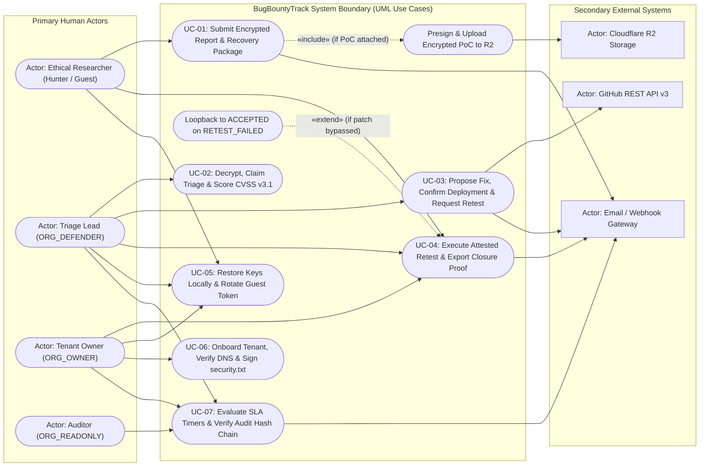
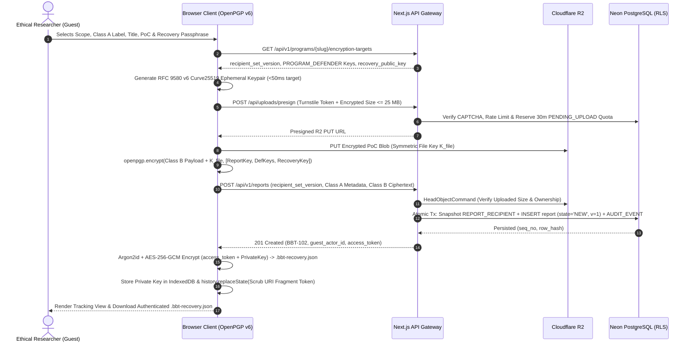
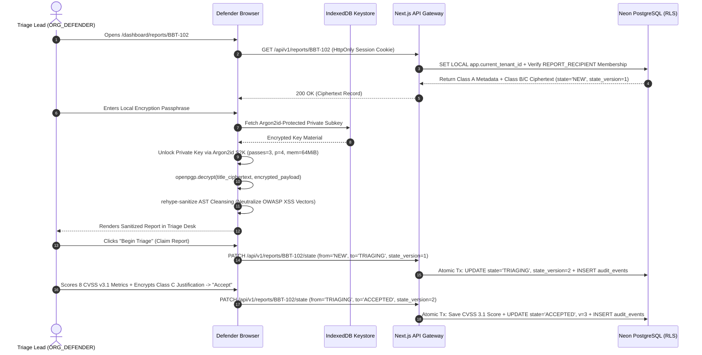
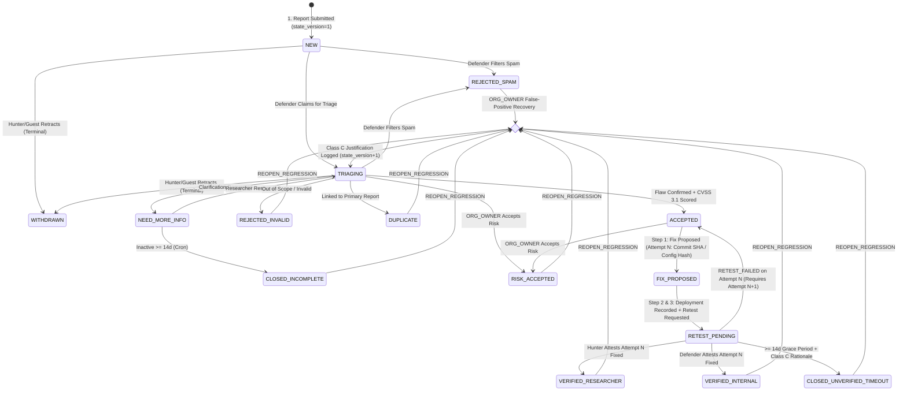

# Punjab Tianjin University of Technology
### Department of Software Engineering Technology
## FINAL YEAR PROJECT (FYP) ENGINEERING SPECIFICATION
# SOFTWARE REQUIREMENTS SPECIFICATION (SRS)
### Project: BugBountyTrack
**A Multi-Tenant Vulnerability Disclosure Platform with Client-Side Cryptographic Payload Isolation and Evidence-Based Remediation Traceability**

---

| Academic & Engineering Parameter | Specification |
| :--- | :--- |
| **Student Author** | Taha Asadullah |
| **Roll Number / Student ID** | `24-ST-013` |
| **Session** | Session 2024–2028 |
| **Batch / Section** | Batch 24-SET-Fall / Section SET-B |
| **Official Student Email** | `24-st-013@students.ptut.edu.pk` |
| **FYP Project Supervisor** | Sir Umar Hayat |
| **Project Identifier** | `PTUT - PRJ - 089` |
| **Department Sub-Field** | 9. Cybersecurity, Privacy & LegalTech |
| **Milestone** | **Week 2** — Software Requirements Specification (**Gate 1: DoR Part II**) |
| **Specification Structure** | Structured in accordance with IEEE Std 830-1998 & ISO/IEC/IEEE 29148:2018 |
| **Client Platform** | Modern Web (Next.js 14+ App Router, React 18+, TypeScript 5.x, Tailwind CSS, OpenPGP.js v6) |
| **Backend & API Engine** | Unified Next.js Fullstack (Serverless API Routes on Node.js 22 LTS) |
| **Database Architecture** | PostgreSQL 16 (Neon Serverless Cloud) / Prisma ORM 5.x (`FORCE ROW LEVEL SECURITY` & Hash-Chained Audit) |
| **Document Status** | Baseline Revision 2.2 — Submitted for Supervisor Review & Milestone Endorsement |

---

## Supporting Deliverable Document (Google Drive Link)

| Deliverable Document | Scope Covered | Repository & Cloud Reference |
| :--- | :--- | :--- |
| **Formal IEEE 830 Software Requirements Specification (`SRS.docx`)** | Complete IEEE 830 SRS, Field-Level Encryption Classification, Functional Requirements (`FR-1` to `FR-8`), Formal Use Cases (`UC-01` to `UC-07`), 4 UML Behavioral Diagrams, Reproducible NFRs (`NFR-01` to `NFR-09`), and Full RTM | Word Deliverable: `requirements/SRS.docx` (Upload to Google Drive and replace link when ready) |

---

## Table of Contents

1. Introduction
   - 1.1 Purpose & Target Scope
   - 1.2 Document Conventions & Priority Schema
   - 1.3 Intended Audience & Stakeholder Matrix
   - 1.4 Problem Statement & Alignment with Week 1 Discovery Baseline (5 Core MVP Features)
2. Overall Description & Cryptographic Protection Boundary
   - 2.1 System Context & Logical Boundaries
   - 2.2 Defensible Protection Boundary, Cryptographic Assumptions & Explicit Limitations
   - 2.3 Field-Level Cryptographic & Visibility Classification Matrix (Table 2.1)
   - 2.4 User Classes, Target Personas & Authorization Model
   - 2.5 Operating Environment & Technical Bounds
   - 2.6 Design, Quota & Infrastructure Constraints
3. Specific Functional Requirements (FR)
   - 3.1 Multi-Tenant Workspaces, Onboarding, Guest Intake & Access Governance (`FR-1`)
   - 3.2 RFC 9116 Policy Discovery & Safe Harbor Engine (`FR-2` — MVP Feature 1)
   - 3.3 Client-Side OpenPGP Cryptographic Pipeline & Key Lifecycle Management (`FR-3` — MVP Feature 2)
   - 3.4 Deterministic CVSS 3.1 Base Scoring Engine (`FR-4` — MVP Feature 3)
   - 3.5 Confidential Triage, Dual-Lane Threading & SLA Timers (`FR-5` — MVP Feature 2)
   - 3.6 Git-Linked & Configuration-Hash Remediation Verification (`FR-6` — MVP Feature 4)
   - 3.7 15-State Lifecycle FSM, Attested Retest & Redacted Closure Exports (`FR-7` — MVP Feature 5)
   - 3.8 Application Hardening, Forced RLS, Upload Reservations & Hash-Chained Audit Ledger (`FR-8` — MVP Feature 5)
4. System Modeling & UML Behavioral Specifications
   - 4.1 Formal Textual Use Case Specifications (`UC-01` to `UC-07`)
   - 4.2 System Use Case Diagram (Figure 4.1)
   - 4.3 Sequence Diagram: Browser-Side OpenPGP Submission & Presigned Upload (Figure 4.2)
   - 4.4 Sequence Diagram: In-Browser Decryption, Triage & CVSS Assessment (Figure 4.3)
   - 4.5 State Machine Diagram: 15-State Remediation & Attested Retest Lifecycle (Figure 4.4)
5. External Interface Requirements
   - 5.1 Complete User Interfaces & Screen Catalog (`SCR-01` to `SCR-12`)
   - 5.2 Software & External API Interfaces
6. Quantifiable Non-Functional Requirements (Latency, Security & Uptime)
7. Verification, Acceptance Criteria & Complete Bidirectional Traceability
   - 7.1 Complete Bidirectional Requirements Traceability Matrix (RTM)
   - 7.2 Verification Test Pyramid & Acceptance Criteria
8. Document Submission & Milestone Sign-Off

---

## 1. Introduction

### 1.1 Purpose & Target Scope

This Software Requirements Specification (SRS) defines the engineering requirements baseline for **BugBountyTrack** (`PTUT - PRJ - 089`). It specifies the functional workflows, field-level cryptographic boundaries, key lifecycle and recovery rules, deterministic severity scoring mathematics, 15-state vulnerability lifecycle finite state machine (FSM), formal Use Case specifications, and quantifiable non-functional acceptance targets (latency, security, and uptime) for our Final Year Project prototype, structured in accordance with **IEEE Std 830-1998** and **ISO/IEC/IEEE 29148:2018**.

### 1.2 Document Conventions & Priority Schema

Every requirement in this specification has a unique, traceable identifier (`FR-X.Y` for Functional Requirements, `NFR-XX` for Non-Functional Requirements, and `UC-XX` for Use Cases) and is assigned a build-consistent priority so that **no P1 requirement ever depends on a P2 component**:

* **P1 (Mandatory Core Release)**: All capabilities required for the end-to-end buildable prototype—including multi-tenant authentication, guided onboarding, DNS TXT verification, RFC 9116 policy signing, client-side OpenPGP v6 encryption, personal/guest/master key recovery, CVSS v3.1 calculation, dual-lane triage, Git commit/config hash verification, the 15-state attested retest workflow, scheduled timeout/SLA checks, quota enforcement, and the hash-chained audit ledger.
* **P2 (Secondary Operational Enhancements)**: Supplementary capabilities that extend convenience without blocking any P1 workflow (specifically: tokenized private program invitations in `FR-1.5`, reviewer duplicate-linking convenience in `FR-5.5`, and formatted PDF/JSON redacted export generation in `FR-7.7`).

### 1.3 Intended Audience & Stakeholder Matrix

| Stakeholder Role | Interaction with Specification | Primary Concerns |
| :--- | :--- | :--- |
| **Taha Asadullah (Student Author)** | Implementation lead; constructs and tests the system against this specification. | Unambiguous state transitions, cryptographic boundary clarity, concurrency rules, and verifiable test criteria. |
| **Sir Umar Hayat (Academic Supervisor)** | Academic evaluator; audits requirements consistency, state machine completeness, and empirical verification evidence. | Elimination of logical contradictions, realistic security claims, complete traceability, and defense readiness. |
| **Software Engineering Peers** | Participants in controlled usability and security evaluation (3–5 peers). | Ergonomics of encrypted report submission, key recovery, triage decryption, and retest attestation. |

### 1.4 Problem Statement & Alignment with Week 1 Discovery Baseline (5 Core MVP Features)

Small and medium software engineering teams (5–50 developers) frequently coordinate incoming vulnerability reports through ad-hoc channels such as generic `security@company.com` email inboxes, shared spreadsheets, or general-purpose issue trackers, or rely on server-managed intake forms where third-party platform servers hold unencrypted report contents. These workflows create four concrete operational problems:
1. External researchers lack standardized **RFC 9116 `security.txt` discovery** and clear **Safe Harbor** scope definitions prior to testing.
2. Sensitive vulnerability titles, reproduction steps, and proof-of-concept (PoC) attachments are transmitted or stored in **server-readable plaintext** across mail servers and ticket databases.
3. Triage teams rely on inconsistent, subjective severity ratings rather than deterministic **FIRST.org CVSS v3.1** vector evaluations.
4. Developers frequently mark security tickets "Closed" **without linking a verified remediation Git commit SHA (or configuration artifact hash) or recording an attested retest** tied to that specific fix attempt.

**BugBountyTrack** addresses these four operational problems through **five core MVP features**, preserved identically from our Week 1 Discovery Baseline:
1. **MVP Feature 1 — RFC 9116 `security.txt` Policy & Safe Harbor Engine** (`FR-2.1` – `FR-2.5`)
2. **MVP Feature 2 — Client-Side End-to-End Encrypted (OpenPGP v6) Submission & Multi-Tenant Triage Workspace** (`FR-1.1` – `FR-1.6`, `FR-3.1` – `FR-3.9`, `FR-5.1` – `FR-5.5`)
3. **MVP Feature 3 — Deterministic CVSS v3.1 Base Severity Calculator** (`FR-4.1` – `FR-4.4`)
4. **MVP Feature 4 — Git Commit SHA & Configuration Hash Remediation Verifier** (`FR-6.1` – `FR-6.5`)
5. **MVP Feature 5 — Attested Retest State Machine, Redacted Closure Exports & Append-Only Audit Ledger** (`FR-7.1` – `FR-7.7`, `FR-8.1` – `FR-8.5`)

---

## 2. Overall Description & Cryptographic Protection Boundary

### 2.1 System Context & Logical Boundaries

BugBountyTrack is organized into three logical tiers (detailed 3-Tier Architecture and Level 0 / Level 1 Data Flow Diagrams are specified in the Week 3 Architecture Deliverable):
1. **Client Browser Runtime**: Next.js 14+ App Router, React 18+, Tailwind CSS, `OpenPGP.js v6` client-side encryption/decryption/signing, `rehype-sanitize` Markdown AST sanitizer, and WebCrypto API (`crypto.subtle`).
2. **Application API Gateway**: Next.js Route Handlers running on Node.js 22 LTS, enforcing Role-Based Access Control (RBAC), database-persisted sessions, optimistic concurrency checks (`recipient_set_version` and `state_version`), Turnstile CAPTCHA and upload quota reservations, SLA/timeout cron evaluation, and GitHub REST API v3 commit/branch comparisons.
3. **Persistence & Object Storage Layer**: Neon Serverless PostgreSQL 16 (enforcing `FORCE ROW LEVEL SECURITY` under a non-superuser runtime role and an append-only hash-chained audit ledger) and Cloudflare R2 (storing client-encrypted binary PoC attachments).

### 2.2 Defensible Protection Boundary, Cryptographic Assumptions & Explicit Limitations

Rather than claiming blanket "zero-knowledge" across the entire application, BugBountyTrack defines an explicit **Client-Side End-to-End Encrypted (E2EE) Payload Isolation Boundary**:

* **What Is Cryptographically Isolated from the Server**: All sensitive vulnerability text and files (classified as **Class B** and **Class C** in Table 2.1—including report titles, vulnerability descriptions, reproduction steps, PoC attachments, discussion messages, internal reviewer notes, CVSS justifications, rejection explanations, risk-acceptance rationales, remediation summaries, and retest notes) are encrypted in the client browser using OpenPGP multi-recipient packets before network transmission. The backend server, PostgreSQL database, and Cloudflare R2 store ciphertext only.
* **What the Server Intentionally Knows (Class A Operational Metadata)**: To route reports, enforce tenant quotas, calculate SLA deadlines, verify Git commits, and maintain a state machine, the server intentionally stores and processes plaintext operational metadata: organization/program identifiers, actor IDs, timestamps, workflow state (`state`, `state_version`), a coarse 8-value category enum (`operational_label`), target asset identifier (`asset_scope`), CVSS v3.1 vector string and numeric score (`cvss_vector`, `cvss_score`), remediation reference metadata (`commit_sha`, `branch_name`, `config_hash`, `deployment_env`), and cryptographic hashes. While `operational_label = AUTHENTICATION_BYPASS` does not reveal an exploit payload, it is meaningful operational metadata and is protected via PostgreSQL Row-Level Security and RBAC.
* **Algorithm Pinning & Explicit OpenPGP.js v6 Configuration**: All keys are standardized on **RFC 9580 Version 6 Curve25519 (`Ed25519` for signing and `X25519` for encryption)** with **64-character hexadecimal SHA-256 fingerprints**. Because merely importing `OpenPGP.js v6` defaults to v4 keys unless configured, the client cryptographic wrapper explicitly sets `openpgp.config.v6Keys = true` and `openpgp.config.s2kArgon2Params = { passes: 3, parallelism: 4, memoryExponent: 16 }` (`2^16 KiB = 65,536 KiB = 64 MiB` RAM). Legacy RSA-4096 and OpenPGP v4 keys are rejected.
* **Report-Scoped Encryption Recipients (`REPORT_RECIPIENT`)**: At the moment a report is submitted, the server snapshots the program's active `PROGRAM_DEFENDER` roster into a report-scoped `REPORT_RECIPIENT` table for that report. Subsequent discussion messages, retest notes, and attachments on that report are encrypted **strictly for the report's `REPORT_RECIPIENT` list** (plus the Submitter for shared Class B items and the offline `recovery_public_key`). Consequently, a newly added program defender **does not** automatically receive decryption access to future discussion messages on older reports unless an existing authorized defender explicitly executes the audited **Session Key Re-Wrapping (`HISTORICAL_ACCESS_GRANTED`)** ceremony (`FR-3.8`), which re-wraps the report's session keys and adds the defender to `REPORT_RECIPIENT`.
* **Explicit Cryptographic & Runtime Limitations**:
  1. *Browser Code & Key-Distribution Trust*: Within the web security model, the client browser trusts the application bundle delivered over HTTPS (hardened with Subresource Integrity and strict Content Security Policy) and the server's public-key directory endpoint (`recipient_set_version`). To detect silent public-key substitution by a compromised server, researchers can verify the organization's public key fingerprint against the cleartext-signed `https://[org-domain]/.well-known/security.txt` hosted on the organization's own domain (`FR-2.3`).
  2. *Prior-Access Revocation Limitation*: Removing a departing defender from `PROGRAM_DEFENDER` and `REPORT_RECIPIENT` immediately blocks their API access and excludes their public key from future messages, but **cannot retroactively erase ciphertext or decrypted keys that the defender downloaded to their local machine prior to revocation**.
  3. *JavaScript Memory Hygiene Limitation*: On logout or key lock, the client explicitly overwrites owned `Uint8Array` buffers (`fill(0)`), deletes ephemeral keys from `IndexedDB` when requested, and nullifies references (`nullified`). However, because JavaScript strings are immutable and managed by an asynchronous garbage collector, this is a **best-effort defense-in-depth measure** and cannot guarantee physical RAM page zeroization against local OS memory dumps.

### 2.3 Field-Level Cryptographic & Visibility Classification Matrix (Table 2.1)

To eliminate ambiguity over which fields are plaintext vs. encrypted across PostgreSQL, Cloudflare R2, logs, notifications, and exports, every domain field is assigned to one of three strict classifications:

| Data Class | Cryptographic Envelope & Recipients | Exact Fields Included | Storage, Logging, Notification & Export Rules |
| :--- | :--- | :--- | :--- |
| **Class A: Plaintext Operational Metadata** | Stored in plaintext in PostgreSQL (protected by `FORCE ROW LEVEL SECURITY` and TLS 1.3 in transit). | `organization_id`, `program_id`, `report_id`, `hunter_id`, `guest_actor_id`, `state`, `state_version`, `operational_label` (8-value enum), `asset_scope`, `cvss_vector`, `cvss_suggested`, `cvss_score`, `rejection_code` (coarse enum: `OUT_OF_SCOPE`, `NON_REPRODUCIBLE`, `SPAM`), `remediation_attempt_no`, `evidence_type`, `commit_sha`, `branch_name`, `verified_branch_head_sha`, `github_signature_verified`, `config_hash`, `deployment_env`, `deployed_version`, `timestamps`, `seq_no`, `prev_hash`, `row_hash`. | **Permitted** in SQL indexes, metadata-only email/webhook notifications (`Report ID`, `operational_label`, `state`, `timestamp`), and default **Redacted Closure Evidence Exports** (`FR-7.7`). Contains **zero** free-text exploit details. |
| **Class B: Encrypted Shared Content (`RESEARCHER_ORG`)** | OpenPGP v6 multi-recipient ciphertext encrypted for: **Submitter Key** + **`REPORT_RECIPIENT` Keys** + **`recovery_public_key`**. | `title_ciphertext`, `description_ciphertext`, `reproduction_steps_ciphertext`, `impact_ciphertext`, encrypted PoC attachment blobs in Cloudflare R2, `RESEARCHER_ORG` discussion messages (`encrypted_body`), **Rejection Reason Details (`rejection_reason_ciphertext`)**, **Remediation Summary & Retest Instructions (`remediation_notes_ciphertext`)**, and **Retest Verification Logs (`verification_notes_ciphertext`)**. | Persisted as **ciphertext only**. Never written to server logs, telemetry, or email notifications. Excluded from Redacted Closure Exports by default. |
| **Class C: Encrypted Internal Content (`REVIEWER_INTERNAL`)** | OpenPGP v6 multi-recipient ciphertext encrypted strictly for: **`REPORT_RECIPIENT` Keys** + **`recovery_public_key`** (**Submitter Key Excluded**). | Reviewer internal discussion messages (`REVIEWER_INTERNAL` lane), **CVSS Severity Justification (`cvss_justification_ciphertext`)**, **Executive Risk-Acceptance Rationale (`risk_rationale_ciphertext`)**, and **Administrative Timeout / Reopen Justifications (`audit_justification_ciphertext`)**. | Persisted as **ciphertext only** and stripped by the API gateway before serving report records to `HUNTER` or `GUEST` sessions. Never included in external notifications or exports. |

### 2.4 User Classes, Target Personas & Authorization Model

1. **Multi-Organization & Dual-Hat User Model**:
   * A registered `USER` account is global and may hold `USER_MEMBERSHIP` records (`ORG_OWNER`, `ORG_DEFENDER`, or `ORG_READONLY`) in **one or more organizations** while also acting as an external `HUNTER` submitting reports to other organizations' programs (subject to conflict-of-interest rules blocking a user from submitting as an external `HUNTER` to a program where they hold an active `USER_MEMBERSHIP`).
2. **Persona 1: Alex Rivera — "The Hunter" (External Ethical Security Researcher / `HUNTER` or `GUEST`)**:
   * Independent security researcher and undergraduate cybersecurity student. Uses Kali Linux, Firefox Developer Edition, and Burp Suite. Requires verifiable RFC 9116 Safe Harbor discovery, frictionless authenticated or account-less guest submission, client-side E2EE payload isolation, deterministic CVSS v3.1 scoring, and an attested retest workflow tied to specific remediation attempts.
3. **Persona 2: Sarah Chen — "The Defender" (Startup Engineering & Security Triage Lead / `ORG_DEFENDER`)**:
   * Lead full-stack engineer managing vulnerability triage and remediation across a **7-developer startup engineering team (7 developers)** (aligned with Week 1 Persona 2). Requires encrypted vulnerability intake that keeps unpatched zero-day exploits out of plaintext emails and issue trackers, dual-lane discussion (`RESEARCHER_ORG` vs. `REVIEWER_INTERNAL`), objective CVSS v3.1 evaluation, Git commit SHA / configuration hash fix tracking, and redacted closure exports.
4. **Organization Owner (`ORG_OWNER`)**:
   * Provisions the organization workspace, completes DNS TXT domain verification, generates and tests the offline **Organization Master Recovery Key**, manages `USER_MEMBERSHIP` and `PROGRAM_DEFENDER` rosters, cleartext-signs `/.well-known/security.txt`, holds exclusive authority to approve `RISK_ACCEPTED` (`FR-7.3`) or reopen false-positive `REJECTED_SPAM` tickets (`FR-7.6`), and executes emergency Master Recovery Key ceremonies. **Decryption Boundary**: An `ORG_OWNER` cannot decrypt Class B/C report ciphertexts in daily operations unless they are also assigned as an active `PROGRAM_DEFENDER` on that report (`REPORT_RECIPIENT`) or explicitly invoke the audited Master Recovery Key ceremony (`MASTER_RECOVERY_INVOKED`).
5. **Read-Only Stakeholder / Auditor (`ORG_READONLY`)**:
   * Inspects Class A operational metadata, SLA countdown compliance, and the hash-chained `audit_events` ledger without access to Class B or Class C ciphertexts.

### 2.5 Operating Environment & Technical Bounds

* **Client Runtime**: Evergreen desktop and mobile browsers (Chromium >= 120, Firefox >= 120, Safari >= 17.0) supporting WebCrypto API (`crypto.subtle`), WebAssembly (`wasm-unsafe-eval` CSP for Argon2id), `FileReader` API, and `IndexedDB`.
* **Server Runtime**: Node.js 22 LTS executing Next.js 14+ App Router serverless handlers (maximum route execution timeout: 15 seconds).
* **Persistence Tier**: PostgreSQL 16 on Neon Serverless Cloud via Prisma ORM 5.x, paired with Cloudflare R2 S3-compatible object storage for encrypted binary attachments.

### 2.6 Design, Quota & Infrastructure Constraints

* **Bounded Academic Cluster Budget (`$0.00/month` Free-Tier Ceiling)**: To guarantee operation within free developer cloud tiers (Neon PostgreSQL `512 MB` storage limit, Cloudflare R2 `10 GB` storage / `1,000,000 Class A ops/mo`, Vercel Hobby/Education `100 GB-hrs/mo`), the academic evaluation deployment enforces a **global cluster cap of `<= 10 evaluation tenants`**, each bounded at **`50 MB` logical PostgreSQL tenant data** and **`2 GB` Cloudflare R2 object storage** (`10 x 50 MB = 500 MB <= 512 MB` Neon limit; `10 x 2 GB` oversubscribed with a global `9.5 GB` R2 circuit breaker).
* **Logical Tenant Database Quota Definition (`50 MB`)**: Because physical PostgreSQL heap pages, WAL segments, and B-tree indexes are shared across the database cluster, a tenant's `50 MB` (`52,428,800 bytes`) database quota is defined deterministically as the sum of `pg_column_size(row)` across all rows where `organization_id = :org_id` in `programs`, `reports`, `discussion_messages`, `remediation_records`, `retest_evidence`, and `audit_events`, maintained via an incremental byte-counter column (`organizations.db_bytes_used`) updated atomically on `INSERT`/`DELETE`.

---

## 3. Specific Functional Requirements (FR)

### 3.1 Multi-Tenant Workspaces, Onboarding, Guest Intake & Access Governance (`FR-1`)

* **FR-1.1 (P1, Core — Multi-Tenant Isolation & Composite Foreign Keys)**: The system shall isolate organization workspaces using an `organization_id` column on all tenant-scoped tables, enforced by composite foreign key constraints `(organization_id, id)` so that cross-organization references (e.g., linking a report from Organization A to a program or user membership in Organization B) are rejected at the relational constraint layer.
* **FR-1.2 (P1, Core — RBAC & Program-Level Authorization)**:
  * **FR-1.2a**: The server shall enforce organization-level roles (`ORG_OWNER`, `ORG_DEFENDER`, `ORG_READONLY`) via `USER_MEMBERSHIP` and global researcher access (`HUNTER`).
  * **FR-1.2b**: Access to retrieve report ciphertexts, presign attachment downloads, or post triage messages shall require active membership in `PROGRAM_DEFENDER` (`is_active = true`) and `REPORT_RECIPIENT` for that report, verified against `USER_MEMBERSHIP` in the same `organization_id`.
* **FR-1.3 (P1, Core — Authentication, Password Hashing & TOTP MFA)**:
  * **FR-1.3a**: User passwords shall be hashed on the server using **Argon2id** (`m = 65536 KiB [64 MiB], t = 3, p = 4, salt = 16 bytes, tag = 32 bytes`; with **Bcrypt** `cost = 12` supported solely for legacy fixture migration).
  * **FR-1.3b**: Authenticated sessions shall use 256-bit cryptographically random tokens persisted as SHA-256 hashes in the `SESSION` table and delivered via `HttpOnly; Secure; SameSite=Lax` cookies. Changing or resetting a password shall immediately delete all active `SESSION` rows for that user.
  * **FR-1.3c**: `ORG_OWNER` and `ORG_DEFENDER` accounts shall support RFC 6238 Time-Based One-Time Password (TOTP) Multi-Factor Authentication, with `totp_secret` encrypted at rest using AES-256-GCM under a server environment key.
* **FR-1.4 (P1, Core — Guided Onboarding Wizard)**: The platform shall provide a Guided Onboarding Wizard (`/onboarding`) enabling an `ORG_OWNER` to complete active setup tasks—workspace slug registration, DNS TXT challenge generation (`FR-2.5`), asset scope configuration, in-browser Curve25519 key generation, mandatory offline **Organization Master Recovery Key** (`recovery_public_key`) test decryption challenge (`FR-3.6`), and in-browser RFC 9116 `security.txt` cleartext signing (`FR-2.2`)—in **<= 15 minutes of active user interaction time** (excluding external DNS TTL propagation wait times).
* **FR-1.5 (P2, Secondary — Public & Private Program Access)**: The platform shall support public disclosure programs (`/programs/[slug]`) and private invitation-only programs (`/programs/[slug]/join?token=...`). The server shall persist only the SHA-256 hash (`token_hash`) of invitation tokens and reject uninvited submissions to private programs with HTTP `403 Forbidden`.
* **FR-1.6 (P1, Core — Account-Less Guest Vulnerability Intake & Authenticated Guest Recovery Package)**: External researchers shall be able to submit encrypted vulnerability reports without registering an account:
  * **FR-1.6a (Durable Guest Actor Identity)**: At submission, the server assigns an immutable UUIDv4 `guest_actor_id` stored on `REPORT.guest_actor_id` and referenced by all subsequent guest comments, retest attestations, and audit events so rotating bearer tokens never breaks historical attribution.
  * **FR-1.6b (Guest Access Token & Ephemeral Report Keypair)**: The browser generates an ephemeral RFC 9580 v6 Curve25519 keypair (`Ed25519` signing + `X25519` encryption; public key stored in `REPORT.guest_public_key`, private key stored in local `IndexedDB`), and the server issues a 256-bit opaque `access_token` (persisting only its SHA-256 hash `guest_token_hash`).
  * **FR-1.6c (Argon2id + AES-256-GCM Encrypted `.bbt-recovery.json` Guest Recovery Package)**: At submission, the guest sets a recovery passphrase (or copies a browser-generated 6-word Diceware passphrase). The browser derives a 256-bit key via **Argon2id** (`t = 3, m = 65536 KiB, p = 4`, random 16-byte `salt`) and encrypts **both `{ access_token, ephemeral_private_key }` inside an AES-256-GCM authenticated ciphertext envelope** (`iv`, `ciphertext`, `gcm_auth_tag`) bound via Additional Authenticated Data (`AAD`) to `{ version: 1, report_id, guest_actor_id, key_format: "openpgp-rfc9580-v6", key_fingerprint }`. Because `access_token` is inside the AES-256-GCM ciphertext, possession of the `.bbt-recovery.json` Guest Recovery Package without the recovery passphrase reveals **zero bearer credentials**, and any modification to cleartext headers or ciphertext is rejected by AES-256-GCM authentication tag verification. If a guest clears `IndexedDB` and loses both their recovery passphrase and `.bbt-recovery.json`, guest session access cannot be recovered by the server.
  * **FR-1.6d (URI Fragment Scrubbing & Telemetry Sanitization)**: Immediate post-submission tracking URLs use a client-side URI fragment (`/report/track/BBT-RPT-XXXX#token=<access_token>`) which is never sent in HTTP request lines or `Referer` headers and is scrubbed on load via `window.history.replaceState(null, '', window.location.pathname)`. Error telemetry hooks strip all URI fragments and authorization headers.
  * **FR-1.6e (Local-Only Browser Restoration at `/report/restore`)**: Selecting `.bbt-recovery.json` on `/report/restore` parses and decrypts the file strictly in client memory using the browser `FileReader` and WebCrypto APIs; the recovery file is **never uploaded to the backend server**.
  * **FR-1.6f (Ed25519 Key Proof-of-Possession & Token Rotation)**: While read-only report polling authenticates via `Authorization: Bearer <access_token>` (`guest_token_hash`), any guest state/content mutation—posting a message, withdrawing a report, submitting a retest attestation (`VERIFIED_RESEARCHER` or `RETEST_FAILED`), or rotating a compromised token (`POST /api/v1/reports/{id}/guest-token/rotate`)—requires **both** the valid bearer token **and** a detached **Ed25519 signature** (`X-Guest-Signature`) over `SHA-256(report_id || state_version || action || payload_sha256 || timestamp)` verified by the server against `REPORT.guest_public_key`. Rotating a guest token invalidates the prior `guest_token_hash` (rendering older `.bbt-recovery.json` bearer tokens invalid for API calls) and triggers immediate client-side generation of an updated `.bbt-recovery.json` file.

### 3.2 RFC 9116 Policy Discovery & Safe Harbor Engine (`FR-2` — MVP Feature 1)

* **FR-2.1 (P1, Core — RFC 9116 Manifest Generation)**: The platform shall generate an RFC 9116 compliant text manifest at `/api/v1/programs/[slug]/security.txt` containing the standard RFC 9116 directives: `Contact` (pointing to the program's encrypted submission URI), `Expires` (ISO 8601 timestamp capped at `<= 365 days` from signing, with automated dashboard warnings 30 days before expiry), `Encryption` (URI to the program's OpenPGP v6 public keyring), `Policy` (URI to the hosted Safe Harbor & Scope policy page), `Acknowledgments`, `Preferred-Languages`, and `Canonical`.
* **FR-2.2 (P1, Core — In-Browser OpenPGP Cleartext Signing)**: The `security.txt` manifest shall be **cleartext-signed in the client browser** (`-----BEGIN PGP SIGNED MESSAGE-----`) using the `ORG_OWNER`'s private Ed25519 signing key without transmitting the private key to the server.
* **FR-2.3 (P1, Core — Signature & Fingerprint Verification)**: The platform shall verify cleartext-signed `security.txt` manifests against the organization's advertised 64-character SHA-256 public key fingerprint, allowing researchers to cross-verify the platform's encryption key against `https://[org-domain]/.well-known/security.txt`.
* **FR-2.4 (P1, Core — Structured Asset Scope & Hosted Safe Harbor Terms)**: Recognizing per RFC 9116 Section 1 that `security.txt` is a discovery manifest rather than a standalone legal contract, the platform shall host the human- and machine-readable **Safe Harbor & Scope Policy** at the URI referenced by the `Policy:` directive (`/programs/[slug]`), defining structured **In-Scope (`IN_SCOPE`)** and **Out-of-Scope (`OUT_OF_SCOPE`)** asset tables and good-faith Safe Harbor authorization clauses adapted from Disclose.io Core terms.
* **FR-2.5 (P1, Core — DNS TXT Domain Ownership Verification)**: Prior to marking an organization domain as `DOMAIN_VERIFIED` for public discovery, the backend shall verify domain ownership via Node.js `dns.promises.resolveTxt('_bbt-challenge.<domain>')` matching the tenant's unique verification token (sandbox evaluation workspaces may operate in `[SANDBOX_UNVERIFIED_DOMAIN]` mode during local grading without blocking P1 onboarding).

### 3.3 Client-Side OpenPGP Cryptographic Pipeline & Key Lifecycle Management (`FR-3` — MVP Feature 2)

* **FR-3.1 (P1, Core — Pinned RFC 9580 v6 Curve25519 Key Generation)**: The client browser shall generate OpenPGP keypairs pinned strictly to **RFC 9580 Version 6 Curve25519 (`Ed25519` primary signing key + `X25519` encryption subkey)** by enforcing `openpgp.config.v6Keys = true`. Key fingerprints shall be 64-character lowercase hexadecimal SHA-256 strings. Bare keypair generation in `< 50 ms` is designated as a provisional benchmark target on reference hardware.
* **FR-3.2 (P1, Core — Argon2id S2K `IndexedDB` Keystore)**: Private keys in browser `IndexedDB` (zero `localStorage` usage) shall be encrypted using OpenPGP **Argon2id S2K** configured via `openpgp.config.s2kArgon2Params = { passes: 3, parallelism: 4, memoryExponent: 16 }` (`65,536 KiB = 64 MiB`, introducing an intentional, estimated cryptographic delay of `~200–400 ms` during passphrase unlock). The application Content Security Policy (CSP) shall permit `'wasm-unsafe-eval'` strictly for OpenPGP.js WebAssembly execution while blocking `'unsafe-inline'` and `'unsafe-eval'` scripts.
* **FR-3.3 (P1, Core — Multi-Recipient Encryption & `recipient_set_version` Concurrency Guard)**:
  * **FR-3.3a**: On initial report submission, all Class B fields (`title_ciphertext`, description, reproduction steps, impact, and PoC attachments) shall be encrypted for: (1) all active `PROGRAM_DEFENDER` subkeys (up to 10 defenders, snapshotted into `REPORT_RECIPIENT`), (2) the organization's `recovery_public_key`, and (3) the submitter's public encryption key.
  * **FR-3.3b**: The submission payload shall include the program's `recipient_set_version`. If `recipient_set_version` changed concurrently, the server shall reject the submission with HTTP `409 Conflict` and return the updated keyring so the browser re-encrypts automatically.
* **FR-3.4 (P1, Core — Encrypted Title & Coarse `operational_label` Enum)**: The specific vulnerability title shall be encrypted as `title_ciphertext` (Class B), while the submitter selects a coarse Class A `operational_label` enum (`AUTHENTICATION_BYPASS`, `INJECTION_VULNERABILITY`, `INFORMATION_DISCLOSURE`, `CROSS_SITE_SCRIPTING`, `ACCESS_CONTROL_ISSUE`, `DENIAL_OF_SERVICE`, `CRYPTOGRAPHIC_CONFIGURATION`, or `OTHER`) for queue filtering and non-leaking notifications.
* **FR-3.5 (P1, Core — Abuse-Guarded Direct-to-R2 Encrypted Attachment Uploads & Safe Download Handling)**:
  * **FR-3.5a (Pre-Upload Abuse & Quota Check)**: Before issuing a presigned Cloudflare R2 upload URL (`POST /api/uploads/presign`), the server shall verify Cloudflare Turnstile CAPTCHA (for unauthenticated guests), enforce IP/user rate limits, validate that the declared **encrypted ciphertext byte size is `<= 25 MB` (`26,214,400 bytes`)**, and create a 30-minute `PENDING_UPLOAD` quota reservation against the tenant's `2 GB` R2 ceiling.
  * **FR-3.5b (Separate File Key Wrapping for Stale Keyring Resilience)**: The browser encrypts the attachment binary with a dedicated random 256-bit symmetric file key (`K_file`), uploads the ciphertext once to Cloudflare R2, and wraps `K_file` inside the report's OpenPGP payload (`REPORT_RECIPIENT`). If `recipient_set_version` is stale (`409 Conflict`) at report submission, the browser re-wraps `K_file` for the updated recipient set without re-uploading the binary blob to R2.
  * **FR-3.5c (Safe Decrypted Attachment Handling)**: Decrypted PoC attachments shall never be rendered inline in the DOM or inside an `<iframe>`; downloads are triggered via isolated `Blob` object URLs with forced `download` attributes, `Content-Disposition: attachment`, and `X-Content-Type-Options: nosniff`.
* **FR-3.6 (P1, Core — Offline Organization Master Recovery Key & Best-Effort Memory Hygiene)**: During onboarding, the browser generates an offline RFC 9580 v6 Curve25519 **Organization Master Recovery Keypair** (`recovery_public_key` stored on `PROGRAM`; private key exported offline encrypted with Argon2id S2K). Program activation requires passing an in-browser test decryption challenge using the exported file. Upon key lock or logout, temporary `Uint8Array` buffers are zeroized (`fill(0)`), ephemeral keys are deleted from `IndexedDB` when requested, and all in-memory JavaScript object references are immediately nullified as a best-effort defense-in-depth measure.
* **FR-3.7 (P1, Core — Registered User Key Backup & Multi-Device Portability)**: Registered `HUNTER`, `ORG_DEFENDER`, and `ORG_OWNER` users shall be able to export and import an Argon2id-protected **Personal Key Backup Bundle (`.bbt-user-keys.json`)** on `/settings/keys` (`SCR-10`, processed locally via `FileReader`) to migrate their private keys across devices or restore access after clearing browser storage.
* **FR-3.8 (P1, Core — Key Rotation, Defender Offboarding & Historical Session Key Re-Wrapping)**:
  * **FR-3.8a (Defender Offboarding & Key Compromise)**: When a defender leaves an organization or marks a key as compromised/expired (`REVOKED`), `ORG_OWNER` deactivates their `PROGRAM_DEFENDER` record and revokes their active `SESSION` rows. This atomically increments `recipient_set_version` so future submissions and future reports exclude the revoked key.
  * **FR-3.8b (Historical Report Isolation & `HISTORICAL_ACCESS_GRANTED` Re-Wrapping)**: A newly onboarded defender (`PROGRAM_DEFENDER`) or a defender who rotated keys after losing browser data without a `.bbt-user-keys.json` backup cannot decrypt pre-existing reports. To grant them access to specific active/historical reports, an existing authorized defender on `REPORT_RECIPIENT` (or `ORG_OWNER` using the offline Master Recovery Key in-browser) locally decrypts the report's session keys (`K_S`), re-wraps them for the new defender's public X25519 subkey, uploads the appended PKESK packet, adds the defender to `REPORT_RECIPIENT`, and records an immutable `HISTORICAL_ACCESS_GRANTED` (or `MASTER_RECOVERY_INVOKED`) audit event.
  * **FR-3.8c (Master Recovery Key Rotation)**: `ORG_OWNER` (authenticated via TOTP MFA) may rotate the program's `recovery_public_key` by completing a new offline key generation and decryption challenge, incrementing `recipient_set_version` for all subsequent reports.

### 3.4 Deterministic CVSS 3.1 Base Scoring Engine (`FR-4` — MVP Feature 3)

* **FR-4.1 (P1, Core — Deterministic FIRST.org CVSS v3.1 Mathematical Engine)**: While selecting appropriate metric values requires human security judgment, computing the resulting **CVSS v3.1 Base Score** (`0.0` to `10.0`) from a selected vector shall be 100% deterministic. The platform shall implement a pure, zero-dependency TypeScript engine using the official FIRST.org exploitability coefficient **`8.22`** and integer-scaled `RoundUp` ceiling function (`Math.ceil(Math.round(val * 100000) / 10000) / 10` per FIRST.org CVSS v3.1 Specification Appendix A to eliminate IEEE 754 floating-point drift), verified against **45 curated FIRST.org and NIST NVD reference fixtures** (`CVSS_TEST_FIXTURES.md`) and an exhaustive property test across all **2,592 valid Base metric combinations**.
* **FR-4.2 (P1, Core — 8 Base Metrics & Scope-Changed Weight Adjustment)**: The engine shall evaluate Attack Vector (`AV:N/A/L/P`), Attack Complexity (`AC:L/H`), Privileges Required (`PR:N/L/H`, applying official Scope-Changed weights `PR:L = 0.68`, `PR:H = 0.50` when `S:C` vs. `0.62` and `0.27` when `S:U`), User Interaction (`UI:N/R`), Scope (`S:U/C`), Confidentiality (`C:N/L/H`), Integrity (`I:N/L/H`), and Availability (`A:N/L/H`).
* **FR-4.3 (P1, Core — Canonical Vector Parser, Serializer & Severity Mapping)**: The engine shall parse, validate, and serialize canonical vector strings (`CVSS:3.1/AV:_/AC:_/PR:_/UI:_/S:_/C:_/I:_/A:_`), rejecting malformed or out-of-order vectors, and map numeric scores to official Qualitative Severity Ratings (`None: 0.0`, `Low: 0.1–3.9`, `Medium: 4.0–6.9`, `High: 7.0–8.9`, `Critical: 9.0–10.0`).
* **FR-4.4 (P1, Core — Decoupled Suggested vs. Official Score & Encrypted Justification)**: The `REPORT` record shall store both `cvss_suggested` (submitted by the researcher) and `cvss_score` / `cvss_vector` (assigned by the defender as Class A metadata), while the defender's written scoring rationale shall be encrypted in-browser as **`cvss_justification_ciphertext` (Class C Internal Content)** to prevent leaking sensitive architectural details in plaintext.

### 3.5 Confidential Triage, Dual-Lane Threading & SLA Timers (`FR-5` — MVP Feature 2)

* **FR-5.1 (P1, Core — In-Browser Decryption & Triage Desk)**: Authorized defenders in `REPORT_RECIPIENT` shall unlock their private X25519 subkey in-browser via Argon2id S2K to decrypt Class B and Class C ciphertexts on `/dashboard/reports/[id]`.
* **FR-5.2 (P1, Core — Dual-Lane Report-Scoped Encrypted Threading)**: The triage desk shall enforce two cryptographically isolated message lanes:
  * **Lane 1 (`RESEARCHER_ORG` — Class B)**: Encrypted for Submitter Key + `REPORT_RECIPIENT` Keys + `recovery_public_key`.
  * **Lane 2 (`REVIEWER_INTERNAL` — Class C)**: Encrypted strictly for `REPORT_RECIPIENT` Keys + `recovery_public_key` (excluding the researcher's key and stripped from researcher API responses).
* **FR-5.3 (P1, Core — Strict Class A Metadata-Only Notifications)**: Outbound email notifications (Resend/Postmark) and webhook alerts shall contain **Class A operational metadata only** (`Report ID`, `operational_label`, `from_state -> to_state`, `timestamp`, and portal URL), containing **zero bytes** of Class B or Class C content.
* **FR-5.4 (P1, Core — Severity-Driven SLA Countdown & Timeout Scheduler)**: An hourly scheduled server job (`/api/cron/lifecycle-evaluate`) shall evaluate Class A deadline timestamps (`Critical: 48h triage / 14d fix`, `High: 72h triage / 30d fix`, `Medium: 7d triage / 90d fix`, `Low: 14d triage / 180d fix`) and 14-day inactivity timers (`NEED_MORE_INFO` -> `CLOSED_INCOMPLETE`), rendering SLA countdown badges in the UI and dispatching metadata-only breach alerts.
* **FR-5.5 (P2, Secondary — Privacy-Preserving Duplicate Linking)**: Defenders may transition a report to `DUPLICATE` referencing a canonical parent `duplicate_of_report_id` within the same `organization_id` without exposing the parent report's ciphertext or reporter identity to the duplicate submitter.

### 3.6 Git-Linked & Configuration-Hash Remediation Verification (`FR-6` — MVP Feature 4)

* **FR-6.1 (P1, Core — Numbered Remediation Attempts & Three-Step Fix-to-Retest Workflow)**:
  * **FR-6.1a (Step 1 — Propose Fix: `ACCEPTED -> FIX_PROPOSED`)**: To transition a report from `ACCEPTED` to `FIX_PROPOSED`, an authorized defender must create a numbered `REMEDIATION_RECORD` (`remediation_attempt_no = 1, 2, ...`, UUID `remediation_record_id`) specifying `evidence_type` (`CODE_COMMIT` or `CONFIG_INFRASTRUCTURE`) and an encrypted remediation summary (`remediation_notes_ciphertext`, Class B).
  * **FR-6.1b (Step 2 — Record Target Deployment)**: On a `FIX_PROPOSED` record, the defender records the target deployment environment (`Staging`, `Pre-Production`, or `Production`), `deployed_version` string, and `deployed_at` timestamp confirming where the candidate fix is live.
  * **FR-6.1c (Step 3 — Request Retest: `FIX_PROPOSED -> RETEST_PENDING`)**: Only after `deployed_at` and `deployment_env` are recorded on the active `remediation_record_id` may the defender transition the report from `FIX_PROPOSED` to `RETEST_PENDING`, which dispatches a metadata-only retest invitation bound to that specific `remediation_record_id` and `remediation_attempt_no`.
* **FR-6.2 (P1, Core — GitHub REST API v3 Commit Existence, Ancestry Direction & Signature Metadata)**:
  * **FR-6.2a (Commit Existence & Signature Metadata)**: For `CODE_COMMIT` evidence, the server queries `GET /repos/{owner}/{repo}/commits/{commit_sha}` to verify that the 40-character hexadecimal SHA exists in the repository, recording the commit timestamp, author login/email metadata, and GitHub's `commit.verification.verified` boolean (`github_signature_verified`). The specification explicitly distinguishes retrieving commit author metadata from cryptographic identity verification.
  * **FR-6.2b (Explicit `BASE...HEAD` Branch Ancestry Check)**: The server queries `GET /repos/{owner}/{repo}/compare/{base}...{head}` with **`base = proposed_commit_sha`** and **`head = target_branch`**. Under GitHub's `BASE...HEAD` semantics, `proposed_commit_sha` is a merged ancestor of `target_branch` (or is the branch tip itself) if and only if the response `status` is **`ahead`** or **`identical`** (`behind_by == 0`). The server persists `verified_branch_head_sha` and `verified_at`, rejecting unmerged or divergent commits (`status == "behind"` or `"diverged"`) with HTTP `422 Unprocessable Entity`.
* **FR-6.3 (P1, Core — Configuration Artifact SHA-256 Hash Binding)**: For `CONFIG_INFRASTRUCTURE` evidence, the browser computes a 64-character SHA-256 hash (`config_hash`) over the supplied configuration file or policy diff via WebCrypto and submits the hash alongside `remediation_notes_ciphertext` (Class B). This hash binds the remediation record to an immutable byte snapshot for audit review; it does not autonomously prove live cloud infrastructure state.
* **FR-6.4 (P1, Core — Private Repository GitHub Credential Lifecycle & Fallback)**: `ORG_OWNER` may configure a fine-grained, read-only GitHub Personal Access Token (`Contents: Read-only`) in `/settings/integrations`, stored encrypted at rest using AES-256-GCM (`github_pat_ciphertext`) and revocable at any time. If the GitHub API returns `401/403` (revoked token) or `5xx` (rate-limit/outage), the server surfaces a clear verification status error and allows the defender to either refresh the token or record a manual commit patch SHA-256 digest flagged with `github_verified = false`.

### 3.7 15-State Lifecycle FSM, Attested Retest & Redacted Closure Exports (`FR-7` — MVP Feature 5)

* **FR-7.1 (P1, Core — Deterministic 15-State Vulnerability Lifecycle FSM & Atomic Concurrency)**:
  * **FR-7.1a (Exact 15 States)**: Every `REPORT` exists in exactly one of **15 distinct lifecycle states**:
    - **6 Active Workflow States**: `(1) NEW`, `(2) TRIAGING`, `(3) NEED_MORE_INFO`, `(4) ACCEPTED`, `(5) FIX_PROPOSED`, `(6) RETEST_PENDING`.
    - **3 Remediation Closure States**: `(7) VERIFIED_RESEARCHER`, `(8) VERIFIED_INTERNAL`, `(9) CLOSED_UNVERIFIED_TIMEOUT`.
    - **6 Non-Remediation Terminal States**: `(10) CLOSED_INCOMPLETE`, `(11) RISK_ACCEPTED`, `(12) REJECTED_INVALID`, `(13) DUPLICATE`, `(14) REJECTED_SPAM`, `(15) WITHDRAWN`.
  * **FR-7.1b (Atomic Optimistic Concurrency via `state_version`)**: Every state transition executes inside an atomic PostgreSQL transaction asserting `WHERE id = :report_id AND state = :expected_state AND state_version = :expected_version`, incrementing `state_version = state_version + 1` and inserting the linked `REMEDIATION_RECORD` / `RETEST_EVIDENCE` and `AUDIT_EVENT` in the same commit. Simultaneous conflicting actions (e.g., a researcher submitting `RETEST_FAILED` at the exact instant a defender submits `CLOSED_UNVERIFIED_TIMEOUT`) result in the second transaction affecting `0` rows and returning HTTP `409 Conflict`.
* **FR-7.2 (P1, Core — Three Distinct Remediation Closure States Bound to `remediation_record_id`)**: From `RETEST_PENDING`, a report transitions to remediation closure exclusively via one of three terminal states, each mandatory-linked via foreign key to the active `remediation_record_id` (`remediation_attempt_no`):
  1. `VERIFIED_RESEARCHER`: The submitting researcher (`HUNTER` or `GUEST` with Ed25519 signature proof-of-possession per `FR-1.6f`) confirms the fix on the target environment and submits `verification_notes_ciphertext` (Class B).
  2. `VERIFIED_INTERNAL`: An authorized `PROGRAM_DEFENDER` certifies the fix internally with `verification_notes_ciphertext` (Class B) and a boolean `verifier_authored_fix` conflict-of-interest disclosure.
  3. `CLOSED_UNVERIFIED_TIMEOUT`: Closed by an authorized defender after `>= 14 days` of researcher inactivity in `RETEST_PENDING`, requiring `audit_justification_ciphertext` (Class C). Never counted as a verified fix in metrics or exports.
* **FR-7.3 (P1, Core — Non-Remediation Terminal States & Authority Rules)**:
  * `WITHDRAWN`: Voluntarily retracted by the submitting researcher (`HUNTER` or `GUEST` with Ed25519 proof-of-possession) from **either `NEW` or `TRIAGING`**. Permanently terminal (`non-reopenable`).
  * `RISK_ACCEPTED`: Formal operational risk acceptance from **either `TRIAGING` or `ACCEPTED`**, restricted **exclusively to `ORG_OWNER`**, requiring `risk_rationale_ciphertext` (Class C) and a scheduled `risk_review_date`. Never counted as a remediated vulnerability.
  * `CLOSED_INCOMPLETE`: Automatic transition from `NEED_MORE_INFO` after `>= 14 days` of researcher inactivity.
  * `REJECTED_INVALID`: Transitioned from `TRIAGING` by an authorized defender with a Class A `rejection_code` enum and Class B `rejection_reason_ciphertext`.
  * `DUPLICATE`: Transitioned from `TRIAGING` by an authorized defender linked to an existing `duplicate_of_report_id` in the same organization.
  * `REJECTED_SPAM`: Transitioned from `NEW` or `TRIAGING` by an authorized defender for automated scanner noise.
* **FR-7.4 (P1, Core — `RETEST_FAILED` Loopback Bound to Remediation Attempt)**: If empirical retesting shows the vulnerability persists or the patch is bypassed, submitting a `RETEST_FAILED` attestation (bound to the tested `remediation_record_id` with `verification_notes_ciphertext`) automatically transitions the report from `RETEST_PENDING` back to `ACCEPTED`. A subsequent fix proposal must create a new `REMEDIATION_RECORD` (`remediation_attempt_no + 1`), preventing any prior retest record from associating with the new fix.
* **FR-7.5 (P1, Core — Automated 14-Day Clarification Timeout)**: Reports remaining in `NEED_MORE_INFO` for `>= 14 days` without a researcher reply are transitioned to `CLOSED_INCOMPLETE` by the hourly lifecycle cron job (`FR-5.4`).
* **FR-7.6 (P1, Core — Explicit Regression & False-Positive Reopening Rules)**:
  * Reports in `VERIFIED_RESEARCHER`, `VERIFIED_INTERNAL`, `CLOSED_UNVERIFIED_TIMEOUT`, `CLOSED_INCOMPLETE`, `RISK_ACCEPTED`, `REJECTED_INVALID`, or `DUPLICATE` may be reopened to `TRIAGING` (via event `REOPEN_REGRESSION`) by an authorized `PROGRAM_DEFENDER` or `ORG_OWNER` with mandatory `audit_justification_ciphertext` (Class C).
  * To recover accidental spam classifications, a report in `REJECTED_SPAM` may be reopened to `TRIAGING` **exclusively by `ORG_OWNER`** with mandatory `audit_justification_ciphertext` (Class C).
  * Only `WITHDRAWN` (researcher-retracted) is permanently non-reopenable.
* **FR-7.7 (P2, Secondary — Redacted Closure Evidence Export in PDF & JSON)**: Authorized defenders may generate a **Redacted Closure Evidence Export** containing strictly **Class A Plaintext Operational Metadata** by default (`report_id`, `operational_label`, `cvss_vector`, `cvss_score`, lifecycle transition timestamps, `remediation_attempt_no`, `commit_sha`, `branch_name`, `verified_branch_head_sha`, `config_hash`, `deployment_env`, terminal closure state, and the signed audit checkpoint hash chain), excluding all Class B and Class C ciphertexts so organizations can share verifiable closure records with external auditors without exposing exploit details.

### 3.8 Application Hardening, Forced RLS, Upload Reservations & Hash-Chained Audit Ledger (`FR-8` — MVP Feature 5)

* **FR-8.1 (P1, Core — Markdown AST Sanitization & OWASP XSS Corpus Neutralization)**: All decrypted Class B and Class C Markdown fields shall be parsed into an Abstract Syntax Tree (AST) and sanitized via `unified` / `remark-parse` / `rehype-sanitize` using a strict allowlist (forbidding `<script>`, `<iframe>`, `<object>`, `<svg>`, inline `style`, `javascript:`, `data:`, and `on*` event attributes), neutralizing **100% of the defined OWASP Cross-Site Scripting (XSS) Filter Evasion test corpus**.
* **FR-8.2 (P1, Core — Restricted Runtime Role & `FORCE ROW LEVEL SECURITY`)**:
  * **FR-8.2a**: Schema migrations shall execute under a separate `bbt_migrator` database role, whereas the Next.js application runtime shall connect exclusively as `bbt_app_runtime` configured with **`NOSUPERUSER NOCREATEDB NOCREATEROLE NOBYPASSRLS`**.
  * **FR-8.2b**: Every tenant-scoped table shall enforce both `ENABLE ROW LEVEL SECURITY` and **`FORCE ROW LEVEL SECURITY`**, with policies evaluating `organization_id = NULLIF(current_setting('app.current_tenant_id', true), '')::uuid` bound via `SET LOCAL` inside every interactive transaction.
  * **FR-8.2c**: Unauthenticated guest tracking requests (`/report/track/[id]`) and background cron jobs shall execute through narrowly scoped PostgreSQL `SECURITY DEFINER` functions (with locked `search_path = public, pg_temp`) that filter strictly by `(report_id, guest_token_hash)` or evaluate Class A SLA/timeout timestamps without granting broad table scan privileges.
* **FR-8.3 (P1, Core — Shared-Store Rate Limiting & Pre-Upload Turnstile CAPTCHA)**: Public report submission and presigned upload endpoints (`/api/v1/reports`, `/api/uploads/presign`) shall enforce shared PostgreSQL rate-limiting (`<= 5 submissions / hour / IP`, `<= 10 presign requests / hour / IP`) and Cloudflare Turnstile CAPTCHA verification before allocating storage or database rows.
* **FR-8.4 (P1, Core — Tenant Quota Accounting, Pending Upload Reservations & Orphan Cleanup)**:
  * Enforces `50 MB` logical PostgreSQL storage (`organizations.db_bytes_used`) and `2 GB` Cloudflare R2 storage (`organizations.r2_bytes_used` + active `PENDING_UPLOAD` reservations) per evaluation tenant (within the global `10-tenant` cluster cap).
  * Displays dashboard warnings at **90%** utilization and rejects new allocations at **100%** with HTTP `413 Payload Too Large`.
  * Before binding an uploaded R2 object to a `REPORT`, the server executes `HeadObjectCommand` to verify that the actual uploaded object size matches the reserved `ContentLength` (`<= 25 MB`) and belongs to the issuing tenant/session. Unbound `PENDING_UPLOAD` objects older than **30 minutes** are deleted from R2 and credited back to quota by the hourly cleanup job.
* **FR-8.5 (P1, Core — Canonical Tamper-Evident Hash-Chained Audit Ledger & External Checkpoint)**:
  * **FR-8.5a (Privilege Boundary)**: The `bbt_app_runtime` PostgreSQL role is granted `INSERT` and `SELECT` only on `audit_events` (`0` `UPDATE`, `DELETE`, or `TRUNCATE` privileges).
  * **FR-8.5b (Per-Tenant Gapless Ordering & Concurrency Lock)**: Each `audit_events` row is scoped per `organization_id` with a gapless, monotonically increasing `seq_no BIGINT` (starting at `1`, where `prev_hash = "0000...0000"`). Within the same database transaction as the state/evidence change, the server acquires a row lock (`SELECT seq_no, row_hash FROM audit_events WHERE organization_id = :org_id ORDER BY seq_no DESC LIMIT 1 FOR UPDATE`) to serialize concurrent appends and prevent competing chain heads.
  * **FR-8.5c (Canonical RFC 8785 JCS Hash Binding All Event Payloads)**: `row_hash` is computed as `SHA-256(RFC8785_JCS({ org_id, seq_no, report_id, state_version, actor_type, actor_id, action, from_state, to_state, remediation_record_id, evidence_payload_sha256, justification_ciphertext_sha256, timestamp_iso8601, prev_hash }))`. Because `evidence_payload_sha256` (covering `commit_sha`, `branch_name`, `config_hash`, `cvss_vector`, and `remediation_notes_ciphertext`) and `justification_ciphertext_sha256` are bound inside the hash input, modifying any remediation reference, CVSS score, or encrypted justification invalidates `row_hash`.
  * **FR-8.5d (External Witness Checkpoint & Scope of Proof)**: While `INSERT/SELECT`-only privileges prevent application-tier tampering, a privileged database superuser with raw disk access could theoretically rewrite rows and recompute hashes. To make privileged database tampering detectable, every outbound metadata notification email/webhook and every exported closure certificate includes an Ed25519-signed **Audit Checkpoint Receipt** (`{ org_id, seq_no, row_hash, timestamp }`), allowing independent verification against previously emitted external checkpoints. Furthermore, the specification explicitly notes that an audit record proves **who attested to an action, when, and against which commit/config hash**—it does not mathematically prove the absence of residual software bugs in the target application.

---

## 4. System Modeling & UML Behavioral Specifications

### 4.1 Formal Textual Use Case Specifications (`UC-01` to `UC-07`)

#### Use Case UC-01: Submit Encrypted Vulnerability Report & Generate Authenticated Recovery Package

* **Primary Actor**: Ethical Security Researcher (`Hunter` or `Guest Hunter`).
* **Preconditions**: Researcher is viewing an organization's active public program page (or holds a valid private program invitation token `token_hash`).
* **Main Success Scenario**:
  1. Researcher selects an in-scope target asset (`asset_scope`), selects a coarse Class A `operational_label` enum, enters the specific vulnerability title, reproduction steps, and optional PoC attachment (`<= 25 MB` encrypted size), and sets (or copies) a Guest Recovery Passphrase.
  2. Browser configures `OpenPGP.js v6` (`v6Keys = true`), generates an ephemeral RFC 9580 v6 Curve25519 keypair in memory (`< 50 ms` target), and fetches the program's active `PROGRAM_DEFENDER` subkeys (`recipient_set_version`) plus `recovery_public_key`.
  3. If an attachment is present: Browser completes Cloudflare Turnstile CAPTCHA and calls `POST /api/uploads/presign` with the encrypted file size. Server verifies CAPTCHA, rate limits, and tenant quota, reserves a 30-minute `PENDING_UPLOAD` slot, and returns a presigned R2 `PUT` URL. Browser encrypts the file with symmetric key `K_file` and uploads the ciphertext directly to Cloudflare R2.
  4. Browser encrypts all Class B fields (`title_ciphertext`, description, reproduction steps, impact, and `K_file` if attachment present) into a multi-recipient OpenPGP packet for the active `PROGRAM_DEFENDER` subkeys, `recovery_public_key`, and the reporter's key.
  5. Browser dispatches `POST /api/v1/reports` with `operational_label`, `recipient_set_version`, `title_ciphertext`, `encrypted_payload`, `guest_public_key`, and the R2 upload reference.
  6. Inside a single PostgreSQL transaction, the server validates Turnstile CAPTCHA, rate limits, `recipient_set_version`, and R2 object size (`HeadObjectCommand`), snapshots active `PROGRAM_DEFENDER` members into `REPORT_RECIPIENT`, inserts the `REPORT` in state `NEW` (`state_version = 1`), and appends `seq_no` to `audit_events`.
  7. For guest submitters, the server returns `report_id`, durable `guest_actor_id`, and `access_token`. Browser encrypts **both `access_token` and `ephemeral_private_key`** using Argon2id + AES-256-GCM into a downloadable `.bbt-recovery.json` package (`FR-1.6c`), stores the key in `IndexedDB`, displays the Secret Tracking URL (`/report/track/BBT-RPT-XXXX#token=<secret>`), and immediately scrubs the URI fragment via `window.history.replaceState`.
* **Extensions**:
  * *2a. Organization public key missing or invalid*: Browser blocks submission and alerts user.
  * *3a / 6a. Rate limit (`> 5/hr/IP`) or storage quota (`> 100%`) exceeded*: Server rejects at presign or submission with HTTP `429 Too Many Requests` or `413 Payload Too Large`.
  * *5a. Stale `recipient_set_version`*: Server returns HTTP `409 Conflict` with updated keyring; browser re-encrypts the text payload and `K_file` (without re-uploading the R2 attachment blob) and retries automatically.

#### Use Case UC-02: Decrypt, Claim for Triage & Score Vulnerability Report

* **Primary Actor**: Organization Triage Lead (`ORG_DEFENDER` in `REPORT_RECIPIENT`).
* **Preconditions**: Authenticated with `ORG_DEFENDER` role and listed in `REPORT_RECIPIENT` for the report; report is in state `NEW` or `TRIAGING`.
* **Main Success Scenario**:
  1. Defender opens `/dashboard/reports/[id]`. Browser fetches the ciphertext record (`state_version`) and retrieves the defender's encrypted private key from `IndexedDB`.
  2. Defender enters their local encryption passphrase to unlock the Argon2id S2K-protected private key (`~200–400 ms` intentional delay).
  3. Browser decrypts `title_ciphertext` and `encrypted_payload` in memory, sanitizes the Markdown AST via `rehype-sanitize`, and renders sanitized HTML.
  4. **Step 4a (Claim Intake: `NEW -> TRIAGING`)**: If the report is in `NEW`, the defender clicks "Begin Triage," atomically transitioning `NEW -> TRIAGING` (`state_version + 1`) and recording the assigned triager in `audit_events`.
  5. **Step 4b (Evaluate & Accept: `TRIAGING -> ACCEPTED`)**: Defender posts encrypted comments in either `RESEARCHER_ORG` (Class B) or `REVIEWER_INTERNAL` (Class C), selects the 8 CVSS v3.1 Base metrics, writes the encrypted scoring rationale (`cvss_justification_ciphertext`, Class C), and transitions the report from `TRIAGING` to `ACCEPTED` (`state_version + 1`).
  6. Server persists `cvss_vector`, `cvss_score`, and `cvss_justification_ciphertext` and appends a hash-chained `AUDIT_EVENT`.
* **Extensions**:
  * *2a. Passphrase incorrect*: Browser displays decryption error; private key remains locked.
  * *5a. Insufficient reproduction details*: Defender transitions `TRIAGING -> NEED_MORE_INFO` and posts a Class B clarification question (auto-transitions to `CLOSED_INCOMPLETE` after `>= 14 days` of researcher inactivity).
  * *5b. Duplicate submission*: Defender links canonical parent `duplicate_of_report_id` and transitions `TRIAGING -> DUPLICATE`.
  * *5c. Out of scope or invalid*: Defender selects Class A `rejection_code`, writes Class B `rejection_reason_ciphertext`, and transitions `TRIAGING -> REJECTED_INVALID`.
  * *5d. Automated scanner spam*: Defender transitions `NEW` or `TRIAGING -> REJECTED_SPAM` (reopenable only by `ORG_OWNER` if misclassified).
  * *5e. Operational risk acceptance*: `ORG_OWNER` transitions `TRIAGING` or `ACCEPTED -> RISK_ACCEPTED` with Class C `risk_rationale_ciphertext` and `risk_review_date`.

#### Use Case UC-03: Propose Remediation Evidence, Confirm Deployment & Request Retest

* **Primary Actor**: Organization Triage Lead (`ORG_DEFENDER` in `REPORT_RECIPIENT`).
* **Preconditions**: Report is in state `ACCEPTED`.
* **Main Success Scenario**:
  1. **Step 1 — Record Proposed Fix (`ACCEPTED -> FIX_PROPOSED`)**: Defender opens the Remediation Modal (`SCR-04`), selects `CODE_COMMIT` or `CONFIG_INFRASTRUCTURE`, and writes encrypted remediation notes (`remediation_notes_ciphertext`, Class B).
     - *Path A (`CODE_COMMIT`)*: Defender inputs repository, `target_branch`, and 40-char `commit_sha`. Server queries GitHub REST API v3 (`/commits/{sha}` and `/compare/{commit_sha}...{target_branch}`), verifies `status` is `ahead` or `identical`, and records `verified_branch_head_sha` and `github_signature_verified`.
     - *Path B (`CONFIG_INFRASTRUCTURE`)*: Browser computes a 64-char SHA-256 `config_hash` via WebCrypto over the configuration artifact.
     Server creates `REMEDIATION_RECORD` (`remediation_attempt_no = N`, `remediation_record_id`) and atomically transitions report state `ACCEPTED -> FIX_PROPOSED` (`state_version + 1`).
  2. **Step 2 — Confirm Target Environment Deployment**: Once the patch is deployed, the defender records the target `deployment_env` (`Staging`, `Pre-Production`, or `Production`), `deployed_version`, and `deployed_at` timestamp on `remediation_record_id`.
  3. **Step 3 — Request Retest (`FIX_PROPOSED -> RETEST_PENDING`)**: Defender triggers "Request Retest." Server verifies `deployed_at != NULL` on the active `remediation_record_id`, atomically transitions `FIX_PROPOSED -> RETEST_PENDING` (`state_version + 1`), records an `AUDIT_EVENT`, and sends a Class A metadata-only retest invitation referencing `remediation_attempt_no`.
* **Extensions**:
  * *1a. Commit SHA not found or not an ancestor of `target_branch` (`status` is `behind` or `diverged`)*: Server returns HTTP `422 Unprocessable Entity`; report remains in `ACCEPTED`.
  * *3a. Attempt to transition to `RETEST_PENDING` before recording deployment*: Server rejects with HTTP `400 Bad Request`.

#### Use Case UC-04: Execute Attested Retest Bound to Remediation Attempt & Export Closure Evidence

* **Primary Actor**: Ethical Security Researcher (`Hunter` / `Guest Hunter`) and Organization Triage Lead (`Defender`).
* **Preconditions**: Report is in state `RETEST_PENDING` with an active `remediation_record_id` (`remediation_attempt_no = N`).
* **Main Success Scenario**:
  1. Researcher inspects the linked `commit_sha` / `config_hash` and `deployment_env` for `remediation_attempt_no = N` and re-tests the target asset.
  2. Researcher writes encrypted verification notes (`verification_notes_ciphertext`, Class B) and submits a `VERIFIED_RESEARCHER` attestation bound to `remediation_record_id` (signed in-browser with the guest's Ed25519 report key if a guest submitter).
  3. Inside an atomic transaction checking `state == RETEST_PENDING` and `state_version`, the server persists `RETEST_EVIDENCE` (linked to `remediation_record_id`), transitions the report to `VERIFIED_RESEARCHER` (`state_version + 1`), and appends a hash-chained `AUDIT_EVENT` with a signed checkpoint receipt.
  4. Defender opens `SCR-08` and generates a **Redacted Closure Evidence Export** (PDF or JSON) containing strictly Class A metadata and the signed audit checkpoint chain.
* **Extensions**:
  * *2a. Vulnerability still exploitable (`RETEST_FAILED`)*: Researcher submits reproduction proof bound to `remediation_record_id`; server records `RETEST_EVIDENCE (fix_confirmed = false)` and atomically transitions `RETEST_PENDING -> ACCEPTED` (`state_version + 1`). Any subsequent fix requires `remediation_attempt_no = N + 1`.
  * *2b. Internal verification (`VERIFIED_INTERNAL`)*: Defender certifies the fix on `remediation_record_id` with `verification_notes_ciphertext` and `verifier_authored_fix` disclosure; state transitions to `VERIFIED_INTERNAL`.
  * *2c. Researcher unresponsive (`>= 14 days`)*: Defender submits `audit_justification_ciphertext` (Class C) and transitions `RETEST_PENDING -> CLOSED_UNVERIFIED_TIMEOUT`.
  * *2d. Simultaneous conflicting action (`409 Conflict`)*: If a researcher submits `RETEST_FAILED` while a defender simultaneously submits `CLOSED_UNVERIFIED_TIMEOUT`, the second transaction fails the `state_version` check and returns HTTP `409 Conflict`.

#### Use Case UC-05: Restore Guest or Registered User Keys & Rotate Compromised Guest Token

* **Primary Actor**: Account-Less Researcher (`Guest Hunter`) or Registered User (`Hunter` / `Defender` / `Owner`).
* **Preconditions**: Actor possesses an Argon2id + AES-256-GCM encrypted `.bbt-recovery.json` (guest) or `.bbt-user-keys.json` (registered user) file and its recovery passphrase.
* **Main Success Scenario**:
  1. Actor navigates to `/report/restore` (guest) or `/settings/keys` (registered user, `SCR-10`) and selects their backup JSON file.
  2. Browser reads the file strictly in local memory via `FileReader` (zero network upload), derives the 256-bit key via Argon2id S2K, and verifies the AES-256-GCM authentication tag (`gcm_auth_tag`).
  3. For guests: Browser decrypts `{ access_token, ephemeral_private_key }`, imports the private key into `IndexedDB`, and authenticates against `/report/track/BBT-RPT-XXXX` preserving durable `guest_actor_id` attribution.
  4. If the guest suspects their `access_token` was exposed, they click "Rotate Tracking Token," which signs a rotation request with their Ed25519 report key (`FR-1.6f`), invalidates the old `guest_token_hash` on the server, and downloads a new `.bbt-recovery.json` package.
* **Extensions**:
  * *2a. Wrong passphrase or tampered file*: AES-256-GCM authentication tag verification fails in browser memory; import is aborted with zero network calls.

#### Use Case UC-06: Onboard Tenant, Verify DNS, Configure Master Recovery Key & Sign `security.txt`

* **Primary Actor**: Organization Owner (`ORG_OWNER`).
* **Preconditions**: Authenticated user creating or configuring an organization workspace.
* **Main Success Scenario**:
  1. Owner completes the Guided Onboarding Wizard (`SCR-07`) and publishes the `_bbt-challenge.<domain>` DNS TXT record verified by the server (`FR-2.5`).
  2. Browser configures `openpgp.config.v6Keys = true` and generates the owner's Curve25519 keypair plus the offline **Organization Master Recovery Keypair** (`recovery_public_key`).
  3. Owner downloads the Argon2id-encrypted private Master Recovery Key file and completes the mandatory in-browser test decryption challenge (`Uint8Array` buffers zeroized immediately after verification).
  4. Owner assigns authorized defenders to `PROGRAM_DEFENDER` (incrementing `recipient_set_version`) and cleartext-signs the generated RFC 9116 `security.txt` manifest in-browser for publication at `/.well-known/security.txt`.

#### Use Case UC-07: Enforce Scheduled SLA / Inactivity Timers & Verify Hash-Chained Audit Ledger

* **Primary Actor**: Organization Reviewer (`ORG_DEFENDER`), Read-Only Auditor (`ORG_READONLY`), or Hourly System Cron.
* **Preconditions**: Active vulnerability reports exist within the tenant workspace.
* **Main Success Scenario**:
  1. Hourly lifecycle cron job (`/api/cron/lifecycle-evaluate`) evaluates Class A `sla_triage_due` and `sla_remediation_due` deadlines, transitions `NEED_MORE_INFO` reports inactive for `>= 14 days` to `CLOSED_INCOMPLETE`, and purges expired `PENDING_UPLOAD` reservations older than 30 minutes.
  2. Approaching or breached SLA targets trigger Class A metadata-only email and webhook alerts containing a signed Audit Checkpoint Receipt.
  3. Defenders and `ORG_READONLY` auditors inspect `/dashboard/audit` (`SCR-12`) to verify gapless `seq_no` ordering, RFC 8785 JCS `row_hash` continuity, and external checkpoint signatures.

---

### 4.2 System Use Case Diagram (Figure 4.1)

---

### 4.3 Sequence Diagram: Browser-Side OpenPGP Submission & Presigned Upload (Figure 4.2)

---

### 4.4 Sequence Diagram: In-Browser Decryption, Triage & CVSS Assessment (Figure 4.3)

---

### 4.5 State Machine Diagram: 15-State Remediation & Attested Retest Lifecycle (Figure 4.4)

#### Complete 15-State Transition & Concurrency Matrix

| # | Current State | Trigger Event / Action | Permitted Actor | Guard Conditions & Atomic Concurrency Rule (`state_version`) | Next State | Bound Evidence & Class A/B/C Classification |
| :---: | :--- | :--- | :--- | :--- | :--- | :--- |
| **1** | `NEW` | Claim for Triage | `ORG_DEFENDER` (`REPORT_RECIPIENT`) | `state == NEW` & `state_version` match | `TRIAGING` | Class A triager ID & intake timestamp |
| **2** | `NEW` / `TRIAGING` | Filter Scanner Spam | `ORG_DEFENDER` | Automated noise / non-actionable spam | `REJECTED_SPAM` | Class A `SPAM` code + `audit_events` row |
| **3** | `NEW` / `TRIAGING` | Withdraw Submission | `HUNTER` / `GUEST` | Valid session or Guest Ed25519 signature (`FR-1.6f`) | `WITHDRAWN` | Permanently terminal (`non-reopenable`) |
| **4** | `TRIAGING` | Request Clarification | `ORG_DEFENDER` | PoC incomplete; posts Class B inquiry | `NEED_MORE_INFO` | Class B message + 14-day timer started |
| **5** | `NEED_MORE_INFO` | Submit Clarification | `HUNTER` / `GUEST` | Supplementary Class B details provided | `TRIAGING` | Class B response payload; timer reset |
| **6** | `NEED_MORE_INFO` | 14-Day Inactivity Timeout | System Cron | Researcher inactive `>= 14 days` (`FR-7.5`) | `CLOSED_INCOMPLETE` | Class A automated timeout audit record |
| **7** | `TRIAGING` | Reject Invalid / Out-of-Scope | `ORG_DEFENDER` | Out of scope or non-reproducible | `REJECTED_INVALID` | Class A `rejection_code` + Class B reason |
| **8** | `TRIAGING` | Mark as Duplicate | `ORG_DEFENDER` | Same root cause as earlier report in org | `DUPLICATE` | Class A `duplicate_of_report_id` FK |
| **9** | `TRIAGING` / `ACCEPTED` | Accept Operational Risk | **`ORG_OWNER` only** | Management accepts risk without patch | `RISK_ACCEPTED` | Class C `risk_rationale_ciphertext` + review date |
| **10** | `TRIAGING` | Accept Vulnerability | `ORG_DEFENDER` | Valid in-scope flaw; CVSS 3.1 computed | `ACCEPTED` | Class A `cvss_vector`/`score` + Class C rationale |
| **11** | `ACCEPTED` | Propose Fix (Attempt `N`) | `ORG_DEFENDER` | GitHub `BASE...HEAD` (`ahead`/`identical`) OR 64-hex `config_hash` | `FIX_PROPOSED` | New `REMEDIATION_RECORD` (`attempt_no = N`) |
| **12** | `FIX_PROPOSED` | Confirm Deployment & Request Retest | `ORG_DEFENDER` | `deployment_env`, `deployed_version` & `deployed_at != NULL` recorded on Attempt `N` | `RETEST_PENDING` | Class A deployment metadata + Class B instructions |
| **13** | `RETEST_PENDING` | Retest Failed (`RETEST_FAILED`) | `HUNTER` / `GUEST` / `ORG_DEFENDER` | Flaw persists on Attempt `N` (Ed25519 signed if guest) | `ACCEPTED` | `RETEST_EVIDENCE (fix_confirmed=false)` bound to Attempt `N` |
| **14** | `RETEST_PENDING` | Researcher Confirms Fix | `HUNTER` / `GUEST` | Mitigated on Attempt `N` (Ed25519 signed if guest) | `VERIFIED_RESEARCHER` | `RETEST_EVIDENCE (fix_confirmed=true)` bound to Attempt `N` |
| **15** | `RETEST_PENDING` | Internal Defender Certifies Fix | `ORG_DEFENDER` | Mitigated on Attempt `N` + author conflict flag | `VERIFIED_INTERNAL` | `RETEST_EVIDENCE` bound to Attempt `N` + conflict flag |
| **16** | `RETEST_PENDING` | 14-Day Retest Grace Timeout | `ORG_DEFENDER` | Researcher inactive `>= 14 days` after invite | `CLOSED_UNVERIFIED_TIMEOUT` | Class C `audit_justification_ciphertext` (not a verified fix) |
| **17** | `VERIFIED_*` / `CLOSED_*` / `RISK_ACCEPTED` / `REJECTED_INVALID` / `DUPLICATE` | Reopen (`REOPEN_REGRESSION`) | `ORG_DEFENDER` / `ORG_OWNER` | Regression or new proof submitted | `TRIAGING` | Mandatory Class C `audit_justification_ciphertext` |
| **18** | `REJECTED_SPAM` | Recover False-Positive Spam | **`ORG_OWNER` only** | Accidental spam classification corrected | `TRIAGING` | Mandatory Class C `audit_justification_ciphertext` |

---

## 5. External Interface Requirements

### 5.1 Complete User Interfaces & Screen Catalog (`SCR-01` to `SCR-12`)

The platform provides a responsive, accessible web interface comprising **12 complete screens** covering all user, administrative, cryptographic, and audit workflows:
1. **`SCR-01: Public Program Discovery & Hosted Safe Harbor Policy (/programs/[slug])`**: Displays organization profile, hosted Safe Harbor legal terms (`FR-2.4`), structured `IN_SCOPE` and `OUT_OF_SCOPE` asset tables, rules of engagement, and the active 64-character SHA-256 public key fingerprint.
2. **`SCR-02: Cryptographic Report Submission & Guest Recovery Setup (/programs/[slug]/submit)`**: Form for selecting the Class A `operational_label` enum, entering the specific title (`title_ciphertext`), selecting `asset_scope`, suggesting a CVSS v3.1 vector, writing the Markdown description/PoC, uploading presigned encrypted attachments (`<= 25 MB`), and downloading the Argon2id + AES-256-GCM encrypted `.bbt-recovery.json` package.
3. **`SCR-03: Triage & Confidential Discussion Desk (/dashboard/reports/[id])`**: Passphrase-unlocked triage view displaying decrypted Class B/C content, Dual-Lane discussion threads (`RESEARCHER_ORG` vs. `REVIEWER_INTERNAL`), SLA countdown badge, interactive CVSS v3.1 calculator with Class C justification, and atomic lifecycle state transition controls.
4. **`SCR-04: Three-Step Remediation Proposal & Deployment Modal`**: Modal supporting Step 1 (`ACCEPTED -> FIX_PROPOSED` via GitHub commit SHA/branch compare or WebCrypto SHA-256 `config_hash`), Step 2 (recording `deployment_env`, `deployed_version`, and `deployed_at`), and Step 3 (`FIX_PROPOSED -> RETEST_PENDING`).
5. **`SCR-05: Attested Retest & Closure Modal`**: Verification modal bound to `remediation_record_id` (`remediation_attempt_no`) for submitting `VERIFIED_RESEARCHER` (with Ed25519 signature proof for guests), `VERIFIED_INTERNAL` (with conflict-of-interest disclosure), `RETEST_FAILED` (looping back to `ACCEPTED`), or `CLOSED_UNVERIFIED_TIMEOUT`.
6. **`SCR-06: Organization Policy, DNS Verification & GitHub Integration Settings (/settings/security-txt, /settings/integrations)`**: Interface for configuring RFC 9116 directives, executing in-browser cleartext OpenPGP signing, running DNS TXT challenge verification, and managing AES-256-GCM encrypted GitHub Personal Access Tokens.
7. **`SCR-07: Guided Onboarding Wizard (/onboarding)`**: Step-by-step setup wizard guiding new `ORG_OWNER` users through workspace creation, DNS TXT verification, local Curve25519 key generation, mandatory offline Master Recovery Key decryption challenge, and RFC 9116 `security.txt` signing.
8. **`SCR-08: Redacted Closure Evidence Export Modal (/dashboard/reports/[id]/export)`**: Export generator producing Class A metadata PDF and JSON closure certificates with signed audit checkpoint receipts.
9. **`SCR-09: Authentication, Registration & TOTP MFA Challenge (/auth/login, /auth/register, /auth/mfa)`**: Screens for email/Argon2id authentication, TOTP authenticator app QR enrollment, step-up MFA verification, and password reset with session revocation.
10. **`SCR-10: Cryptographic Key Management, Personal Backup, Guest Restore & Master Recovery Ceremony (/settings/keys, /report/restore)`**: Local `FileReader` interface for exporting/importing `.bbt-user-keys.json` (registered users), restoring `.bbt-recovery.json` and rotating guest tokens (guests), rotating/revoking compromised keys, and executing audited `HISTORICAL_ACCESS_GRANTED` / `MASTER_RECOVERY_INVOKED` session-key re-wrapping.
11. **`SCR-11: Organization Membership, Role & Program Defender Roster (/settings/members)`**: Administrative interface for `ORG_OWNER` to invite users to `USER_MEMBERSHIP` (`ORG_OWNER`, `ORG_DEFENDER`, `ORG_READONLY`), assign/remove `PROGRAM_DEFENDER` key recipients (`recipient_set_version`), and grant historical report access.
12. **`SCR-12: Multi-Tenant Vulnerability Queue, SLA Dashboard & Audit Ledger Explorer (/dashboard/reports, /dashboard/audit)`**: Filterable queue sorting reports by Class A metadata (`operational_label`, `state`, `cvss_score`, `sla_triage_due`), tenant storage quota meters (`50 MB` DB / `2 GB` R2), and an interactive hash-chain verifier inspecting `audit_events` (`seq_no`, `row_hash`, `prev_hash`).

### 5.2 Software & External API Interfaces

* **GitHub REST API v3**:
  * `GET /repos/{owner}/{repo}/commits/{commit_sha}`: Verifies 40-char commit SHA existence and retrieves commit author/timestamp metadata plus `commit.verification.verified` signature status.
  * `GET /repos/{owner}/{repo}/compare/{commit_sha}...{target_branch}` (`BASE...HEAD` where `base = commit_sha`, `head = target_branch`): Verifies that the proposed fix commit is an ancestor of (or identical to) the target branch tip (`status IN ('ahead', 'identical')` and `behind_by == 0`), recording `verified_branch_head_sha` and `verified_at`.
* **DNS Resolver (Node.js `dns.promises`)**: `resolveTxt('_bbt-challenge.<domain>')` verifying domain ownership tokens.
* **Resend / Postmark Transactional Email API**: `POST /emails` dispatching Class A metadata-only notifications and signed audit checkpoint receipts over TLS 1.3.
* **Cloudflare R2 Object Storage (S3-Compatible API)**: `PutObjectCommand`, `HeadObjectCommand`, `GetObjectCommand`, and `DeleteObjectCommand` managing presigned encrypted PoC uploads (`<= 25 MB` ciphertext) and 30-minute orphan reservation cleanup.

---

## 6. Quantifiable Non-Functional Requirements (Latency, Security & Uptime)

All performance, availability, and recovery thresholds below are established as **provisional engineering acceptance targets** to be empirically measured under the explicitly specified reference conditions during Phase 4 (Quality Assurance & Verification):

* **NFR-01 (Server API Latency Target & Reference Conditions)**:
  * **Target**: `p95 <= 300 ms` (warm invocation) and `p95 <= 1,200 ms` (serverless cold start) for non-cryptographic API endpoints (`GET /api/v1/programs`, `GET /api/v1/reports`, state transition `PATCH` routes).
  * **Measurement Conditions**: Measured via k6 running 20 concurrent virtual users (VUs) over 60 seconds against a Node.js 22 LTS serverless deployment connected to Neon PostgreSQL 16 (same regional zone, pooled via PgBouncer) with a seeded dataset of 10 organizations and 500 encrypted reports.
* **NFR-02 (Client Cryptographic Latency Benchmark & Reference Conditions)**:
  * **Target**: `< 50 ms` for bare RFC 9580 v6 Curve25519 keypair generation; `~200–400 ms` for Argon2id S2K key unlocking (`passes = 3, parallelism = 4, memoryExponent = 16 [64 MiB]`); and `<= 1,500 ms` for end-to-end multi-recipient payload encryption or decryption.
  * **Measurement Conditions**: Measured via Playwright `performance.now()` over 50 iterations in Chromium 120+ on reference hardware (4-core / 8-thread x86_64 CPU @ 2.8 GHz or Apple M1, 16 GB RAM), encrypting a `100 KB` Markdown payload across `5` recipient subkeys (`3` `PROGRAM_DEFENDER` keys + `1` `recovery_public_key` + `1` submitter key), measured separately from network transfer and Argon2id unlock time.
* **NFR-03 (Security — Zero Cross-Tenant Leakage under `FORCE ROW LEVEL SECURITY`)**:
  * **Target**: `0` unauthorized cross-tenant rows returned across 100% of integration test queries (`TC-SEC-01`).
  * **Measurement Conditions**: Verified against PostgreSQL 16 running under the `bbt_app_runtime` role (`NOSUPERUSER NOBYPASSRLS`) with `FORCE ROW LEVEL SECURITY` enabled on all tenant tables across interleaved PgBouncer pooled transactions for Tenant A and Tenant B.
* **NFR-04 (Accessibility & Usability — Automated Scan + Manual Human Evaluation)**:
  * **Target**: `0` critical/serious automated violations in `@axe-core/playwright` WCAG 2.2 Level AA scans (`>= 4.5:1` normal text contrast, `>= 24x24 CSS px` interactive targets), **combined with** a mandatory manual keyboard-navigation, focus-order, and screen-reader walkthrough across `SCR-01` through `SCR-12`, plus a System Usability Scale (SUS) score of **`>= 75.0`** across `3–5` peer evaluators. (Per W3C guidance, automated tooling alone cannot certify full WCAG 2.2 conformance without human review.)
* **NFR-05 (Security — Defined OWASP XSS Corpus Neutralization & CSP Hardening)**:
  * **Target**: `100%` neutralization of all test vectors in the project's **OWASP Cross-Site Scripting (XSS) Filter Evasion Test Corpus** (`100` curated malicious Markdown/HTML fixtures) via `rehype-sanitize` AST parsing, and `0` unexpected CSP violations under a strict Content Security Policy (`script-src 'self' 'wasm-unsafe-eval'; object-src 'none'; frame-ancestors 'none'`).
* **NFR-06 (Reliability — Logical DB Quota, R2 Reservation & Cluster Budget Enforcement)**:
  * **Target**: Enforce `50 MB` (`52,428,800 bytes`) logical PostgreSQL row-byte quota (`organizations.db_bytes_used`) and `2 GB` Cloudflare R2 object quota (including active 30-minute `PENDING_UPLOAD` reservations) per tenant across `<= 10` evaluation tenants, triggering dashboard warnings at `90%` and HTTP `413 Payload Too Large` rejection at `100%`.
* **NFR-07 (Security — Tamper-Evident Audit Chain & External Checkpoint Integrity)**:
  * **Target**: `100%` rejection of `UPDATE`, `DELETE`, and `TRUNCATE` statements executed by `bbt_app_runtime` on `audit_events`, and `100%` detection of any simulated single-byte modification to historical audit rows or linked evidence hashes via RFC 8785 JCS `row_hash` chain verification against emitted Ed25519 Audit Checkpoint Receipts.
* **NFR-08 (Determinism — 100% CVSS v3.1 Parity Across 45 Fixtures & 2,592 Combinations)**:
  * **Target**: `100%` exact numeric parity (`0.0` drift) across all **45 FIRST.org and NIST NVD reference fixtures** in `CVSS_TEST_FIXTURES.md` and `100%` invariant compliance across all **2,592 valid Base metric combinations** using FIRST.org's integer-scaled `RoundUp` formula and `8.22` coefficient.
* **NFR-09 (System Uptime SLO, Backup Scope & Cryptographic Disaster Recovery)**:
  * **Target**: Provisional monthly service availability target of **`>= 99.5%`** (`<= 3.65 hours/month` unplanned downtime) for public disclosure and policy routes, monitored via 5-minute `/api/v1/health` synthetic probes (`p95 <= 200 ms`).
  * **Backup Scope & Cryptographic Recovery Boundary (`RPO <= 24h`, `RTO <= 4h`)**: Daily automated Neon PostgreSQL point-in-time snapshots and Cloudflare R2 object replication target a Recovery Point Objective of **`RPO <= 24 hours`** and a sandbox restoration Recovery Time Objective of **`RTO <= 4 hours`** for **server-stored state (Class A operational metadata, audit chains, and Class B/C ciphertexts)**. Because the server never escrows private keys, restoring readable plaintext after a disaster additionally requires the tenant's offline **Organization Master Recovery Key** (`.bbt-recovery` key kit tested during `UC-06`) or intact defender `.bbt-user-keys.json` backups.

### Quantifiable Non-Functional Requirements Summary Matrix

| NFR ID | Quality Pillar | Provisional Acceptance Target | Reference Measurement Condition & Verification Method |
| :--- | :--- | :--- | :--- |
| **NFR-01** | **Latency (Server API)** | `p95 <= 300 ms` warm / `<= 1,200 ms` cold | k6 (`20 VUs`, `60s`, 500-report DB, Node.js 22 + Neon PgBouncer) |
| **NFR-02** | **Latency (Client Crypto)** | `< 50 ms` keygen; `~200–400 ms` Argon2id; `<= 1,500 ms` encrypt | Playwright (`100 KB` payload, `5` recipients, Chromium 120+, 50 runs) |
| **NFR-03** | **Security (Forced RLS)** | `0` cross-tenant rows (`bbt_app_runtime` `NOBYPASSRLS`) | Interleaved Tenant A / Tenant B pooled RLS test (`TC-SEC-01`) |
| **NFR-04** | **Accessibility & Usability** | `0` axe-core AA errors + manual keyboard/SR pass; `SUS >= 75.0` | `@axe-core/playwright` + manual audit across `SCR-01..12` + 3–5 peer study |
| **NFR-05** | **Security (XSS Corpus & CSP)** | `100%` neutralization of 100-vector OWASP XSS corpus | Vitest `rehype-sanitize` corpus test (`TC-SEC-02`) + Playwright CSP check |
| **NFR-06** | **Reliability (Quotas)** | `50 MB` logical DB / `2 GB` R2 (`<= 10` tenants); warn `90%`, block `100%` | Pre-upload reservation, `HeadObject` & HTTP `413` test (`TC-SEC-04`) |
| **NFR-07** | **Security (Audit Chain)** | `0` `UPDATE`/`DELETE` grants; RFC 8785 JCS hash + checkpoint receipt | Privilege denial & tamper-detection integration test (`TC-SEC-05`) |
| **NFR-08** | **Determinism (CVSS 3.1)** | `100%` parity on 45 NVD fixtures + all `2,592` Base combinations | `verify_cvss_engine.py` & Vitest exhaustive 2,592-vector suite (`TC-CVSS-01`) |
| **NFR-09** | **Uptime & Continuity** | `>= 99.5%` uptime (`<= 3.65h/mo`); `RPO <= 24h`, `RTO <= 4h` (ciphertext+meta) | `/api/v1/health` 5-min probe & sandbox DB/R2 + Master Key restore drill (`TC-OPS-01`) |

---

## 7. Verification, Acceptance Criteria & Complete Bidirectional Traceability

### 7.1 Complete Bidirectional Requirements Traceability Matrix (RTM)

Every single Functional Requirement (`FR-1.1` through `FR-8.5`) and Non-Functional Requirement (`NFR-01` through `NFR-09`) is mapped bidirectionally to its Week 1 Core MVP Feature, Use Case (`UC-01` to `UC-07`), Screen (`SCR-01` to `SCR-12`), Automated Test Case, and WBS Work Package:

| Req ID | Priority | Core MVP Feature & Capability Description | Use Case ID | Screen ID | Automated Test Case ID | WBS Code |
| :--- | :---: | :--- | :---: | :---: | :--- | :---: |
| **FR-1.1** | P1 | **MVP 2**: Multi-tenant isolation & composite FKs `(org_id, id)` | `UC-06` | `SCR-07` | `TC-SEC-01` (Composite FK & RLS isolation) | `WP-1.1`, `WP-1.2` |
| **FR-1.2** | P1 | **MVP 2**: 4-tier RBAC, `USER_MEMBERSHIP` & `REPORT_RECIPIENT` | `UC-02` | `SCR-11` | `TC-AUTH-02` (Role & recipient boundary test) | `WP-2.3` |
| **FR-1.3** | P1 | **MVP 2**: Argon2id auth, DB sessions, password-reset kill & TOTP MFA | `UC-02` | `SCR-09` | `TC-AUTH-01` (Argon2id auth & session revocation) | `WP-2.2` |
| **FR-1.4** | P1 | **MVP 2**: Guided onboarding wizard (`<= 15m` active time) | `UC-06` | `SCR-07` | `TC-ONBOARD-01` (End-to-end onboarding wizard) | `WP-2.1` |
| **FR-1.5** | P2 | **MVP 2**: Public & tokenized private programs (`token_hash`) | `UC-01` | `SCR-01` | `TC-INVITE-01` (Private token hash validation) | `WP-2.1` |
| **FR-1.6** | P1 | **MVP 2**: Guest intake, AES-256-GCM `.bbt-recovery.json` & Ed25519 PoP | `UC-01`, `UC-05` | `SCR-02`, `SCR-10` | `TC-GUEST-01` (Encrypted recovery & Ed25519 PoP) | `WP-4.1` |
| **FR-2.1** | P1 | **MVP 1**: RFC 9116 `security.txt` manifest generator (`<= 365d` expiry) | `UC-06` | `SCR-06` | `TC-POL-01` (RFC 9116 directive & expiry check) | `WP-3.1` |
| **FR-2.2** | P1 | **MVP 1**: In-browser Ed25519 cleartext PGP policy signing | `UC-06` | `SCR-06` | `TC-POL-02` (In-browser cleartext signature test) | `WP-3.2` |
| **FR-2.3** | P1 | **MVP 1**: Cleartext `security.txt` signature & 64-hex fingerprint verifier | `UC-01`, `UC-06` | `SCR-01`, `SCR-06` | `TC-POL-04` (Public key fingerprint cross-check) | `WP-3.2` |
| **FR-2.4** | P1 | **MVP 1**: Structured `IN_SCOPE` / `OUT_OF_SCOPE` & hosted Safe Harbor | `UC-01`, `UC-06` | `SCR-01`, `SCR-06` | `TC-POL-05` (Asset scope & Safe Harbor rendering) | `WP-3.1` |
| **FR-2.5** | P1 | **MVP 1**: Automated DNS TXT (`_bbt-challenge.<domain>`) verification | `UC-06` | `SCR-06`, `SCR-07` | `TC-POL-03` (DNS TXT challenge resolver test) | `WP-3.3` |
| **FR-3.1** | P1 | **MVP 2**: Pinned RFC 9580 v6 Curve25519 keygen (`v6Keys = true`) | `UC-01`, `UC-06` | `SCR-02`, `SCR-10` | `TC-CRYPTO-01` (v6 key & 64-hex fingerprint test) | `WP-3.4` |
| **FR-3.2** | P1 | **MVP 2**: Argon2id S2K (`memExp=16`) `IndexedDB` store & WASM CSP | `UC-02` | `SCR-10` | `TC-CRYPTO-02` (Argon2id S2K unlock & CSP test) | `WP-3.4` |
| **FR-3.3** | P1 | **MVP 2**: Multi-recipient PKESK (`REPORT_RECIPIENT`) & `409` guard | `UC-01` | `SCR-02` | `TC-CRYPTO-03` (Multi-recipient & `409` retry) | `WP-4.1` |
| **FR-3.4** | P1 | **MVP 2**: Class B `title_ciphertext` & Class A `operational_label` enum | `UC-01` | `SCR-02`, `SCR-12` | `TC-CRYPTO-05` (Class A/B field boundary test) | `WP-4.1` |
| **FR-3.5** | P1 | **MVP 2**: Pre-upload guarded R2 presign (`<= 25 MB`), `K_file` & safe download | `UC-01` | `SCR-02`, `SCR-03` | `TC-CRYPTO-04` (Presign quota, `K_file` & `nosniff`) | `WP-4.2` |
| **FR-3.6** | P1 | **MVP 2**: Offline Master Recovery Key challenge & memory hygiene | `UC-06` | `SCR-07`, `SCR-10` | `TC-CRYPTO-06` (Recovery challenge & `Uint8Array` zeroize) | `WP-3.4` |
| **FR-3.7** | P1 | **MVP 2**: Registered user Personal Key Backup (`.bbt-user-keys.json`) | `UC-05` | `SCR-10` | `TC-CRYPTO-07` (Local `FileReader` user key restore) | `WP-3.4` |
| **FR-3.8** | P1 | **MVP 2**: Key rotation, offboarding & `HISTORICAL_ACCESS_GRANTED` re-wrap | `UC-05`, `UC-06` | `SCR-10`, `SCR-11` | `TC-CRYPTO-08` (Historical isolation & session re-wrap) | `WP-4.1` |
| **FR-4.1** | P1 | **MVP 3**: Deterministic CVSS 3.1 engine (`8.22` coeff., integer `RoundUp`) | `UC-02` | `SCR-02`, `SCR-03` | `TC-CVSS-01` (45 NVD fixtures + 2,592 combinations) | `WP-4.3` |
| **FR-4.2** | P1 | **MVP 3**: 8 Base metrics & Scope-Changed (`S:C`) `PR` weight adjustment | `UC-02` | `SCR-02`, `SCR-03` | `TC-CVSS-02` (`S:U` vs. `S:C` privilege weight test) | `WP-4.3` |
| **FR-4.3** | P1 | **MVP 3**: Canonical CVSS 3.1 vector parser, serializer & severity rating | `UC-02` | `SCR-02`, `SCR-03` | `TC-CVSS-03` (Malformed vector rejection suite) | `WP-4.3` |
| **FR-4.4** | P1 | **MVP 3**: Decoupled suggested/assigned score & Class C justification | `UC-02` | `SCR-03` | `TC-CVSS-04` (Class C justification encryption test) | `WP-4.3` |
| **FR-5.1** | P1 | **MVP 2**: In-browser decryption & triage desk (`NEW -> TRIAGING`) | `UC-02` | `SCR-03` | `TC-TRIAGE-01` (In-browser decrypt & claim test) | `WP-4.4` |
| **FR-5.2** | P1 | **MVP 2**: Dual-lane `REPORT_RECIPIENT` threading (Class B vs. Class C) | `UC-02` | `SCR-03` | `TC-TRIAGE-02` (Class C stripping & key exclusion) | `WP-5.1` |
| **FR-5.3** | P1 | **MVP 2**: Strict Class A metadata-only email/webhook notifications | `UC-01`–`UC-07` | `SCR-03` | `TC-NOTIF-01` (Zero Class B/C bytes in notifications) | `WP-5.2` |
| **FR-5.4** | P1 | **MVP 2**: Hourly SLA countdown & inactivity timeout scheduler | `UC-07` | `SCR-03`, `SCR-12` | `TC-SLA-01` (Hourly SLA & 14d timeout cron test) | `WP-5.2` |
| **FR-5.5** | P2 | **MVP 2**: Privacy-preserving duplicate report linking (`DUPLICATE`) | `UC-02` | `SCR-03` | `TC-TRIAGE-03` (Cross-reporter ciphertext isolation) | `WP-5.2` |
| **FR-6.1** | P1 | **MVP 4**: 3-step fix workflow (`ACCEPTED -> FIX_PROPOSED -> RETEST_PENDING`) | `UC-03` | `SCR-04` | `TC-VCS-01` (Deployment guard before `RETEST_PENDING`) | `WP-5.3` |
| **FR-6.2** | P1 | **MVP 4**: GitHub commit check & `BASE...HEAD` (`commit_sha...branch`) compare | `UC-03` | `SCR-04` | `TC-VCS-02` (`ahead`/`identical` vs. `behind` rejection) | `WP-5.3` |
| **FR-6.3** | P1 | **MVP 4**: WebCrypto 64-hex SHA-256 `config_hash` artifact binding | `UC-03` | `SCR-04` | `TC-VCS-03` (SHA-256 config hash binding test) | `WP-5.4` |
| **FR-6.4** | P1 | **MVP 4**: Encrypted GitHub PAT lifecycle & API failure fallback | `UC-03`, `UC-06` | `SCR-04`, `SCR-06` | `TC-VCS-04` (Encrypted PAT rotation & 422/503 handling) | `WP-5.3` |
| **FR-7.1** | P1 | **MVP 5**: 15-state lifecycle FSM & atomic `state_version` concurrency guard | `UC-02`–`UC-04` | `SCR-03`, `SCR-05` | `TC-STATE-01` (15-state transitions & `409` race test) | `WP-4.4`, `WP-6.1` |
| **FR-7.2** | P1 | **MVP 5**: 3 remediation closures bound to `remediation_record_id` | `UC-04` | `SCR-05` | `TC-STATE-02` (Attempt-bound attestation verification) | `WP-6.1` |
| **FR-7.3** | P1 | **MVP 5**: Non-remediation states (`WITHDRAWN` from `NEW`, `ORG_OWNER` risk) | `UC-01`, `UC-02` | `SCR-03` | `TC-STATE-03` (`WITHDRAWN` & `ORG_OWNER` `RISK_ACCEPTED`) | `WP-6.1` |
| **FR-7.4** | P1 | **MVP 5**: `RETEST_FAILED` loopback to `ACCEPTED` requiring Attempt `N+1` | `UC-04` | `SCR-05` | `TC-STATE-04` (`RETEST_FAILED` attempt increment test) | `WP-6.1` |
| **FR-7.5** | P1 | **MVP 5**: Automated 14-day `NEED_MORE_INFO -> CLOSED_INCOMPLETE` timeout | `UC-02`, `UC-07` | `SCR-03`, `SCR-12` | `TC-STATE-05` (14-day clarification timeout cron test) | `WP-6.1` |
| **FR-7.6** | P1 | **MVP 5**: Audited `REOPEN_REGRESSION` & `ORG_OWNER` spam recovery | `UC-02`, `UC-04` | `SCR-03` | `TC-STATE-06` (Reopen rules & `WITHDRAWN` block test) | `WP-6.1` |
| **FR-7.7** | P2 | **MVP 5**: Class A Redacted Closure Evidence Export (PDF & JSON) | `UC-04` | `SCR-08` | `TC-EXPORT-01` (Zero Class B/C bytes in export test) | `WP-6.1` |
| **FR-8.1** | P1 | **MVP 5**: `rehype-sanitize` AST cleansing against 100-vector OWASP corpus | `UC-02` | `SCR-03` | `TC-SEC-02` (100-vector OWASP XSS corpus unit test) | `WP-1.3` |
| **FR-8.2** | P1 | **MVP 5**: `bbt_app_runtime` (`NOBYPASSRLS`) & `FORCE ROW LEVEL SECURITY` | `UC-02`, `UC-07` | `SCR-12` | `TC-SEC-01` (Forced RLS & `SECURITY DEFINER` test) | `WP-1.2` |
| **FR-8.3** | P1 | **MVP 5**: Shared rate limiter (`5/hr/IP`) & pre-upload Turnstile CAPTCHA | `UC-01` | `SCR-02` | `TC-SEC-03` (Pre-presign CAPTCHA & HTTP 429 test) | `WP-2.4` |
| **FR-8.4** | P1 | **MVP 5**: `50 MB` logical DB / `2 GB` R2 quota, 30m reservation & `HeadObject` | `UC-01`, `UC-07` | `SCR-02`, `SCR-12` | `TC-SEC-04` (Quota reservation, orphan purge & `413`) | `WP-6.2` |
| **FR-8.5** | P1 | **MVP 5**: RFC 8785 JCS hash-chained `audit_events` (`seq_no`) & checkpoint | `UC-01`–`UC-07` | `SCR-08`, `SCR-12` | `TC-SEC-05` (Payload-bound hash & `UPDATE` denial) | `WP-1.2` |
| **NFR-01..09**| P1 | Quantifiable Latency, Forced RLS, WCAG 2.2, CVSS Parity & `>= 99.5%` Uptime | `UC-01`–`UC-07` | `SCR-01`–`SCR-12` | `TC-PERF-01`, `TC-SEC-01..05`, `TC-OPS-01` | `WP-1.1`–`WP-6.2` |

### 7.2 Verification Test Pyramid & Acceptance Criteria

* **Level 1 — Deterministic Unit & Cryptographic Verification (Vitest)**:
  * **CVSS v3.1 Exhaustive Verification (`TC-CVSS-01..04`)**: 100% parity across all **45 FIRST.org and NIST NVD reference fixtures** (`CVSS_TEST_FIXTURES.md`) and all **2,592 Base metric combinations** using integer-scaled `RoundUp` and `8.22` coefficient, plus parser rejection of malformed vectors.
  * **OpenPGP v6, Guest Recovery & Key Lifecycle (`TC-CRYPTO-01..08`, `TC-GUEST-01`)**: Verifies `openpgp.config.v6Keys = true`, 64-hex SHA-256 fingerprints, Argon2id (`memoryExponent = 16`) + AES-256-GCM encryption of `{ access_token, ephemeral_private_key }` inside `.bbt-recovery.json`, Ed25519 signature proof-of-possession on guest mutations, and `REPORT_RECIPIENT` isolation before/after `HISTORICAL_ACCESS_GRANTED` session key re-wrapping.
  * **AST XSS Corpus (`TC-SEC-02`)**: Asserts 100% neutralization of the 100-vector OWASP XSS corpus through `rehype-sanitize`.
* **Level 2 — Database, Concurrency & API Integration Verification (Supertest / PostgreSQL 16)**:
  * **Forced RLS & Composite FK Boundary (`TC-SEC-01`)**: Confirms `bbt_app_runtime` (`NOBYPASSRLS`) under `FORCE ROW LEVEL SECURITY` returns `0` cross-tenant rows and blocks cross-organization foreign key insertions.
  * **Three-Step Remediation, GitHub `BASE...HEAD` & 15-State Concurrency (`TC-VCS-01..04`, `TC-STATE-01..06`)**: Verifies that `FIX_PROPOSED -> RETEST_PENDING` is rejected if `deployed_at` is null; verifies `compare/{commit_sha}...{target_branch}` accepts `ahead`/`identical` and rejects `behind`/`diverged`; verifies `RETEST_FAILED` increments `remediation_attempt_no`; and verifies that simultaneous conflicting transitions on the same `state_version` return HTTP `409 Conflict`.
  * **Payload-Bound Audit Chain (`TC-SEC-05`)**: Confirms `UPDATE`/`DELETE` denial on `audit_events`, gapless `seq_no` serialization under concurrent writes, and RFC 8785 JCS `row_hash` invalidation if any `commit_sha`, `cvss_vector`, or `justification_ciphertext_sha256` is altered.
* **Level 3 — End-to-End Browser, Accessibility & Recovery Drill (Playwright / axe-core / k6)**:
  * Complete E2E flow across `SCR-01` to `SCR-12`, `@axe-core/playwright` + manual keyboard/screen-reader check, k6 latency benchmark (`NFR-01`), and sandbox database/R2 + offline Master Recovery Key restoration drill (`NFR-09`).

---

## 8. Document Submission & Milestone Sign-Off

This Week 2 Software Requirements Specification (`SRS`, Revision 2.2) is submitted for academic supervisor review and milestone endorsement as the requirements baseline for **BugBountyTrack** (`PTUT - PRJ - 089`) under the Department of Software Engineering Technology, Punjab Tianjin University of Technology (PTUT), Lahore.

| Role | Name & Designation | Roll No. / Section | Signature | Date |
| :--- | :--- | :--- | :--- | :--- |
| **Student Author** | **Taha Asadullah** (B.Sc. Software Engineering Technology) | `24-ST-013` / `SET-B` | *Signed: Taha Asadullah* | October 11, 2026 |
| **Project Supervisor** | **Sir Umar Hayat** (Assistant Professor, Dept. of SET, PTUT) | Faculty Supervisor | ______________________ | ____________ |
