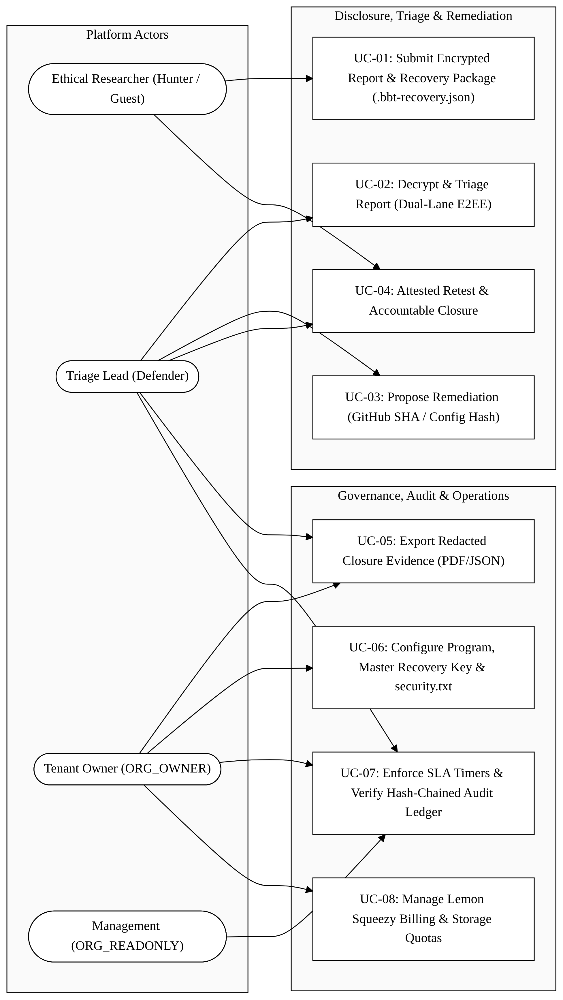
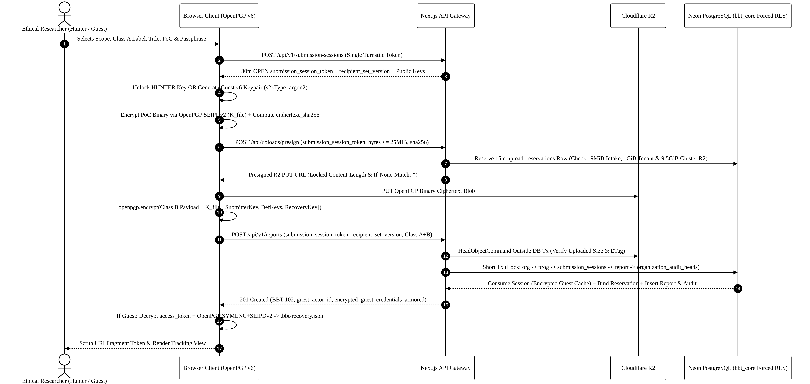
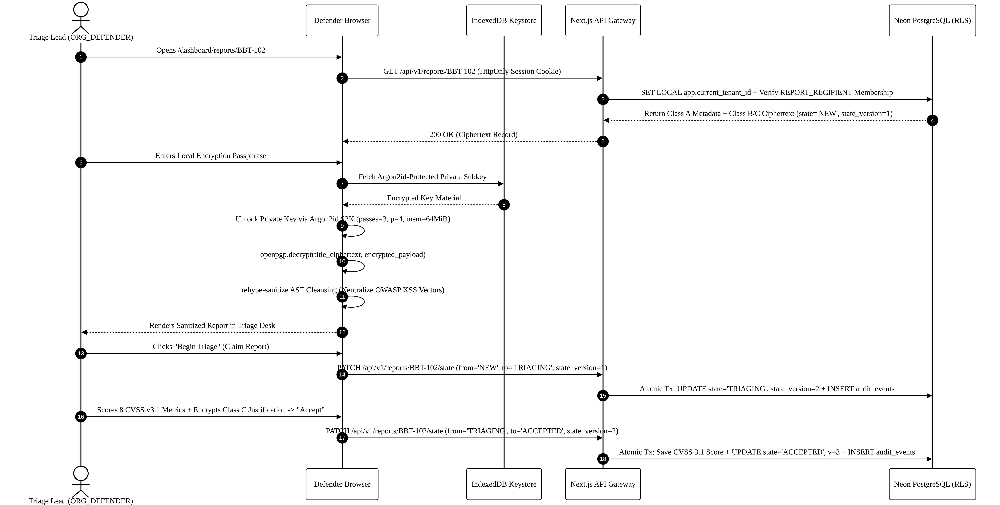
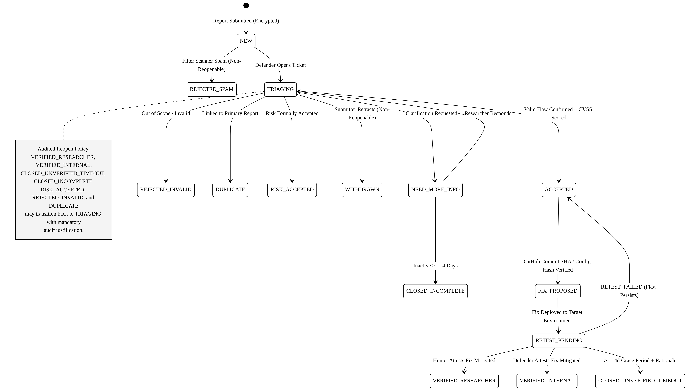

# SOFTWARE REQUIREMENTS SPECIFICATION (SRS)
## BugBountyTrack — Multi-Tenant Vulnerability Disclosure Platform with Client-Side Cryptographic Isolation and Evidence-Based Remediation Tracking

---

### Document Control & Academic Metadata

| Attribute | Specification |
| :--- | :--- |
| **Document Title** | Software Requirements Specification (SRS) — **BugBountyTrack** |
| **Document Version** | **Revision 2.8 (Concise Academic Submission Edition)** |
| **Release Date** | October 12, 2026 |
| **Author / Candidate** | **Taha Asadullah** (Roll No: **`24-ST-013`**) |
| **Academic Institution** | Punjab Tianjin University of Technology (PTUT), Lahore |
| **Department & Program** | Department of Software Engineering Technology — BS Software Engineering Technology |
| **Batch / Section** | Batch 24-SET-Fall / Section SET-B (`24-st-013@students.ptut.edu.pk`) |
| **FYP Project Supervisor** | **Sir Umar Hayat** (Assistant Professor, PTUT Lahore) |
| **Project Identifier** | `PTUT - PRJ - 089` (Sub-Field: 9. Cybersecurity, Privacy & LegalTech) |
| **Milestone** | **Week 2** — Software Requirements Specification (SRS), Use Cases & Non-Functional Requirements |
| **Governing Standards** | IEEE Std 830-1998 & ISO/IEC/IEEE 29148:2018 |
| **Technical Stack** | Next.js 14+ (App Router, TypeScript), Node.js 22 LTS, PostgreSQL 16 (Neon), Cloudflare R2, OpenPGP.js v6 |

---

## 1. Introduction

### 1.1 Purpose
This Software Requirements Specification (SRS) defines the functional, cryptographic, data, and non-functional requirements for **BugBountyTrack** (`PTUT - PRJ - 089`). Structured in accordance with **IEEE Std 830-1998** and **ISO/IEC/IEEE 29148:2018**, this document serves as the baseline agreement for system architecture, implementation, automated verification, and academic evaluation.

### 1.2 Document Conventions & Prioritization
* **Normative Keywords**: **Shall** indicates a mandatory requirement; **should** indicates a recommended goal; **may** indicates an optional capability (IETF RFC 2119).
* **Priority Levels**:
  - **`P1 (Core Academic MVP & Week 7 Prototype)`**: Mandatory requirements delivering the 5 locked Week 1 MVP features.
  - **`P2 (Secondary Extensions)`**: Extended operational capabilities (private program invitations, redacted closure exports, webhook retries, and disaster recovery drills) scheduled after `P1` completion.

### 1.3 Project Scope & Problem Statement

> **Core Value Proposition**: *"A confidential vulnerability reporting workspace that helps small software teams receive reports, coordinate fixes, and document how each issue was retested and closed."*

Small software teams (`5–50` developers) and early-stage startups face a structural gap when receiving external vulnerability disclosures. Enterprise managed bug bounty platforms store decrypted report bodies on vendor servers, while ad-hoc channels (`security@company.com` email inboxes or web forms) lack mandatory end-to-end encryption, standardized severity scoring, and verifiable remediation tracking.

**BugBountyTrack** addresses these gaps through three core mechanisms:
1. **Zero-Plaintext Server Storage for Vulnerability Payloads**: Report titles, technical write-ups, reproduction steps, proof-of-concept (PoC) attachments, severity adjustment explanations, and triage messages are encrypted in the browser using **OpenPGP.js v6 (`RFC 9580` Curve25519: `Ed25519` signing + `X25519` encryption)** before transmission. The server stores only ciphertext, key fingerprints, and coarse routing metadata.
2. **Account-Less Guest Intake with Self-Contained Recovery**: Researchers can submit encrypted reports without registering an account (`GUEST` mode), receiving a durable `guest_actor_id` and downloading a password-encrypted **`.bbt-recovery.json` Guest Recovery Package** (`RFC 9580` symmetric `SEIPDv2` AEAD with Argon2id S2K) for local browser restoration.
3. **Evidence-Based Remediation & Attested Retest State Machine**: Declaring a fix is decoupled from closing a report. Defenders must bind either a GitHub-verified commit SHA (`FR-6.2`) or an encrypted configuration snapshot (`FR-6.3`), transition the report to `RETEST_PENDING`, and record a verified closure outcome (`VERIFIED_RESEARCHER`, `VERIFIED_INTERNAL`, or `CLOSED_UNVERIFIED_TIMEOUT`) backed by an append-only, hash-chained audit ledger (`FR-8.5`).

### 1.4 Normative References & Discovery Methodology
1. **Normative Standards**: IETF RFC 9116 (`security.txt`), IETF RFC 9580 (OpenPGP v6 Crypto-Refresh), FIRST.org CVSS v3.1 Specification, ISO/IEC 29147:2018 & ISO/IEC 30111:2019 (Vulnerability Disclosure & Handling), OWASP ASVS v4.0.3 Level 2, IETF RFC 8785 (JSON Canonicalization Scheme), and NIST SP 800-63B.
2. **Discovery Methodology**: Requirements elicitation combined secondary industry and standards research with structured workflow modeling across four operational frictions (`FRC-01` Provider-Held Keys, `FRC-02` Unencrypted Email Intake, `FRC-03` Missing Policy Discovery & Signup Friction, and `FRC-04` Unverified "Fix-and-Forget" Closures). User personas (**Alex Rivera** and **Sarah Chen**) are designated as secondary-research-derived **Provisional Composite Personas**, while live target-user discovery interviews (`>= 4` participants across Hunter and Defender cohorts) are tracked separately in `requirements/DISCOVERY_INTERVIEW_LOG.md` (`Status: PENDING_LIVE_INTERVIEWS`).

### 1.5 Core MVP Features (`P1`) vs. Secondary Extensions (`P2`)

| Feature Area | Mandatory Core Scope (`P1` — Academic MVP Baseline) | Secondary Extensions (`P2`) |
| :--- | :--- | :--- |
| **1. RFC 9116 `security.txt` & Policy Generator** (`FR-2.1`–`FR-2.5`) | Automated `/.well-known/security.txt` generation (`<= 365d` expiry), in-browser Ed25519 cleartext signing, `IN_SCOPE`/`OUT_OF_SCOPE` asset tables, Safe Harbor terms, and `_bbt-challenge` DNS TXT verification. | *None (100% P1 Core).* |
| **2. Client-Side OpenPGP v6 Encryption** (`FR-3.1`–`FR-3.8`) | RFC 9580 v6 Curve25519 keygen, Argon2id S2K (`64 MiB`) in `IndexedDB`, multi-recipient `PKESK` wrapping (`N <= 10` defenders), `title_ciphertext` + neutral `operational_label`, direct-to-R2 encrypted attachments (`<= 25 MiB`), offline Master Recovery Key, and historical key re-wrapping. | *None (100% P1 Core).* |
| **3. Deterministic CVSS v3.1 Engine** (`FR-4.1`–`FR-4.4`) | Pure TypeScript FIRST.org CVSS v3.1 Base calculator (`8.22` coefficient, `RoundUp`), canonical vector parser (verified against 45 official vectors), mandatory Class B severity override explanation, and `CVSS_ASSESSMENT_HISTORY`. | *None (100% P1 Core).* |
| **4. Dual-Lane Triage & GitHub Fix Verification** (`FR-5.1`–`FR-6.4`) | Dual-lane encrypted messaging (`RESEARCHER_ORG` vs. `REVIEWER_INTERNAL`), minimal-metadata email notifications, GitHub REST API v3 commit SHA & branch verification, and encrypted infrastructure config snapshots. | Outbound Slack/webhook notifications (`FR-5.3b`) & SLA escalation alerts (`FR-5.4`). |
| **5. Attested Retest State Machine & Audit Ledger** (`FR-7.1`–`FR-8.7`) | 15-state lifecycle engine, 3 distinct `RETEST_PENDING` closure states (`VERIFIED_RESEARCHER`, `VERIFIED_INTERNAL`, `CLOSED_UNVERIFIED_TIMEOUT`), `RETEST_FAILED` loopback, `CLOSED_INCOMPLETE`, `RISK_ACCEPTED`, and dual SHA-256 hash-chained `AUDIT_EVENT` ledger. | Private program invitation tokens (`FR-1.5b`), Redacted Closure Evidence Exports (`FR-8.6`), and DR restore drills (`FR-8.7`). |

---

## 2. Overall Description

### 2.1 System Perspective & 3-Tier Architecture
BugBountyTrack operates as a decoupled 3-tier web application:
1. **Client Browser Tier (Cryptographic & Presentation Boundary)**: Next.js 14+ React client executing `OpenPGP.js v6` (`WebCrypto` + WebAssembly Argon2id) to generate Curve25519 keys, encrypt/decrypt Class B and Class C payloads in memory, sign guest requests, and sanitize decrypted Markdown into safe DOM nodes via `rehype-sanitize` (`FR-8.1`). Private keys never leave the client browser in plaintext.
2. **Application & API Tier (Stateless Orchestration & Validation)**: Next.js Route Handlers on Node.js 22 LTS enforcing authentication, RBAC (`Table 2.2`), Cloudflare Turnstile and PostgreSQL rate limiting (`FR-8.3`), authoritative CVSS v3.1 Base score recalculation (`FR-4.2`), GitHub REST API v3 commit verification (`FR-6.2`), and Cloudflare R2 presigned upload issuance (`FR-3.5`).
3. **Persistence & Storage Tier (Multi-Tenant Isolation)**: PostgreSQL 16 (Neon Serverless) schema `bbt_core` enforcing `FORCE ROW LEVEL SECURITY` under non-superuser role `bbt_app` (`NOBYPASSRLS`) and composite foreign keys `(organization_id, id)`, paired with Cloudflare R2 object storage for encrypted binary attachments.

### 2.2 Field-Level Cryptographic Classification (`Class A`, `Class B`, `Class C`)

| Data Class | Confidentiality Level |PKESK Recipients | Representative Attributes |
| :--- | :--- | :--- | :--- |
| **Class A: Routing & Workflow Metadata** | Server-readable plaintext | *None (Plaintext columns)* | `report.id`, `tracking_id`, `state`, `state_version`, `operational_label` (8-value enum), `cvss_vector`, `cvss_score`, `severity`, `commit_sha`, `audit_events` hashes, and timestamps. |
| **Class B: Shared Researcher & Defender Ciphertext** | End-to-end encrypted (`OpenPGP v6 SEIPDv2`) | Submitter key (`HUNTER` or `GUEST`) + Active `PROGRAM_DEFENDER` keys (`N <= 10`) + Org `recovery_public_key` | `title_ciphertext`, `payload_ciphertext` (vulnerability description & PoC), `RESEARCHER_ORG` messages, `cvss_explanation_ciphertext`, `retest_evidence.evidence_ciphertext`, and R2 encrypted attachments. |
| **Class C: Defender-Only Internal Ciphertext** | End-to-end encrypted (`OpenPGP v6 SEIPDv2`); stripped from researcher API responses | Active `PROGRAM_DEFENDER` keys (`N <= 10`) + Org `recovery_public_key` (**Excludes** Researcher/Guest key) | `REVIEWER_INTERNAL` triage notes, `cvss_internal_notes_ciphertext`, and `remediation_records.config_artifact_ciphertext`. |

### 2.3 User Classes, Roles & Provisional Personas

| Role Identifier | Description & Cryptographic Capabilities |
| :--- | :--- |
| **`GUEST` (Account-Less Researcher)** | Unauthenticated external finder submitting a report (`FR-1.6`). Holds an ephemeral Curve25519 keypair in `IndexedDB`, a durable `guest_actor_id`, a bearer `access_token` (stored server-side only as `guest_token_hash`), and a downloadable `.bbt-recovery.json` bundle. |
| **`HUNTER` (Registered Researcher)** | Authenticated external researcher with a persistent account, TOTP MFA option, Curve25519 keypair, and downloadable `.bbt-user-keys.json` backup. Can submit to public/invited programs and claim prior `GUEST` reports (`FR-1.6g`). |
| **`ORG_DEFENDER` (Program Triager)** | Authenticated organization engineer assigned to specific programs via `PROGRAM_DEFENDER` (`FR-1.2`). Decrypts Class B and Class C ciphertexts for assigned reports, manages triage transitions, links remediation commits, and executes internal retests. |
| **`ORG_OWNER` (Workspace Administrator)** | Organization lead with mandatory RFC 6238 TOTP MFA (`FR-1.3c`). Configures programs, DNS verification, GitHub PATs, defender rosters, `RISK_ACCEPTED` sign-offs, and emergency recovery via the offline Organization Master Recovery Key. |
| **`ORG_VIEWER` (Read-Only Stakeholder)** | Compliance or management observer permitted to view Class A aggregate program metrics, SLA timers, and redacted closure exports (`FR-8.6`), with zero access to Class B or Class C ciphertexts (`HTTP 403`). |

* **Persona 1 — Alex Rivera (`HUNTER` / `GUEST`, Provisional Composite Persona)**: 22-year-old BS Cybersecurity senior and independent web security researcher (` Kali Linux`, `Burp Suite`). Needs frictionless guest submission without mandatory account creation, client-side encryption so zero-day PoCs are not exposed on third-party servers, objective CVSS v3.1 scoring, and retest notifications when a fix is deployed.
* **Persona 2 — Sarah Chen (`ORG_OWNER` / `ORG_DEFENDER`, Provisional Composite Persona)**: 31-year-old CTO of a 7-developer B2B SaaS startup (`Next.js`, `PostgreSQL`, `GitHub Actions`). Needs a 15-minute `security.txt` onboarding flow, multi-defender browser decryption without CLI PGP keyrings, GitHub commit verification, and auditable closure exports for enterprise customer security reviews.

### 2.4 Authoritative Permission Matrix (`Table 2.2`)

| Operation / Resource | `GUEST` (Token + PoP) | `HUNTER` (Auth) | `ORG_VIEWER` | `ORG_DEFENDER` (Assigned) | `ORG_OWNER` (MFA) |
| :--- | :---: | :---: | :---: | :---: | :---: |
| View public program policy & `/.well-known/security.txt` | Allow | Allow | Allow | Allow | Allow |
| Submit encrypted report (`POST /api/v1/reports`) | Allow | Allow | Deny (`403`) | Deny (`403`) | Deny (`403`) |
| Read own report (`Class A + Class B` only; `Class C` stripped) | Allow (Own) | Allow (Own) | Deny (`403`) | N/A | N/A |
| Read assigned program report (`Class A + Class B + Class C`) | Deny (`403`) | Deny (`403`) | Class A Only | Allow (`REPORT_RECIPIENT`) | Allow (`REPORT_RECIPIENT` or Recovery) |
| Post `RESEARCHER_ORG` comment (Class B) | Allow (Own) | Allow (Own) | Deny (`403`) | Allow (Assigned) | Allow (Assigned) |
| Post `REVIEWER_INTERNAL` note (Class C) | Deny (`403`) | Deny (`403`) | Deny (`403`) | Allow (Assigned) | Allow (Assigned) |
| Triage transitions, CVSS override & remediation record binding | Deny (`403`) | Deny (`403`) | Deny (`403`) | Allow (Assigned) | Allow (Assigned) |
| Submit `VERIFIED_RESEARCHER` / `RETEST_FAILED` attestation | Allow (Own) | Allow (Own) | Deny (`403`) | Deny (`403`) | Deny (`403`) |
| Submit `VERIFIED_INTERNAL` (with `is_fix_implementer` flag) | Deny (`403`) | Deny (`403`) | Deny (`403`) | Allow (Assigned) | Allow (Assigned) |
| Approve `RISK_ACCEPTED`, manage roster, or run Recovery Fetch | Deny (`403`) | Deny (`403`) | Deny (`403`) | Deny (`403`) | Allow (TOTP Step-Up) |

### 2.5 Operating Environment & Bounded Cloud Storage Quotas
To operate reliably within zero-cost academic evaluation tiers (**Neon PostgreSQL Free Tier: `512 MiB` physical storage**; **Cloudflare R2 Free Tier: `10 GiB` storage**) across up to 10 evaluation tenants:
1. **Cloudflare R2 Attachment Quotas**: Capped at **`<= 25 MiB` per attachment**, **`<= 50 MiB` per report**, **`1.0 GiB` per tenant**, and a **hard cluster ceiling of `9.5 GiB`** enforced in `bbt_core.cluster_storage_state` during `POST /api/uploads/presign`.
2. **PostgreSQL Per-Tenant Storage Pools (`512 MiB` Cluster Budget)**:
   - **Bucket A — Per-Tenant Intake Pool (`20 MiB` per tenant; `200 MiB` across 10 tenants)**: Emits a warning at `90%` (`18.0 MiB`) and caps new report submissions at `95%` (`19.0 MiB`, `HTTP 413 NEW_REPORT_INTAKE_QUOTA_EXCEEDED`), reserving the final **`5%` (`1.0 MiB`) exclusively for compact (`<= 16 KiB`) researcher responses on active reports** (`NEED_MORE_INFO` replies and `RETEST_PENDING` attestations).
   - **Bucket B — Per-Tenant Security & Triage Reserve (`6 MiB` base per tenant; `60 MiB` across 10 tenants)**: Tracks internal defender records, `remediation_records` (`<= 160 KiB` plaintext / `<= 256 KiB` armored ciphertext), and `audit_events`. Reserves the final **`300 KiB` (`307,200 bytes`) strictly for Priority-0 critical security operations** (revocations, token rotations, clarification replies, terminal closures, and their audit rows).
   - **Bucket C — Shared Emergency Buffer (`20 MiB`) & Overhead Budget (`232 MiB`)**: Provides a `20 MiB` cluster emergency buffer (up to `+2 MiB` per tenant via MFA-verified owner action) and budgets `232 MiB` for PostgreSQL indexes, TOAST, WAL, and shared tables, with physical database size continuously monitored on `/api/v1/health`.
   - **Atomic Quota Pause Protection (`bbt_core.fn_process_researcher_response_or_pause`)**: If a researcher's valid `NEED_MORE_INFO` reply or `RETEST_PENDING` attestation is rejected by a logical quota threshold (`SQLSTATE 'P0001'`), a nested PL/pgSQL `BEGIN ... EXCEPTION` subtransaction block inside the client-owned transaction rolls back the rejected write while retaining the `organizations -> reports FOR UPDATE` locks and sets `capacity_deadline_paused = true` so the report cannot be unfairly closed by timeout while capacity is full.

---

## 3. Specific Functional Requirements (`FR`)

### 3.1 Multi-Tenant Workspaces, Authentication & Guest Intake (`FR-1`)
* **FR-1.1 (`P1` — Multi-Tenant Isolation)**: Every tenant-scoped table in `bbt_core` shall include `organization_id` enforced by composite foreign keys `(organization_id, id)` and PostgreSQL `FORCE ROW LEVEL SECURITY`.
* **FR-1.2 (`P1` — Role & Recipient Authorization)**: All API endpoints shall enforce **Table 2.2**. Report ciphertexts and attachment download URLs shall be accessible only to the submitting researcher (`Class A + Class B` only, with `Class C` stripped at the query projection layer), active assigned defenders in `REPORT_RECIPIENT` (`is_active = true`), or an MFA-verified `ORG_OWNER` executing an audited recovery fetch (`FR-3.8b`).
* **FR-1.3 (`P1` — Argon2id Authentication & Mandatory Owner TOTP MFA)**:
  - **FR-1.3a/b**: Passwords shall be hashed with **Argon2id** (`64 MiB` memory, `t = 3`, `p = 4`). Sessions shall use 256-bit random tokens stored as SHA-256 hashes in `SESSION` (`HttpOnly; Secure; SameSite=Lax`); password changes immediately revoke all active sessions.
  - **FR-1.3c**: RFC 6238 TOTP MFA (`totp_secret` encrypted via AES-256-GCM) is mandatory for `ORG_OWNER` before activating a program. Privileged owner actions (program activation, recovery-fetch, member/key revocation, `RISK_ACCEPTED`, GitHub PAT changes, and quota recovery) require a step-up TOTP verification within the last `10 minutes` (`HTTP 403 MFA_STEP_UP_REQUIRED`).
* **FR-1.4 (`P1` — Guided Onboarding Wizard)**: The `/onboarding` wizard shall guide an `ORG_OWNER` through workspace slug creation, TOTP MFA enrollment, DNS TXT challenge generation, scope setup, in-browser Curve25519 key generation, mandatory offline **Organization Master Recovery Key** decryption verification, and in-browser `security.txt` signing in `<= 15 minutes` of active interaction.
* **FR-1.5 (`P1/P2` — Public & Private Programs)**: The platform shall serve public disclosure programs (`/programs/[slug]`, `P1`) and support invitation-only private programs (`/programs/[slug]/join?token=...`, `P2`) storing only the SHA-256 `token_hash` with a 72-hour single-use expiry.
* **FR-1.6 (`P1` — Account-Less Guest Vulnerability Intake & Recovery)**:
  - **FR-1.6a/b (Durable Guest Identity & Encrypted Credential Cache)**: At submission, the server assigns an immutable UUIDv4 `guest_actor_id` and issues a 256-bit `access_token`, persisting only `guest_token_hash` on `REPORT`. To prevent plaintext token persistence in retry caches (`submission_sessions` or `guest_mutation_nonces`), `{ report_id, guest_actor_id, access_token }` is encrypted to `REPORT.guest_public_key` (`encrypted_guest_credentials_armored`, OpenPGP v6 `PKESK` + `SEIPDv2`).
  - **FR-1.6c/d (`.bbt-recovery.json` & URI Fragment Scrubbing)**: The browser exports a password-encrypted `.bbt-recovery.json` Guest Recovery Package (`openpgp-symenc-seipdv2` with Argon2id S2K). Tracking URLs place `#token=<access_token>` strictly in the URI fragment and scrub it on load via `window.history.replaceState`.
  - **FR-1.6e/f (Local Restoration, Signature-Only Rotation & JCS Proof-of-Possession)**: Restoring `.bbt-recovery.json` occurs strictly in browser memory via `FileReader`. All guest mutations (`POST_COMMENT`, `WITHDRAW_REPORT`, `VERIFIED_RESEARCHER`, `RETEST_FAILED`, `ROTATE_GUEST_TOKEN`) require an OpenPGP v6 Ed25519 detached signature (`X-Guest-Signature`) over an RFC 8785 JCS canonical payload with a 128-bit `nonce` recorded atomically in `guest_mutation_nonces` (5-minute TTL).
  - **FR-1.6g (Portfolio Claiming)**: An authenticated `HUNTER` may bind a prior `GUEST` report to their account by presenting both the valid `access_token` and an Ed25519 signature from `guest_public_key`.

### 3.2 RFC 9116 `security.txt` & Policy Management (`FR-2`)
* **FR-2.1 (`P1` — RFC 9116 Manifest Generation)**: The system shall generate an RFC 9116 compliant `security.txt` manifest (`Contact`, `Expires` `<= 365 days`, `Encryption`, `Preferred-Languages`, `Canonical`, `Policy`) served as `text/plain; charset=utf-8`.
* **FR-2.2 (`P1` — In-Browser Cleartext Signing)**: During onboarding or policy updates, the browser shall sign `security.txt` using `openpgp.sign({ message: openpgp.createCleartextMessage({ text }) })` and the server shall verify the signature and 64-hex SHA-256 fingerprint before persistence (`HTTP 422` on mismatch).
* **FR-2.3 & FR-2.4 (`P1` — Scope Matrix & Safe Harbor)**: Programs shall define structured `IN_SCOPE` and `OUT_OF_SCOPE` asset rules (`DOMAIN`, `WILDCARD`, `CIDR`, `MOBILE_APP`, `SOURCE_REPO`, `API_ENDPOINT`, `OTHER`) and render a standardized Safe Harbor legal authorization clause.
* **FR-2.5 (`P1` — DNS TXT Ownership Verification)**: Before marking a domain asset verified, the server shall query DNS TXT records for `_bbt-challenge.<domain>` matching the organization's verification token.

### 3.3 Client-Side OpenPGP v6 Cryptography & Key Lifecycle (`FR-3`)
* **FR-3.1 (`P1` — Pinned OpenPGP v6 Curve25519 Profile)**: All keys shall use **RFC 9580 OpenPGP Version 6** (`Ed25519` primary signing + `X25519` encryption subkey) with 64-character lowercase hex SHA-256 fingerprints (`^[0-9a-f]{64}$`) and `SEIPDv2` AEAD encryption. Legacy RSA and v4 keys shall be rejected (`HTTP 422`).
* **FR-3.2 (`P1` — Argon2id `IndexedDB` Keystore & `.bbt-user-keys.json` Backup)**: Private keys shall be encrypted with **Argon2id S2K** (`0x04`, `64 MiB` memory, `t = 3`, `p = 4`), stored in browser `IndexedDB` (never `localStorage`), exported as `.bbt-user-keys.json` during onboarding, and zeroized in memory (`Uint8Array.fill(0)`) on logout or after 15 minutes of inactivity.
* **FR-3.3 (`P1` — Multi-Recipient PKESK Envelope & Version Guards)**: Class B payloads shall be encrypted to the submitter's public key, the organization's `recovery_public_key`, and all active `PROGRAM_DEFENDER` public keys (`N <= 10`). Submissions with a stale `recipient_set_version` or `report_recipient_version` shall be rejected with `HTTP 409 Conflict` returning the current keyring.
* **FR-3.4 (`P1` — Encrypted Title & Neutral Operational Label)**: Report titles shall be encrypted in `title_ciphertext` (Class B). Plaintext routing metadata shall use only the 8-value `operational_label` enum (`INJECTION`, `AUTH_SESSION`, `ACCESS_CONTROL`, `XSS_CLIENT`, `CRYPTO_CONFIG`, `SERVER_INFRA`, `BUSINESS_LOGIC`, `OTHER`).
* **FR-3.5 (`P1` — Atomic Submission Sessions & Direct-to-R2 Encrypted Attachments)**:
  - **FR-3.5a**: Before uploading attachments or submitting a report, the client obtains a single-use `submission_session_token` (`POST /api/v1/programs/{slug}/submission-sessions`, 30-minute TTL) that enforces idempotent retries via `request_payload_sha256`.
  - **FR-3.5b**: Attachments (`<= 25 MiB` each, `<= 5` per report, `<= 50 MiB` total) are encrypted in-browser as binary OpenPGP v6 `SEIPDv2` packets, uploaded directly to Cloudflare R2 via presigned `PUT` URLs (`POST /api/uploads/presign`), and verified via `HeadObject` byte-size and `PKESK` recipient header inspection before report creation.
* **FR-3.6 (`P1` — Offline Organization Master Recovery Key)**: During `/onboarding`, the browser generates an offline Curve25519 Master Recovery Keypair (`recovery_public_key`), downloads the offline recovery kit, and must pass a client-side challenge-ciphertext decryption check before the workspace can activate.
* **FR-3.7 & FR-3.8 (`P1` — Key Rotation, Defender Offboarding & Separated Historical Re-Wrapping)**:
  - **FR-3.7**: Rotating a defender key increments `recipient_set_version` and `report_recipient_version` for future messages while preserving prior key history.
  - **FR-3.8a**: Removing a defender supports three explicit scopes: (1) Program-only removal, (2) Organization-wide removal, or (3) Single-report revocation (`REPORT_RECIPIENT.is_active = false`).
  - **FR-3.8b**: Historical key recovery is strictly separated into two endpoints verified against `seipdv2_body_sha256` (guaranteeing the underlying encrypted body bytes were not altered): (1) `POST /api/v1/reports/{id}/rewrap-researcher-key` (`CLASS_B_ONLY` — rejects any Class C item with `HTTP 422`), and (2) `POST /api/v1/reports/{id}/grant-defender-access` (`CLASS_B_AND_C` for newly assigned defenders).

### 3.4 Deterministic CVSS v3.1 Severity Engine (`FR-4`)
* **FR-4.1 (`P1` — Pure TypeScript CVSS v3.1 Base Engine)**: The system shall compute Base scores (`0.0` to `10.0`) and severity ratings (`NONE`, `LOW`, `MEDIUM`, `HIGH`, `CRITICAL`) from the 8 mandatory Base metrics (`AV`, `AC`, `PR`, `UI`, `S`, `C`, `I`, `A`) using the official FIRST.org equations (`8.22` exploitability coefficient and integer-scaled `RoundUp`), achieving 100% parity with all 45 vectors in `requirements/CVSS_TEST_FIXTURES.md`.
* **FR-4.2 (`P1` — Canonical Parser & Server Recalculation)**: The parser shall accept Base metrics in any order, reject duplicate/unknown metrics or non-Base Temporal/Environmental metrics with `HTTP 400`, serialize vectors in canonical order (`CVSS:3.1/AV:_/AC:_/PR:_/UI:_/S:_/C:_/I:_/A:_`), and recalculate scores authoritatively on the server.
* **FR-4.3 & FR-4.4 (`P1` — Audited Severity Overrides)**: Defender CVSS overrides shall require a mandatory Class B encrypted rationale (`cvss_explanation_ciphertext`, shared with the researcher) and an immutable entry in `CVSS_ASSESSMENT_HISTORY` (plus optional Class C internal notes).

### 3.5 Dual-Lane Triage, Notifications & Cron Maintenance (`FR-5`)
* **FR-5.1 (`P1` — Triage Dashboard)**: Defenders shall filter and sort reports by Class A metadata (`state`, `severity`, `cvss_score`, `operational_label`, SLA due dates) and decrypt selected reports client-side in memory.
* **FR-5.2 (`P1` — Dual-Lane Encrypted Messaging)**: Every report shall separate `RESEARCHER_ORG` messages (Class B, visible to researcher and defenders) from `REVIEWER_INTERNAL` notes (Class C, encrypted strictly to active `REPORT_RECIPIENT` defenders and `recovery_public_key`, and stripped from all researcher responses).
* **FR-5.3 (`P1/P2` — Minimal-Metadata Notifications)**: Email notifications (`P1`) and optional Slack/webhook dispatches (`P2`) shall contain **only Class A metadata** (`tracking_id`, `operational_label`, `state`, timestamp) and never include decrypted titles, bodies, or tokens.
* **FR-5.4 (`P1/P2` — Authenticated 3-Phase Hourly SLA & R2 Cleanup Cron)**: An hourly cron endpoint (`POST /api/v1/internal/cron/sla-check`, authenticated via HMAC-SHA256 `X-Cron-Signature`) executes up to 3 bounded batches per invocation (`Phase 1` DB claim via `FOR UPDATE SKIP LOCKED` with a 2-minute `claim_expires_at` lease -> `Phase 2` Cloudflare R2 `DeleteObjectCommand` with an `11,000 ms` cutoff -> `Phase 3` immediate per-batch DB finalization crediting quota strictly once on transition to `'DELETED'`), with enforceable DB timeouts (`lock_timeout = '250ms'`, `statement_timeout = '800ms'`) and self-draining continuation (`has_more_backlog`).

### 3.6 Remediation Evidence & GitHub Commit Verification (`FR-6`)
* **FR-6.1 (`P1` — Decoupled Fix Recording)**: Moving a report to `RETEST_PENDING` requires creating a validated `REMEDIATION_RECORD` with `remediation_attempt_no` incremented sequentially (`1, 2, ...`).
* **FR-6.2 (`P1` — GitHub REST API v3 Commit & Branch Verification)**: For `CODE_COMMIT` fixes, the server validates `repository_url` against an HTTPS `github.com` allowlist (preventing SSRF), queries `GET /repos/{owner}/{repo}/commits/{sha}` and `GET /repos/{owner}/{repo}/compare/{branch}...{sha}`, and maps responses deterministically (`200` -> `VERIFIED_COMMIT` / `VERIFIED_ON_TARGET_BRANCH`; `404` -> `HTTP 422 COMMIT_NOT_FOUND`; `401` -> `HTTP 422 GITHUB_AUTH_INVALID`; `403/429` rate limit -> `HTTP 503 GITHUB_RATE_LIMITED_RETRYABLE`).
* **FR-6.3 (`P1` — Encrypted Infrastructure Configuration Evidence)**: For non-code fixes (`CONFIG_INFRASTRUCTURE`), the browser computes `config_sha256_hash` over the raw configuration text (`<= 160 KiB` UTF-8 plaintext with OpenPGP compression disabled -> `<= 256 KiB` armored ciphertext) and encrypts it as Class C `config_artifact_ciphertext`, accompanied by a Class B researcher-visible summary (`fix_summary_ciphertext`).
* **FR-6.4 (`P1` — Scoped GitHub PAT Storage)**: Optional private-repo GitHub Personal Access Tokens shall be encrypted at rest using AES-256-GCM and restricted to read-only `contents:read` / `metadata:read` scopes.

### 3.7 15-State Vulnerability Lifecycle & Retest Verification (`FR-7`)
* **FR-7.1 (`P1` — Deterministic 15-State Lifecycle & Concurrency Guard)**: Every report shall follow the 15-state transition matrix (Section 4.5). Mutations require matching `expected_state_version` (incrementing `state_version` on success or returning `HTTP 409 Conflict` on mismatch) and acquire locks in the canonical 6-table order (`1. cluster_storage_state -> 2. organizations -> 3. programs -> 4. user_memberships/program_defenders -> 5. reports/report_recipients -> 6. organization_audit_heads`).
* **FR-7.2 (`P1` — Three Non-Overlapping `RETEST_PENDING` Outcomes)**:
  1. `VERIFIED_RESEARCHER`: Submitted by the reporting `HUNTER` or `GUEST` confirming the fix resolved the vulnerability.
  2. `VERIFIED_INTERNAL`: Submitted by an authorized `ORG_DEFENDER` or `ORG_OWNER` with mandatory `is_fix_implementer` (`BOOLEAN`) conflict-of-interest disclosure (`SELF_VERIFIED_BY_IMPLEMENTER` vs. `INDEPENDENT_INTERNAL_PEER`).
  3. `CLOSED_UNVERIFIED_TIMEOUT`: Permitted only after `>= 14 days` in `RETEST_PENDING` (`now() >= retest_due_at`, `capacity_deadline_paused = false`, and zero researcher responses since `retest_requested_at`), requiring an explicit defender/owner action and a `>= 30`-character rationale. Expiration alone never auto-closes a report as verified.
* **FR-7.3 & FR-7.4 (`P1` — Retest Evidence & `RETEST_FAILED` Loopback)**: Every retest submission creates an immutable `RETEST_EVIDENCE` row bound to the active `remediation_record_id`. If the vulnerability remains reproducible (`RETEST_FAILED`), the report loops back from `RETEST_PENDING` to `ACCEPTED` for a new fix attempt.
* **FR-7.5 (`P1` — Clarification Timeout `CLOSED_INCOMPLETE`)**: Reports in `NEED_MORE_INFO` with zero researcher replies for `>= 14 days` (`capacity_deadline_paused = false`) may be closed as `CLOSED_INCOMPLETE` (or auto-transitioned by the hourly cron job when the tenant is not under a capacity lock).
* **FR-7.6 & FR-7.7 (`P1` — `RISK_ACCEPTED` & Controlled Reopening)**: Transitioning to `RISK_ACCEPTED` requires `ORG_OWNER` TOTP step-up MFA, a `>= 50`-character rationale, and `risk_review_due_at`. Closed reports (except `WITHDRAWN`, which is permanently terminal, and `REJECTED_SPAM`, which requires owner recovery) may be reopened to `TRIAGING` with an audited justification.

### 3.8 Security Controls, Hash-Chained Audit Ledger & Closure Exports (`FR-8`)
* **FR-8.1 (`P1` — Client-Side AST Markdown Sanitization)**: Decrypted Markdown shall be parsed via `remark-parse` and sanitized via `rehype-sanitize` (stripping `<script>`, `<iframe>`, `<object>`, `<svg>`, event handlers, `javascript:`/`data:` URIs, and remote `http://`/`https://` images) before DOM rendering.
* **FR-8.2 (`P1` — PostgreSQL RLS & `SECURITY DEFINER` Boundary)**: Schema `bbt_core` shall enforce `FORCE ROW LEVEL SECURITY` under role `bbt_app` (`NOBYPASSRLS`). Cross-context operations (guest submission, token rotation, researcher response/pause, and cron cleanup) execute through schema-qualified `SECURITY DEFINER` functions owned by `bbt_definer` (`SET search_path = pg_catalog, bbt_core, pg_temp`) that validate caller inputs before setting transaction-local `app.definer_*` flags.
* **FR-8.3 (`P1` — Rate Limiting & Turnstile CAPTCHA)**: Unauthenticated intake and auth routes shall enforce Cloudflare Turnstile CAPTCHA and PostgreSQL sliding-window rate limits (`10` submissions/hour/IP; `5` failed logins/15 min/IP+email).
* **FR-8.4 (`P1` — Storage Quota Enforcement)**: Database trigger `trg_enforce_tenant_db_quota` and presign checks shall enforce the Section 2.5 tenant and cluster storage limits (`HTTP 413` / `HTTP 507` on logical quota exhaustion; `HTTP 503` on physical disk exhaustion `SQLSTATE '53100'`).
* **FR-8.5 (`P1` — Append-Only Dual Hash-Chained Audit Ledger)**: Every state transition, key change, CVSS override, remediation record, and retest submission shall append an immutable row to `AUDIT_EVENT` (`SELECT, INSERT` only for `bbt_app`; zero `UPDATE`/`DELETE`), chaining both the tenant-wide hash (`row_hash = SHA-256(prev_tenant_row_hash || "|" || event_digest)`) and the per-report hash (`report_chain_hash = SHA-256(prev_report_chain_hash || "|" || event_digest)`).
* **FR-8.6 & FR-8.7 (`P2` — Redacted Closure Exports & DR Drills)**: For reports in verified/closed states (`VERIFIED_RESEARCHER`, `VERIFIED_INTERNAL`, `CLOSED_UNVERIFIED_TIMEOUT`, `RISK_ACCEPTED`), the system shall generate a downloadable **Redacted Closure Evidence Export (`bbt-closure-export-v1` JSON & PDF)** signed by the server's Ed25519 key (`X-BBT-Export-Signature`) containing the per-report hash chain (`closure_report_seq_no = M <= total_report_events = K`) and salted SHA-256 commitments (`bbt-commit-v1`) without exposing Class B/C ciphertexts or private repo URLs (`FR-8.6`), supported by automated backup/restore verification (`FR-8.7`).

---

## 4. System Use Cases & Behavioral Models

### 4.1 System Use Case Diagram (`Figure 4.2`)

### 4.2 Formal Use Case Specifications (`UC-01` – `UC-07`)

#### Use Case `UC-01`: Account-Less Guest & Authenticated Researcher Report Submission (`FR-1.6`, `FR-3.3`–`FR-3.5`, `FR-4.1`)
* **Actors**: `GUEST` or `HUNTER` (Primary), Cloudflare Turnstile, Cloudflare R2, PostgreSQL `bbt_core`.
* **Preconditions**: Target program status is `ACTIVE`; researcher browser supports WebCrypto and `IndexedDB`.
* **Main Success Scenario**:
  1. Researcher opens `/programs/[slug]/submit`; browser fetches program scope and active `PROGRAM_DEFENDER` public keys (`recipient_set_version`, `recovery_public_key`) and requests a 30-minute `submission_session_token`.
  2. For `GUEST`, the browser generates an ephemeral OpenPGP v6 Curve25519 keypair in memory (`IndexedDB`).
  3. Researcher selects an `operational_label`, computes the CVSS v3.1 Base vector, and writes the report title and PoC description.
  4. Browser encrypts `title_ciphertext`, `payload_ciphertext`, and optional binary attachments (`<= 25 MiB` each, uploaded directly to R2 via presigned `PUT` URLs) to the submitter key, `recovery_public_key`, and all active `PROGRAM_DEFENDER` keys.
  5. Browser submits the ciphertext envelope (`POST /api/v1/reports`). Server validates Turnstile, rate limits, `recipient_set_version`, OpenPGP v6 `PKESK` headers, and CVSS v3.1 score, then atomically inserts `REPORT` (`state = 'NEW'`), `REPORT_RECIPIENT` rows, initial `CVSS_ASSESSMENT_HISTORY`, and `AUDIT_EVENT` (`tenant_seq_no`, `report_seq_no = 1`).
  6. For `GUEST`, the server encrypts `{ report_id, guest_actor_id, access_token }` to `guest_public_key` (`encrypted_guest_credentials_armored`); browser decrypts `access_token`, downloads `.bbt-recovery.json`, and navigates to `/report/track/[id]#token=...` (scrubbing the URL fragment on load).
* **Alternative / Exception Flows**:
  - *`1a. Stale Keyring (`409 Conflict`)*: If `recipient_set_version` changed, server returns the updated public key roster; browser re-encrypts in memory and retries.
  - *`5a. Network Drop & Idempotent Retry (`200 OK`)*: Retrying with the same `submission_session_token` and `request_payload_sha256` returns the cached `encrypted_guest_credentials_armored` without creating a duplicate report.
  - *`5b. Quota Exceeded (`413 Payload Too Large`)*: If tenant intake usage exceeds `95%` (`19.0 MiB`), new submission is rejected with `NEW_REPORT_INTAKE_QUOTA_EXCEEDED`.

#### Use Case `UC-02`: Intake Clarification Loop & `CLOSED_INCOMPLETE` Timeout (`FR-1.6f`, `FR-7.5`)
* **Actors**: `ORG_DEFENDER` (Primary), `HUNTER` / `GUEST` (Secondary), Hourly Cron Scheduler.
* **Main Success Scenario**:
  1. Defender transitions report from `NEW` or `TRIAGING` to `NEED_MORE_INFO` with a Class B encrypted clarification question; server sets `clarification_due_at = now() + 14 days`.
  2. Researcher submits an encrypted Class B reply (signed via RFC 8785 JCS `X-Guest-Signature` if `GUEST`) via `bbt_core.fn_process_researcher_response_or_pause`; report automatically returns to `TRIAGING` and clears `clarification_due_at`.
* **Exception Flows**:
  - *`2a. 14-Day Inactivity Timeout (`CLOSED_INCOMPLETE`)*: If `now() >= clarification_due_at` with zero researcher replies and `capacity_deadline_paused = false`, defender or hourly cron transitions report to `CLOSED_INCOMPLETE`.
  - *`2b. Quota Rejection During Researcher Reply (`413`/`507` with Deadline Pause)*: If the researcher's reply triggers a logical quota exception (`SQLSTATE 'P0001'`), the nested PL/pgSQL `EXCEPTION` handler rolls back the message write while retaining the report lock, sets `capacity_deadline_paused = true`, and commits the pause before returning `413`/`507`, blocking timeout closure until capacity is restored (`+7 days` minimum grace on resume). If the report was already closed before acquiring the lock, returns `409 Conflict`.

#### Use Case `UC-03`: Encrypted Triage, CVSS Override & Dual-Lane Discussion (`FR-4.3`, `FR-5.1`–`FR-5.3`)
* **Actors**: `ORG_DEFENDER` (Primary), `HUNTER` / `GUEST` (Secondary).
* **Main Success Scenario**:
  1. Assigned defender unlocks their Curve25519 private key in browser `IndexedDB` using their Argon2id passphrase and decrypts `title_ciphertext` and `payload_ciphertext` in memory.
  2. Defender posts internal technical notes to `REVIEWER_INTERNAL` (encrypted strictly as Class C to active `REPORT_RECIPIENT` defenders and `recovery_public_key`) and external updates to `RESEARCHER_ORG` (Class B).
  3. If adjusting the CVSS v3.1 vector, defender submits the updated vector with a mandatory Class B `cvss_explanation_ciphertext`; server recalculates the score, updates `REPORT`, and appends `CVSS_ASSESSMENT_HISTORY` and `AUDIT_EVENT`.
  4. Defender transitions the report to `ACCEPTED` (`state_version` incremented).

#### Use Case `UC-04`: Remediation Recording & GitHub Commit Verification (`FR-6.1`–`FR-6.4`)
* **Actors**: `ORG_DEFENDER` (Primary), GitHub REST API v3 (External).
* **Preconditions**: Report is in `ACCEPTED` or `IN_REMEDIATION`.
* **Main Success Scenario**:
  1. Defender transitions report to `IN_REMEDIATION` and submits a fix via `POST /api/v1/reports/{id}/remediations`.
  2. For `CODE_COMMIT`, server validates `repository_url`, queries GitHub REST API v3 (`commits/{sha}` and `compare/{branch}...{sha}`), and verifies commit existence and branch inclusion (`VERIFIED_ON_TARGET_BRANCH`).
  3. For `CONFIG_INFRASTRUCTURE`, browser hashes (`config_sha256_hash`) and encrypts the configuration snapshot (`<= 160 KiB` plaintext) as Class C `config_artifact_ciphertext` plus a Class B summary.
  4. Server creates `REMEDIATION_RECORD` (`remediation_attempt_no` incremented), transitions report to `RETEST_PENDING` (`retest_due_at = now() + 14 days`), and dispatches a Class A retest notification to the researcher.

#### Use Case `UC-05`: Attested Retest & Accountable Closure (`FR-7.2`–`FR-7.4`, `FR-8.6`)
* **Actors**: `HUNTER` / `GUEST` or `ORG_DEFENDER` / `ORG_OWNER`.
* **Preconditions**: Report is in `RETEST_PENDING` with an active `remediation_record_id`.
* **Main Success Scenario (Path A — Researcher Verification `VERIFIED_RESEARCHER`)**: Researcher retests the fix, encrypts Class B retest observations (`RETEST_EVIDENCE`), and submits `VERIFIED_RESEARCHER` (with JCS detached signature if `GUEST`); server transitions report to `VERIFIED_RESEARCHER` and appends `AUDIT_EVENT`.
* **Alternative Flows**:
  - *Path B — Internal Verification (`VERIFIED_INTERNAL`)*: An authorized defender submits `RETEST_EVIDENCE` with mandatory `is_fix_implementer` disclosure (`true` or `false`); server transitions report to `VERIFIED_INTERNAL`.
  - *Path C — Unresponsive Researcher Timeout (`CLOSED_UNVERIFIED_TIMEOUT`)*: After `>= 14 days` (`now() >= retest_due_at`, `capacity_deadline_paused = false`, zero researcher replies), defender submits a `>= 30`-character justification to close as `CLOSED_UNVERIFIED_TIMEOUT`.
  - *Path D — Failed Retest Loopback (`RETEST_FAILED`)*: If the bug still reproduces, researcher or defender submits `RETEST_FAILED` evidence; report automatically returns to `ACCEPTED` for a new remediation attempt (`remediation_attempt_no + 1`).

#### Use Case `UC-06`: Risk Acceptance & Post-Closure Reopening (`FR-7.6`, `FR-7.7`)
* **Actors**: `ORG_OWNER` (with 10-minute TOTP MFA step-up).
* **Main Success Scenario**:
  1. To accept a vulnerability without patching (`ACCEPTED` or `IN_REMEDIATION` -> `RISK_ACCEPTED`), `ORG_OWNER` completes TOTP step-up MFA and submits a `>= 50`-character rationale and `risk_review_due_at`.
  2. If a closed report (`VERIFIED_RESEARCHER`, `VERIFIED_INTERNAL`, `CLOSED_UNVERIFIED_TIMEOUT`, `CLOSED_INCOMPLETE`, `RISK_ACCEPTED`, `DUPLICATE`, `OUT_OF_SCOPE`, `REJECTED_INVALID`) regresses, an authorized defender/owner submits a reopen rationale (`>= 30` chars), returning the report to `TRIAGING`. (`WITHDRAWN` is permanently non-reopenable).

#### Use Case `UC-07`: Defender Offboarding, Historical Key Re-Wrapping & 3-Phase R2 Cleanup (`FR-3.8`, `FR-5.4`, `FR-8.4`)
* **Actors**: `ORG_OWNER` (Primary), Hourly Cron Worker & Cloudflare R2 (Secondary).
* **Main Success Scenario**:
  1. When offboarding a defender, `ORG_OWNER` selects Program-Only Removal, Organization-Wide Removal, or Single-Report Revocation; server sets `REPORT_RECIPIENT.is_active = false` and increments `recipient_set_version` / `report_recipient_version`.
  2. To grant a newly assigned defender access to an existing report, an authorized defender/owner re-wraps the symmetric session keys in-browser and invokes `grant-defender-access` (`CLASS_B_AND_C`), verified against `seipdv2_body_sha256`. (For researcher key recovery, `rewrap-researcher-key` enforces `CLASS_B_ONLY`).
  3. Hourly cron job claims expired/orphaned `upload_reservations` in batches of 10 (`status = 'DELETING'`, 2-minute `claim_expires_at`), deletes objects in Cloudflare R2, and immediately finalizes each batch (`status = 'DELETED'`), crediting tenant and cluster R2 quota strictly once.

### 4.3 Sequence Diagram — Encrypted Report Submission (`Figure 4.3`)

### 4.4 Sequence Diagram — In-Browser Decryption & Commit Verification (`Figure 4.4`)

### 4.5 15-State Vulnerability Lifecycle State Machine (`Figure 4.5`)

| Current State | Permitted Next State(s) | Authorized Actor(s) | Required Guard Condition |
| :--- | :--- | :--- | :--- |
| **`NEW`** | `TRIAGING`, `NEED_MORE_INFO`, `DUPLICATE`, `OUT_OF_SCOPE`, `REJECTED_INVALID`, `REJECTED_SPAM`, `WITHDRAWN` | `ORG_DEFENDER`, `ORG_OWNER` (`WITHDRAWN` by Submitter) | Valid `expected_state_version`; `WITHDRAWN` permitted only from `NEW`/`NEED_MORE_INFO`/`TRIAGING`. |
| **`NEED_MORE_INFO`** | `TRIAGING` (on reply), `CLOSED_INCOMPLETE` (`>= 14d`), `WITHDRAWN` | Submitter (reply/withdraw), Defender/Cron (`CLOSED_INCOMPLETE`) | `CLOSED_INCOMPLETE` requires `now() >= clarification_due_at` and `capacity_deadline_paused = false`. |
| **`TRIAGING`** | `ACCEPTED`, `NEED_MORE_INFO`, `DUPLICATE`, `OUT_OF_SCOPE`, `REJECTED_INVALID`, `REJECTED_SPAM`, `WITHDRAWN` | `ORG_DEFENDER`, `ORG_OWNER` (`WITHDRAWN` by Submitter) | Duplicate requires `duplicate_of_report_id` in same organization. |
| **`ACCEPTED`** | `IN_REMEDIATION`, `RETEST_PENDING`, `RISK_ACCEPTED` | `ORG_DEFENDER`, `ORG_OWNER` (`RISK_ACCEPTED` = Owner MFA) | Moving to `RETEST_PENDING` requires a validated `REMEDIATION_RECORD`. |
| **`IN_REMEDIATION`** | `RETEST_PENDING`, `ACCEPTED`, `RISK_ACCEPTED` | `ORG_DEFENDER`, `ORG_OWNER` | `RETEST_PENDING` sets `retest_due_at = now() + 14 days`. |
| **`RETEST_PENDING`** | `VERIFIED_RESEARCHER`, `VERIFIED_INTERNAL`, `CLOSED_UNVERIFIED_TIMEOUT`, `ACCEPTED` (`RETEST_FAILED`) | Researcher (`VERIFIED_RESEARCHER`/`RETEST_FAILED`), Defender (`VERIFIED_INTERNAL`/`CLOSED_UNVERIFIED_TIMEOUT`/`RETEST_FAILED`) | Requires `RETEST_EVIDENCE` (or `>= 14d` elapsed + `capacity_deadline_paused = false` + rationale for `CLOSED_UNVERIFIED_TIMEOUT`). |
| **Closed States** | `TRIAGING` (Reopen) | `ORG_DEFENDER`, `ORG_OWNER` (`REJECTED_SPAM` = Owner MFA) | Requires `>= 30`-char reopen reason; `WITHDRAWN` is permanently non-reopenable. |

---

## 5. Data Dictionary Summary & External Interfaces

### 5.1 Relational Data Dictionary Summary (PostgreSQL 16 Schema `bbt_core`)
All tenant tables enforce `FORCE ROW LEVEL SECURITY` (`organization_id = current_setting('app.current_org_id', true)::uuid`) and composite foreign keys `(organization_id, id)`:

| Table Name | Primary Key & Scope | Key Columns & Integrity Constraints |
| :--- | :--- | :--- |
| **`cluster_storage_state`** | `id = 1` (Singleton) | `total_r2_allocated_bytes` (`<= 9.5 GiB`), `emergency_db_buffer_used_bytes` (`<= 20 MiB`). |
| **`organizations`** | `id` (UUID) | `slug` (UNIQUE), `recovery_public_key`, `recovery_key_fingerprint` (64-hex), `db_intake_bytes_used`, `db_reserve_bytes_used`, `db_reserve_quota_bytes`, `r2_bytes_used`, `github_pat_ciphertext`, `commitment_salts_json`. |
| **`users` & `sessions`** | `id` (UUID) | `email` (UNIQUE), `password_hash` (Argon2id), `totp_secret_ciphertext`, `public_key`, `key_fingerprint` (64-hex), `encrypted_key_backup_json`; `sessions.token_hash` (SHA-256), `mfa_verified_at`. |
| **`user_memberships`** | `(organization_id, user_id)` | `role` (`ORG_OWNER`, `ORG_DEFENDER`, `ORG_VIEWER`), `status`. |
| **`programs` & `scope_assets`** | `id` (UUID, Tenant) | `slug`, `visibility` (`PUBLIC`/`PRIVATE`), `status`, `recipient_set_version` (`INT`), `security_txt_cleartext_signed`; `scope_assets` (`asset_type`, `identifier`, `dns_verified`). |
| **`program_defenders`** | `(program_id, user_id)` | Enforces `N <= 10` active defenders per program with verified 64-hex OpenPGP v6 keys. |
| **`program_invitations`** | `id` (UUID, Tenant) | `token_hash` (SHA-256, UNIQUE), `recipient_email`, `expires_at` (`72h`), `consumed_at`. |
| **`submission_sessions`** | `id` (UUID, Tenant) | `token_hash` (UNIQUE), `request_payload_sha256`, `cached_response_json` (contains `encrypted_guest_credentials_armored`), `expires_at` (`30m`). |
| **`upload_reservations`** | `id` (UUID, Tenant) | `r2_object_key`, `exact_ciphertext_bytes`, `status` (`RESERVED`, `BOUND`, `DELETING`, `DELETED`, `DELETE_FAILED`), `claim_id`, `claim_expires_at`. |
| **`reports`** | `id` (UUID, Tenant) | `tracking_id` (`BBT-RPT-XXXX`), `hunter_id` XOR `guest_actor_id` (`guest_token_hash`, `guest_public_key`), `state` (15-state enum), `state_version`, `report_recipient_version`, `operational_label`, `title_ciphertext`, `payload_ciphertext`, `seipdv2_body_sha256`, `cvss_vector`, `cvss_score`, `capacity_deadline_paused`. |
| **`report_recipients`** | `(report_id, user_id)` | `key_fingerprint` (64-hex), `is_active` (`BOOLEAN`), `wrapped_session_key_armored`. |
| **`attachments`** | `id` (UUID, Tenant) | `report_id`, `r2_object_key`, `ciphertext_size_bytes` (`<= 25 MiB`), `sha256_ciphertext_digest`, `seipdv2_body_sha256`. |
| **`discussion_messages`** | `id` (UUID, Tenant) | `report_id`, `lane` (`RESEARCHER_ORG` Class B vs. `REVIEWER_INTERNAL` Class C), `author_type`, `body_ciphertext`, `seipdv2_body_sha256`. |
| **`cvss_assessment_history`**| `id` (UUID, Tenant) | `report_id`, `vector_string`, `base_score`, `severity`, `explanation_ciphertext` (Class B), `internal_notes_ciphertext` (Class C). |
| **`remediation_records` & `retest_evidence`** | `id` (UUID, Tenant) | `remediation_attempt_no`, `remediation_type` (`CODE_COMMIT`/`CONFIG_INFRASTRUCTURE`), `commit_sha`, `commit_verification_status`, `config_sha256_hash`, `config_artifact_ciphertext` (Class C); `retest_evidence` (`outcome`, `is_fix_implementer`, `evidence_ciphertext` Class B). |
| **`guest_mutation_nonces`** | `(report_id, nonce)` | Replay-prevention cache (`action`, `request_sha256`, `response_body_json`, 5-minute `expires_at`). |
| **`organization_audit_heads` & `audit_events`** | `organization_id` / `id` | Append-only tamper-evident ledger (`tenant_seq_no`, `report_seq_no`, `event_digest`, `prev_tenant_row_hash`, `row_hash`, `prev_report_chain_hash`, `report_chain_hash`). |

### 5.2 User Interface Screen Inventory (`SCR-01` – `SCR-12`) & External APIs
* **Core Screens**: `SCR-01` Public Program Directory & Policy View, `SCR-02` Encrypted Report Submission Form (with interactive CVSS v3.1 calculator & `.bbt-recovery.json` export), `SCR-03` Guest Tracking & Local `.bbt-recovery.json` Restoration Portal (`/report/restore`), `SCR-04` Guided Organization Onboarding Wizard (`/onboarding`), `SCR-05` Defender Triage Queue, `SCR-06` Dual-Lane Decrypted Report Workspace, `SCR-07` Remediation & GitHub Commit Binder, `SCR-08` Retest Attestation Modal, `SCR-09` Defender Roster & Historical Key Re-Wrap Modal, `SCR-10` RFC 9116 `security.txt` Signing Studio, `SCR-11` Audit Chain Verifier & Redacted Closure Export View, and `SCR-12` Quota & Capacity Health Banner.
* **External Interfaces**: (1) **GitHub REST API v3** over TLS 1.3 (`commits/{sha}` and `compare/{base}...{head}`, `5,000 ms` timeout), (2) **Cloudflare R2 S3-Compatible API** (`PutObject` presigned URLs, `HeadObject`, `DeleteObject`), (3) **Cloudflare Turnstile Verification API**, and (4) **Resend HTTPS Email API** (Class A metadata-only notifications).

---

## 6. Quantifiable Non-Functional Requirements (`NFR`)

| NFR ID | Category | Quantifiable Target & Reference Verification Method |
| :--- | :--- | :--- |
| **`NFR-01`** | **API Response Latency** | Server-side API routes (excluding external GitHub/DNS calls) shall achieve **`p95 <= 400 ms`** and **`p99 <= 800 ms`** under a 50-VU `k6` load test over 60 seconds against seeded PostgreSQL data. |
| **`NFR-02`** | **Client Cryptographic Latency** | In-browser OpenPGP.js v6 multi-recipient (`N = 12` keys) encryption and single-report decryption of a `64 KiB` payload shall complete in **`<= 1,500 ms`** (`p95`) on a standard desktop browser (Chrome 128+, 4 vCPU, 8 GB RAM), with bare Curve25519 keygen targeting `< 50 ms` and Argon2id (`64 MiB`) passphrase unlock completing in `~200–400 ms`. |
| **`NFR-03`** | **Cryptographic & XSS Security** | **Zero plaintext storage** of Class B/C fields in PostgreSQL or logs; strict CSP (`default-src 'self'`, `script-src 'self' 'wasm-unsafe-eval' https://challenges.cloudflare.com`, `object-src 'none'`); 100% neutralization of OWASP XSS vectors via `rehype-sanitize`. |
| **`NFR-04`** | **Usability & Accessibility** | Guided `/onboarding` completion in **`<= 15 minutes`** of active interaction; System Usability Scale **`SUS >= 75.0`** across `3–5` peer evaluators in Phase 4; **WCAG 2.2 Level AA** compliance (`>= 4.5:1` contrast, `24x24 px` minimum targets, full keyboard navigation). |
| **`NFR-05`** | **Multi-Tenant Isolation** | **100% cross-tenant query/mutation rejection** verified across all 16 tenant tables under role `bbt_app` (`NOBYPASSRLS`) with `FORCE ROW LEVEL SECURITY` and composite foreign keys `(organization_id, id)`. |
| **`NFR-06`** | **Concurrency & Lock Safety** | Zero lost updates under 20 concurrent state/keyring mutations (`state_version`, `recipient_set_version` returning `HTTP 409`); zero deadlocks via universal 6-table lock order; atomic researcher deadline pause under client-owned outer transactions (`fn_process_researcher_response_or_pause`). |
| **`NFR-07`** | **Audit Ledger Immutability** | `bbt_app` granted strictly `SELECT, INSERT` on `audit_events` (`0` `UPDATE`/`DELETE` privileges); 100% tamper detection across both `row_hash` and `report_chain_hash` chains on any single-bit modification. |
| **`NFR-08`** | **Standards Compliance** | 100% conformance with RFC 9116 (`security.txt`), RFC 9580 (OpenPGP v6 Curve25519 + `SEIPDv2`), RFC 8785 (JCS), and FIRST.org CVSS v3.1 (45/45 official test vectors in `CVSS_TEST_FIXTURES.md`). |
| **`NFR-09`** | **Uptime SLO & Quota Reliability** | Monthly availability **`>= 99.5%`** (`<= 3.6 hours/month` unplanned downtime budget monitored via `/api/v1/health`); `RPO <= 24 hours`, `RTO <= 4 hours`; strict enforcement of `512 MiB` Neon DB and `9.5 GiB` R2 free-tier caps with `250 ms` DB lock timeout and `800 ms` statement timeout on cron batches. |

---

## 7. Bidirectional Requirements Traceability Matrix (`RTM`)

| Requirement ID | Core Feature / Domain | Use Case(s) | Database Entities (`bbt_core`) | Verification Test ID | Priority |
| :--- | :--- | :--- | :--- | :--- | :---: |
| **`FR-1.1` – `FR-1.5`** | Multi-Tenancy, RBAC, Argon2id Auth, Owner TOTP MFA & Onboarding | `UC-01`, `UC-06`, `UC-07` | `organizations`, `users`, `sessions`, `user_memberships`, `programs`, `program_invitations` | `TC-TENANT-01`, `TC-AUTH-01`–`03`, `TC-ONBOARD-01` | `P1` (`FR-1.5b` `P2`) |
| **`FR-1.6a` – `FR-1.6g`** | Account-Less Guest Intake, `.bbt-recovery.json`, Encrypted Retry Cache & JCS PoP | `UC-01`, `UC-02`, `UC-05` | `reports`, `submission_sessions`, `guest_mutation_nonces` | `TC-GUEST-01a`–`01e`, `TC-GUEST-02`, `TC-GUEST-03` | `P1` |
| **`FR-2.1` – `FR-2.5`** | RFC 9116 `security.txt`, Cleartext Signing, Scope Rules & DNS TXT Check | `UC-01` | `programs`, `scope_assets` | `TC-SECTXT-01`–`03`, `TC-DNS-01` | `P1` |
| **`FR-3.1` – `FR-3.8`** | OpenPGP v6 Curve25519, Argon2id `IndexedDB`, Direct-to-R2 Uploads, Recovery Key & Historical Re-Wrapping | `UC-01`, `UC-03`, `UC-07` | `users`, `organizations`, `program_defenders`, `reports`, `report_recipients`, `upload_reservations`, `attachments` | `TC-CRYPTO-01`–`06`, `TC-R2-01`–`03`, `TC-REWRAP-01`–`02` | `P1` |
| **`FR-4.1` – `FR-4.4`** | Deterministic CVSS v3.1 Engine (45 Vectors), Canonical Parser & Override History | `UC-01`, `UC-03` | `reports`, `cvss_assessment_history` | `TC-CVSS-01`–`04` (`verify_cvss_engine.py`) | `P1` |
| **`FR-5.1` – `FR-5.4`** | Triage Queue, Dual-Lane Messaging (`Class B` vs. `Class C`), Notifications & 3-Phase Cron | `UC-02`, `UC-03`, `UC-07` | `reports`, `discussion_messages`, `notification_outbox`, `upload_reservations` | `TC-TRIAGE-01`–`03`, `TC-CRON-01`–`03` | `P1` (`FR-5.3b` `P2`) |
| **`FR-6.1` – `FR-6.4`** | Remediation Records, GitHub REST API v3 Verification & Config Ciphertext | `UC-04` | `remediation_records`, `organizations` | `TC-REM-01`–`04`, `TC-GH-01`–`03` | `P1` |
| **`FR-7.1` – `FR-7.7`** | 15-State Lifecycle Engine, Attested Retests, Quota Pause Protection & Reopening | `UC-02`, `UC-05`, `UC-06` | `reports`, `retest_evidence`, `audit_events` | `TC-STATE-01`–`06`, `TC-PAUSE-01`–`02` | `P1` |
| **`FR-8.1` – `FR-8.7`** | AST XSS Sanitization, PostgreSQL RLS, Rate Limits, Quotas, Hash-Chained Audit & Redacted Exports | `UC-01`–`UC-07` | `audit_events`, `organization_audit_heads`, `cluster_storage_state` | `TC-XSS-01`, `TC-RLS-01`, `TC-QUOTA-01`–`03`, `TC-AUDIT-01`–`03` | `P1` (`FR-8.6`–`8.7` `P2`) |

---

## 8. Document Submission & Milestone Sign-Off

| Role | Name & Designation | Signature / Status | Date |
| :--- | :--- | :--- | :--- |
| **Prepared & Submitted By** | **Taha Asadullah** (Roll No: `24-ST-013`, Section: `SET-B`, BS Software Engineering Technology, PTUT Lahore) | *Submitted for Week 2 Milestone Evaluation* | October 12, 2026 |
| **Reviewed & Approved By** | **Sir Umar Hayat** (FYP Project Supervisor, Assistant Professor, Department of Software Engineering Technology, PTUT Lahore) | `[ ] Approved   [ ] Revisions Requested` | _________________ |
