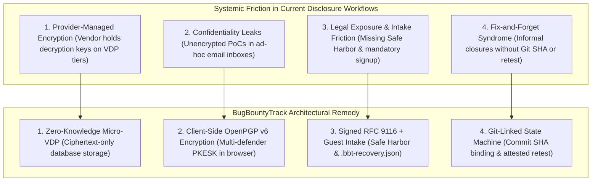
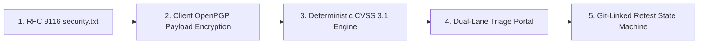

# Academic Progress Report — Week 1: Problem Discovery & User Personas

## BugBountyTrack — Private Bug Bounty & Vulnerability Disclosure Platform

---

## 1. Academic & Project Control Metadata

| Attribute | Specification |
| :--- | :--- |
| **Institution** | Punjab Tianjin University of Technology (PTUT) |
| **Department** | Software Engineering Technology |
| **Degree Program** | Bachelor of Science in Software Engineering Technology |
| **Course Module** | 5th-Semester Capstone Project / Evaluated Software Prototype |
| **Project Identifier** | `PTUT - PRJ - 089` |
| **Official Title** | **BugBountyTrack: Private Bug Bounty & Vulnerability Disclosure Platform** |
| **Category** | 9. Cybersecurity, Privacy & LegalTech |
| **Student / Candidate** | Taha Asadullah (`24-st-013@students.ptut.edu.pk`) |
| **Claimed Date** | October 2, 2026 |
| **Active Milestone** | **Week 1**: Problem Discovery & User Personas |
| **SDLC Phase Gate** | **Gate 1: Definition of Ready (DoR)** |
| **Student Author & Project Lead** | Taha Asadullah (Roll No: `24-ST-013`, Section: `SET-B`) |
| **Academic Supervisor** | Sir Umar Hayat (Assistant Professor, PTUT Lahore) |

### Supporting Deliverable Documents (Google Drive Links)

| Deliverable Document | Scope Covered | Google Drive Link |
| :--- | :--- | :--- |
| **Document 1: Provisional User Personas & Operational Discovery** | Executive Context, Secondary Research & Workflow Modeling of 4 Operational Frictions, and 2 Provisional Composite Personas (Hunter & Defender) with Empathy Maps | [View User Personas & Discovery Doc (Google Drive)](https://docs.google.com/document/d/1drXMfAk4pIKc_9aMKZav62KfVZQ04--zT6VyuhDZKFA/edit?usp=drive_link) |
| **Document 2: Project Charter, Problem Statement & 5 Core MVP Features** | Project Charter, Scope Boundaries, Finalized 1-Paragraph Problem Statement, and 5 Core MVP Features | [View Project Charter & MVP Features Doc (Google Drive)](https://docs.google.com/document/d/1-N7Pv-3CO95XNWcvjSga6vf0vDKOvFKdPQ5l6uGpQJY/edit?usp=drive_link) |

---

## 2. Executive Context & Industry Background

Vulnerability disclosure is recognized by international cybersecurity standards (ISO/IEC 29147 and ISO/IEC 30111) as a core operational discipline for modern software engineering. When independent security researchers discover vulnerabilities in Internet-facing systems, an established channel must exist to receive, triage, remediate, and verify these findings in a cooperative, confidential manner.

While large enterprises and open-source projects have access to commercial crowdsourced platforms (e.g., HackerOne, Bugcrowd, Intigriti) and free entry tiers (e.g., HackerOne Essential VDP, GitHub Security Advisories), small software engineering teams (5–50 developers) and independent startups face three structural architectural gaps:

- **Provider-Managed Key Control**: Existing VDP platforms—including their free tiers—operate on a provider-managed encryption model where the third-party platform vendor holds the decryption keys and can access submitted exploit descriptions and proof-of-concept payloads on server infrastructure, rather than enforcing client-side end-to-end encryption (E2EE) where only the receiving engineering team can decrypt.
- **Administrative & Ecosystem Lock-In**: Free forge-specific tools (such as GitHub Security Advisories) require mandatory reporter accounts and do not cover multi-service SaaS applications, APIs, or infrastructure outside a single public code repository, while enterprise platforms involve heavy sales-led onboarding unsuited for small engineering squads.
- **The Ad-Hoc Disclosure & Verification Pitfall**: Teams unwilling to delegate zero-day exploit visibility to third-party platform operators publish generic `security@` or `support@` email inboxes. Unless reporters and recipients manually configure PGP keys out-of-band, standard email (SMTP) lacks mandatory end-to-end encryption, exposes sensitive exploit steps across mail servers and shared inboxes, and treats bug closure as an informal text update without verifiable Git commit linkage or structured researcher retesting.

BugBountyTrack was conceived to resolve these structural gaps by engineering a lightweight, high-assurance Vulnerability Disclosure Platform (VDP) that is friction-free to adopt, adheres to RFC 9116 discovery standards linked to hosted Safe Harbor terms, preserves client-side zero-knowledge cryptographic confidentiality at rest, and enforces rigorous remediation traceability.

---

## 3. Secondary Research, Workflow Modeling & Operational Friction Analysis

During the Week 1 discovery phase, secondary industry research, public vulnerability disclosure post-mortems, and standards-based workflow modeling (ISO/IEC 29147, ISO/IEC 30111, RFC 9116, RFC 9580, FIRST.org CVSS v3.1) were conducted across both sides of the disclosure equation: independent ethical researchers and startup technical leaders.

> **Methodological & Empirical Separation Note**: No live external target-user interview transcripts were completed prior to this baseline. All friction analyses (`FRC-01`–`FRC-04`) and the two personas in Section 4 (**Alex Rivera** and **Sarah Chen**) are explicitly documented as **secondary research and workflow modeling constructs (Provisional Composite Personas)**. Because the original Week 1 assignment specifies target-user interviews—and later Phase 4 peer usability testing (`SUS`) does not substitute for earlier target-user discovery interviews—live target-user interview sessions are tracked as a separate empirical validation item in the repository's Empirical Interview Log (`DISCOVERY_INTERVIEW_LOG.md`, currently `PENDING_LIVE_INTERVIEWS` with `0` completed sessions), keeping actual interview findings strictly distinct from modeling assumptions.

### 3.1 Primary Friction Dimensions Identified

#### Friction 1: Provider-Managed Encryption & Ad-Hoc Email Leaks

- **Observed Behavior**: Free and commercial VDP tiers rely on provider-managed encryption where the platform vendor retains decryption capability, while teams avoiding third-party plaintext visibility ask researchers to email proof-of-concept (PoC) scripts, SQL injection payloads, or authentication bypass steps to addresses like `security@company.com`.
- **Vulnerability**: Unless senders manually configure PGP, standard email (SMTP) lacks mandatory end-to-end encryption, leaving unpatched zero-day vulnerabilities readable across mail servers and shared inboxes. Conversely, delegating decryption keys to a third-party VDP vendor turns the vendor platform into a high-value point of exposure.

#### Friction 2: Legal Ambiguity & Onboarding Chilling Effect on Ethical Hackers

- **Observed Behavior**: Without a formalized, cryptographically signed `/.well-known/security.txt` discovery file linking to explicit Safe Harbor policy terms, security researchers operate in legal uncertainty under the Computer Fraud and Abuse Act (CFAA) or national cybercrime statutes, and frequently abandon submissions when forced to register an account for a single report.
- **Vulnerability**: Researchers refrain from reporting critical findings out of fear of legal retaliation or registration friction, leaving production vulnerabilities unpatched until malicious actors exploit them.

#### Friction 3: Triage Chaos & Subjective Severity Disagreements

- **Observed Behavior**: Communications occur across fragmented email threads without standardized scoring metrics. Researchers label submissions as "Critical" to command urgent attention, while engineering teams downgrade valid reports to "Low" or "Informative" without transparent mathematical justification.
- **Vulnerability**: Severe operational friction and mistrust develop between the engineering team and the security research community due to subjective severity evaluation.

#### Friction 4: The "Fix-and-Forget" Remediation Verification Gap

- **Observed Behavior**: Traditional issue trackers (Jira, Linear, GitHub Issues) and basic VDP workflows allow a developer to mark a vulnerability ticket as "Closed" or "Resolved" via a simple status toggle the moment a pull request is merged. There is no cryptographic verification that a specific Git commit landed on the target branch, and no structured retest workflow re-engaging the original finder.
- **Vulnerability**: Security patches deployed without verifiable commit linkage and finder retesting frequently address only surface symptoms (such as an incomplete regex filter or a single API route) while leaving the underlying vulnerability exploitable via adjacent vectors.

---

## 4. Provisional Composite User Personas (Workflow Modeling)

To ground system requirements in concrete human workflows prior to live target-user interviews, two **Provisional Composite Personas** were synthesized from industry disclosure literature and standards modeling to represent the primary system actors.

---

### Persona 1: The Ethical Security Researcher ("The Hunter")

#### Demographic & Professional Profile

* **Name**: Alex Rivera
* **Age**: 23
* **Role**: Independent Security Researcher / Undergraduate Cybersecurity Student
* **Experience**: 2 years part-time bug bounty hunting, Top 5% on university CTF teams
* **Primary Operating Environment**: Kali Linux, macOS, Firefox Developer Edition
* **Primary Tooling**: Burp Suite Professional, `ffuf`, `nuclei`, `curl`, Python (`requests`), GnuPG CLI

#### Goals & Motivations

1. **Responsible Coordination**: Notify vulnerable organizations rapidly and ethically—either via an authenticated Hunter account or via a 60-second account-less guest submission—before malicious actors exploit the weakness.
2. **Reputation & Proof of Competence**: Earn verifiable proof of discoveries (CVSS v3.1 metrics, verified remediation attribution, and Hall of Fame credit) for their professional portfolio.
3. **Legal Safety**: Verify explicit legal Safe Harbor terms via a signed `/.well-known/security.txt` policy guaranteeing protection for good-faith testing within scope.

#### Critical Pain Points & Operational Friction

* **The Black Hole (Ghosting)**: Submits detailed reports to `security@target.com` and receives zero acknowledgement or status updates for months.
* **Payload Insecurity**: Refuses to email raw exploit scripts in plaintext or upload them to platforms where third-party staff can inspect unpatched zero-days.
* **Subjective Severity Downgrades**: Frustrated when an organization acknowledges a high-impact vulnerability but unilaterally labels it "Low Severity" without a deterministic CVSS v3.1 vector breakdown.
* **Incomplete Fixes**: Discovers that a developer applied a superficial client-side check and closed the report without inviting Alex to re-verify the patch.

#### Empathy Map (Alex Rivera)

| Dimension | User Expression & Internal State |
| :--- | :--- |
| **Says** | *"I found a critical IDOR that exposes customer data. I want to report it responsibly, but I don't want to get sued or ignored."* |
| **Thinks** | *"Will they actually patch the root cause, or will a developer copy-paste my plaintext PoC into Slack and leak it?"* |
| **Does** | Uses Burp Suite to capture reproduction steps; checks `/.well-known/security.txt` before testing; verifies patches during retest. |
| **Feels** | Cautious regarding legal safety; frustrated by corporate silence; respected when an engineering team verifies their fix professionally. |

---

### Persona 2: The Startup Engineering Lead ("The Defender")

#### Demographic & Professional Profile

* **Name**: Sarah Chen
* **Age**: 31
* **Role**: CTO / Lead Full-Stack Engineer at a 7-person B2B FinTech SaaS startup
* **Experience**: 8 years in full-stack web engineering; generalist with security ownership
* **Primary Operating Environment**: macOS, VS Code, GitHub, Vercel, Neon PostgreSQL
* **Primary Tooling**: TypeScript, Next.js, Docker, GitHub Actions, Linear, Slack

#### Goals & Motivations

1. **Protect Customer Assets with Zero-Knowledge Privacy**: Ensure incoming vulnerability reports are encrypted client-side so only her designated program defenders (`PROGRAM_DEFENDER`) can decrypt them—never a third-party VDP vendor.
2. **Compliance & Credibility**: Rapidly demonstrate adherence to RFC 9116 (`security.txt`) and export **Redacted Closure Evidence** summaries for B2B enterprise customer security questionnaires and SOC 2 audits.
3. **Efficient Engineering Focus**: Spend minimal time filtering automated noise and maximum time implementing verifiable code remedies linked to GitHub commits.

#### Critical Pain Points & Operational Friction

* **Scanner Spam Fatigue**: Shared `security@` inbox is bombarded with generic output from automated scanners demanding bounties for non-issues.
* **Cryptographic Setup Barrier**: Wants PGP-encrypted vulnerability intake, but managing CLI GnuPG keyrings across a 7-person engineering team is impractical without automated in-browser key management (`RFC 9580 v6 Curve25519`).
* **Database Exposure Fear**: Knows that storing unpatched exploits in plaintext on third-party vendor servers or internal trackers creates a catastrophic single point of failure if that database is breached.
* **Verification Uncertainty**: Merges a pull request claiming to fix a flaw, but lacks a formal state machine to confirm the commit landed on the target branch and withstood researcher retesting.

#### Empathy Map (Sarah Chen)

| Dimension | User Expression & Internal State |
| :--- | :--- |
| **Says** | *"We want researchers to report vulnerabilities, but free VDP tools store raw exploits in plaintext on vendor servers, and our email inbox is flooded with scanner spam."* |
| **Thinks** | *"If an ethical hacker sends us an exploit, I need it encrypted client-side so only my authorized defenders can read it, and I need proof that our Git commit actually fixed it."* |
| **Does** | Reviews GitHub Pull Requests; coordinates hotfixes; manages cloud production credentials; prepares compliance evidence for enterprise clients. |
| **Feels** | Overwhelmed by manual inbox triage; protective of customer data and engineering cycles; confident when fixes are backed by commit SHAs and retest attestations. |

---

## 5. Finalized Academic Problem Statement

The formal Problem Statement, refined and submitted for the PTUT 5th-Semester Capstone Project, is formulated as follows:

> **"While established vulnerability platforms and source-code hosts offer free entry tiers (such as HackerOne Essential VDP or GitHub Security Advisories), they rely on provider-managed encryption where the platform vendor holds the decryption keys and can access submitted exploit payloads on server infrastructure, or are locked to single-forge repository ecosystems. Teams unwilling to delegate zero-day exploit visibility to third-party platform operators typically fall back to ad-hoc communication channels (email, issue trackers, social media DMs), where—unless senders manually configure PGP—exploit reproduction steps traverse mail servers and shared inboxes without end-to-end encryption, while missing RFC 9116 `security.txt` discovery files and hosted Safe Harbor policy terms leave researchers in legal ambiguity. Furthermore, existing issue trackers and entry-level VDP tiers treat vulnerability resolution as an informal status change ('Closed' or 'Resolved'), creating a 'fix-and-forget' verification gap where patches are deployed without verifiable Git commit linkage or attested researcher retesting. BugBountyTrack resolves these gaps by delivering a lightweight, multi-tenant Vulnerability Disclosure Platform (VDP) that automates signed RFC 9116 `security.txt` discovery linked to hosted Safe Harbor terms, enforces zero-knowledge client-side OpenPGP exploit payload encryption (RFC 9580 v6 Curve25519), provides deterministic CVSS 3.1 scoring, and governs remediation through an evidence-based, Git-linked retest state machine."**

---

## 6. The 5 Core MVP Features

These five features directly address the four operational frictions identified through secondary research and workflow modeling, defining the core Minimum Viable Product (MVP) scope:

---

### Feature 1: Hosted RFC 9116 `security.txt` & Scope Policy Generator (`FR-2`)

* **Problem Solved**: Eliminates researcher legal ambiguity and provides standardized, machine-readable discovery for defensive disclosure programs.
* **Technical & Cryptographic Boundary**:
  - Generates a standards-compliant RFC 9116 policy incorporating `Contact`, `Expires`, `Encryption` (URI to program OpenPGP v6 public key), `Policy` (URI to program Safe Harbor scope), `Preferred-Languages`, and `Canonical` after automated DNS TXT domain verification (`_bbt-challenge.<domain>`).
  - **Client-Side Cleartext Signing (RFC 9116 §2.3)**: Because the server is strictly zero-knowledge and never holds private keys, the `security.txt` policy is **cleartext-signed inside the Organization Owner's browser** using their client-side Ed25519 private signing key (`openpgp.js` v6). The signed artifact is exported for publication at `https://[org-domain]/.well-known/security.txt` and served for preview and signature verification at `/api/v1/programs/[slug]/security.txt`.
  - Includes a Disclose.io-aligned Safe Harbor policy builder where startup leads define in-scope assets, out-of-scope boundaries, and good-faith legal protection terms (referenced via the RFC 9116 `Policy:` directive).
* **Acceptance Condition**: Endpoint serves HTTP 200 with MIME type `text/plain; charset=utf-8`, passes automated RFC 9116 syntax validation, and verifies cryptographically against the organization's advertised public key.

---

### Feature 2: Client-Side OpenPGP v6 Exploit Payload Encryption & Neutral Labeling (`FR-3`)

* **Problem Solved**: Prevents plaintext exploit and proof-of-concept exposure over transit networks and eliminates zero-day vulnerability leakage if the server-side database is ever compromised.
* **Technical & Cryptographic Boundary**:
  - Executes strictly inside the user's browser runtime (`openpgp.js` v6 via `WebCrypto` and WebAssembly).
  - Enforces a unified **RFC 9580 Version 6 Curve25519** (`Ed25519` signing + `X25519` encryption) profile with **64-character hexadecimal SHA-256 fingerprints**. Private keys are encrypted at rest using **Argon2id S2K** (`t=3`, `m=64 MiB`, `p=4`, enabled via CSP `'wasm-unsafe-eval'`) and stored exclusively in browser **`IndexedDB`** (never in unencrypted browser storage).
  - Encrypts all sensitive report fields—including the vulnerability title (`title_ciphertext`), description, reproduction steps, impact statement, and raw PoC attachments (up to 25 MiB uploaded via presigned Cloudflare R2 URLs)—using multi-recipient OpenPGP Public-Key Encrypted Session Key (`PKESK`) packets addressed to all active **Program Defenders** (`N ≤ 10` via `PROGRAM_DEFENDER`), the organization's **Offline Master Recovery Key** (`recovery_public_key`), and the **Submitter/Guest Key**, guarded by optimistic concurrency counter `recipient_set_version`.
  - Captures a server-readable neutral 8-category `operational_label` enum (`AUTHENTICATION_BYPASS`, `INJECTION_VULNERABILITY`, `INFORMATION_DISCLOSURE`, `CROSS_SITE_SCRIPTING`, `ACCESS_CONTROL_ISSUE`, `SERVER_SIDE_REQUEST_FORGERY`, `DENIAL_OF_SERVICE`, `OTHER`) so queue routing and external alerts never leak vulnerability titles.
* **Acceptance Condition**: Direct inspection of PostgreSQL records and Cloudflare R2 objects confirms sensitive titles, descriptions, and attachments exist solely as OpenPGP ciphertext blocks (`-----BEGIN PGP MESSAGE-----`).

---

### Feature 3: Deterministic CVSS 3.1 Severity Scoring Engine (`FR-4`)

* **Problem Solved**: Eliminates subjective severity disputes between ethical researchers and organization triage leads.
* **Technical Boundary**:
  - Implemented as a standalone, deterministic pure TypeScript function adhering strictly to the **FIRST.org Common Vulnerability Scoring System v3.1** specification (using the official `8.22` exploitability coefficient and standard `RoundUp` arithmetic).
  - Evaluates the 8 foundational Base Metrics: Attack Vector (`AV`), Attack Complexity (`AC`), Privileges Required (`PR`), User Interaction (`UI`), Scope (`S`), Confidentiality (`C`), Integrity (`I`), and Availability (`A`).
  - Computes the exact numerical Base Score (`0.0–10.0`), assigns the qualitative severity rating (`NONE`, `LOW`, `MEDIUM`, `HIGH`, `CRITICAL`), generates the canonical vector string (e.g., `CVSS:3.1/AV:N/AC:L/PR:N/UI:N/S:U/C:H/I:H/A:H`), and decouples the researcher's suggested rating (`cvss_suggested`) from the defender's official rating (`cvss_score`).
* **Acceptance Condition**: Automated verification confirms 100% mathematical parity across all 2,592 base metric combinations and all 45 canonical FIRST.org/NIST test fixtures.

---

### Feature 4: Dual-Lane Intake (Account-Less Guest & Authenticated Hunter) & Encrypted Triage Portal (`FR-1`, `FR-5`, `FR-8`)

* **Problem Solved**: Centralizes scattered disclosures into a structured, role-isolated workspace while eliminating mandatory account-registration friction for one-off reporters.
* **Technical & Privacy Boundary**:
  - Built with Next.js App Router and PostgreSQL (enforcing Row-Level Security via `SET LOCAL app.current_tenant_id = :org_id`), supporting both **Authenticated Hunters** and **Account-Less Guest Reporters**.
  - Guest submissions generate a durable `guest_actor_id` (UUIDv4), a single downloadable Argon2id-protected recovery bundle (`.bbt-recovery.json` v1) for multi-device restoration at `/report/restore`, and an unguessable tracking URL (`/report/track/BBT-RPT-XXXX#token=<access_token>`). On page load, client JavaScript reads the `#token=` URI fragment into memory and immediately scrubs the address bar via `window.history.replaceState()`, while the server stores only `guest_token_hash`.
  - Provides two cryptographically separated discussion lanes: (1) **Researcher–Organization Conversation** (encrypted for Submitter + Program Defenders + Org Recovery Key) and (2) **Reviewer Internal Notes** (encrypted strictly for Program Defenders + Org Recovery Key).
  - Renders decrypted Markdown safely through a strict Abstract Syntax Tree (AST) sanitizer (`unified` / `remark-parse` / `rehype-sanitize`) preventing stored XSS and remote tracking beacons.
* **Acceptance Condition**: Authorized Program Defenders and returning Reporters (via `IndexedDB` or imported `.bbt-recovery.json`) decrypt messages strictly in-browser; cross-tenant requests and uninvited private-program submissions are rejected with HTTP 403 Forbidden.

---

### Feature 5: Git-Linked Remediation & Retest Verification State Machine (`FR-6`, `FR-7`)

* **Problem Solved**: Eliminates the "Fix-and-Forget" verification gap by binding vulnerability closure to verifiable code/configuration artifacts and attested retesting.
* **Technical Boundary**:
  - Enforces a deterministic finite state machine governing the vulnerability lifecycle (`NEW → TRIAGING → ACCEPTED → FIX_PROPOSED (FIX_COMMITTED) → RETEST_PENDING → [TERMINAL STATE]`, with non-remediation branches `NEED_MORE_INFO → CLOSED_INCOMPLETE`, `RETEST_FAILED → ACCEPTED`, and `REJECTED_SPAM / REJECTED_INVALID / DUPLICATE / WITHDRAWN / RISK_ACCEPTED`).
  - Advancing a report to `FIX_PROPOSED` (`FIX_COMMITTED`) requires recording either a verified **40-character Git commit SHA** (`[0-9a-f]{40}`, validated against the repository branch via the GitHub REST API v3) or a client-computed **64-character SHA-256 configuration hash** (`CONFIG_INFRASTRUCTURE`), alongside the target deployment environment (`Staging`, `Pre-Production`, `Production`).
  - Decouples fix declaration from ticket closure: from `RETEST_PENDING`, a report transitions to resolved only when the original researcher attests mitigation (`VERIFIED_RESEARCHER`), an authorized defender certifies the fix (`VERIFIED_INTERNAL`), or an expired grace period (≥ 14 days) is closed with mandatory administrative justification (`CLOSED_UNVERIFIED_TIMEOUT`, never counted as a verified fix). All state transitions are recorded in an append-only, SHA-256 hash-chained (`prev_hash`) audit table (`INSERT` and `SELECT` privileges only).
* **Acceptance Condition**: Automated state machine guards reject any closure transition lacking verified commit/hash evidence, actor attribution, and required justification metadata.

---

## 7. Document Endorsement & Milestone Sign-Off

| Signatory Role | Name & Academic Designation | Status / Signature | Date |
| :--- | :--- | :--- | :--- |
| **Submitted By (Student Author)** | **Taha Asadullah** (Roll No: `24-ST-013`, Section: `SET-B`, BS Software Engineering Technology, PTUT Lahore) | *Signed: Taha Asadullah* | October 2026 |
| **Reviewed By (Academic Supervisor)** | **Sir Umar Hayat** (Assistant Professor, Department of Software Engineering Technology, PTUT Lahore) | `[ ] Approved` / `[ ] Revisions` — Signature: `[__________________]` | `[____________]` |
