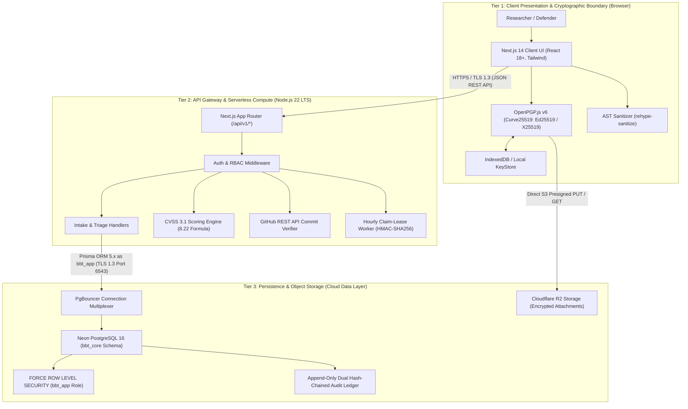
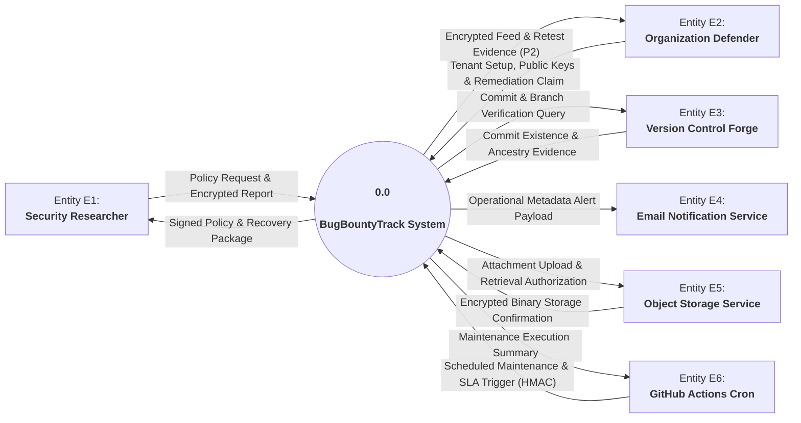
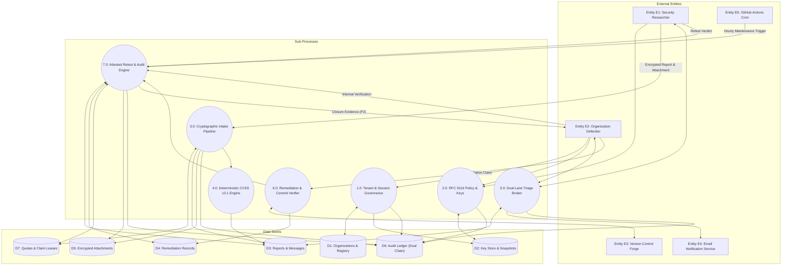

# Week 3 Task & Deliverable: High-Level Architecture & Cloud Topology

| Attribute | Details |
| :--- | :--- |
| **Project ID** | `PTUT - PRJ - 089` |
| **Project Title** | **BugBountyTrack — Private Bug Bounty & Vulnerability Disclosure Platform** |
| **Student Author** | Taha Asadullah (Roll No: `24-ST-013`, Section: `SET-B`) |
| **Academic Supervisor** | Sir Umar Hayat (Assistant Professor, PTUT Lahore) |
| **Milestone** | **Week 3** — High-Level Architecture & Cloud Topology |
| **Standard Compliance** | IEEE Std 42010-2011 / IEEE Std 830-1998 / ISO/IEC/IEEE 29148:2018 |
| **WBS Task IDs** | `WP-1.1` (8h), `WP-1.2` (12h), `WP-1.3` (10h), `WP-1.4` (10h), `WP-2.1` (8h) — **Architecture Baseline** |

---

## Supporting Deliverable Document (Google Drive Link)

| Deliverable Document | Scope Covered | Google Drive Link |
| :--- | :--- | :--- |
| **High-Level Architecture & Cloud Topology Specification (`HIGH_LEVEL_ARCHITECTURE.docx`)** | Complete IEEE 42010 High-Level Architecture Specification, 3-Tier Zero-Plaintext Model, DFD Level 0 Context Diagram, DFD Level 1 Functional Decomposition, 4 Defensible System Boundaries, What BugBountyTrack Controls vs Does NOT Control, Comprehensive STRIDE Threat Mitigation Analysis, Cloud Topology Justification, $0.00 Academic vs. $61.00 Commercial Cost Feasibility Models, and Bidirectional Requirements Traceability Matrix | [View High-Level Architecture Specification (Google Drive)](PASTE_GOOGLE_DRIVE_LINK_FOR_ARCHITECTURE_DOCX_HERE) |

---

## Part 1: 3-Tier Zero-Plaintext Architecture & Defensible System Boundaries

### 1.1 3-Tier Architectural Model Overview
The system architecture for **BugBountyTrack** is designed around a zero-trust, client-side encryption paradigm that resolves the core friction identified in Week 1 (`FRC-01` Provider-Held Decryption Keys) and formalizes the technical boundaries specified in Week 2 (`SRS Revision 2.8`):

1. **Tier 1: Client Presentation & Cryptographic Boundary (Web Browser)**
   - Executes inside the user's browser runtime using React 18+ and Next.js 14 Client Components.
   - Houses the **OpenPGP.js v6 WebCrypto / WebAssembly cryptographic core**, which performs in-memory Curve25519 (`Ed25519` / `X25519`) keypair generation, multi-recipient payload encryption, and symmetric `.bbt-recovery.json` encapsulation.
   - Cleanses decrypted report text via `rehype-sanitize` before DOM injection, eliminating DOM-based cross-site scripting vulnerabilities.
2. **Tier 2: Presentation & Gateway / API Server Tier (Serverless Compute)**
   - Deployed on Vercel's global edge infrastructure running on **Node.js 22 LTS**.
   - Handles stateless HTTP routing (`/api/v1/*`, `/.well-known/security.txt`), CSPRNG 256-bit session token governance (`token_hash`), Argon2id password KDF (`FR-1.3a`), `__Host-bbt-session` cookies (`SameSite=Lax`, `Secure`), Cloudflare Turnstile token validation, and rate limiting (10 submissions/hour/IP, `FR-8.3`).
   - Houses the pure TypeScript FIRST.org CVSS v3.1 scoring engine (accepting base metrics in any ordering, calculating scores in < 5 ms with the official `8.22` coefficient, and emitting canonical vectors).
   - Manages integrations with external services (GitHub REST API v3 for commit verification via `compare/{branch}...{sha}` and Resend for metadata-only email alerts).
   - Executes scheduled maintenance via `POST /api/v1/internal/cron/sla-check` authenticated via HMAC-SHA256 (`X-Cron-Timestamp` and `X-Cron-Signature: sha256=<64-hex-hmac>`).
3. **Tier 3: Persistence & Object Storage Tier (Cloud Data Layer)**
   - **Neon Serverless PostgreSQL 16**: Enforces strict database multi-tenancy via **`FORCE ROW LEVEL SECURITY`** under the dedicated schema `bbt_core`, accessed by the unprivileged `bbt_app` database role (`NOSUPERUSER NOBYPASSRLS`). Houses an append-only, dual hash-chained audit ledger (`bbt_core.audit_events`) linking every event via SHA-256 (`tenant_row_hash` and `report_chain_hash`, `FR-8.5`). Enforces storage quotas with a separate 20 MiB intake pool and 6 MiB reserve floor (`FR-8.4`).
   - **Cloudflare R2 Object Storage**: Provides S3-compatible, zero-egress-fee distributed storage for encrypted binary proof-of-concept attachments (`<= 25 MiB` each). Attachments are uploaded directly by the client browser via presigned URLs without buffering on serverless API handlers.

### 1.2 System Trust Boundaries & STRIDE Threat Mitigation
* **Client Cryptographic Boundary**: Plaintext vulnerability data and private keys exist strictly inside browser memory. At no point are unencrypted vulnerability descriptions, reproduction steps, or raw private keys transmitted to the API server or stored in database tables.
* **Serverless API Boundary**: The server tier functions strictly as a blind routing, access-control, and validation orchestrator. It receives armored ciphertexts, verifies authentication nonces, and updates state machines without inspecting sensitive payloads.
* **Database Boundary**: Data rows are protected at the database engine level using PostgreSQL Row-Level Security (`FORCE ROW LEVEL SECURITY`) bound to unprivileged role `bbt_app`. Even if an application route omits an explicit tenant filter, the database rejects queries that do not match the session's active `organization_id`.
* **Object Storage Boundary**: Cloudflare R2 presigned URLs enforce strict time-bounded uploads (15-minute lease), file size limits (`<= 25 MiB`), and SHA-256 checksum verification, isolating binary uploads from server memory exhaustion.

### 1.3 Defensible Boundaries: What BugBountyTrack Controls vs Does NOT Control

| Operational Dimension | What BugBountyTrack Controls | What BugBountyTrack Does NOT Control |
| :--- | :--- | :--- |
| **Cryptography** | Client-side OpenPGP v6 envelope creation, verification, and dual-lane key wrapping. | Malware, keyloggers, or hostile browser extensions on researcher or defender endpoints. |
| **Identity & Access** | CSPRNG session tokens (`token_hash`), Argon2id password KDF, TOTP MFA, and HMAC cron auth. | Compromised credentials or MFA devices outside application boundaries. |
| **Remediation Verification** | Live repository commit existence and branch inclusion check via GitHub API (`compare/{branch}...{sha}`). | Real-world server deployment and runtime execution of the committed fix on defender production systems. |
| **Multi-Tenancy** | PostgreSQL engine-level RLS (`FORCE ROW LEVEL SECURITY`) via `bbt_app` role and schema isolation. | Physical host hardware or hypervisor security of cloud hosting providers. |
| **Storage & Retention** | Strict quota limits (20 MiB intake, 6 MiB reserve floor) and automated hourly lease garbage collection. | Cloud provider physical storage integrity or disaster recovery beyond documented SLAs. |

---

## Part 2: Data Flow Diagrams (DFD Level 0 & Level 1)

### 2.1 DFD Level 0: System Context Diagram
The Level 0 Context Diagram establishes the global perimeter of BugBountyTrack (`0.0`), mapping all communication vectors between the system and its six external entities:

### 2.2 DFD Level 1: Functional System Decomposition
The Level 1 Data Flow Diagram breaks down the central system process into seven core functional sub-processes interacting with seven distinct data stores:

---

## Part 3: Cloud Infrastructure Stack Justification & Cost Feasibility

### 3.1 Technology Stack Selection & Trade-Off Matrix

| Component | Selected Stack | Evaluated Alternative | Deciding Rationale |
| :--- | :--- | :--- | :--- |
| **Application Framework** | **Next.js 14+ App Router** (Node.js 22 LTS, TypeScript) | Separate React SPA + Express.js Backend | Unified fullstack repository eliminates API contract divergence; React Server Components reduce client bundle size; native Server Actions provide type-safe mutations. |
| **Compute Runtime** | **Vercel Serverless Platform** (Edge + Node.js Functions) | AWS ECS / Docker Containers on EC2 / Kubernetes | Eliminates Linux OS maintenance, container patching, and cluster management toil for a solo student developer; achieves warm p95 latency <= 400 ms and cold start <= 1,200 ms (`NFR-01`). |
| **Database Tier** | **Neon Serverless PostgreSQL 16** (with PgBouncer) | Supabase / AWS Aurora / MongoDB Atlas | True compute autoscaling (0.25 to 2 CU); built-in PgBouncer connection pooling prevents serverless connection exhaustion; robust RLS engine (`bbt_app` role) guarantees multi-tenant security. |
| **Object Storage** | **Cloudflare R2 Storage** (S3-Compatible API) | AWS S3 Standard / Google Cloud Storage | **Zero egress bandwidth fees** eliminates catastrophic billing risks when researchers and defenders download large encrypted PoC screen recordings; full AWS SDK v3 S3 API compatibility. |
| **Bot Verification** | **Cloudflare Turnstile** | Google reCAPTCHA v3 / hCaptcha | Privacy-preserving, non-intrusive CAPTCHA with zero user tracking cookies; seamless React component integration; blocks automated vulnerability spam at zero cost. |
| **Email Service** | **Resend API** | AWS SES / SendGrid | Modern developer-focused REST API with native React Email templating; eliminates complex SMTP handshakes; free tier provides 3,000 metadata-only alerts/month. |
| **Cron Automation** | **GitHub Actions** (Scheduled Workflows) | AWS EventBridge / Vercel Cron | Free standard Linux runners; initiates hourly maintenance on `/api/v1/internal/cron/sla-check` using HMAC-SHA256 signatures (`FR-8.4c`). |

### 3.2 Dual-Track Cost Model & Financial Viability
* **Academic Evaluation Tier ($0.00 / month)**: 100% covered by permanent cloud free tiers (Vercel Hobby, Neon Free 512 MB, Cloudflare R2 10 GB with zero egress fees, Resend 3,000 emails/month, and GitHub Actions 2,000 build minutes). Zero external departmental expenditure required.
* **Commercial Production Tier (~$61.00 / month for 25 Startups)**: Scales smoothly via Vercel Pro ($20/seat), Neon Launch ($19), Cloudflare R2 Pay-as-you-go ($0.75 for 50 GB), Resend Pro ($20), and Cloudflare Registrar ($1.25 amortized). With 2 paying organizations on the $49/month Team tier ($98/mo revenue), the platform generates a **+37.7% net operating margin**, proving strong commercial sustainability.

---

## Part 4: Requirements Traceability & Verification

| Architectural Component | Traced IEEE 830 Requirements | Traced Use Cases | Verification Method |
| :--- | :---: | :---: | :--- |
| **Tier 1: Browser Cryptographic Core** | `FR-3.1`–`FR-3.8`, `FR-1.6c-d` | `UC-01`, `UC-03` | Automated in-browser Jest/Playwright tests asserting RFC 9580 Curve25519 key generation (< 50 ms) and `.bbt-recovery.json` encryption. |
| **Tier 2: Stateless Serverless API Routes**| `FR-1.1`–`FR-1.5`, `FR-4.1`–`FR-4.4`, `FR-5.4`, `FR-8.4c` | `UC-01`, `UC-02`, `UC-03`, `UC-07` | Integration tests verifying Turnstile token validation, CVSS 3.1 45-fixture mathematical parity (8.22, accepting any metric order), and HMAC-SHA256 cron authorization on `/api/v1/internal/cron/sla-check`. |
| **Tier 3: Neon PostgreSQL RLS & Audit** | `FR-8.2`, `FR-8.4`, `FR-8.5`, `FR-7.1` | `UC-04`, `UC-06`, `UC-07` | SQL migration assertions validating `FORCE ROW LEVEL SECURITY` under `bbt_app` role, 20 MiB intake / 6 MiB reserve quota pools, and SHA-256 dual hash chaining (`tenant_row_hash` & `report_chain_hash`). |
| **Tier 3: Cloudflare R2 Direct Storage** | `FR-3.5`, `FR-3.6`, `FR-8.4` | `UC-01`, `UC-07` | Presigned URL generation and direct binary streaming verification with simulated network failures and 15-minute lease expiry tests. |
| **External: GitHub REST API Integration** | `FR-6.1`, `FR-6.2`, `FR-6.4` | `UC-04` | Mocked GitHub API tests asserting commit existence, branch inclusion via `GET /repos/{owner}/{repo}/compare/{branch}...{sha}`, and 403 rate-limit header handling. |

---

## Document Submission & Milestone Sign-Off

### Student Author Endorsement
I hereby confirm that this **Week 3 Deliverable: High-Level Architecture & Cloud Topology** represents an authentic, standards-compliant architectural formulation authored for **BugBountyTrack** (`PTUT - PRJ - 089`), rigorously aligned with the approved IEEE 830 Software Requirements Specification (`Revision 2.8`).

* **Student Author**: **Taha Asadullah** (Roll No: `24-ST-013`, Section `SET-B`)  
* **Signature**: `[Signed Electronically — Taha Asadullah]`  
* **Date**: October 16, 2026  

---

### Academic Supervisor Endorsement
* **Academic Supervisor**: **Sir Umar Hayat** (Assistant Professor, PTUT Lahore)  
* **Department**: Department of Software Engineering Technology  
* **Status**: `[PENDING ACADEMIC SUPERVISOR REVIEW & ENDORSEMENT]`  
* **Date**: `____________________`  
