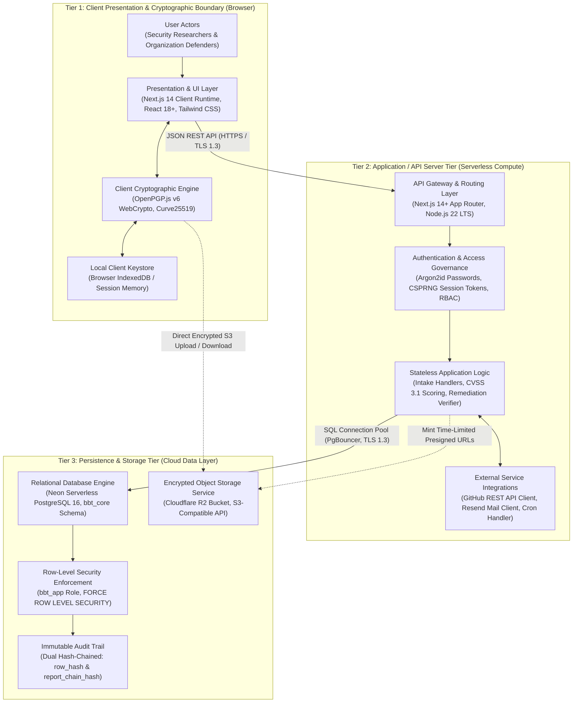
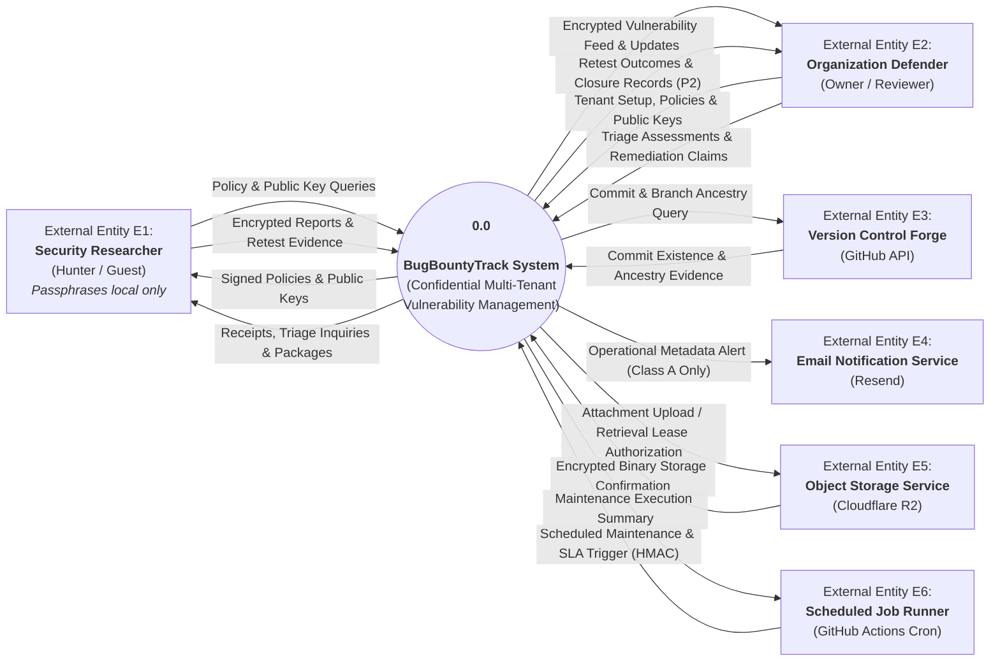
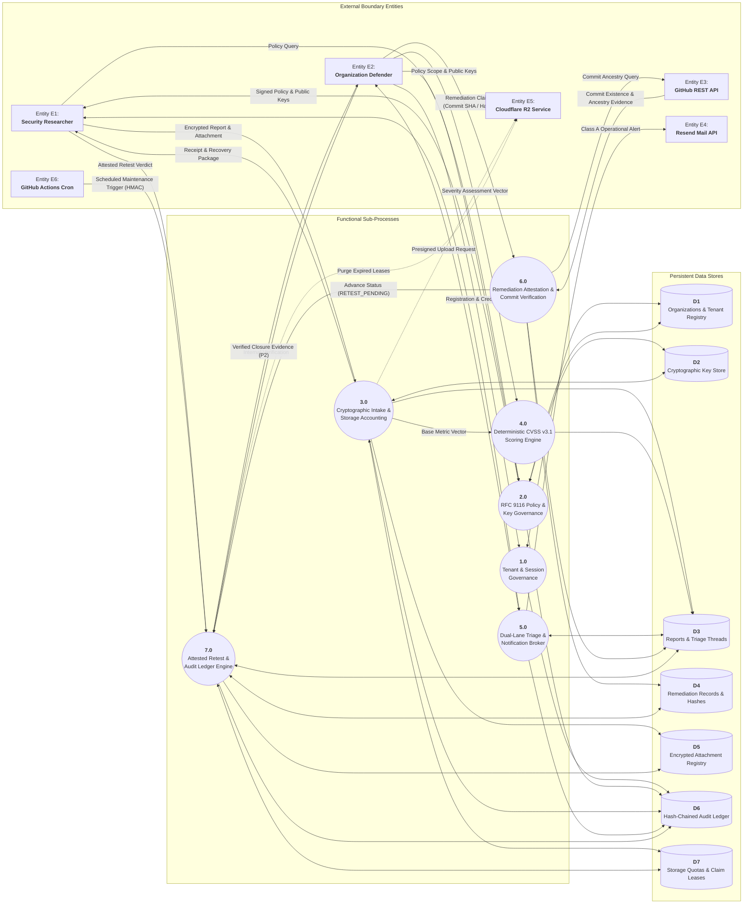

# Week 3 Task & Deliverable: High-Level Architecture & Cloud Topology

| Attribute | Details |
| :--- | :--- |
| **Project ID** | `PTUT - PRJ - 089` |
| **Project Title** | **BugBountyTrack — Private Bug Bounty & Vulnerability Disclosure Platform** |
| **Student Author** | Taha Asadullah (Roll No: `24-ST-013`, Section: `SET-B`) |
| **Academic Supervisor** | Sir Umar Hayat (Assistant Professor, PTUT Lahore) |
| **Milestone** | **Week 3** — High-Level Architecture & Cloud Topology |
| **Standard Compliance** | IEEE Std 42010-2011 / IEEE Std 830-1998 / ISO/IEC/IEEE 29148:2018 |
| **WBS Task IDs** | `WP-1.1` (8h), `WP-1.2` (12h), `WP-1.3` (10h), `WP-1.4` (10h), `WP-2.1` (8h) — **Architecture Baseline** |

---

## Supporting Deliverable Documents & Reference Artifacts

| Deliverable Document | Scope Covered | Repository & Cloud Reference |
| :--- | :--- | :--- |
| **Week 1 Discovery: Personas, Charter & MVP Features (`WEEK_1_DISCOVERY_REPORT.docx`)** | Executive Context, 4 Operational Frictions, 2 Provisional Composite Personas, and 5 Core MVP Features | [View Week 1 Discovery Doc (Google Drive)](https://docs.google.com/document/d/1drXMfAk4pIKc_9aMKZav62KfVZQ04--zT6VyuhDZKFA/edit?usp=drive_link) |
| **Week 2 Formal IEEE 830 Software Requirements Specification (`SRS.docx`)** | Complete Submitted IEEE 830 SRS (`Revision 2.8`), Table 2.2 Permission Matrix, `FR-1` to `FR-8`, `UC-01` to `UC-07`, 4 UML Diagrams, and NFRs | [View Week 2 IEEE 830 SRS Doc (Google Drive)](https://docs.google.com/document/d/1n8VKmXeK4TSTPPR-mDXp3NkKwDxvzTzEWR9tgdZlxSg/edit?usp=drive_link) |
| **Week 3 High-Level Architecture & Cloud Topology (`HIGH_LEVEL_ARCHITECTURE.docx`)** | 3-Tier Zero-Plaintext Model, Balanced DFD Level 0 & Level 1, Defensible System Boundaries, and Cloud Topology Justification | Local Word: `architecture/HIGH_LEVEL_ARCHITECTURE.docx` / `Resources/HIGH_LEVEL_ARCHITECTURE.docx` |

---

## Part 1: 3-Tier Zero-Plaintext Architecture & Defensible System Boundaries

### 1.1 3-Tier Architectural Model Overview
The system architecture for **BugBountyTrack** is designed around a zero-trust, client-side encryption paradigm that resolves the core friction identified in Week 1 (`FRC-01` Provider-Held Decryption Keys) and formalizes the technical boundaries specified in Week 2 (`submitted SRS Revision 2.8, pending formal supervisor evaluation`):

1. **Tier 1: Client Presentation & Cryptographic Boundary (Web Browser)**
   - Executes inside the user's browser runtime using React 18+ and Next.js 14 Client Components.
   - Houses the **OpenPGP.js v6 WebCrypto / WebAssembly cryptographic core**, which performs in-memory Curve25519 (`Ed25519` / `X25519`) keypair generation, multi-recipient payload encryption, and symmetric `.bbt-recovery.json` encapsulation.
   - Cleanses decrypted report text via `rehype-sanitize` before DOM injection, eliminating DOM-based cross-site scripting vulnerabilities.
   - *Note: Guest recovery passphrases are entered and processed strictly within browser memory and are never transmitted to the backend.*
2. **Tier 2: Presentation & Gateway / API Server Tier (Serverless Compute)**
   - Deployed on Vercel's global edge infrastructure running on **Node.js 22 LTS**.
   - Handles stateless HTTP routing (`/api/v1/*`, `/.well-known/security.txt`), CSPRNG 256-bit session token governance (`token_hash`), Argon2id password KDF (`FR-1.3`), `__Host-bbt-session` cookies (`SameSite=Lax`, `Secure`), Cloudflare Turnstile token validation, and rate limiting (10 submissions/hour/IP, `FR-8.3`).
   - Houses the pure TypeScript FIRST.org CVSS v3.1 scoring engine (accepting base metrics in any ordering, calculating scores in < 5 ms proposed design target under `FR-4` with the official `8.22` coefficient, and emitting canonical vectors).
   - Manages integrations with external services (GitHub REST API v3 for commit verification via `compare/{branch}...{sha}` confirming commit existence and branch ancestry, and Resend for metadata-only email alerts).
   - Executes scheduled maintenance via `POST /api/v1/internal/cron/sla-check` authenticated via HMAC-SHA256 (`X-Cron-Timestamp` and `X-Cron-Signature: sha256=<64-hex-hmac>`, `FR-5.4`).
3. **Tier 3: Persistence & Object Storage Tier (Cloud Data Layer)**
   - **Neon Serverless PostgreSQL 16**: Enforces strict database multi-tenancy via **`FORCE ROW LEVEL SECURITY`** under the dedicated schema `bbt_core`, accessed by the unprivileged `bbt_app` database role (`NOSUPERUSER NOBYPASSRLS`). Houses an append-only, dual hash-chained audit ledger (`bbt_core.audit_events`) linking every event via SHA-256 (`row_hash` and `report_chain_hash`, `FR-8.5`). Enforces storage quotas with a separate 20 MiB intake pool and 6 MiB security and triage reserve (with a 300 KiB Priority-0 floor within that reserve) (`FR-8.4`).
   - **Cloudflare R2 Object Storage**: Provides S3-compatible, zero-egress-fee distributed storage for encrypted binary proof-of-concept attachments (`<= 25 MiB` each). Attachments are uploaded directly by the client browser via presigned URLs without buffering on serverless API handlers.

### 1.2 System Trust Boundaries & STRIDE Threat Mitigation
* **Client Cryptographic Boundary**: Plaintext vulnerability data and private keys exist strictly inside browser memory. At no point are unencrypted vulnerability descriptions, reproduction steps, or raw private keys transmitted to the API server or stored in database tables.
* **Serverless API Boundary**: The server tier functions strictly as a blind routing, access-control, and validation orchestrator. It receives armored ciphertexts, verifies authentication nonces, and updates state machines without inspecting sensitive payloads.
* **Database Boundary**: Data rows are protected at the database engine level using PostgreSQL Row-Level Security (`FORCE ROW LEVEL SECURITY`) bound to unprivileged role `bbt_app`. Even if an application route omits an explicit tenant filter, the database engine rejects queries that do not match the session's active `organization_id`. The dual-chain audit ledger restricts application-level modification and supports independent detection of changes to recorded history.
* **Object Storage Boundary**: Cloudflare R2 presigned URLs enforce strict time-bounded uploads (15-minute lease), file size limits (`<= 25 MiB`), and SHA-256 checksum verification, isolating binary uploads from server memory exhaustion.

### 1.3 Defensible Boundaries: What BugBountyTrack Controls vs Does NOT Control

| Operational Dimension | What BugBountyTrack DOES Architecturally Control | What BugBountyTrack DOES NOT Control |
| :--- | :--- | :--- |
| **Cryptography** | Client-side OpenPGP v6 envelope creation, verification, and dual-lane key wrapping. | Malware, keyloggers, or hostile browser extensions on researcher or defender endpoints. |
| **Identity & Access** | CSPRNG session tokens (`token_hash`), Argon2id password KDF, TOTP MFA, and HMAC cron auth. | Compromised credentials or MFA devices outside application boundaries. |
| **Remediation Verification** | Live repository commit existence and branch ancestry check via GitHub API (`compare/{branch}...{sha}`). | Real-world server deployment and runtime execution of the committed fix on defender production systems (an API response alone does not establish production deployment or prove the fix works). |
| **Multi-Tenancy** | PostgreSQL engine-level RLS (`FORCE ROW LEVEL SECURITY`) via `bbt_app` role and schema isolation. | Physical host hardware or hypervisor security of cloud hosting providers. |
| **Storage & Retention** | Strict quota limits (20 MiB intake pool, 6 MiB security and triage reserve with 300 KiB Priority-0 floor) and automated hourly lease garbage collection. | Cloud provider physical storage integrity or disaster recovery beyond documented SLAs. |
| **Notifications & Messaging** | Notifications contain only approved Class A metadata and exclude confidential report content; redaction of vulnerability descriptions from alert emails. | Upstream SMTP deliverability; recipient mail server spam filters; mail server security at rest on the recipient's mail provider. |

---

## Part 2: Data Flow Diagrams (DFD Level 0 & Level 1)

### 2.1 DFD Level 0: System Context Diagram
The Level 0 Context Diagram establishes the global perimeter of BugBountyTrack (`0.0`), mapping all communication vectors between the system and its six external entities:

### 2.2 DFD Level 1: Functional System Decomposition
The Level 1 Data Flow Diagram breaks down the central system process into seven core functional sub-processes interacting with seven distinct data stores and all six external boundary entities:

---

## Part 3: Cloud Infrastructure Stack Justification & Cost Feasibility

### 3.1 Technology Stack Selection & Trade-Off Matrix

| Subsystem Layer | Chosen Technology | Primary Alternatives Evaluated | Architectural Rationale & Trade-Off |
| :--- | :--- | :--- | :--- |
| **Frontend & API Fullstack Engine** | **Next.js 14+ App Router** (Node.js 22 LTS on Vercel) | React SPA + Express.js API; Go / Gin Microservices | Unified TypeScript codebase eliminates API contract drift; React Server Components provide zero-bundle rendering; serverless architecture scales to zero during idle periods. |
| **Application Runtime Fleet** | **Vercel Serverless Compute** (Global Edge + Lambda Core) | AWS ECS / Fargate (Docker); Kubernetes (EKS / GKE); VPS | Eliminates container orchestration toil, OS patching, and VPC maintenance for a solo student engineer; engineering design target of p95 <= 400 ms and p99 <= 800 ms (`NFR-01`), labeled as targets rather than achieved results. |
| **Relational Database Engine** | **Neon Serverless PostgreSQL 16** (with PgBouncer Pooling) | Supabase; AWS Aurora; MongoDB Atlas; DynamoDB | True serverless compute autoscaling (0.25 to 2 CU); built-in PgBouncer pooling prevents connection drops; robust RLS engine (`bbt_app` role) & ACID audit ledger. |
| **Object Storage Persistence** | **Cloudflare R2** (Direct Presigned Uploads) | AWS S3 Standard; Google Cloud Storage (GCS) | S3-compatible API with zero egress fees, eliminating bandwidth charges for PoC downloads; provides predictable cost boundaries for academic demo and commercial sizing. |
| **Bot Protection & Perimeter Defense** | **Cloudflare Turnstile** & Cloudflare Anycast WAF | Google reCAPTCHA v3; hCaptcha | Privacy-preserving, non-interactive bot verification; zero user tracking cookies; seamless Next.js drop-in; protects unauthenticated guest intake endpoints. |
| **Transactional Notification Mail** | **Resend API** (Node.js REST SDK) | AWS SES; SendGrid; Postmark | Clean modern REST API with native React Email support and zero complex SMTP handshake overhead; free tier provides 3,000 metadata-only alerts/month. |
| **Continuous Automation & Cron** | **GitHub Actions** (Ubuntu 22.04 LTS Runners) | GitLab CI; CircleCI; AWS EventBridge | Native repository integration; provides 2,000 free runner minutes/month; executes hourly scheduled jobs via HMAC-SHA256 on `/api/v1/internal/cron/sla-check` (`FR-5.4`). |

### 3.2 Dual-Track Cost Model & Financial Sizing Analysis
* **Academic Evaluation Sizing ($0.00 / month)**: Estimated cost of $0.00 under cloud free tiers (Vercel Hobby, Neon Free 512 MB, Cloudflare R2 10 GB with zero egress fees, Resend 3,000 emails/month, and GitHub Actions 2,000 build minutes), subject to provider limits and platform workload. Zero external departmental expenditure required for FYP evaluation.
* **Commercial Production Sizing (~$61.00 / month for 25 Startups)**: Sized using standard pricing: Vercel Pro ($20/seat), Neon Launch ($19), Cloudflare R2 Pay-as-you-go (~$0.75 for 50 GB), Resend Pro ($20), and Cloudflare Registrar ($1.25 amortized). Cost estimates depend on actual tenant volume, traffic, and storage growth.

---

## Part 4: Implementation Phases and Clarifications

### 4.1 Phase 1 Working Demonstration: Core Central Workflow
The first demonstrable release focuses on proving the complete central workflow in running software:
`Submit Encrypted Report -> Review & Triage -> Record Fix Evidence -> Retest Attestation -> Record Closure Outcome`

This ensures that early testing exercises client-side encryption, authenticated access control, GitHub commit verification, and immutable ledger persistence before secondary features are layered on.

### 4.2 Milestone Phasing vs. Requirement Priority Obligations
Sequencing features into subsequent milestones (Weeks 4–16) organizes development order; **it does not remove or diminish any P1 obligation** established in the submitted IEEE 830 SRS (`Revision 2.8`).
* **Mandatory P1 Invariants**: All requirements designated as `P1` (e.g., RFC 9116 policies, dual-lane messaging, quota pause protection, controlled reopening, and hash-chained audit logging) remain planned mandatory deliverables.
* **Secondary P2 Extensions**: Features designated as `P2` (such as Redacted Closure Evidence Exports `FR-8.6` and automated disaster recovery drills `FR-8.7`) are scheduled following complete verification of core `P1` functionality.

### 4.3 Supervisor Governance on Scope Realignment
If empirical development reveals that advanced edge-case mechanisms—such as multi-recipient historical key re-wrapping (`FR-3.8`), offline master key recovery (`FR-3.6`, `FR-3.8b`), or dual concurrent audit ledger chains (`row_hash` and `report_chain_hash`, `FR-8.5`)—cannot realistically be completed within semester constraints, the candidate will formally propose explicit scope deferrals directly to the FYP Academic Supervisor (Sir Umar Hayat). Architectural specifications must not silently relabel submitted `P1` requirements as optional.

---

## Part 5: Requirements Traceability & Verification

| Architectural Component | Traced IEEE 830 Requirements | Traced Use Cases | Verification Method |
| :--- | :---: | :---: | :--- |
| **Tier 1: Browser Cryptographic Core** | `FR-3.1`–`FR-3.8`, `FR-1.6` | `UC-01`, `UC-03`, `UC-07` | Automated in-browser Playwright tests asserting RFC 9580 Curve25519 key generation (< 50 ms proposed design target under `NFR-02`) and `.bbt-recovery.json` encryption; confirms guest recovery passphrases remain in local browser memory. |
| **Tier 2: Stateless Serverless API Routes**| `FR-1.1`–`FR-1.5`, `FR-4.1`–`FR-4.4`, `FR-5.1`–`FR-5.4` | `UC-01`, `UC-02`, `UC-03`, `UC-07` | Integration tests verifying Turnstile token validation, CVSS 3.1 45-fixture mathematical parity (8.22, accepting any metric order with calculation < 5 ms proposed design target under `FR-4`), and HMAC-SHA256 cron authorization on `/api/v1/internal/cron/sla-check` (`FR-5.4`). |
| **Tier 3: Neon PostgreSQL RLS & Audit** | `FR-8.2`, `FR-8.4`, `FR-8.5`, `FR-7.1` | `UC-04`, `UC-06`, `UC-07` | SQL migration assertions validating `FORCE ROW LEVEL SECURITY` under `bbt_app` role, 20 MiB intake / 6 MiB reserve quota pools (with 300 KiB Priority-0 floor), and SHA-256 dual hash chaining (`row_hash` & `report_chain_hash`). |
| **Tier 3: Cloudflare R2 Direct Storage** | `FR-3.5`, `FR-3.6`, `FR-8.4` | `UC-01`, `UC-07` | Presigned URL generation and direct binary streaming verification with simulated network failures and 15-minute lease expiry tests referencing external entity E5 and metadata store D5. |
| **External: GitHub REST API Integration** | `FR-6.1`, `FR-6.2`, `FR-6.4` | `UC-04` | Mocked GitHub API tests asserting commit existence and branch ancestry via `GET /repos/{owner}/{repo}/compare/{branch}...{sha}`, handling 403 rate-limit headers. |

---

## Document Submission & Milestone Sign-Off

### Student Author Endorsement
I hereby confirm that this **Week 3 Deliverable: High-Level Architecture & Cloud Topology** represents an authentic, standards-compliant architectural formulation authored for **BugBountyTrack** (`PTUT - PRJ - 089`), rigorously aligned with the submitted IEEE 830 Software Requirements Specification (`Revision 2.8, pending formal supervisor evaluation`).

* **Student Author**: **Taha Asadullah** (Roll No: `24-ST-013`, Section `SET-B`)  
* **Signature**: `[Signed Electronically — Taha Asadullah]`  
* **Date**: October 16, 2026  

---

### Academic Supervisor Endorsement
* **Academic Supervisor**: **Sir Umar Hayat** (Assistant Professor, PTUT Lahore)  
* **Department**: Department of Software Engineering Technology  
* **Status**: `[PENDING ACADEMIC SUPERVISOR REVIEW & ENDORSEMENT]`  
* **Date**: `____________________`  
